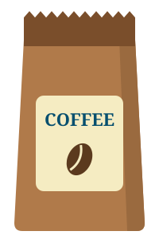

<style>
/* Code on the left, the values it gave on the right. */
.side-by-side { display: grid; grid-template-columns: 560px minmax(0, 1fr); gap: 24px; align-items: start; }
.side-by-side p { margin: 0; }
.caption { font-size: 20px; color: var(--secondary); }
/* What the page showed, one column for each value we tried. */
.runs { display: grid; grid-auto-flow: column; grid-auto-columns: minmax(0, 1fr); gap: 24px; }
.runs p { margin: 0; }
/* A table on its own, centered across the slide. */
.centered table { margin-left: auto; margin-right: auto; }
/* The theme draws a .demo as a white panel whose 12px edge is a shadow, so the margins keep
   that edge clear of the caption above and the slide's sides. */
.demo { margin: 20px 12px 28px; }
.demo p { margin: 0; }
/* Pieces of the Colan's Coffee page, drawn small inside a .demo. */
.demo .sign { padding: 2px 10px; border-radius: 6px; background-color: dimgray; color: white; }
.demo .card { padding: 4px 12px; border: 4px solid lightgray; border-radius: 8px; }
.demo img { vertical-align: middle; }
</style>

# `if`

Colan Biemer

---

## Working with the DOM

Today's exercises change a web page: they hide a sign, turn off a button, and recolor text. JavaScript changes a page through the **DOM** (Document Object Model). Each problem gives you the DOM line it needs:

```js
document.getElementById("sign").hidden = true;
```

We won't explain how these lines work. Copy them as given, and focus on the JavaScript that decides when they run.

---

# Comparisons

---

## Yes-or-No Questions

A program makes decisions by asking yes-or-no questions. Is the order at least \$50? Did the user leave the password box empty?

The answer is a **boolean**: `true` or `false`. A variable can hold it, like any other value:

```js
let total = 60;
let freeShipping = total >= 50; // true
```

---

## Comparison Operators

| Operator | Meaning               | Example   | Gives   |
| -------- | --------------------- | --------- | ------- |
| `===`    | equal                 | `5 === 5` | `true`  |
| `!==`    | not equal             | `5 !== 5` | `false` |
| `<`      | less than             | `3 < 5`   | `true`  |
| `>`      | greater than          | `3 > 5`   | `false` |
| `<=`     | less than or equal    | `5 <= 5`  | `true`  |
| `>=`     | greater than or equal | `4 >= 5`  | `false` |

A comparison always gives a boolean.

---

## `=` vs. `===`

`=` **puts** a value in a variable. `===` **asks** whether two values are equal, and gives back `true` or `false`.

```js
let a = 5;
let isFive = a === 5; // true
```

The second line has both: `===` asked the question, and `=` put the answer in `isFive`.

---

## Where Is `==`? Why `===`?

| Year | What Happened                                                                                                                                                       |
| ---- | ------------------------------------------------------------------------------------------------------------------------------------------------------------------- |
| 1995 | Netscape programmers asked for `"404" == 404` to be `true`, since web servers send numbers as strings. Brendan Eich made `==` change both sides to the same type.   |
| 1997 | Programmers found those rules confusing, so Eich took most of them out. The standards committee kept the old `==`, since changing it would break existing websites. |
| 1997 | Microsoft added `===` and `!==` to Internet Explorer 4. They never change types.                                                                                    |
| 1999 | `===` and `!==` joined the official JavaScript standard.                                                                                                            |

<p class="caption">Source: Allen Wirfs-Brock and Brendan Eich, <a href="https://doi.org/10.1145/3386327">"JavaScript: The First 20 Years"</a> (2020)</p>

`"21" === 21` is `false`, so we turn what the user types into a number before comparing it.

---

## Let's Build Colan's Coffee

Open [if-starter.html](https://github.com/bi3mer/lectures/blob/main/cs213/js/examples/if-starter.html) on GitHub and set it up in WebStorm:

1. Click **Copy raw file**, the copy icon above the code.
2. Paste it into a new HTML file in WebStorm.
3. In the same folder, make an empty file named `practice.js`. The page already links to it with `<script src="practice.js"></script>`.

---

## Problem (Me): Open Sign

The sign next to the shop's name says `Open`. The shop closes at 6 PM, which is hour 18 on a 24-hour clock.

1. Get the current hour (0 to 23) with this line:

```js
let hour = new Date().getHours();
```

2. From hour 18 on, hide the sign. Use this line to change the page:

```js
document.getElementById("sign").hidden = true;
```

---

## Solution (Me): Open Sign

```js
let hour = new Date().getHours();

document.getElementById("sign").hidden = hour >= 18;
```

<div class="runs">
<div>
<p class="caption">Hour 9</p>
<div class="demo"><p><strong>Colan's Coffee</strong> <span class="sign">Open</span></p></div>
</div>
<div>
<p class="caption">Hour 20</p>
<div class="demo"><p><strong>Colan's Coffee</strong></p></div>
</div>
</div>

`hidden` takes a boolean, so the comparison's answer goes straight in. To see the sign at another hour for testing, change the value of `hour` in the code.

---

## Problem (Us): Sold Out

Let's turn off the **Buy** button for the beans when the shop runs out.

1. Store how many bags are left in a variable `bagsLeft`. Let's say 3.
2. When none are left, turn off the button. Use this line to change the page:

```js
document.getElementById("buy").disabled = true;
```

3. How can we test if there are no bags left?

---

## Solution (Us): Sold Out

```js
let bagsLeft = 3;

document.getElementById("buy").disabled = bagsLeft === 0;
```

The last line uses both: `===` asks whether `bagsLeft` is 0, and `=` puts the answer in `disabled`.

---

## Problem (You): Age Limit

Our drinks with caffeine are for ages 12 and up, so the latte's **Order** button starts out turned off. Hot chocolate is for everyone. The menu has an age box, and it calls `checkAge()` every time the age in it changes:

```html
<input id="age" type="number" oninput="checkAge()" />
```

1. Write the `checkAge()` function.
2. Inside it, get the age with `document.getElementById("age").value`, and turn it into a number.
3. From 12 up, turn the latte's **Order** button on. Under 12, turn it off. Use this line to change the page:

```js
document.getElementById("latte").disabled = true;
```

---

## Solution (You): Age Limit

```js
function checkAge() {
  let age = Number(document.getElementById("age").value);

  document.getElementById("latte").disabled = age < 12;
}
```

With `age <= 12`, a 12-year-old can't order a latte.

---

# `if` and `else`

---

## `if`

```js
if (condition) {
  // runs only when condition is true
}
```

- The condition goes in `( )`, and the code to run goes in `{ }`.
- When the condition is `true`, the code inside runs. When it's `false`, JavaScript skips that code.
- As with a function, the code inside is indented, and there's no `;` after the `}`.

---

## Example: Espresso Shots

<div class="side-by-side">
<div>

```js
let shots = 4;
let warning = "";

if (shots > 3) {
  warning = "Too much caffeine!";
}
```

</div>
<div>

| `shots` | `warning`              |
| ------- | ---------------------- |
| 4       | `"Too much caffeine!"` |
| 2       | `""`                   |

</div>
</div>

For 2, `2 > 3` was `false`, so the code inside of the if-statement brackets (`{ ... }`) was never run.

---

## `else`

<div class="side-by-side">
<div>

```js
let total = 60;
let shipping;

if (total >= 50) {
  shipping = "free";
} else {
  shipping = "$5";
}
```

</div>
<div>

| `total` | `shipping` |
| ------- | ---------- |
| 60      | `"free"`   |
| 20      | `"$5"`     |

</div>
</div>

`else` runs when the condition is `false`. Exactly one of the two blocks runs, every time.

---

## Problem (Me): Open or Closed

A missing sign doesn't tell anyone we're closed. Let's replace the `hidden` line with an `if`:

1. Before hour 18, make the sign green.
2. Otherwise, the sign says `Closed` on red, and the page turns gray.

Use these lines to change the page:

```js
document.getElementById("sign").textContent = "Closed";
document.getElementById("sign").style.backgroundColor = "red";
document.body.style.backgroundColor = "gray";
```

---

## Solution (Me): Open or Closed

```js
if (hour < 18) {
  document.getElementById("sign").style.backgroundColor = "green";
} else {
  document.getElementById("sign").textContent = "Closed";
  document.getElementById("sign").style.backgroundColor = "red";
  document.body.style.backgroundColor = "gray";
}
```

Each block can hold as many lines as we need. `document.body` is the page's `<body>`, so it needs no id.

---

## Problem (Us): Member Name

Let's put the member's name on the rewards card. The card has a name box, and it calls `showName()` every time the name in it changes:

```html
<input id="name" oninput="showName()" />
```

1. Write the `showName()` function.
2. Inside it, get the name with `document.getElementById("name").value`.
3. If the box is empty, show `Guest`. Otherwise, show their name. Use this line to change the page:

```js
document.getElementById("member").textContent = "Guest";
```

---

## Solution (Us): Member Name

```js
function showName() {
  let name = document.getElementById("name").value;

  if (name === "") {
    document.getElementById("member").textContent = "Guest";
  } else {
    document.getElementById("member").textContent = name;
  }
}
```

`""` is an _empty_ string. We could also test with `name.length === 0`.

---

## Problem (You): Low Stock

Let's warn customers when the beans run low.

1. Under 5 bags, the stock line says `Only 3 left!` in orange, with the real count.
2. Otherwise, it says `In stock.`

Use these lines to change the page:

```js
document.getElementById("stock").textContent = "Only 3 left!";
document.getElementById("stock").style.color = "orange";
```

---

## Solution (You): Low Stock

```js
if (bagsLeft < 5) {
  document.getElementById("stock").textContent = `Only ${bagsLeft} left!`;
  document.getElementById("stock").style.color = "orange";
} else {
  document.getElementById("stock").textContent = "In stock.";
}
```

<div class="runs">
<div>
<p class="caption">12 bags</p>
<div class="demo"><p> In stock.</p></div>
</div>
<div>
<p class="caption">3 bags</p>
<div class="demo"><p> <span style="color: orange">Only 3 left!</span></p></div>
</div>
<div>
<p class="caption">0 bags</p>
<div class="demo"><p> <span style="color: orange">Only 0 left!</span></p></div>
</div>
</div>

`bagsLeft` already exists from Sold Out, so there's no second `let`. `Only 0 left!` needs a third choice, which comes next.

---

# `else if`

---

## More Than Two Choices

```js
if (firstCondition) {
  // runs when firstCondition is true
} else if (secondCondition) {
  // runs when firstCondition is false and secondCondition is true
} else {
  // runs when both are false
}
```

JavaScript checks the conditions from top to bottom. It runs the block under the first `true` condition and skips the rest. We can add as many `else if`s as we need, and the `else` at the end is optional.

---

## Example: Cup Sizes

<div class="side-by-side">
<div>

```js
let ounces = 10;
let size;

if (ounces <= 8) {
  size = "Small";
} else if (ounces <= 12) {
  size = "Medium";
} else {
  size = "Large";
}
```

</div>
<div>


</div>
</div>

Reaching the `else if` already means `ounces > 8`, so we don't check it again.

---

## Order Matters

<div class="side-by-side">
<div>

```js
if (ounces <= 12) {
  size = "Medium";
} else if (ounces <= 8) {
  size = "Small";
} else {
  size = "Large";
}
```

</div>
<div>

We swapped the first two checks from Cup Sizes. For a 6-ounce cup, `6 <= 12` was `true`, so JavaScript ran the first block and skipped the rest.

Every number that's `<= 8` is also `<= 12`, so `size` can never be `"Small"`.

</div>
</div>

Put the narrowest check first.

---

## Problem (Me): Reward Levels

Each member gets a badge for their reward points. Store the points in a variable `points` (let's say 320), then set the badge and the color of the card's border:

- 500 and up: 🥇 with a `gold` border
- 200 to 499: 🥈 with a `silver` border
- Below 200: 🥉 with a `tan` border

Use these lines to change the page:

```js
document.getElementById("badge").textContent = "🥇";
document.getElementById("rewards").style.borderColor = "gold";
```

---

## Solution (Me): Reward Levels

```js
let points = 320;

if (points >= 500) {
  document.getElementById("badge").textContent = "🥇";
  document.getElementById("rewards").style.borderColor = "gold";
} else if (points >= 200) {
  document.getElementById("badge").textContent = "🥈";
  document.getElementById("rewards").style.borderColor = "silver";
} else {
  document.getElementById("badge").textContent = "🥉";
  document.getElementById("rewards").style.borderColor = "tan";
}
```

<div class="runs">
<div>
<p class="caption">650 points</p>
<div class="demo"><div class="card" style="border-color: gold"><p>🥇 Sam</p></div></div>
</div>
<div>
<p class="caption">320 points</p>
<div class="demo"><div class="card" style="border-color: silver"><p>🥈 Sam</p></div></div>
</div>
<div>
<p class="caption">40 points</p>
<div class="demo"><div class="card" style="border-color: tan"><p>🥉 Sam</p></div></div>
</div>
</div>

---

## Problem (Us): Stock Levels

`Only 0 left!` should say `Sold out.` Let's replace our Low Stock code with three levels:

- 0: `Sold out.` in red, and the bag fades to `0.3` opacity
- 1 to 4: `Only 3 left!` in orange, with the real count
- 5 or more: `In stock.`

Which check should go first? Use these lines to change the page:

```js
document.getElementById("stock").style.color = "red";
document.getElementById("bag").style.opacity = "0.3";
```

---

## Solution (Us): Stock Levels

```js
if (bagsLeft === 0) {
  document.getElementById("stock").textContent = "Sold out.";
  document.getElementById("stock").style.color = "red";
  document.getElementById("bag").style.opacity = "0.3";
} else if (bagsLeft < 5) {
  document.getElementById("stock").textContent = `Only ${bagsLeft} left!`;
  document.getElementById("stock").style.color = "orange";
} else {
  document.getElementById("stock").textContent = "In stock.";
}
```

<div class="runs">
<div>
<p class="caption">0 bags</p>
<div class="demo"><p> <span style="color: red">Sold out.</span></p></div>
</div>
<div>
<p class="caption">3 bags</p>
<div class="demo"><p> <span style="color: orange">Only 3 left!</span></p></div>
</div>
<div>
<p class="caption">12 bags</p>
<div class="demo"><p> In stock.</p></div>
</div>
</div>

`0 < 5` is also `true`, so the `=== 0` check had to come first.

---

## Problem (You): A Greeting

The greeting under our name should change with the hour: `Good morning! ☀️` before hour 12, `Good afternoon! 🌤️` before hour 18, and `Good evening! 🌙` after that.

<!-- prettier-ignore -->
```js
} else (hour >= 18) {
} else {
document.getElementById("greeting").textContent = "Good afternoon! 🌤️";
document.getElementById("greeting").textContent = "Good morning! ☀️";
} else if hour < 18 {
} else if (hour < 18) {
}
if (hour < 12) {
document.getElementById("greeting").textContent = "Good evening! 🌙";
```

Assemble the program from the lines above. Two of the lines are wrong.

---

## Solution (You): A Greeting

```js
if (hour < 12) {
  document.getElementById("greeting").textContent = "Good morning! ☀️";
} else if (hour < 18) {
  document.getElementById("greeting").textContent = "Good afternoon! 🌤️";
} else {
  document.getElementById("greeting").textContent = "Good evening! 🌙";
}
```

<div class="runs">
<div>
<p class="caption">Hour 9</p>
<div class="demo"><p>Good morning! ☀️</p></div>
</div>
<div>
<p class="caption">Hour 14</p>
<div class="demo"><p>Good afternoon! 🌤️</p></div>
</div>
<div>
<p class="caption">Hour 20</p>
<div class="demo"><p>Good evening! 🌙</p></div>
</div>
</div>

`else` never takes a condition, and every condition needs parentheses, so `} else (hour >= 18) {` and `} else if hour < 18 {` were the wrong lines.

---

# Combining Conditions

---

## Logical Operators

- `a && b`: **and**, `true` when both are `true`
- `a || b`: **or**, `true` when at least one is `true`
- `!a`: **not**, `true` becomes `false` and `false` becomes `true`

Each side of `&&` and `||` is a full comparison, like `total >= 10`, or a boolean.

---

## And: `&&`

<div class="centered">

| `a`     | `b`     | `a && b` |
| ------- | ------- | -------- |
| `true`  | `true`  | `true`   |
| `true`  | `false` | `false`  |
| `false` | `true`  | `false`  |
| `false` | `false` | `false`  |

</div>

`&&` gives `true` only when both sides are `true`.

---

## Or: `||`

<div class="centered">

| `a`     | `b`     | `a \|\| b` |
| ------- | ------- | ---------- |
| `true`  | `true`  | `true`     |
| `true`  | `false` | `true`     |
| `false` | `true`  | `true`     |
| `false` | `false` | `false`    |

</div>

`||` gives `false` only when both sides are `false`.

---

## Not: `!`

<div class="centered">

| `a`     | `!a`    |
| ------- | ------- |
| `true`  | `false` |
| `false` | `true`  |

</div>

---

## Example: Member Discount

To get 10% off, a customer has to spend at least \$10 **and** be a member.

```js
let total = 8;
let isMember = true;
let getsDiscount = total >= 10 && isMember;
```

<div class="centered">

| `total` | `isMember` | `getsDiscount` |
| ------- | ---------- | -------------- |
| 8       | `true`     | `false`        |
| 12      | `true`     | `true`         |
| 12      | `false`    | `false`        |

</div>

---

## Example: Plant Milk

Oat milk and almond milk cost 50 cents extra.

```js
let milk = "oat";
let costsExtra = milk === "oat" || milk === "almond";
```

<div class="centered">

| `milk`     | `costsExtra` |
| ---------- | ------------ |
| `"oat"`    | `true`       |
| `"almond"` | `true`       |
| `"whole"`  | `false`      |

</div>

Each side of `||` needs its own `milk ===`. For `"whole"`, `milk === "oat" || "almond"` gives `"almond"`, not `false`, and an `if` treats that string as `true`, so every milk would cost extra.

---

## Example: Not Sold Out

A customer can order a bag when it's **not** sold out. `bagsLeft` already exists from Sold Out.

<div class="side-by-side">
<div>

```js
let isSoldOut = bagsLeft === 0;
let canOrder = !isSoldOut;
```

</div>
<div>

| `bagsLeft` | `isSoldOut` | `canOrder` |
| ---------- | ----------- | ---------- |
| 0          | `true`      | `false`    |
| 3          | `false`     | `true`     |

</div>
</div>

`!` flips the boolean right after it, so `!isSoldOut` reads as "not sold out."

---

## A Range in One Step

In math class, 13 ≤ age ≤ 19 means "from 13 to 19." In JavaScript, it lets 45 through:

<div class="side-by-side">
<div>

```js
let age = 45;
let isTeen = 13 <= age <= 19; // true
```

<p class="caption">Fixed</p>

```js
let isTeen = age >= 13 && age <= 19;
```

</div>
<div>


</div>
</div>

A range takes two comparisons, joined with `&&`.

---

## Problem (Me): Opening Hours

Our sign says `Open` at 3 AM. The shop opens at 7 and closes at 18. Let's change the condition in Open or Closed:

1. From 7 up to 18, the sign is green.
2. Otherwise, it says `Closed` on red, and the page turns gray.

---

## Solution (Me): Opening Hours

```js
if (hour >= 7 && hour < 18) {
  document.getElementById("sign").style.backgroundColor = "green";
} else {
  document.getElementById("sign").textContent = "Closed";
  document.getElementById("sign").style.backgroundColor = "red";
  document.body.style.backgroundColor = "gray";
}
```

---

## Problem (Us): Free Pastry

Early birds (before hour 9) and Gold members (500 points or more) get a free pastry.

1. If either rule applies, show the pastry note on the rewards card.
2. The note starts out hidden. When neither rule applies, do we need an `else`?

Use this line to change the page:

```js
document.getElementById("pastry").hidden = false;
```

---

## Solution (Us): Free Pastry

```js
if (hour < 9 || points >= 500) {
  document.getElementById("pastry").hidden = false;
}
```

<div class="runs">
<div>
<p class="caption">Hour 8, 40 points</p>
<div class="demo"><div class="card" style="border-color: tan"><p>🥉 Sam</p><p>🥐 Free pastry!</p></div></div>
</div>
<div>
<p class="caption">Hour 14, 650 points</p>
<div class="demo"><div class="card" style="border-color: gold"><p>🥇 Sam</p><p>🥐 Free pastry!</p></div></div>
</div>
<div>
<p class="caption">Hour 14, 40 points</p>
<div class="demo"><div class="card" style="border-color: tan"><p>🥉 Sam</p></div></div>
</div>
</div>

There's no `else`. The note starts out hidden, and this code runs once, so when neither rule applies, there's nothing to change.

---

## Problem (You): Happy Hour

From 2 PM until 4 PM (hours 14 and 15), lattes are half price.

1. During happy hour, change the latte's price to `$2.25`, in red.
2. Outside happy hour, leave it at `$4.50`.

Use these lines to change the page:

```js
document.getElementById("latte-price").textContent = "$2.25";
document.getElementById("latte-price").style.color = "red";
```

---

## Solution (You): Happy Hour

```js
if (hour >= 14 && hour < 16) {
  document.getElementById("latte-price").textContent = "$2.25";
  document.getElementById("latte-price").style.color = "red";
}
```

---

## Shortcut: The Ternary Operator


The ternary operator fits an `if`/`else` on one line. _Ternary_ means three parts. Use it when both branches only pick a value; otherwise, use `if` and `else`.

---

## Problem (You): Order and Buy

**Order** switches to `Cancel` and back. **Buy** takes away a bag. We start with 3 bags, so the stock line never needs `In stock.`

<!-- prettier-ignore -->
```js
function orderLatte() {
document.getElementById("buy").disabled = isSoldOut;
document.getElementById("stock").textContent = message;
let message = isSoldOut ? "Sold out." : `Only ${bagsLeft} left!`;
document.getElementById("bag").style.opacity = isSoldOut ? "0.3" : "1";
let isSoldOut = bagsLeft === 0;
let ordered = false;
}
}
document.getElementById("stock").style.color = isSoldOut ? "red" : "orange";
ordered = !ordered;
function buyBag() {
bagsLeft = bagsLeft - 1;
document.getElementById("latte").textContent = ordered ? "Cancel" : "Order";
```

Assemble both functions from the lines above.

---

## Solution (You): Order and Buy

```js
let ordered = false;

function orderLatte() {
  ordered = !ordered;
  document.getElementById("latte").textContent = ordered ? "Cancel" : "Order";
}

function buyBag() {
  bagsLeft = bagsLeft - 1;
  let isSoldOut = bagsLeft === 0;
  let message = isSoldOut ? "Sold out." : `Only ${bagsLeft} left!`;
  document.getElementById("stock").textContent = message;
  document.getElementById("stock").style.color = isSoldOut ? "red" : "orange";
  document.getElementById("bag").style.opacity = isSoldOut ? "0.3" : "1";
  document.getElementById("buy").disabled = isSoldOut;
}
```

`ordered` sits outside `orderLatte()`, so it keeps its value between clicks.

---

# Conclusion

---

## The Finished Page

Every solution from today, together:

- [Colan's Coffee](https://bi3mer.github.io/lectures/cs213/js/examples/if-final/), running live
- [practice.js](https://github.com/bi3mer/lectures/blob/main/cs213/js/examples/if-final/practice.js) on GitHub, in the order we wrote it

The HTML is the same as `if-starter.html`. The page uses the real hour, so to see another time of day, change `new Date().getHours()` to a number, like `20`.

---

## Summary

- A comparison gives a boolean: `true` or `false`.
- Compare with `===` and `!==`, and turn what the user types into a number first.
- `if` runs its block when the condition is `true`, and `else` runs when it's `false`.
- `else if` checks from top to bottom and runs only the first match, so order matters.
- `&&` needs both sides `true`, `||` needs one, and `!` flips a boolean.
- A range takes two comparisons: `hour >= 7 && hour < 18`.
- `condition ? a : b` picks between two values on one line.

---

# Questions?

---

## Why `===` Instead of `==`?

Before it compares, `==` changes both sides to the same type. Its rules for that surprise even experienced programmers:

| Code        | Gives   |
| ----------- | ------- |
| `0 == "0"`  | `true`  |
| `0 == ""`   | `true`  |
| `"0" == ""` | `false` |

`0` equals both strings, but the two strings aren't equal to each other. `===` never changes types, so all three would give `false`.
