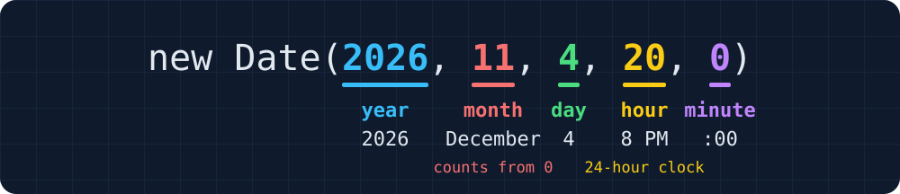

<style>
.caption { font-size: 20px; color: var(--secondary); }
</style>

# Numbers, Math, Dates, and Strings

Colan Biemer

---

## Decimals Aren't Exact

<!-- prettier-ignore -->
```js
console.log(0.1 + 0.2);         // 0.30000000000000004
console.log(0.1 + 0.2 === 0.3); // false
console.log(127.5 * 0.12);      // 15.299999999999999
```

JavaScript [stores every number in binary](#51). Most decimals, like 0.1, have no exact binary form, just as 1/3 has no exact decimal form (0.333...).

---

## Checking a Number

<!-- prettier-ignore -->
```js
let count = Number("two");
console.log(count === NaN);         // false
console.log(Number.isNaN(count));   // true

console.log(Number.isInteger(3));   // true
console.log(Number.isInteger(2.5)); // false
console.log(Number.isInteger(NaN)); // false
```

- [`NaN`](lecture-js.html#69) is the only value that isn't equal to itself, so `=== NaN` is always `false`. `Number.isNaN` checks for it.
- `Number.isInteger` is `true` only for whole numbers, so it rules out `NaN` too.

---

## `toLocaleString`

<!-- prettier-ignore -->
```js
let total = 1234.5;
let money = { style: "currency", currency: "USD" };

console.log(total.toLocaleString());               // 1,234.5
console.log(total.toLocaleString("en-US", money)); // $1,234.50
```

With no arguments, it follows the browser's language, so a German browser shows `1.234,5`. `"en-US"` and the options in `money` give dollars and cents. Like [`toFixed(2)`](lecture-js.html#78), it returns a string.

---

## The `Math` Object

<!-- prettier-ignore -->
```js
console.log(Math.PI);         // 3.141592653589793
console.log(Math.sqrt(16));   // 4
console.log(Math.abs(-7.5));  // 7.5
console.log(Math.pow(2, 10)); // 1024
```

**`Math`** is an object built into JavaScript. Its properties are constants, like `Math.PI`, and functions, like `Math.sqrt`. `Math.pow(2, 10)` is the same as [`2 ** 10`](lecture-js.html#71).

---

## Rounding: `round`, `floor`, and `ceil`

<center>

| `x`    | `Math.round(x)` | `Math.floor(x)` | `Math.ceil(x)` |
| ------ | --------------- | --------------- | -------------- |
| `4.2`  | `4`             | `4`             | `5`            |
| `4.5`  | `5`             | `4`             | `5`            |
| `4.8`  | `5`             | `4`             | `5`            |
| `-4.2` | `-4`            | `-5`            | `-4`           |

</center>

`round` goes to the nearest whole number. `floor` always goes down and `ceil` always goes up, so `Math.floor(-4.2)` is `-5`.

---

## Rounding to Cents

<!-- prettier-ignore -->
```js
let fee = 127.5 * 0.12;
console.log(fee);                         // 15.299999999999999
console.log(Math.round(fee * 100) / 100); // 15.3
console.log(fee.toFixed(2));              // 15.30
```

`* 100` turns dollars into cents, `round` keeps whole cents, and `/ 100` turns them back into dollars, still a number. [`toFixed(2)`](lecture-js.html#78) gives a string, so it's for showing, not for more math.

---

## `Math.min` and `Math.max`

<!-- prettier-ignore -->
```js
console.log(Math.min(4, 9, 2)); // 2
console.log(Math.max(4, 9, 2)); // 9

let count = 20;
count = Math.min(count, 8);
console.log(count); // 8
```

Both take any number of arguments. `Math.min(count, 8)` gives 8 whenever `count` is larger, so it sets a highest value. `Math.max(count, 1)` sets a lowest value.

---

## Spreading an Array: `...`

<!-- prettier-ignore -->
```js
let prices = [35, 52.5, 89.5];
console.log(Math.max(prices));    // NaN
console.log(Math.max(...prices)); // 89.5
console.log(Math.min(...prices)); // 35
```

`Math.max` takes numbers, not an array. `...` **spreads** an array, passing each item as its own argument, so `Math.max(...prices)` is `Math.max(35, 52.5, 89.5)`.

---

## `Math.random`

<!-- prettier-ignore -->
```js
console.log(Math.random()); // 0.7281964018253458
console.log(Math.random()); // 0.04293581720519471
console.log(Math.random()); // 0.5139022791366285
```

Each call gives a new number from 0 up to, but not including, 1, so your numbers will differ. It takes no arguments.

---

## Random Whole Numbers

```js
let roll = Math.floor(Math.random() * 6) + 1;
```

<center>

| Step              | Smallest | Largest  |
| ----------------- | -------- | -------- |
| `Math.random()`   | `0`      | `0.999…` |
| `* 6`             | `0`      | `5.999…` |
| `Math.floor(...)` | `0`      | `5`      |
| `+ 1`             | `1`      | `6`      |

</center>

This rolls a die. Without the `+ 1`, it gives 0 to 5, which is a random [index](lecture-arrays-js.html#5) into an array of 6 items.

---

## `new Date()`

```js
let now = new Date();
console.log(now);
```

<p class="caption">Console</p>

```text
Tue Oct 27 2026 09:30:00 GMT-0400 (Eastern Daylight Time)
```

A **`Date`** is an object that holds one moment in time. `new` makes a new object of a built-in type, so `new Date()` makes a Date for the moment that line ran.

---

## A Date of Our Choosing

```js
let show = new Date(2026, 11, 4, 20, 0);
console.log(show);
```

<p class="caption">Console</p>

```text
Fri Dec 04 2026 20:00:00 GMT-0500 (Eastern Standard Time)
```



Months count from 0, so `new Date(2026, 12, 4)` is January 4, 2027.

---

## Why Do Months Start at 0?

JavaScript 1.0 copied Java's `java.util.Date`, "bugs and all," so the two languages could work together. That brought along months numbered 0 to 11 and time counted from 1970.

Java's year 2000 problem came too: `getYear()` gives `126` for 2026, the years since 1900. Use `getFullYear()`.

Source: Allen Wirfs-Brock and Brendan Eich, [JavaScript: The First 20 Years](https://dl.acm.org/doi/10.1145/3386327) (2020).

---

## Reading the Parts

<!-- prettier-ignore -->
```js
let show = new Date(2026, 11, 4, 20, 0);
console.log(show.getFullYear()); // 2026
console.log(show.getMonth());    // 11
console.log(show.getDate());     // 4
console.log(show.getDay());      // 5
console.log(show.getHours());    // 20
console.log(show.getMinutes());  // 0
```

`getMonth` counts from 0, as it did going in. `getDate` is the day of the month, and `getDay` is the day of the week, from 0 (Sunday) to 6 (Saturday).

---

## Milliseconds Since 1970

<!-- prettier-ignore -->
```js
let show = new Date(2026, 11, 4, 20, 0);
console.log(show.getTime()); // 1796432400000
console.log(Date.now());     // 1793107800000
```

Inside, a Date is one number: the milliseconds since midnight on January 1, 1970, in UTC, the world's reference time. `Date.now()` gives that number for right now.

---

## Subtracting Dates

<!-- prettier-ignore -->
```js
let now = new Date(2026, 9, 27, 9, 30); // Tuesday, 9:30 AM
let due = new Date(2026, 9, 30, 17, 0); // Friday, 5:00 PM

console.log(due - now); // 286200000
console.log(due < now); // false
```

`-` and `<` turn each date into its milliseconds, so `due - now` is the time between them. `+` [glues strings](lecture-js.html#74) instead, so `due + now` is one long string.

---

## From Milliseconds to Days, Hours, and Minutes

<!-- prettier-ignore -->
```js
let ms = 286200000; // due - now

let days = Math.floor(ms / (1000 * 60 * 60 * 24)); // 3
let hours = Math.floor(ms / (1000 * 60 * 60)) % 24; // 7
let minutes = Math.floor(ms / (1000 * 60)) % 60;    // 30

console.log(`${days}d ${hours}h ${minutes}m`); // 3d 7h 30m
```

`ms / (1000 * 60 * 60)` is 79.5 hours. `floor` keeps the 79 whole hours, and [`% 24`](lecture-js.html#72) leaves the 7 that don't fill a day.

---

## `toLocaleDateString` and `toLocaleTimeString`

<style scoped>
pre { font-size: 0.75em; }
</style>

<!-- prettier-ignore -->
```js
let show = new Date(2026, 11, 4, 20, 0);
let short = { hour: "numeric", minute: "2-digit" };

console.log(show.toLocaleDateString());               // 12/4/2026
console.log(show.toLocaleTimeString());               // 8:00:00 PM
console.log(show.toLocaleTimeString("en-US", short)); // 8:00 PM
```

Like [`toLocaleString`](#4), they follow the browser's language, so a British browser shows the date as `04/12/2026`. `"en-US"` and an options object pick the format.

---

## Day and Month Names

<style scoped>
pre { font-size: 0.75em; }
</style>

<!-- prettier-ignore -->
```js
let show = new Date(2026, 11, 4, 20, 0);
let month = { month: "long" };
let weekday = { weekday: "long" };
let full = { weekday: "long", month: "long", day: "numeric" };

console.log(show.toLocaleDateString("en-US", month));   // December
console.log(show.toLocaleDateString("en-US", weekday)); // Friday
console.log(show.toLocaleDateString("en-US", full));    // Friday, December 4
```

`"long"` spells out a name, and `"short"` gives `Dec` or `Fri`. The browser knows the names in other languages too, so `"es-ES"` gives `viernes, 4 de diciembre`.

---

## Changing a Date

```js
let due = new Date(2026, 9, 30, 17, 0); // Friday, October 30
due.setDate(due.getDate() + 3);
console.log(due);
```

<p class="caption">Console</p>

```text
Mon Nov 02 2026 17:00:00 GMT-0500 (Eastern Standard Time)
```

Every `get` method except `getDay` has a `set` partner. October, which is `9` not `10` due to [months starting at 0](#14), has 31 days, so day 33 rolls over to November 2. `setDate` changes the Date itself.

---

## Strings Don't Change

<!-- prettier-ignore -->
```js
let code = "semi10";
code.toUpperCase();
console.log(code); // semi10

code = code.toUpperCase();
console.log(code); // SEMI10
```

A string method never changes its string. [`toUpperCase`](lecture-loops-js.html#10) returns a new, uppercase string, so we keep it by assigning it. `toLowerCase` works the same way.

---

## `trim`

<!-- prettier-ignore -->
```js
let typed = "  ada  lovelace ";
console.log(`[${typed}]`);        // [  ada  lovelace ]
console.log(`[${typed.trim()}]`); // [ada  lovelace]
```

`trim` removes the spaces at both ends, but not the ones in the middle. People type stray spaces into boxes, so trim what a box gives us.

---

## Chaining Methods

<!-- prettier-ignore -->
```js
let typed = "  semi10 ";
let code = typed.trim().toUpperCase();
console.log(code); // SEMI10
```

Calling a method on the result of another method is **chaining**. It runs left to right: `trim` gives `"semi10"`, and `toUpperCase` runs on that.

---

## `includes`, `startsWith`, and `endsWith`

<!-- prettier-ignore -->
```js
let email = "ada@school.edu";
console.log(email.includes("@"));      // true
console.log(email.startsWith("ada"));  // true
console.log(email.endsWith(".edu"));   // true
console.log(email.includes("School")); // false
```

Each one gives a boolean. [Like an array's `includes`](lecture-arrays-js.html#13), they look for an exact match, so `"School"` doesn't match `"school"`.

---

## `slice`

<!-- prettier-ignore -->
```js
let code = "SEMI10";
console.log(code.slice(0, 4)); // SEMI
console.log(code.slice(4));    // 10
console.log(code.slice(-2));   // 10

let word = "aDA";
word = word[0].toUpperCase() + word.slice(1).toLowerCase();
console.log(word); // Ada
```

`slice(start, end)` copies from `start` up to, but not including, `end`. With no `end`, it copies to the end. A negative index counts back from the end, [unlike `[-1]`](lecture-arrays-js.html#7).

---

## `split`

<!-- prettier-ignore -->
```js
let parts = "Ada King Lovelace".split(" ");
console.log(parts);                   // ["Ada", "King", "Lovelace"]
console.log(parts[parts.length - 1]); // Lovelace
console.log("20:00".split(":"));      // ["20", "00"]
```

`split` cuts a string at each match of its argument, and returns an array of the pieces. It's the reverse of [`join`](lecture-arrays-js.html#14). The pieces are strings, even `"20"`.

---

## `replaceAll`

<!-- prettier-ignore -->
```js
let typed = "1,250";
console.log(Number(typed));                     // NaN
console.log(Number(typed.replaceAll(",", ""))); // 1250
console.log("1,250,000".replace(",", ""));      // 1250,000
```

`replaceAll` swaps every match of its first argument for its second, and `""` deletes them. `replace` swaps only the first match.

---

## `padStart`

<!-- prettier-ignore -->
```js
let minutes = 5;
console.log(String(minutes).padStart(2, "0")); // 05
console.log(String(42).padStart(4, "0"));      // 0042
console.log(minutes.padStart(2, "0"));         // TypeError
```

`padStart(2, "0")` adds `"0"`s to the front until the string is 2 characters long, as a clock shows `8:05`. A number has no `padStart`, so it needs [`String()`](lecture-js.html#75) first.

---

## `repeat`

<!-- prettier-ignore -->
```js
console.log("█".repeat(6));                  // ██████
console.log("★".repeat(4) + "☆".repeat(1)); // ★★★★☆
```

`repeat` glues a string to itself that many times, so `"█".repeat(6)` draws [`depthBar(600)`](lecture-loops-js.html#32) without a loop.

---

# Building the Ticket Page

---

## Setting Up the Starter

Today's page sells tickets to a concert by The Semicolons. Its starter has two files on GitHub: [index.html](https://github.com/bi3mer/lectures/blob/main/cs213/js/examples/tickets-starter/index.html) and [practice.js](https://github.com/bi3mer/lectures/blob/main/cs213/js/examples/tickets-starter/practice.js). Set them up in WebStorm, in a new folder:

1. Open each file, and click **Copy raw file**, the copy icon above the code.
2. Paste each one into a new file in WebStorm with the same name.

`practice.js` starts with `price`, `percentOff`, and `dollars(amount)`, which formats a number with [`toLocaleString`](#4).

---

## Problem (Us): Order Total

The **Tickets** box calls `showTotal()` when its number changes. Let's fill it in, in the Order Total section.

1. `count` holds the box's value. Turn it into a number.
2. Take `percentOff` percent off the tickets (it stays 0 until Promo Code), then find a 12% fee. [Round](#7) both to cents.
3. Uncomment the last three page lines, and replace each `?` with an amount, passed to `dollars()`.

The box starts at 2 tickets, which should cost $85.00, plus a $10.20 fee.

---

## Solution (Us): Order Total

<style scoped>
pre { font-size: 0.75em; }
</style>

```js
function showTotal() {
  let count = Number(document.getElementById("count").value);

  let subtotal = count * price * (1 - percentOff / 100);
  subtotal = Math.round(subtotal * 100) / 100;
  let fee = Math.round(subtotal * 0.12 * 100) / 100;
  let total = subtotal + fee;

  document.getElementById("subtotal").textContent = dollars(subtotal);
  document.getElementById("fee").textContent = dollars(fee);
  document.getElementById("total").textContent = dollars(total);
}
```

Rounding each amount before adding keeps the page's lines adding up to the total. With 15% off, three tickets cost 108.375, which rounds to 108.38.

---

## Problem (You): Ticket Limit

Typing 20 in the box sells 20 tickets, and 2.5 sells two and a half. Turn the pseudocode into code in `showTotal()`'s Ticket Limit section.

```text
round count down to a whole number
keep count at 1 or more
keep count at 8 or less
put count back in the box
```

For the last line, uncomment the page line, and replace its `?` with `count`. [`Math.min` and `Math.max`](#8) can each keep one side.

---

## Solution (You): Ticket Limit

```js
function showTotal() {
  let count = Number(document.getElementById("count").value);

  count = Math.floor(count);
  count = Math.max(count, 1);
  count = Math.min(count, 8);
  document.getElementById("count").value = count;

  // the subtotal, fee, and total, from Order Total
}
```

`Math.max(count, 1)` gives 1 whenever `count` is smaller. An empty box gives `Number("")`, which is `0`, so it becomes 1.

---

## Problem (Us): Countdown

The header counts down to the show, like `Starts in 38d 10h 30m`. Let's write it in the Countdown section.

1. Search `practice.js` for `@1`, and make `show` [Friday, December 4, 2026, at 8:00 PM](#13).
2. In `showCountdown()`, find the milliseconds from now until `show`, and [turn them into days, hours, and minutes](#18).
3. Uncomment the page line, and replace its `?` with the countdown.
4. What should the page say once the show has started?

`setInterval(showCountdown, 1000)`, under the function, takes [a function as a value](lecture-arrays-js.html#23) and calls it every 1000 ms.

---

## Solution (Us): Countdown

<style scoped>
pre { font-size: 0.75em; }
</style>

```js
let show = new Date(2026, 11, 4, 20, 0); // @1

function showCountdown() {
  let ms = show - new Date();
  let days = Math.floor(ms / (1000 * 60 * 60 * 24));
  let hours = Math.floor(ms / (1000 * 60 * 60)) % 24;
  let minutes = Math.floor(ms / (1000 * 60)) % 60;

  if (ms > 0) {
    document.getElementById("countdown").textContent =
      `Starts in ${days}d ${hours}h ${minutes}m`;
  } else {
    document.getElementById("countdown").textContent = "The show has started";
  }
}
```

Writing `12` for December would count down to January 4, 2027. After the show, `ms` is negative, so the `else` keeps the countdown from going below zero.

---

## Problem (You): Show Date

The header should say when the show is: `Friday, December 4 at 8:00 PM`. Turn the pseudocode into code in the Show Date section.

```text
set date to show's weekday, month, and day, like Friday, December 4
set time to show's time, like 8:00 PM
put "date at time" on the page
```

For the last line, uncomment the page line, and replace its `?`. [`toLocaleDateString`](#20) can write the names, and [`toLocaleTimeString`](#19) can format the time.

---

## Solution (You): Show Date

```js
let full = { weekday: "long", month: "long", day: "numeric" };
let date = show.toLocaleDateString("en-US", full);
let short = { hour: "numeric", minute: "2-digit" };
let time = show.toLocaleTimeString("en-US", short);

document.getElementById("when").textContent = `${date} at ${time}`;
```

The options pick the parts, and `"en-US"` puts the month before the day. A British browser would show `Friday 4 December` without it.

---

## Problem (Us): Promo Code

A code like `SEMI10` takes 10% off the tickets, and `semi10` with stray spaces should work too. The **Apply** button calls `applyCode()`. Let's fill it in, in the Promo Code section.

1. Uncomment the first page line, and [trim and uppercase](#24) the code.
2. The number after `SEMI` is the percent. Get it with [`slice`](#26), as a number.
3. If the code starts with `SEMI` and the percent is a whole number above 0, set `percentOff`, and show the first message. Otherwise, set `percentOff` to 0, and show the second.

---

## Solution (Us): Promo Code

<style scoped>
pre { font-size: 0.75em; }
</style>

```js
function applyCode() {
  let code = document.getElementById("code").value.trim().toUpperCase();
  let percent = Number(code.slice(4));

  if (code.startsWith("SEMI") && Number.isInteger(percent) && percent > 0) {
    percentOff = percent;
    document.getElementById("code-message").textContent = `${percent}% off`;
  } else {
    percentOff = 0;
    document.getElementById("code-message").textContent = "Unknown code";
  }

  showTotal();
}
```

`SEMIX` makes `percent` `NaN`, and `SEMI` alone makes it `0`, so both are unknown. `percentOff` sits outside the function, so `showTotal()` sees its new value.

---

## Problem (You): Name on Ticket

<style scoped>
pre { font-size: 0.75em; }
</style>

The **Name** box calls `showName()` as we type. The ticket shows the last name in capitals, then the first, so `ada lovelace` becomes `LOVELACE, Ada`. Turn the pseudocode into code in the Name on Ticket section.

```text
set name to the box's value, without spaces at either end
if name is empty
  put "GUEST" on the ticket
else
  set parts to name, split at each space
  set first to the first part, with only its first letter uppercase
  set last to the last part, all uppercase
  put "last, first" on the ticket
```

Uncomment the page lines as you use them. [`slice`](#26) shows how to capitalize a word.

---

## Solution (You): Name on Ticket

<style scoped>
pre { font-size: 0.75em; }
</style>

```js
function showName() {
  let name = document.getElementById("name").value.trim();

  if (name === "") {
    document.getElementById("ticket-name").textContent = "GUEST";
  } else {
    let parts = name.split(" ");
    let first = parts[0];
    first = first[0].toUpperCase() + first.slice(1).toLowerCase();
    let last = parts[parts.length - 1].toUpperCase();
    document.getElementById("ticket-name").textContent = `${last}, ${first}`;
  }
}
```

Without the empty check, `first[0]` is `undefined`, and calling `toUpperCase()` on it is a `TypeError`. A middle name is skipped, since `last` is the last part.

---

## Problem (You): Parsons 1

<style scoped>
pre { font-size: 0.75em; }
</style>

<!-- prettier-ignore -->
```js
let seat = Math.floor(Math.random()) * 20 + 1;
document.getElementById("confirmation").textContent = `Row ${row}, seat ${seat}, ${code}`;
let number = Math.floor(Math.random() * 10000);
function parsons1() {
let code = "SC-" + number.padStart(4, "0");
let rows = "ABCDEFGH";
}
let seat = Math.floor(Math.random() * 20) + 1;
let row = rows[Math.floor(Math.random() * rows.length)];
let code = "SC-" + String(number).padStart(4, "0");
```

- Assemble the program in the Parsons 1 section of `practice.js`. Two of the lines are wrong.
- What does `parsons1` do? What should it be named?

---

## Solution (You): Parsons 1

<style scoped>
pre { font-size: 0.75em; }
</style>

```js
function parsons1() {
  let rows = "ABCDEFGH";
  let row = rows[Math.floor(Math.random() * rows.length)];
  let seat = Math.floor(Math.random() * 20) + 1;
  let number = Math.floor(Math.random() * 10000);
  let code = "SC-" + String(number).padStart(4, "0");

  document.getElementById("confirmation").textContent =
    `Row ${row}, seat ${seat}, ${code}`;
}
```

Each click on **Buy** gives the ticket a random row, seat, and confirmation code, so `assignSeat` would be a better name.

---

# Conclusion

---

## The Finished Page

Every solution from today, together:

- [The Semicolons: Live](https://bi3mer.github.io/lectures/cs213/js/examples/tickets-final/), running live
- [practice.js](https://github.com/bi3mer/lectures/blob/main/cs213/js/examples/tickets-final/practice.js) on GitHub, with every section filled in

The HTML is the same as the starter's `index.html`, and `practice.js` starts with the starter's code.

---

## Summary

- Decimals aren't exact, so round money to cents: `Math.round(x * 100) / 100`.
- `=== NaN` is always `false`. Check with `Number.isNaN` or `Number.isInteger`.
- `toLocaleString` adds commas, and its options can show dollars and cents.
- `round`, `floor`, and `ceil` make whole numbers. `min` and `max` set limits.
- `...` spreads an array into separate arguments: `Math.max(...prices)`.
- `Math.floor(Math.random() * n) + 1` is a whole number from 1 to `n`.
- Months and weekdays count from 0, so `new Date(2026, 11, 4)` is December 4.
- Subtracting dates gives milliseconds. Split them up with `floor` and `%`.
- String methods return new strings and can chain: `.trim().toUpperCase()`.
- `slice` copies part of a string, `split` cuts it into an array, and `padStart` pads it.

---

# Questions?

---

## Appendix: Why 0.1 Never Ends in Binary

Binary places are halves, quarters, eighths, and so on.

<center>

| Binary                | Decimal               |
| --------------------- | --------------------- |
| `0.00011`             | `0.09375`             |
| `0.000110011`         | `0.099609375`         |
| `0.0001100110011`     | `0.0999755859375`     |
| `0.00011001100110011` | `0.09999847412109375` |
| ...                   | never 0.1             |

</center>

Each `0011` gets closer to 0.1 but never reaches it, since 0.1 is not a whole number of 16ths, 32nds, or any other power of 2.

---

## Appendix: 0.1 + 0.2 in Binary

```text
  0.1   0.0001100110011001100110011001100110011001100110011001101
+ 0.2   0.0011001100110011001100110011001100110011001100110011010
= sum   0.0100110011001100110011001100110011001100110011001100111
  0.3   0.0100110011001100110011001100110011001100110011001100110
                                                                ^
```

In binary, 0.1 and 0.2 repeat `0011` forever, like 1/3 = 0.333... in decimal, so JavaScript rounds each one off. Their sum ends in 1 where 0.3 ends in 0.

---

## Appendix: Why `0.1` Prints as `0.1`

<center>

| Written     | Stored                      | Printed               |
| ----------- | --------------------------- | --------------------- |
| `0.1`       | `0.10000000000000000555...` | `0.1`                 |
| `0.3`       | `0.29999999999999998889...` | `0.3`                 |
| `0.1 + 0.2` | `0.30000000000000004440...` | `0.30000000000000004` |

</center>

JavaScript and Python print the shortest decimal that leads back to the stored value, so `0.1` hides its extra digits. `0.1 + 0.2` is stored as a different number than `0.3`, so it prints with more digits.
