<style>
/* Every Bootstrap demo is a screenshot of a page in examples/bootstrap/, made by
   render-bootstrap-shots.sh. Loading Bootstrap in the deck would restyle every slide. */
section img { border: 1px solid rgb(200, 200, 200); }

/* The review slides draw plain CSS live, with the mini pages from layout.md. */
.demo {
  width: 720px;
  font-size: 18px;
  line-height: 1.4;
  font-family: Georgia, "Times New Roman", serif;
  display: flow-root; /* keeps a demo's floats inside the demo */
}
.demo .header, .demo .footer { background-color: rgb(43, 26, 14); color: rgb(246, 231, 210); }
.demo .nav, .demo .ad { background-color: rgb(230, 201, 168); }
.demo .article { background-color: rgb(251, 243, 232); }
.demo h1, .demo h2 { border: none; color: inherit; padding: 0; }
.demo h1 { font-size: 1.3em; margin: 4px 0; }
.demo h2 { font-size: 1.1em; margin: 4px 0; }
.demo p { margin: 4px 0; }
.demo ul { margin: 4px 0; padding-left: 1.4em; }
.demo li + li { margin-top: 0; }
.demo a { color: rgb(138, 75, 31); }

/* The finished table from the tables lecture. Undo the slide theme's table styling first. */
.demo table { display: table; width: 100%; margin: 0; border-collapse: collapse; overflow: visible; }
.demo th, .demo td { border: 1px solid black; padding: 8px; }
.demo th { background-color: rgb(43, 26, 14); color: rgb(246, 231, 210); text-align: left; font-weight: bold; }
.demo tr { background-color: transparent; border-top: none; }
.demo tr:nth-child(even) { background-color: rgb(251, 243, 232); }
.demo tr:hover { background-color: rgb(246, 231, 210); }
.demo .rating { text-align: right; }

/* Numbered boxes for the CSS grid review. */
.boxes { font-size: 22px; line-height: 1.3; }
.boxes div { background-color: rgb(230, 201, 168); border: 2px solid rgb(138, 75, 31); padding: 6px 10px; text-align: center; }

/* Code beside a picture, and pictures beside each other. */
.side-by-side { display: grid; grid-template-columns: 560px minmax(0, 1fr); gap: 24px; align-items: start; }
.side-by-side .demo { width: auto; }
.side-by-side table { margin-top: 0; }
.two-up { display: grid; grid-template-columns: 1fr 1fr; gap: 24px; align-items: start; }
.laptop-phone { display: grid; grid-template-columns: minmax(0, 1fr) 300px; gap: 24px; align-items: start; }
.three-up { display: grid; grid-template-columns: 190px 380px minmax(0, 1fr); gap: 16px; align-items: start; }
.side-by-side img, .two-up img, .laptop-phone img, .three-up img { max-width: 100%; }
.side-by-side p, .two-up p, .laptop-phone p, .three-up p { margin: 0; }
.caption { font-size: 20px; color: var(--secondary); }
</style>

# CSS: Bootstrap

Colan Biemer

---

## Bootstrap...

So far, we've written every CSS rule ourselves. Today we're looking at [Bootstrap](https://getbootstrap.com), a stylesheet someone else wrote that we can use via class names.

---

## Problem: CSS Everywhere

> "In the earlier days of Twitter, engineers used almost any library they were familiar with to meet front-end requirements. Inconsistencies among the individual applications made it difficult to scale and maintain them." - Mark Otto, [Bootstrap from Twitter](https://blog.x.com/developer/en_us/a/2011/bootstrap-twitter), August 19, 2011

At Twitter (now X), each team styled its own tools with whatever CSS it knew. A button in one tool looked different from a button in another. How could Twitter make every team's buttons match?

---

## Solution: One Shared Stylesheet

- 2010: Mark Otto and Jacob Thornton start one shared stylesheet at Twitter ([About Bootstrap](https://getbootstrap.com/docs/5.3/about/overview/))
- A team writes `class="btn"`, so changing every button means changing one file
- August 19, 2011: Twitter releases it for free as Bootstrap

---

## Review: Who Styled This Page?

<div class="side-by-side">
<div>

This page has no CSS. Where did the big heading, the bullets, and the blue links come from?

</div>
<div>

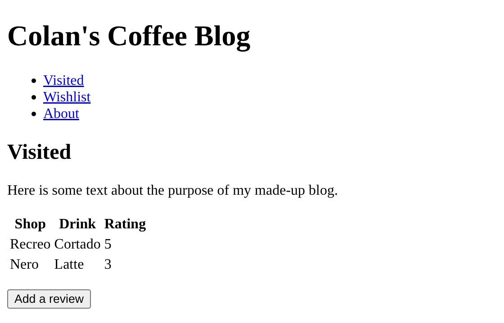

</div>
</div>

---

## Solution: The Browser's Default Stylesheet

The browser styled it. Every browser has a default stylesheet, which is why an `h1` is big, a `ul` has bullets, and links are blue, even when we write no CSS.

---

## Problem: Browsers Disagree

Chrome, Firefox, and Safari each have their own default stylesheet, and they don't all match. So even Twitter's shared button could look different from one browser to the next. How can we address this?

---

## Solution: A Reset Stylesheet

Create your own default style sheet and load that in. This is referred to as a **reset** stylesheet.

Bootstrap's is called **[Reboot](https://getbootstrap.com/docs/5.3/content/reboot/)**, and it's built on [normalize.css](https://necolas.github.io/normalize.css/).

---

## Problem: Why Not Style the Tag?

Reboot styles tags directly, like every `h1`, `ul`, and `a` on the page. Why does Bootstrap make us add `class="btn"` instead of styling every button the same way?

---

## Solution: A Class Picks the Elements

```html
<a href="about.html">About</a>
<a class="btn btn-primary" href="review.html">Add a review</a>
```


A tag rule changes every element with that tag. Both of these are links, but only one should look like a button. That's why Bootstrap styles tags only in Reboot, and everything else is a class ([Reboot](https://getbootstrap.com/docs/5.3/content/reboot/)).

---

## Problem: Site-Wide Grids

Once we have a consistent style across browsers, we still need a consistent style for our website. For example, if we are going to make a grid for a blog post, we want each blog to fit into the same template.

---

## Solution: Site-Wide Grids

<style scoped>
/* Bootstrap's twelve columns, drawn with plain CSS grid. */
.twelve { display: grid; grid-template-columns: repeat(12, 60px); gap: 12px 20px; font-size: 18px; margin: 16px 0; }
.twelve div { background-color: rgb(230, 201, 168); border: 2px solid rgb(138, 75, 31); text-align: center; padding: 4px 0; }
.twelve .col-4 { grid-column: span 4; }
.twelve .col-8 { grid-column: span 8; }
</style>

Bootstrap wrote the float rules once and gave us classes instead. It splits the page into 12 columns: `col-4` makes a box 4 columns wide, and `col-8` makes one 8 columns wide.

<div class="twelve">
<div>1</div><div>2</div><div>3</div><div>4</div><div>5</div><div>6</div><div>7</div><div>8</div><div>9</div><div>10</div><div>11</div><div>12</div>
<div class="col-4">col-4</div><div class="col-8">col-8</div>
</div>

```html
<div class="row">
  <div class="col-4">...</div>
  <div class="col-8">...</div>
</div>
```

We pick the classes for our site's format, and Bootstrap handles the rest.

---

## Problem: Phones

<div class="side-by-side">
<div>

Pages were built for desktop screens. When phones showed up (the iPhone was 2007), they laid pages out 980px wide and shrank them to fit ([MDN](https://developer.mozilla.org/en-US/docs/Web/HTML/Reference/Elements/meta/name/viewport)).

Last lecture, how did we give a phone its own layout?

</div>
<div>

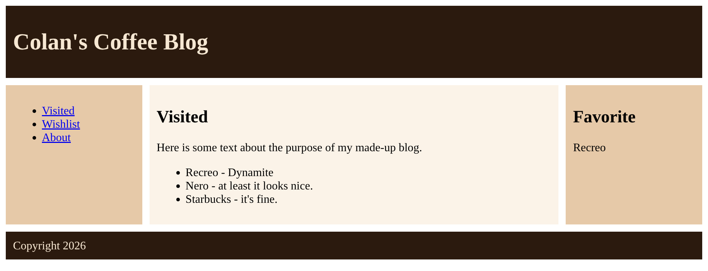

<p class="caption">Last lecture's grid page at 980px, shrunk to 375px</p>

</div>
</div>

---

## Solution: Responsive Web Design

> "Fluid grids, flexible images, and media queries are the three technical ingredients for responsive web design" - Ethan Marcotte, [Responsive Web Design](https://alistapart.com/article/responsive-web-design/), 2010

As the screen-size changes, the browser adjusts all the elements without needing new HTML.

---

## Solution: Responsive Web Design (Continued)

<style scoped>
td code { white-space: nowrap; }
</style>

| Ingredient      | CSS                | What it does                                                              |
| --------------- | ------------------ | ------------------------------------------------------------------------- |
| fluid grid      | `%` or `fr` widths | columns get narrower as the screen does, instead of staying a fixed width |
| flexible images | `max-width: 100%`  | an image shrinks to fit its box, but never stretches past its real size   |
| media queries   | `@media`           | different rules for different widths, like one column on a phone          |

---

## Exercise: Mobile First

<!-- prettier-ignore -->
```css
body {
  grid-template-columns: 1fr 3fr 1fr;
}
@media (max-width: 600px) {
  body { grid-template-columns: 1fr; }
}
```

Last lecture, we wrote the laptop layout first. With **mobile first**, the phone layout is the default, and a media query adds the wider one. Rewrite this mobile first. (Hint: `min-width`)

---

## Exercise: Mobile First (Continued)

<!-- prettier-ignore -->
```css
body {
  grid-template-columns: 1fr;
}
@media (min-width: 601px) {
  body { grid-template-columns: 1fr 3fr 1fr; }
}
```

`min-width: 601px` means 601px and wider, so the media query adds rules as the screen grows. Bootstrap's grid works this way.

---

## Problem: CSS Has Grid Now. Why Bootstrap?

Last lecture, we built the holy grail with CSS grid. Which of today's problems does grid solve?

- Every tool looked different
- Browsers disagree on defaults
- Columns took floats
- Phones need their own layout

---

## Solution: CSS Has Grid Now. Why Bootstrap?

Grid solves the floats. The other three still need CSS that someone has to write:

| Problem                       | What Bootstrap gives us                                   |
| ----------------------------- | --------------------------------------------------------- |
| every tool looked different   | components with one look: buttons, navbars, cards, tables |
| browsers disagree on defaults | Reboot                                                    |
| phones need their own layout  | breakpoints and responsive classes: `col-md-4`            |

---

## Review: Linking a Stylesheet

Bootstrap's CSS is one file, `bootstrap.min.css`. How do we use a stylesheet that's in another file?

---

## Solution: Link to a CDN

```html
<link rel="stylesheet" href="style.css" />
```

`href` can also be a full URL:

```html
<link
  href="https://cdn.jsdelivr.net/npm/bootstrap@5.3.8/dist/css/bootstrap.min.css"
  rel="stylesheet"
  integrity="sha384-sRIl4kxILFvY47J16cr9ZwB07vP4J8+LH7qKQnuqkuIAvNWLzeN8tE5YBujZqJLB"
  crossorigin="anonymous"
/>
```

A **CDN** (content delivery network) is a set of servers around the world with copies of the same files. `.min` means minified: the spaces and comments are gone.

---

## The Two Extra Attributes

`integrity` lets the browser check that the file it downloaded is the same file Bootstrap published. If anything in it changed, the browser won't use it ([MDN](https://developer.mozilla.org/en-US/docs/Web/Security/Defenses/Subresource_Integrity)).

`crossorigin="anonymous"` has to be there for that check to work. We copy both from [getbootstrap.com](https://getbootstrap.com/docs/5.3/getting-started/introduction/) instead of typing them.

---

## The Starter Page

<!-- prettier-ignore -->
```html
<!doctype html>
<html lang="en">
  <head>
    <meta charset="utf-8" />
    <meta name="viewport" content="width=device-width, initial-scale=1" />
    <title>Bootstrap Starter</title>
    <link href="https://cdn.jsdelivr.net/.../css/bootstrap.min.css" rel="stylesheet"
          integrity="sha384-sRIl..." crossorigin="anonymous" />
  </head>
  <body>
    <div class="container">
      <h1>Hello, Bootstrap</h1>
    </div>
    <script src="https://cdn.jsdelivr.net/.../js/bootstrap.bundle.min.js"
            integrity="sha384-FKyo..." crossorigin="anonymous"></script>
  </body>
</html>
```

The full file: [https://bi3mer.github.io/lectures/cs213/lectures/07-css-bootstrap/examples/bootstrap/starter.html](https://bi3mer.github.io/lectures/cs213/lectures/07-css-bootstrap/examples/bootstrap/starter.html)

---

## The Viewport Line

```html
<meta name="viewport" content="width=device-width, initial-scale=1" />
```

Without this line, a phone lays our page out 980px wide and shrinks it to fit, so `@media (max-width: 600px)` never switches on. `width=device-width` lays the page out as wide as the screen, and `initial-scale=1` starts it at normal size, not zoomed out.

(We should have covered this last week, sorry.)

---

## The Viewport Line (Continued)

<div class="two-up">
<div>


<p class="caption">Without it: 980px, so the media query is off</p>

</div>
<div>

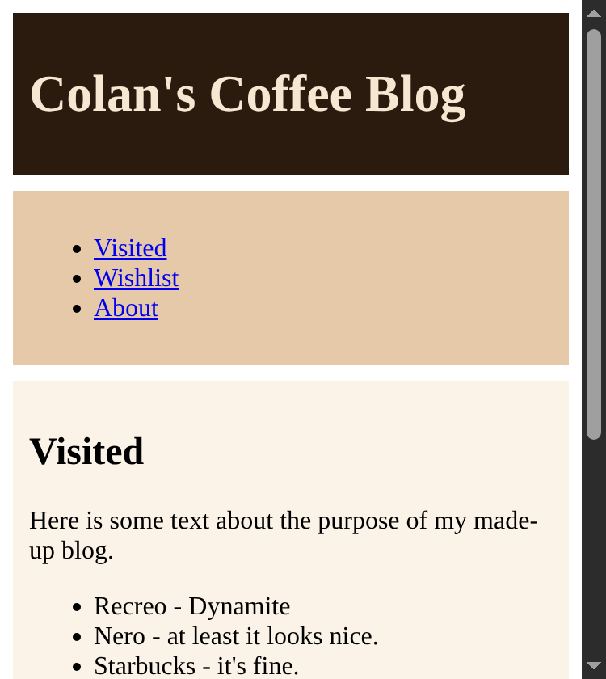

<p class="caption">With it: 375px, so the media query is on</p>

</div>
</div>

---

## The Starter Page (Continued)

- The `<link>` goes in the `<head>`, before our own stylesheets
- The `<script>` goes at the end of the `<body>` (it contains JavaScript, which we begin to cover next week)

---

## Downloading Instead

<div class="side-by-side">
<div>

```text
my-site/
  css/
    bootstrap.min.css
  js/
    bootstrap.bundle.min.js
  index.html
```

</div>
<div>

<!-- prettier-ignore -->
```html
<link rel="stylesheet"
      href="css/bootstrap.min.css" />
<script
  src="js/bootstrap.bundle.min.js">
</script>
```

</div>
</div>

We can also [download](https://getbootstrap.com/docs/5.3/getting-started/download/) Bootstrap and keep the two files with our site (the zip has more, but these are the ones we need). On our own computer, the downloaded files load fastest and work without the internet. Once the site is on our VM, the CDN is usually faster, since its servers are closer to our visitors.

---

## Problem: Without Bootstrap Versus With

<div class="two-up">
<div>


<p class="caption">No Bootstrap</p>

</div>
<div>

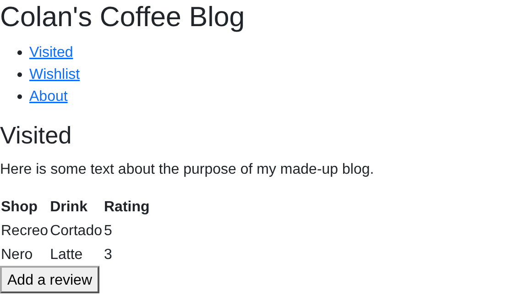

<p class="caption">Bootstrap linked, no classes</p>

</div>
</div>

Even without classes, the same HTML page renders differently. Why?

---

## Solution: Without Bootstrap Versus With

Bootstrap includes Reboot, which overrides the browser's default styles. For anything else, like buttons or columns, we add Bootstrap's classes.

---

## Container, Row, Column

<div class="side-by-side">
<div>

```html
<div class="container">
  <div class="row">
    <div class="col box">1</div>
    <div class="col box">2</div>
    <div class="col box">3</div>
  </div>
</div>
```

</div>
<div>


```css
.box {
  background-color: rgb(230, 201, 168);
  border: 2px solid rgb(138, 75, 31);
  padding: 12px;
  text-align: center;
}
```

</div>
</div>

- `.container` sets a maximum width, centers itself on the page, and pads the sides
- `.row` holds columns, and `.col`s split it equally
- `.box` is our own CSS (above), so we can see the columns

---

## What the Classes Are

Bootstrap is CSS like ours. Here's the core of the grid:

<div class="side-by-side">
<div>

```css
.row {
  display: flex;
  flex-wrap: wrap;
}
.col {
  flex: 1 0 0;
}
```

</div>
<div>

- `.row` is a flex container, from the end of last lecture
- `flex: 1 0 0`: each `.col` grows to an equal share
- `flex-wrap: wrap`: columns that don't fit go to a new line

</div>
</div>

---

## Twelve Columns

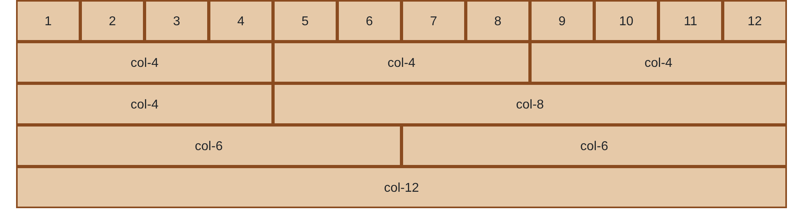

Every row is 12 units wide, and `col-4` takes 4 of them.

---

## Why 12?

Because 12 divides evenly by 2, 3, 4, and 6:

| Split                  | Classes                   |
| ---------------------- | ------------------------- |
| halves                 | `col-6 col-6`             |
| thirds                 | `col-4 col-4 col-4`       |
| quarters               | `col-3 col-3 col-3 col-3` |
| sixths                 | `col-2` six times         |
| a third and two thirds | `col-4 col-8`             |

---

## Exercise: A Wider Middle Column

Three columns, and the middle one is twice as wide as each side. Which classes?

---

## Exercise: A Wider Middle Column (Continued)

<div class="side-by-side">
<div>

```html
<div class="row">
  <div class="col-3 box">col-3</div>
  <div class="col-6 box">col-6</div>
  <div class="col-3 box">col-3</div>
</div>
```

</div>
<div>

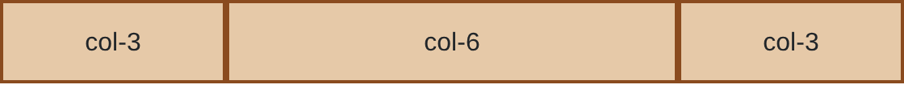

</div>
</div>

---

## Exercise: Three Rows

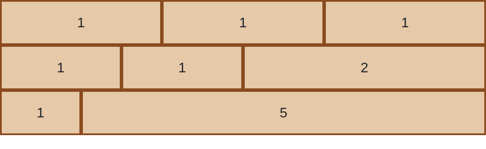

The numbers are the ratios: 1:1:1, then 1:1:2, then 1:5. Which classes?

---

## Exercise: Three Rows (Continued)

<div class="side-by-side">
<div>

```html
<div class="row">
  <div class="col-4 box">1</div>
  <div class="col-4 box">1</div>
  <div class="col-4 box">1</div>
</div>
<div class="row">
  <div class="col-3 box">1</div>
  <div class="col-3 box">1</div>
  <div class="col-6 box">2</div>
</div>
<div class="row">
  <div class="col-2 box">1</div>
  <div class="col-10 box">5</div>
</div>
```

</div>
<div>

Add up the parts, divide 12 by the total, and multiply.

</div>
</div>

---

## Exercise: The Holy Grail's Middle Row

Last lecture's middle row was `grid-template-columns: 1fr 3fr 1fr`. How do we write it with Bootstrap?

---

## Exercise: The Holy Grail's Middle Row (Continued)

We can't, exactly. 1 + 3 + 1 = 5 parts, and 12 / 5 = 2.4.

|                     | nav   | article | ad    |
| ------------------- | ----- | ------- | ----- |
| `1fr 3fr 1fr`       | 20%   | 60%     | 20%   |
| `col-2 col-8 col-2` | 16.7% | 66.7%   | 16.7% |
| `col-3 col-6 col-3` | 25%   | 50%     | 25%   |

Instead, we can write it ourselves.

---

## Columns That Fill the Rest

<div class="side-by-side">
<div>

```html
<div class="row">
  <div class="col-6 box">col-6</div>
  <div class="col box">col</div>
  <div class="col box">col</div>
</div>
<div class="row">
  <div class="col box">nav</div>
  <div class="col-7 box">article</div>
  <div class="col box">ad</div>
</div>
```

</div>
<div>

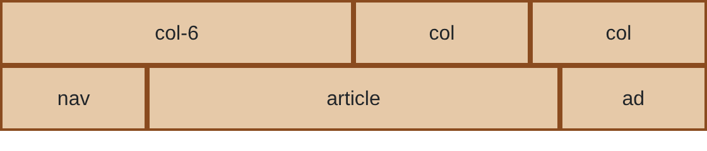

</div>
</div>

A `.col` without a number splits whatever is left over. With `col-7`, the holy grail's middle row comes out 20.8%, 58.3%, 20.8%.

---

## Problem: Too Many Columns

```html
<div class="row">
  <div class="col-8 box">col-8</div>
  <div class="col-8 box">col-8</div>
</div>
```

16 > 12. What happens?

---

## Solution: Too Many Columns

<div class="side-by-side">
<div>


</div>
<div>

The second column wraps to a new line.

</div>
</div>

Six `col-4` photos in one row make two lines of three.

---

## Problem: Where Are the Gutters?

<div class="side-by-side">
<div>

Bootstrap's [docs](https://getbootstrap.com/docs/5.3/layout/gutters/) say "Gutters are the padding between your columns," and the default is 24px. But our boxes touch. Where did it go?

```css
.row > * {
  padding-left: 12px;
  padding-right: 12px;
}
```

</div>
<div>


</div>
</div>

`.row > *` means every direct child of a `.row`. (Hint: what does `background-color` paint?)

---

## Solution: Color a Box Inside the Column

<div class="side-by-side">
<div>

```html
<div class="row">
  <div class="col">
    <div class="box">1</div>
  </div>
  <div class="col">
    <div class="box">2</div>
  </div>
  <div class="col">
    <div class="box">3</div>
  </div>
</div>
```

</div>
<div>


</div>
</div>

The background paints the padding, so the gutter was inside our colored box. If we put the color on a `<div>` inside the column, we can see it.

---

## Problem: The Page Scrolls Sideways

<div class="side-by-side">
<div>

```html
<body>
  <div class="row">
    <div class="col">...</div>
    <div class="col">...</div>
    <div class="col">...</div>
  </div>
</body>
```

```css
.row {
  /* simplified */
  margin-left: -12px;
  margin-right: -12px;
}
```

</div>
<div>

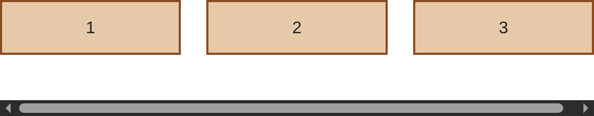

</div>
</div>

Let's say we leave out the `.container`. Now the page scrolls sideways. Why?

---

## Solution: Rows Go in a Container

<center>
<div>

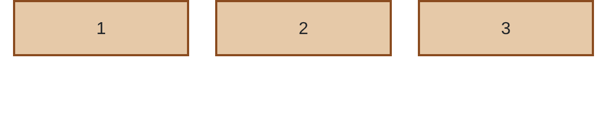

</div>
</center>

- The row's −12px margins make it 24px wider than its parent. The container has 12px of padding on each side to make room for them.
- The negative margins cancel the outer columns' padding, so the boxes line up with the text above and below the row.

---

## Gutter Classes

<div class="side-by-side">
<div>

| Class  | Sets                             |
| ------ | -------------------------------- |
| `g-2`  | both gutters                     |
| `gx-2` | the gutter between columns       |
| `gy-2` | the gutter between wrapped lines |

</div>
<div>

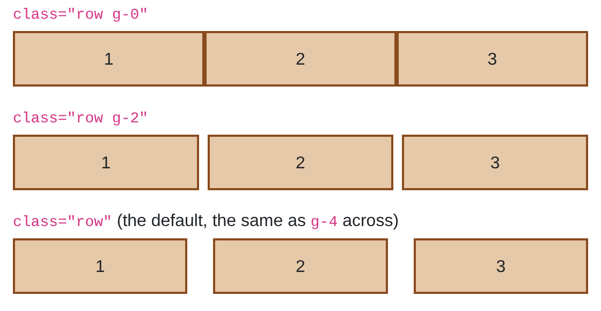

</div>
</div>

- The sizes go from 0 to 5: 0, 4px, 8px, 16px, 24px, and 48px.
- With no class, a row gets 24px between columns and 0 between lines. (Bootstrap writes these in `rem`, where 1rem is the page's font size, 16px by default.)

---

## Problem: The Rows Touch

<div class="side-by-side">
<div>

```html
<div class="row">
  <div class="col-4">...</div>
  <div class="col-4">...</div>
  <div class="col-4">...</div>
</div>
<div class="row">
  <div class="col-8">...</div>
  <div class="col-4">...</div>
</div>
<div class="row">
  <div class="col-12">...</div>
</div>
```

</div>
<div>

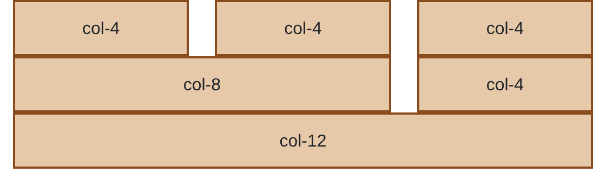

</div>
</div>

Each `...` is a `<div class="box">`. How do we put 24px between the rows?

---

## Problem: `gy-4` Does Nothing

<div class="side-by-side">
<div>

```html
<div class="row gy-4">...</div>
<div class="row gy-4">...</div>
<div class="row gy-4">...</div>
```

</div>
<div>


</div>
</div>

We gave every row `gy-4`, and nothing changed. Why?

---

## Solution: `gy-4` Does Nothing

<!-- prettier-ignore -->
```css
.row.gy-4 { margin-top: -24px; }
.row.gy-4 > * { margin-top: 24px; }
```

Each column moves down 24px, and the row moves up 24px. Our rows never wrap, so the two always cancel. `gy` only shows up between lines that wrap.

---

## Solution: One Row That Wraps

<div class="side-by-side">
<div>

```html
<div class="row g-4">
  <div class="col-4">...</div>
  <div class="col-4">...</div>
  <div class="col-4">...</div>
  <div class="col-8">...</div>
  <div class="col-4">...</div>
  <div class="col-12">...</div>
</div>
```

</div>
<div>

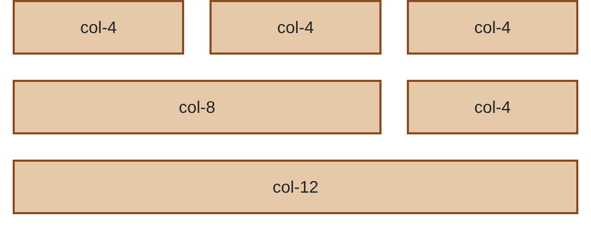

</div>
</div>

If we put everything in one row, it wraps into three lines, and the gutter shows up between them. `g-4` sets both gutters to 24px.

---

## Solution: Margin Between Rows

<div class="side-by-side">
<div>

```html
<div class="row mb-4">...</div>
<div class="row mb-4">...</div>
<div class="row mb-4">...</div>
```

</div>
<div>


</div>
</div>

Or we can keep three rows and give each one a margin. `mb-4` is `margin-bottom: 24px`.

---

## Spacing Classes

| Class          | Sets                              |
| -------------- | --------------------------------- |
| `m-4`, `p-4`   | margin, padding on all four sides |
| `mt-4`, `mb-4` | top, bottom                       |
| `ms-4`, `me-4` | left, right                       |
| `mx-4`, `my-4` | left and right, top and bottom    |

Every `m` class has a `p` version, like `py-3` for padding on the top and bottom. They use the same sizes as the gutters, 0 to 5.

---

## Review: The Same Rows in CSS Grid

Two rows of `col-4` and `col-8`, with 24px between the columns and between the rows. How do we write that in plain CSS grid? (Hint: `gap`)

---

## Review: The Same Rows in CSS Grid (Continued)

<style scoped>
.boxes { display: grid; grid-template-columns: 1fr 2fr; gap: 24px; }
</style>

<div class="side-by-side">
<div>

```css
.rows {
  display: grid;
  grid-template-columns: 1fr 2fr;
  gap: 24px;
}
```

</div>
<div class="boxes">
<div>1</div>
<div>2</div>
<div>3</div>
<div>4</div>
</div>
</div>

Four cells in two columns make two rows. `gap` puts 24px between the columns and between the rows, so grid doesn't need the padding, the negative margins, or the container.

---

## Picking a Width

<!-- prettier-ignore -->
```css
@media (min-width: 601px) {
  body { grid-template-columns: 1fr 3fr 1fr; }
}
```

Earlier, our layout switched at 601px. Another page might switch at 768px, and another at 800px, so one site changes layouts at different widths. Bootstraps let's us handle this with **breakpoints**.

---

## Breakpoints

| Infix  | Applies when the window is | `.container` width |
| ------ | -------------------------- | ------------------ |
| (none) | any width                  | 100%               |
| `sm`   | 576px or wider             | 540px              |
| `md`   | 768px or wider             | 720px              |
| `lg`   | 992px or wider             | 960px              |
| `xl`   | 1200px or wider            | 1140px             |
| `xxl`  | 1400px or wider            | 1320px             |

---

## Breakpoints in Class Names

```html
<div class="col-sm-6">...</div>
```

`col-sm-6` has three parts:

- `col`: a column
- `sm`: only when the window is 576px or wider (a small screen or bigger)
- `6`: 6 of the 12 units, so half the row

Below 576px, `col-sm-6` doesn't apply, and a column's default is the whole row.

---

## The Reviews Page

```html
<div class="container">
  <div class="row">
    <div class="col-4 box">
      <h2>Recreo</h2>
      <p>Cortado. Dynamite: the staff remember your order.</p>
    </div>
    <div class="col-4 box">
      <h2>Nero</h2>
      <p>Latte. At least it looks nice, and there is a seat by the window.</p>
    </div>
    <div class="col-4 box">
      <h2>Starbucks</h2>
      <p>Drip. It's fine, and it is open when nothing else is.</p>
    </div>
  </div>
</div>
```

---

## The Reviews Page (Continued)

```html
<head>
  <!-- the starter page's <meta> and <link> tags -->
  <style>
    .box {
      background-color: rgb(230, 201, 168);
      border: 2px solid rgb(138, 75, 31);
      padding: 12px;
      text-align: center;
    }
  </style>
</head>
```

---

## Problem: Three Reviews on a Phone

<div class="laptop-phone">
<div>

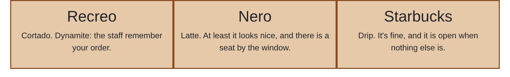

<p class="caption">1000px wide</p>

</div>
<div>

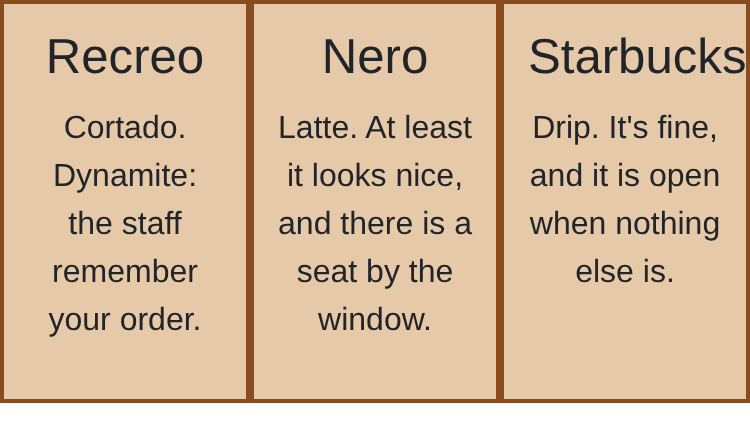

<p class="caption">375px wide</p>

</div>
</div>

Each review is `col-4`, so it takes a third of the row at every screen size. On a phone, a third is too narrow to read. We want one column on phones and three from, let's say, 800px up. What should we do?

---

## Solution: `col-md-4`

<div class="laptop-phone">
<div>


<p class="caption">1000px wide</p>

Change to `col-md-4`.

</div>
<div>

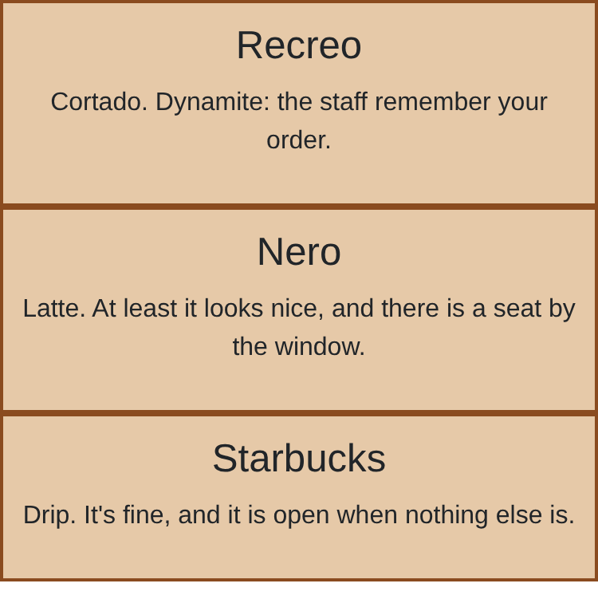

<p class="caption">375px wide</p>

</div>
</div>

Bootstrap has no 800px breakpoint. `lg` starts at 992px, so an 800px screen would still get one column. `md` starts at 768px, the closest breakpoint below 800px.

---

## Problem: How Does `col-md-4` Work?

`col-md-4` is a class inside a media query. Here is a simplified `col-4`:

```css
.col-4 {
  flex: 0 0 auto;
  width: 33.33333333%;
}
```

What does `col-md-4` look like, with a media query for `md` (768px or wider)?

---

## Solution: A Class Inside a Media Query

```css
@media (min-width: 768px) {
  .col-md-4 {
    flex: 0 0 auto;
    width: 33.33333333%;
  }
}
```

By using `min-width`, this rule is saying, "Only change the default if the width is greater than or equal to `768px`."

---

## Four Boxes

```html
<div class="container">
  <div class="row">
    <div class="col box">1</div>
    <div class="col box">2</div>
    <div class="col box">3</div>
    <div class="col box">4</div>
  </div>
</div>
```

We are going to use this HTML for the next couple of questions...

---

## Problem: What Does It Look Like?

```html
<div class="container">
  <div class="row">
    <div class="col box">1</div>
    <div class="col box">2</div>
    <div class="col box">3</div>
    <div class="col box">4</div>
  </div>
</div>
```

What does this page look like on a laptop (1100px wide)? What about on a phone (375px wide)?

---

## Solution: Four Across, Always

<div class="laptop-phone">
<div>


<p class="caption">1100px wide</p>

</div>
<div>

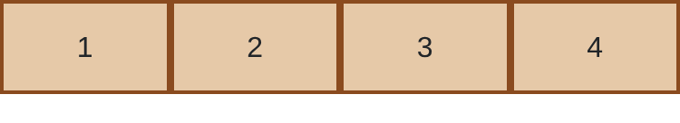

<p class="caption">375px wide</p>

</div>
</div>

`col` has no number, so the four boxes split the row evenly, a quarter each. It has no breakpoint either, so a phone gets four across too, and each box is under 100px wide.

---

## Problem: One per Row

Which class, in place of `col`, makes each box wrap and take up the whole row?

1. `col-1`
2. `col-3`
3. `col-6`
4. `col-12`

---

## Solution: `col-12`

<div class="side-by-side">
<div>

```html
<div class="col-12 box">1</div>
<div class="col-12 box">2</div>
<div class="col-12 box">3</div>
<div class="col-12 box">4</div>
```

</div>
<div>

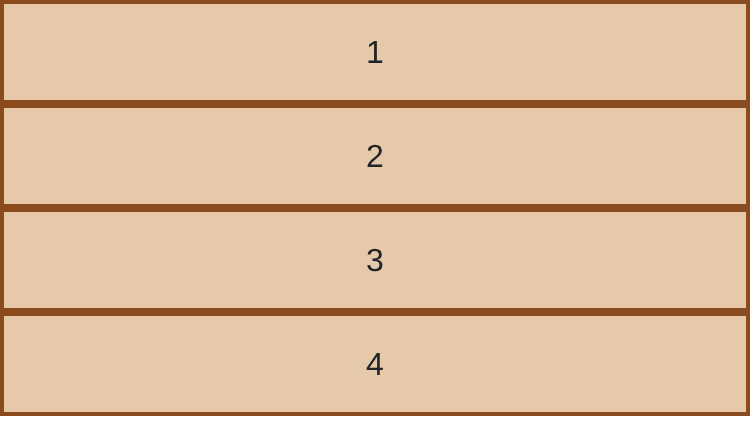

<p class="caption">375px</p>

</div>
</div>

Replace `col` with `col-12` on each box. Every row is 12 units wide, so `col-12` takes all of them. It has no breakpoint, so it applies at every width.

---

## Problem: Two per Row from `md`

<div class="side-by-side">
<div>

Let's say that at 768px or wider, each box should take half the row. Which class do we add?

</div>
<div>

| Infix  | Applies when the window is |
| ------ | -------------------------- |
| (none) | any width                  |
| `sm`   | 576px or wider             |
| `md`   | 768px or wider             |
| `lg`   | 992px or wider             |
| `xl`   | 1200px or wider            |
| `xxl`  | 1400px or wider            |

</div>
</div>

---

## Solution: `col-md-6`

```html
<div class="col-md-6 box">1</div>
<div class="col-md-6 box">2</div>
<div class="col-md-6 box">3</div>
<div class="col-md-6 box">4</div>
```

<div class="two-up">
<div>


<p class="caption">375px</p>

</div>
<div>

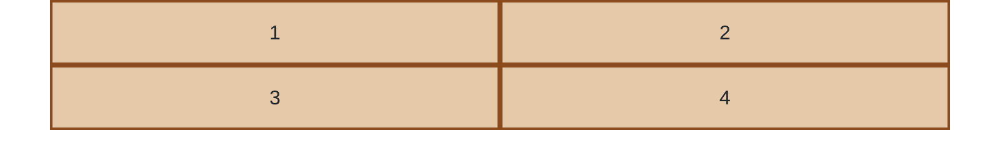

<p class="caption">800px</p>

</div>
</div>

Below 768px, `col-md-6` doesn't apply, and a `.row`'s children are the whole row by default. So we don't need `col-12` anymore: `col-md-6` alone gives one per row on phones and two per row from 768px up.

---

## Problem: Four per Row

<div class="side-by-side">
<div>

At `992px` or wider, each box should take a quarter of the row. Between `768px` and `992px`, each box should take half of the row. Otherwise, each box should take up the whole row. How can we do this?

</div>
<div>

| Infix  | Applies when the window is |
| ------ | -------------------------- |
| (none) | any width                  |
| `sm`   | 576px or wider             |
| `md`   | 768px or wider             |
| `lg`   | 992px or wider             |
| `xl`   | 1200px or wider            |
| `xxl`  | 1400px or wider            |

</div>
</div>

---

## Solution: `col-lg-3`

```html
<div class="col-md-6 col-lg-3 box">1</div>
<div class="col-md-6 col-lg-3 box">2</div>
<div class="col-md-6 col-lg-3 box">3</div>
<div class="col-md-6 col-lg-3 box">4</div>
```

<div class="three-up">
<div>


<p class="caption">375px</p>

</div>
<div>


<p class="caption">800px</p>

</div>
<div>


<p class="caption">1100px</p>

</div>
</div>

A column can have more than one class. Read it left to right as the screen grows: the whole row, then 6, then 3.

---

## Problem: Does the Order Matter?

We added the classes from the smallest screen to the biggest. Here they are in reverse:

```html
<div class="col-lg-3 col-md-6 box">1</div>
```

At 1100px, both match. Do we still get four across?

---

## Solution: Does the Order Matter?

<!-- prettier-ignore -->
```css
/* bootstrap.min.css, simplified, in file order */
@media (min-width: 768px) { .col-md-6 { width: 50%; } }
@media (min-width: 992px) { .col-lg-3 { width: 25%; } }
```

Yes. Each rule is one class, so they tie, and the later rule in the file wins. Bootstrap puts bigger breakpoints later, so the order in `class` doesn't matter.

---

## Problem: A Box Two Rows Tall

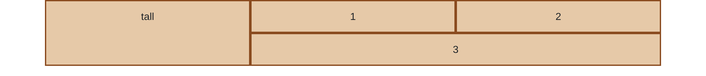

We want to make the above. The left box takes 4 of the 12 units, and the two rows on the right take up the other 8. How can we make this?

---

## Solution: Rows Inside a Column

<div class="side-by-side">
<div>

```html
<div class="row">
  <div class="col-md-4 box">tall</div>
  <div class="col-md-8">
    <div class="row">
      <div class="col-lg-6 box">1</div>
      <div class="col-lg-6 box">2</div>
    </div>
    <div class="row">
      <div class="col-12 box">3</div>
    </div>
  </div>
</div>
```

</div>
<div>


<p class="caption">1100px</p>

</div>
</div>

The inner rows have 12 units of their own, so `col-lg-6` is half of the `col-md-8`. `.row` is a flex container, so the `col-md-4` stretches to the height of both rows.

---

## Problem: The Tall Box on Smaller Screens

<div class="side-by-side">
<div>

```html
<div class="row">
  <div class="col-md-4 box">tall</div>
  <div class="col-md-8">
    <div class="row">
      <div class="col-lg-6 box">1</div>
      <div class="col-lg-6 box">2</div>
    </div>
    <div class="row">
      <div class="col-12 box">3</div>
    </div>
  </div>
</div>
```

</div>
<div>


<p class="caption">1100px</p>

</div>
</div>

At 1100px, the tall box sits beside 1 and 2. What does it look like at 800px? At 375px?

---

## Solution: The Tall Box on Smaller Screens

<div class="three-up">
<div>

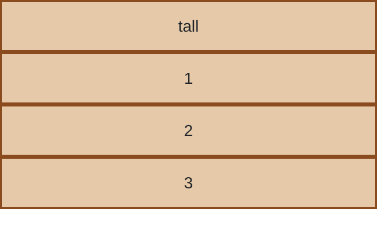

<p class="caption">375px</p>

</div>
<div>

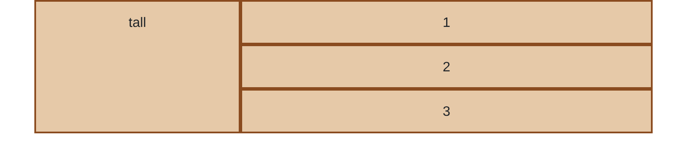

<p class="caption">800px</p>

</div>
<div>


<p class="caption">1100px</p>

</div>
</div>

At 375px, neither `md` nor `lg` applies, so everything stacks. At 800px, only `md` applies: the tall box moves beside the inner rows, but 1 and 2 still stack. From 992px up, `lg` puts 1 and 2 in one row.

---

## Components

At Twitter, every tool drew its own button. Bootstrap gives us one set of classes for pieces like buttons, navbars, and tables ([Components](https://getbootstrap.com/docs/5.3/components/buttons/)).

---

## The `<button>` Tag

<div class="side-by-side">
<div>

```html
<p>
  Had coffee somewhere good?
  <button>Add a review</button>
</p>
```

</div>
<div>


</div>
</div>

`<button>` makes a button. It sits in the line with the text around it, like `<a>`. Clicking it doesn't do anything yet. That takes JavaScript.

---

## Bootstrap's Buttons

<div class="side-by-side">
<div>

```html
<p>
  Had coffee somewhere good?
  <button class="btn">Add a review</button>
</p>
<p>
  Had coffee somewhere good?
  <button class="btn btn-primary">Add a review</button>
</p>
```

</div>
<div>


</div>
</div>

With just `btn`, the browser's gray box is gone, and the button looks like text with some padding around it. Adding `btn-primary` gives it a color.

---

## Other Button Colors


There are lots of other button colors we can use, like `btn-success` and `btn-danger`.

---

## Nav Links on a Phone


At 900px, the links fit. On a phone they don't, so they usually hide behind a ☰ button. Bootstrap's navbar can do this for us.

---

## A Navbar

<div class="side-by-side">
<div>

```html
<nav class="navbar bg-primary" data-bs-theme="dark">
  <div class="container">
    <a class="navbar-brand" href="#">Colan's Coffee Blog</a>
  </div>
</nav>
```

</div>
<div>


</div>
</div>

`navbar` makes the bar. `bg` is short for background, so `bg-primary` gives it the primary color. The other colors work too, like `bg-warning` for yellow. `navbar-brand` makes the site name bigger and takes away the link's blue and underline.

---

## A Navbar (Continued)

<!-- prettier-ignore -->
```html
<a class="navbar-brand" href="#">Colan's Coffee Blog</a>
<ul class="navbar-nav">
  <li class="nav-item"><a class="nav-link" href="#">Visited</a></li>
  <li class="nav-item"><a class="nav-link" href="#">Wishlist</a></li>
  <li class="nav-item"><a class="nav-link" href="#">About</a></li>
</ul>
```


`navbar-nav` goes on the list, `nav-item` on each `<li>`, and `nav-link` on each link. Without anything else, the links stack in a column, even at 900px.

---

## `navbar-expand-md`

<!-- prettier-ignore -->
```html
<nav class="navbar navbar-expand-md bg-primary" data-bs-theme="dark">
  <div class="container">
    <a class="navbar-brand" href="#">Colan's Coffee Blog</a>
    <button class="navbar-toggler" type="button"
            data-bs-toggle="collapse" data-bs-target="#links">
      <span class="navbar-toggler-icon"></span>
    </button>
    <div class="collapse navbar-collapse" id="links">
      <ul class="navbar-nav">...</ul>
    </div>
  </div>
</nav>
```

We add the ☰ button (`navbar-toggler`) and wrap the list in a `collapse` div. [navbar.html](examples/bootstrap/navbar.html) also has `aria-` attributes for screen readers.

---

## `navbar-expand-md` (Continued)

<div class="side-by-side">
<div>

From `md` up, the links sit in a row. Below `md`, they collapse behind ☰.

`data-bs-target="#links"` tells the button which element to open: the one with `id="links"`.

</div>
<div class="two-up">
<div>


<p class="caption">Closed</p>

</div>
<div>

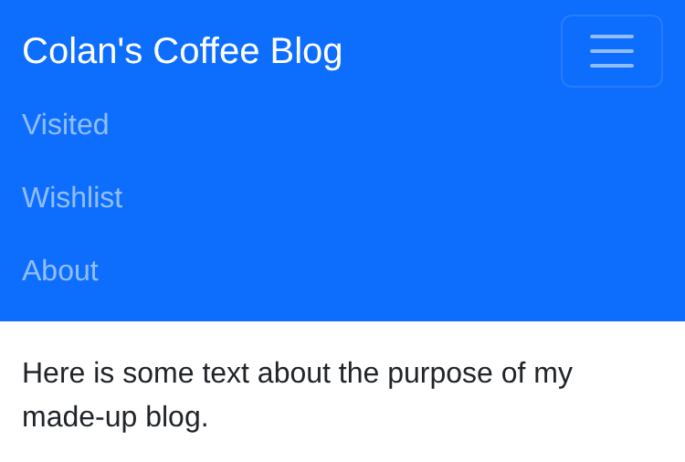

<p class="caption">After a click</p>

</div>
</div>
</div>

---

## Review: Our Table

<div class="side-by-side">
<div>

```html
<table>
  <tr>
    <th>Shop</th>
    <th>Drink</th>
    <th>Rating</th>
  </tr>
  <tr>
    <td>Recreo</td>
    <td>Cortado</td>
    <td class="rating">5</td>
  </tr>
  <!-- two more rows: Nero and Starbucks -->
</table>
```

</div>
<div class="demo">
<table>
<tr><th>Shop</th><th>Drink</th><th>Rating</th></tr>
<tr><td>Recreo</td><td>Cortado</td><td class="rating">5</td></tr>
<tr><td>Nero</td><td>Latte</td><td class="rating">3</td></tr>
<tr><td>Starbucks</td><td>Drip</td><td class="rating">2</td></tr>
</table>
</div>
</div>

Here's the HTML for last lecture's table. Styling it took six CSS rules. Let's see what Bootstrap gives us instead.

---

## A Bootstrap Table

<div class="side-by-side">
<div>

```html
<table class="table table-striped">
  <thead>
    <tr>
      <th>Shop</th>
      ...
    </tr>
  </thead>
  <tbody>
    <tr>
      <td>Recreo</td>
      ...
    </tr>
    <!-- Nero, Starbucks -->
  </tbody>
</table>
```

</div>
<div>

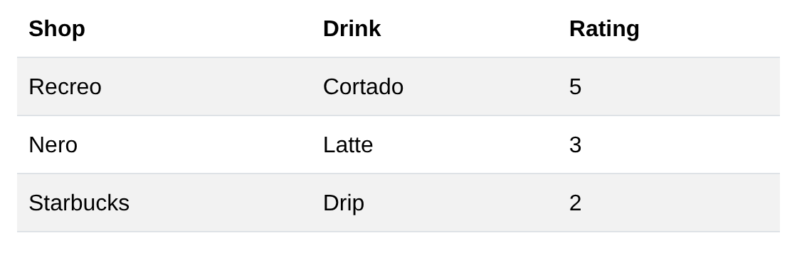
`.table` gives us the lines and padding, and `.table-striped` shades every other row. Bootstrap wants the header row in `<thead>` and the rest in `<tbody>`.

</div>
</div>

---

## More Table Classes

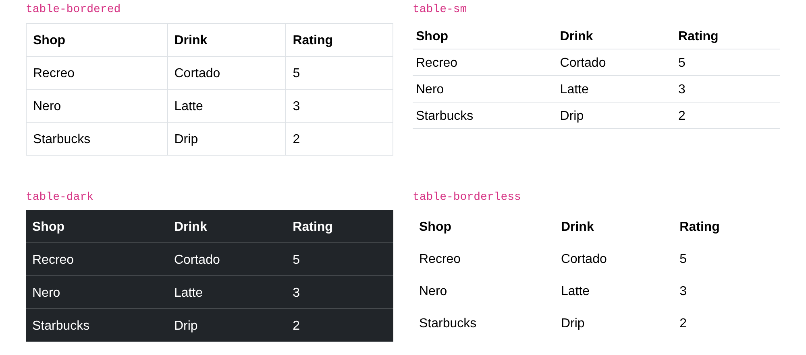

These go next to `table` too, like `class="table table-bordered"`. `table-hover` shades the row under the mouse.

---

## The Whole Page

There's no `<style>` anywhere in the page. The two new classes are `card`, a box with a border and rounded corners, and `border-top`, a line above the footer.

The full file: [https://bi3mer.github.io/lectures/cs213/lectures/07-css-bootstrap/examples/bootstrap/blog.html](https://bi3mer.github.io/lectures/cs213/lectures/07-css-bootstrap/examples/bootstrap/blog.html)

---

## Problem: It Looks Like Bootstrap

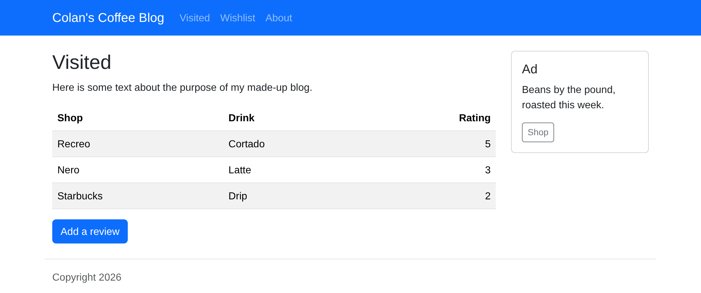

Every site that uses the default file looks like this. How do we change it?

---

## Solution: Themes

[Bootswatch](https://bootswatch.com) has 26 free themes. Each one is Bootstrap rebuilt with its own colors and fonts, and we use one by swapping one line:

```html
<link
  href="https://cdn.jsdelivr.net/npm/bootswatch@5.3.8/dist/minty/bootstrap.min.css"
  rel="stylesheet"
/>
```

It replaces `bootstrap.min.css`, so we don't link both. We also leave out Bootstrap's `integrity`, since it only matches Bootstrap's own file.

---

## Same HTML, Four Themes

<div class="two-up">
<div>

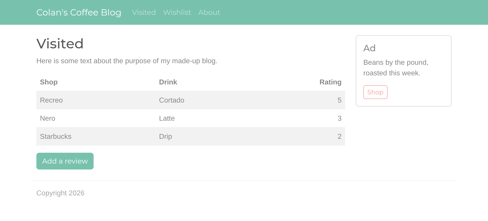

<p class="caption">minty</p>

</div>
<div>

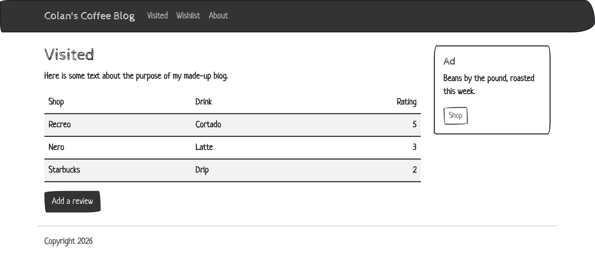

<p class="caption">sketchy</p>

</div>
<div>

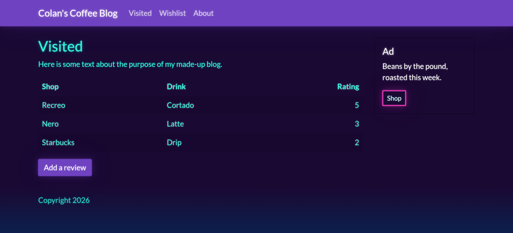

<p class="caption">vapor</p>

</div>
<div>

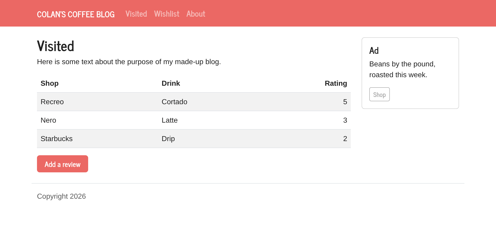

<p class="caption">journal</p>

</div>
</div>

---

## Exercise: Pick a Theme

1. Add the blog page to your WebStorm setup: [https://bi3mer.github.io/lectures/cs213/lectures/07-css-bootstrap/examples/bootstrap/blog.html](https://bi3mer.github.io/lectures/cs213/lectures/07-css-bootstrap/examples/bootstrap/blog.html)
2. Pick a theme on [bootswatch.com](https://bootswatch.com). From its **Download** menu, save `bootstrap.min.css` it into a `css` folder.
3. Replace the page's Bootstrap `<link>` with one to the file we downloaded.

---

## Summary: Bootstrap

- Bootstrap solves problems we've solved by hand: browser defaults, columns, and phones
- `.container` → `.row` → `.col-*`, 12 units per row
- Gutters are padding: color a box inside the column, and keep rows in a container
- Mobile first: `col-md-4` applies from a breakpoint up
- Components: `btn`, `navbar`, and `table`, with colors named by purpose (`primary`, `danger`)
- Themes: swap Bootstrap's stylesheet for a Bootswatch file to change the whole look
