<style>
/* Code on the left, what the console shows on the right. */
.side-by-side { display: grid; grid-template-columns: 560px minmax(0, 1fr); gap: 24px; align-items: start; }
.side-by-side p { margin: 0; }
.caption { font-size: 20px; color: var(--secondary); }
</style>

# Intro to JavaScript

Colan Biemer

---

## This Week's Participation Assignment

This week's participation assignment is due **Friday at 5 PM ET**.

---

## Syllabus Update: Late Policy

The syllabus has a new late policy for participation assignments:

All participation assignments submitted after the due date will receive a 5% penalty per day, for up to 3 days. After the third day, the assignment will receive a zero, with no opportunity for a regrade.

---

## Late Policy: Exceptions

There are two exceptions to this policy:

1. You have received an extension from the instructor.
2. You contacted me before the due date because you were experiencing a genuine problem that could not be easily resolved.

A genuine problem is one that requires assistance or troubleshooting beyond a simple oversight. For example, forgetting to start your VM is not considered a genuine problem.

---

## Use a Function

Later, we'll cover how to write and use a function. You must do it in this format for the exercises this week:

```js
function functionName() {
  console.log("hi");
}
```

Which is to say, use `function` to declare functions, not arrow format.

> **IMPORTANT:** No credit will be given if this exercise does not use a function as otherwise it is exactly the example shown in class!

---

# A Brief History of JavaScript

---

## Start of 1995

The web was HTML and images. Once a page loaded, it couldn't do anything on its own.

So how did a page ever change, like after the user clicked "Log in"?

---

## Server-Side Rendering

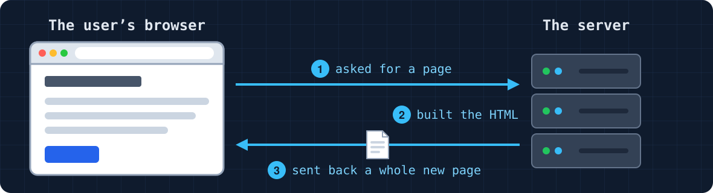

Every time a page needed to change, the server built a whole new page. Building the HTML on the server is called **server-side rendering**.

---

## Example: Logging In

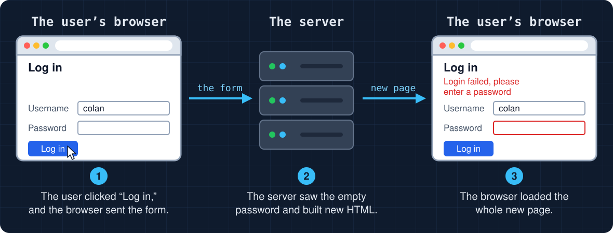

---

## Problems with Server-Side Rendering

1. Incredibly slow: especially back in the '90s and before
2. Annoying: setting up server-side rendering for simple things like a drop-down menu is ridiculous
3. Small checks: the browser could not check an empty password box. It had to send the form to the server.

If the browser could run code, the page could check the password box itself and show the message right away, without asking the server.

---

## 1995: Things Change

- Sun: **Java applets**, allowed Java programs to run inside the page through a plugin the user had to install
- Netscape: **JavaScript**, a scripting language built into the browser, no plugin needed

---

## Java Applets

<center>

[](https://youtu.be/ZqGSg4b_cZA?t=302)

</center>

---

## Why Did Applets Eventually Die Out?

- Slow
- Security risks
- Compatibility problems from the [browser wars](https://en.wikipedia.org/wiki/Browser_wars)

---

## JavaScript

- Brendan Eich wrote the first version of _JavaScript_ at Netscape in May 1995. He had ten days.
- It was first called _Mocha_.
- Then it was renamed to _LiveScript_.
- Then in December 1995, Netscape and Sun renamed it JavaScript.
- Despite the name, JavaScript and Java are different languages.

---

## Main Features

- **Dynamically typed**: a variable can hold any kind of value, and can switch types.
- **Interpreted**: the browser reads our code and runs it as is, with no extra build step.
- **Runs in the browser**: it can read and change the page while it's open (the DOM).

---

## Example: Logging In with JavaScript


No server roundtrip required anymore.

---

# Node.js

---

## JavaScript Only Ran in the Browser

JavaScript was built to run inside a browser, and there was no easy way to run it anywhere else. The server, the computer sending out the pages, ran programs in other languages.

What if we wanted to write the server in JavaScript too?

---

## Node.js

Ryan Dahl released **Node.js** in 2009. It takes the part of Chrome that runs JavaScript and runs it outside the browser ([nodejs.org](https://nodejs.org/en/learn/getting-started/introduction-to-nodejs)).

```bash
node script.js
```

Now one language can run on both the browser and the server.

---

## Live Demo

```bash
$ node
> console.log("hello from the REPL")
```

```bash
$ node hello.js
```

---

## We'll Use the Browser

We don't need to install Node.js for today. Every browser already has a **console**, where we can run JavaScript and see what it prints.

---

# The Browser Console

---

## Opening the Console

| Browser       | Windows                | Mac                    |
| ------------- | ---------------------- | ---------------------- |
| Chrome / Edge | `Ctrl` + `Shift` + `J` | `Cmd` + `Option` + `J` |
| Firefox       | `Ctrl` + `Shift` + `K` | `Cmd` + `Option` + `K` |
| Safari        |                        | `Cmd` + `Option` + `C` |

Safari needs **Settings → Advanced → Show features for web developers** turned on first. In any browser, we can also right-click the page, pick **Inspect**, then click the **Console** tab.

---

## Our First Line

Type this into the console and press Enter:

```js
console.log("Hello, World!");
```

```text
Hello, World!
```

`console.log()` prints whatever is inside the parentheses.

---

## We Can Use the Console like a Calculator

```js
> 2 + 3  // our input
< 5      // the console's output
> 10 * 4
< 40
> 3 ** 2 // this is 3², so `**` means "to the power of"
< 9
```

When we type an expression (e.g. `3 + 5`) it shows the return value (e.g. `8`).

---

## When There is No Return Value

```text
> console.log("Hi")
  Hi
< undefined
```

- The console runs our line, and it shows that line's value.
- `console.log` printed `Hi`, but `console.log(...)` itself has no value, so the console showed `undefined`.
- When we get to functions, we'll see how to use this behavior intentionally.

---

# Running JavaScript

---

## Running Code in a Page

```html
<body>
  <h1>JavaScript Starter</h1>
  <script>
    console.log("Hello from a script!");
  </script>
</body>
```

<p class="caption">Console</p>

```text
Hello from a script!
```

The easiest way to write JavaScript that other browsers run is by using the `<script>` tag. We place `<script>` at the end of the `<body>`. When we reload the page, the code inside `<script>` will re-run.

---

## Note: The Console Versus a Script

If you write this:

```html
<script>
  "Colan";
  365 * 24;
</script>
```

Nothing prints. The console shows a line's value only when you type that line into the console. In a script, only `console.log` prints.

---

# Statements and Data Types

---

## Statements

```js
console.log("first");
console.log("second");
```

Each line is a **statement**: one instruction. The browser runs them from top to bottom, and each one ends with a `;`.

---

## Do We Need the `;`?

<!-- prettier-ignore -->
```html
<script>
  console.log("first")
  console.log("second")
</script>
```

If you run the above, it will work as well. Without a `;`, JavaScript guesses where each statement ends. When it guesses wrong, the code breaks in confusing ways, so use `;`.

---

## Comments

```js
// A comment runs to the end of the line
console.log("Hi"); // it can go after code, too

/* A comment can also
   span several lines */
```

The browser skips comments. HTML has `<!-- -->`, CSS has `/* */`, and JavaScript has both `//` and `/* */`.

---

## Variables

A **variable** is a name for a value, so we can use the value later.

<!-- prettier-ignore -->
```js
let a;          // make a variable named a
a = true;       // put a value in it

let b = 1;      // both at once

const c = "Hi"; // a variable that can't change
```

---

## Let's Write a Program

Open [inline-js-starter.html](https://github.com/bi3mer/lectures/blob/main/cs213/lectures/08-js-intro/examples/inline-js-starter.html) on GitHub and set it up in WebStorm:

- Click **Copy raw file**, the copy icon above the code.
- Paste it into a new HTML file in WebStorm.

---

## Problem (Me): 3 + 2

- Make a variable `result` and calculate three plus two.
- Log `result` to the console.

---

## Solution (Me): 3 + 2

```js
let result = 3 + 2;
console.log(result);
```

<p class="caption">Console</p>

```text
5
```

---

## Problem (Us): Subtracting from a Variable

Let's write a program that subtracts 3 from a variable.

1. Make a variable named `number` that holds a number.
2. Store `number` minus 3 in `result`.
3. Print `result`.

---

## Solution (Us): Subtracting from a Variable (Continued)

<div class="side-by-side">
<div>

<!-- prettier-ignore -->
```js
let number = 10;         // 1
let result = number - 3; // 2
console.log(result);     // 3
```

<p class="caption">Console</p>

```text
7
```

</div>
<div>

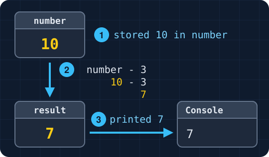

</div>
</div>

If we change `number` to `20`, the program prints `17`. Same thing if we do `15` for `12` or `9` for `6`, etc.

---

## Problem (You): Adding Two Variables

1. Make two variables that each hold a number.
2. Add them together and store the answer in `sum`.
3. Print `sum`.

---

## Solution (You): Adding Two Variables

```js
let first = 4;
let second = 7;
let sum = first + second;
console.log(sum);
```

<p class="caption">Console</p>

```text
11
```

---

## `let`: Changing a Value

<div class="side-by-side">
<div>

<!-- prettier-ignore -->
```js
let price = 14.5;   // 1
console.log(price); // 2

price = 16;         // 3
console.log(price); // 4
```

<p class="caption">Console</p>

```text
14.5
16
```

</div>
<div>

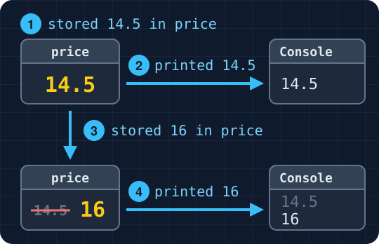

</div>
</div>

With `let`, we can give the variable a new value.

---

## `const`

If we want a variable that can't change, we can use `const`:

```js
const TAX_RATE = 0.0625;
```

Try to change the value of `TAX_RATE`. What happens? (Open up your console and see for yourselves.)

---

## Changing a `const`

```text
Uncaught TypeError: Assignment to constant variable.
```

- You can't change a `const`.
- Also, note the name `TAX_RATE`. This style (all caps with an underscore between words) makes it easy for other developers to know when they are interacting with a `const`.

---

## Brief Aside: `var`

```js
var price = 14.5;
```

`var` is the older way to make a variable, from before `let` and `const` arrived in 2015. Older examples online use it. We'll use `let` and `const`.

---

## Naming Variables: The Rules

<!-- prettier-ignore -->
```js
let price = 12;        // works
let _price = 12;       // works 
let 2price = 12;       // error: a name must start with a letter
let const = 12;        // error: JavaScript already uses const
```

---

## Naming Variables: Camel Case

A name can't have spaces. When a name has more than one word, we use **camel case**.

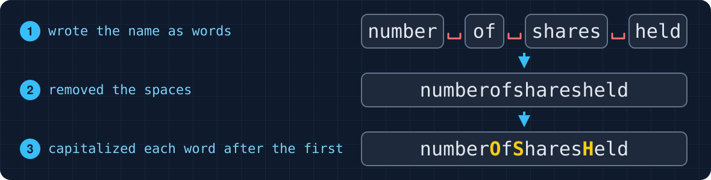

"current state" becomes `currentState`.

---

## Problem (Me): Naming a Variable

We need a variable for the number of students in this class. What should we name it?

---

## Solution (Me): Naming a Variable

<!-- prettier-ignore -->
```js
let x = 30;                  // works, but what is x?
let number of students = 30; // error: no spaces allowed
let numberofstudents = 30;   // works, but hard to read
let numberOfStudents = 30;   // works, but maybe too verbose
let studentCount = 30;       // camelCase and simple
```

A good name tells us what the value is, so we don't have to read the rest of the code to find out.

---

## Problem (Us): Minutes in a Day

Let's make a variable for the number of minutes in a day.

1. Pick a name for the variable.
2. Store `24 * 60` in it.
3. Print it.

---

## Solution (Us): Minutes in a Day

```js
let minutesPerDay = 24 * 60;
console.log(minutesPerDay);
```

<p class="caption">Console</p>

```text
1440
```

`minutes` alone would leave out the "per day" part.

> **Note:** The minutes in a day never change, so this should probably be a `const`, named in all capitals like `TAX_RATE`: `const MINUTES_PER_DAY = 24 * 60;`

---

## Problem (You): Buying Coffee

A customer bought 3 bags of coffee at \$14.50 a bag.

1. Make a variable for the price of one bag.
2. Make a variable for the number of bags they bought.
3. Make a variable for the total, then print it.

---

## Solution (You): Buying Coffee

```js
let bagPrice = 14.5;
let bagsBought = 3;
let total = bagPrice * bagsBought;
console.log(total);
```

<p class="caption">Console</p>

```text
43.5
```

Other names work too, like `pricePerBag` or `bagCount`. Each name should tell a reader what the variable holds.

---

## Data Types

<center>

| Type           | Examples                         |
| -------------- | -------------------------------- |
| number         | `25`, `80.5`, `-3`               |
| string (text)  | `"Hi"`, `'Hi'`                   |
| boolean        | `true`, `false`                  |
| undefined      | a variable we never gave a value |
| null           | "no value," on purpose           |
| array (a list) | `[1, 2, 3]`                      |
| object         | `{ model: "Golf", doors: 4 }`    |

</center>

We'll cover each of these in more detail as they become relevant.

---

# Displaying Output: Formatted Strings

---

## Asking the User with `prompt()`

```js
let name = prompt("What's your name?");
console.log(name);
```

<p class="caption">Console</p>

```text
Colan
```

1. `prompt()` opened a box with our question.
2. The user typed their name and clicked OK.
3. `prompt` gave back what they typed as a string, and we stored that result in `name`.

---

## Concatenation

<div class="side-by-side">
<div>

```js
let name = prompt("What's your name?");
console.log("Hello, " + name + "!");
```

<p class="caption">Console</p>

```text
Hello, Colan!
```

</div>
<div>


</div>
</div>

`+` glued the strings together. This is called **concatenation**. `+` doesn't add spaces, so the space after `Hello,` is inside the quotes.

---

## Template Literals

<div class="side-by-side">
<div>

```js
let name = prompt("What's your name?");
console.log(`Hello, ${name}!`);
```

<p class="caption">Console</p>

```text
Hello, Colan!
```

</div>
<div>

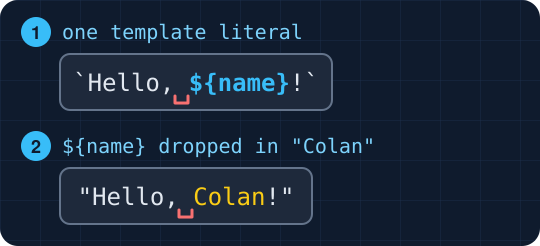

</div>
</div>

A string in backticks ("\`" above tab on the keyboard) is a **template literal**. Inside it, `${ }`drops in a value. We didn't need `+`, and the spaces stayed where we typed them.

---

## Where Is the Backtick?

The backtick `` ` `` is on the key to the left of `1`, under `Esc`. It shares that key with `~`.

---

## Problem (Me): Full Name

Say that we want to greet the user by their full name:

```text
Hello, Colan Biemer!
```

1. Ask for the user's first name, then their last name. (We could also ask for their name all at once, but let's do them individually.)
2. Print the greeting with concatenation.
3. Print it again with a template literal.

---

## Solution (Me): Full Name

```js
let firstName = prompt("What's your first name?");
let lastName = prompt("What's your last name?");

// concatenation
console.log("Hello, " + firstName + " " + lastName + "!");

// template literal
console.log(`Hello, ${firstName} ${lastName}!`);
```

<p class="caption">Console</p>

```text
Hello, Colan Biemer!
Hello, Colan Biemer!
```

Both lines printed the same thing. With concatenation, we needed `" "` for the space between the two names.

---

## Problem (Us): A Drink Order

We want a program that takes three inputs: the user's name, the size of the drink they want, and the name of the drink they want. Then, it should print out that result twice, once with concatenation and once with templates. For example, if I enter "Colan", "large", and "latte", then we should see in the console:

<p class="caption">Console</p>

```text
Colan ordered a large latte.
Colan ordered a large latte.
```

But, instead, of coding let's try it a different way...

---

## Problem (Us): A Drink Order (Continued)

Unscramble the program below (Two of the lines are wrong):

```js
console.log(`${name} ordered a ${size} ${drink}.`);

let size = prompt("What size?");

console.log(name + " ordered a " + size + drink + ".");

let name = prompt("What's your name?");

console.log("${name} ordered a ${size} ${drink}.");

let drink = prompt("What drink?");

console.log(name + " ordered a " + size + " " + drink + ".");
```

(Again, prompt for name, then size, and then, finally, for the name of the drink.)

---

## Solution (Us): A Drink Order

```js
let name = prompt("What's your name?");
let size = prompt("What size?");
let drink = prompt("What drink?");

// concatenation
console.log(name + " ordered a " + size + " " + drink + ".");
// template literal
console.log(`${name} ordered a ${size} ${drink}.`);
```

<p class="caption">Console</p>

```text
Colan ordered a large latte.
Colan ordered a large latte.
```

One wrong line left out the `" "`, so it printed `largelatte`. The other used `"` instead of backticks, so it printed `${name}` as plain text.

---

## Problem (You): Fill in the Blanks

Ask the user for words, then print a sentence like this one:

```text
The sleepy cat jumped over the moon.
```

1. Ask for an adjective, an animal, and a verb in the past tense.
2. Print the sentence with concatenation.
3. Print it again with a template literal.

> The [adjective] [animal] [verb] over the moon.

---

## Solution (You): Fill in the Blanks

```js
let adjective = prompt("Give me an adjective.");
let animal = prompt("Give me an animal.");
let verb = prompt("Give me a verb in the past tense.");

// concatenation
console.log("The " + adjective + " " + animal + " " + verb + " over the moon.");
// template literal
console.log(`The ${adjective} ${animal} ${verb} over the moon.`);
```

<p class="caption">Console</p>

```text
The sleepy cat jumped over the moon.
The sleepy cat jumped over the moon.
```

Concatenation needed a `" "` between each pair of words. Leaving one out glued the words together, like `sleepycat`.

---

# Operators

---

## `prompt` Gives Back a String

<!-- prettier-ignore -->
```js
let a = prompt("First number?");    // the user typed 4
let b = prompt("Second number?");   // the user typed 3
console.log(a + b);                 // "43" -> a string, not a number
console.log(Number(a) + Number(b)); // 7
```

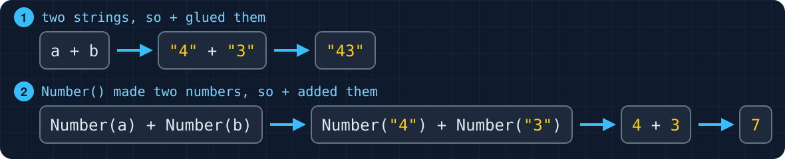

---

## `Number`, `parseInt`, `parseFloat`

| Text        | `Number()` | `parseInt()` | `parseFloat()` |
| ----------- | ---------- | ------------ | -------------- |
| `"10.75"`   | `10.75`    | `10`         | `10.75`        |
| `"12 bags"` | `NaN`      | `12`         | `12`           |
| `"abc"`     | `NaN`      | `NaN`        | `NaN`          |

- `Number` needs the whole string to be a number. `parseInt` keeps the whole number at the start and drops the rest. `parseFloat` does the same, but keeps decimals.
- `NaN` stands for "Not a Number" (e.g. `Number("asdf") -> NaN`).

---

## Cancel and Typos

```js
let bags = Number(prompt("How many bags?"));
```

| The user...                  | `prompt` gives | `Number()` gives |
| ---------------------------- | -------------- | ---------------- |
| types `3`                    | `"3"`          | `3`              |
| types `abc`                  | `"abc"`        | `NaN`            |
| clicks OK with nothing typed | `""`           | `0`              |
| clicks Cancel                | `null`         | `0`              |

---

## Arithmetic Operators

An **operator** takes values, called **operands**, and gives back a new value. In `3 + 4`, `+` is the operator.

| Operator | Meaning   | `10` and `4` give |
| -------- | --------- | ----------------- |
| `+`      | add       | `14`              |
| `-`      | subtract  | `6`               |
| `*`      | multiply  | `40`              |
| `/`      | divide    | `2.5`             |
| `%`      | remainder | `2`               |
| `**`     | power     | `10000`           |

---

## Remainder: `%`

We split 17 cookies evenly among 5 people. Everyone got 3, and some were left over.

<div class="side-by-side">
<div>

```js
console.log(17 % 5);
```

```text
2
```

</div>
<div>

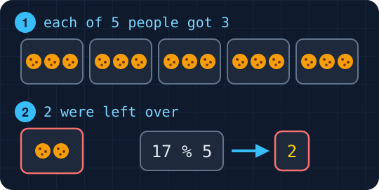

</div>
</div>

---

## Order of Operations

<div class="side-by-side">
<div>

```js
console.log(2 + 3 * 4);
console.log((2 + 3) * 4);
```

<p class="caption">Console</p>

```text
14
20
```

</div>
<div>

1. Parentheses `( )`
2. `**`
3. `*`, `/`, and `%`, left to right
4. `+` and `-`, left to right

</div>
</div>

---

## Strings and Numbers

<div class="side-by-side">
<div>

<!-- prettier-ignore -->
```js
console.log("5" + 3);     // 53
console.log("5" - 3);     // 2
console.log("5" * 3);     // 15
console.log(5 + 3 + "5"); // 85
```

</div>
<div>

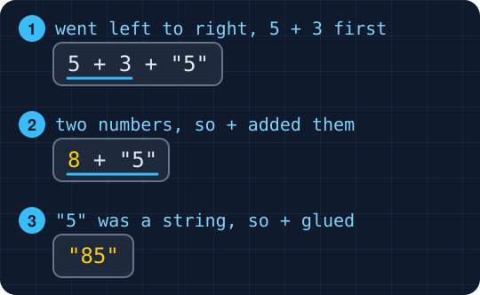

</div>
</div>

If either side of `+` is a string, `+` glues. `-`, `*`, and `/` only do math, so they turn `"5"` into `5`. JavaScript goes left to right: `5 + 3` is `8`, then `8 + "5"` is `"85"`.

---

## Implicit vs. Explicit Conversion

<!-- prettier-ignore -->
```js
console.log("5" + 3);         // 53, implicit
console.log("5" + String(3)); // 53, explicit
console.log("5" - 3);         // 2, implicit
console.log(Number("5") - 3); // 2, explicit
```

When JavaScript changes a type on its own, that's **implicit conversion**, and it makes code hard to read. By making the change in our code, the change is **explicit**.

---

## Assignment Shortcuts

<center>

| Shortcut | Same as     |
| -------- | ----------- |
| `x += 5` | `x = x + 5` |
| `x -= 5` | `x = x - 5` |
| `x *= 5` | `x = x * 5` |
| `x /= 5` | `x = x / 5` |
| `x++`    | `x = x + 1` |
| `x--`    | `x = x - 1` |

</center>

---

## Example: Counting Cups

<div class="side-by-side">
<div>

<!-- prettier-ignore -->
```js
let cupsSold = 0;      // 1
cupsSold++;            // 2
cupsSold++;            // 3
cupsSold += 10;        // 4
console.log(cupsSold); // 5
```

<p class="caption">Console</p>

```text
12
```

</div>
<div>

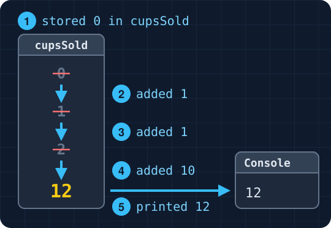

</div>
</div>

---

## Rounding Output

```js
let total = 3 * 14.5 * 1.0625; // with 6.25% tax
console.log(`Total: ${total}`);
console.log(`Total: $${total.toFixed(2)}`);
```

<p class="caption">Console</p>

```text
Total: 46.21875
Total: $46.22
```

1. We can put expressions, such as math, inside a `${ }`.
2. `toFixed(2)` rounds a number to two decimal places and returns a string.
3. Notice that we needed two dollar signs (`$`) inside a template string.

---

## Problem (Me): Bags of Coffee

Let's say that a bag of coffee costs \$14.50, and every order comes with one free bag. The user bought 3 bags, so the console should show:

```text
You get 4 bags for $43.50.
```

1. Ask the user how many bags they want.
2. Add the free bag.
3. Print the bags and the price.

---

## Solution (Me): Bags of Coffee

```js
const BAG_PRICE = 14.5;

let bags = Number(prompt("How many bags?"));
let totalBags = bags + 1;
let subtotal = bags * BAG_PRICE;

console.log(`You get ${totalBags} bags for $${subtotal.toFixed(2)}.`);
```

<p class="caption">Console</p>

```text
You get 4 bags for $43.50.
```

`Number()` turned the user's input from `prompt` into `3` before any math, so `+` added.

---

## Problem (Us): A Receipt

Let's add 6.25% sales tax and print a receipt. For 3 bags, it should look like this:

```text
Bags: 4
Subtotal: $43.50
Tax: $2.72
Total: $46.22
```

1. Store the tax rate in a `const`.
2. Work out the total with tax, then the tax by itself.
3. Print each line of the receipt with a template literal.

---

## Solution (Us): A Receipt

<div class="side-by-side">
<div>

```js
// the math from Bags of Coffee
const TAX_RATE = 0.0625;
let total = subtotal * (1 + TAX_RATE);
let tax = total - subtotal;

console.log(`Bags: ${totalBags}`);
console.log(`Subtotal: $${subtotal.toFixed(2)}`);
console.log(`Tax: $${tax.toFixed(2)}`);
console.log(`Total: $${total.toFixed(2)}`);
```

</div>
<div>

<p class="caption">Console</p>

```text
Bags: 4
Subtotal: $43.50
Tax: $2.72
Total: $46.22
```

</div>
</div>

Without the parentheses, `subtotal * 1 + TAX_RATE` would have been `43.5625`.

---

## Problem (You): Movie Marathon

The user watched three movies that were 120, 95, and 130 minutes long. The program should print:

```text
The marathon is 5 hours and 45 minutes.
```

```js
let hours = (total - minutes) / 60;
total += Number(prompt("Movie 2 length in minutes?"));
let hours = total - minutes / 60;
console.log(`The marathon is ${hours} hours and ${minutes} minutes.`);
let total = Number(prompt("Movie 1 length in minutes?"));
total += prompt("Movie 3 length in minutes?");
total += Number(prompt("Movie 3 length in minutes?"));
let minutes = total % 60;
```

Assemble the program from the lines above. Note, though, that two of the lines are wrong.

---

## Solution (You): Movie Marathon

```js
let total = Number(prompt("Movie 1 length in minutes?"));
total += Number(prompt("Movie 2 length in minutes?"));
total += Number(prompt("Movie 3 length in minutes?"));

let minutes = total % 60;
let hours = (total - minutes) / 60;
console.log(`The marathon is ${hours} hours and ${minutes} minutes.`);
```

<p class="caption">Console</p>

```text
The marathon is 5 hours and 45 minutes.
```

Without `Number()`, `+=` glued `"130"` onto the end, which gave `"215130"`. Without the parentheses, only `minutes` was divided by 60.

---

## Solution (You): Movie Marathon (Continued)

<!-- prettier-ignore -->
```js
let minutes = total % 60;           // 1
let hours = (total - minutes) / 60; // 2
```


---

# Functions

---

## Use a Function

We are about to cover how to write and use a function. You must do it in this format for the exercises this week:

```js
function functionName() {
  console.log("hi");
}
```

Which is to say, use `function` to declare functions, not arrow format.

> **IMPORTANT:** No credit will be given if this exercise does not use a function as otherwise it is exactly the example shown in class!

---

## Problem: The Same Math Three Times

```js
let total = 14.5 * 1.0625;
console.log(`Total: $${total.toFixed(2)}`);

total = 18 * 1.0625;
console.log(`Total: $${total.toFixed(2)}`);

total = 12.25 * 1.0625;
console.log(`Total: $${total.toFixed(2)}`);
```

We wrote the same two lines three times. If the tax rate changes, we have to fix it in three places (like the 40 red paragraphs in CSS).

---

## We Can Remove Duplicate Code With Functions

<div class="side-by-side">
<div>

```js
function printTotal(price) {
  let total = price * 1.0625;
  console.log(`Total: $${total.toFixed(2)}`);
}

printTotal(14.5);
printTotal(18);
printTotal(12.25);
```

</div>
<div>

<p class="caption">Console</p>

```text
Total: $15.41
Total: $19.13
Total: $13.02
```

</div>
</div>

A **function** is a grouping of code with a name.

---

## Writing a Function

```js
function sayHello() {
  console.log("Hello, welcome to Web Development!");
}

sayHello();
```

- A function starts with `function`, then a name, then `()`.
- The code it runs goes inside `{ }`.
- `sayHello();` **calls** the function, which runs the statements inside it.

---

## Problem: Nothing Prints

```html
<script>
  function sayHello() {
    console.log("Hello, welcome to Web Development!");
  }
</script>
```

If we open a page with the `<script>` above, we won't see anything print to the console.

---

## Solution: Nothing Prints

<div class="side-by-side">
<div>

```js
function sayHello() {
  console.log("Hello, welcome to Web Development!");
}

sayHello();
sayHello();
```

<p class="caption">Console</p>

```text
Hello, welcome to Web Development!
Hello, welcome to Web Development!
```

</div>
<div>

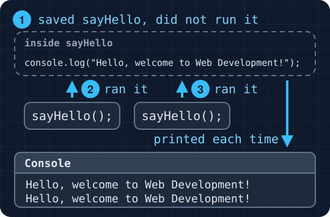

</div>
</div>

Writing a function only defines it. Nothing inside runs until we call it. Above, `sayHello` was called twice. So, it printed twice.

---

## Parameters and Arguments

<div class="side-by-side">
<div>

```js
function displaySum(num1, num2) {
  let total = num1 + num2;
  console.log(`Total: ${total}`);
}

displaySum(6, 20);
displaySum(-5, 17);
```

<p class="caption">Console</p>

```text
Total: 26
Total: 12
```

</div>
<div>


</div>
</div>

`num1` and `num2` are **parameters**: variables that get their values when we call the function. The values we pass in, like `6` and `20`, are **arguments**.

---

## Problem: Arguments in Order

```js
function describeDrink(size, drink) {
  console.log(`A ${size} ${drink}`);
}

describeDrink("large", "latte");
describeDrink("latte", "large");
describeDrink("large");
```

The first call printed `A large latte`. What did the other two print?

---

## Solution: Arguments in Order

<div class="side-by-side">
<div>

```js
function describeDrink(size, drink) {
  console.log(`A ${size} ${drink}`);
}

describeDrink("large", "latte");
describeDrink("latte", "large");
describeDrink("large");
```

</div>
<div>

<p class="caption">Console</p>

```text
A large latte
A latte large
A large undefined
```

</div>
</div>

- Arguments go into parameters in order. The first argument goes into `size`, and the second goes into `drink`.
- A parameter with no argument is `undefined`.

---

## `return`

<div class="side-by-side">
<div>

```js
function addTax(price) {
  return price * 1.0625;
}

let total = addTax(10);
console.log(total * 2);
```

</div>
<div>

<p class="caption">Console</p>

```text
21.25
```

</div>
</div>

**`return`** gives a value back to the code that called the function. A function without `return` gives back `undefined`.

1. `addTax(10)` set `price` to `10`.
2. `return` gave back `10.625`.
3. `total` stored `10.625`, so `total * 2` was `21.25`.

---

## `return` (Continued)

<div class="side-by-side">
<div>

```js
function addTax(price) {
  return price * 1.0625;
}

let total = addTax(10);
console.log(total * 2);
```

<p class="caption">Console</p>

```text
21.25
```

</div>
<div>


</div>
</div>

---

## `return` Ends the Function

```js
function addTax(price) {
  return price * 1.0625;
  console.log("This never runs");
}

console.log(addTax(10));
```

<p class="caption">Console</p>

```
10.625
```

Once a function reaches `return`, it stops. JavaScript skips anything after it. So, `"This never runs"` is never logged to the console.

---

## Copy by Value

<div class="side-by-side">
<div>

```js
function addFreeBag(count) {
  count = count + 1;
  console.log(count);
}

let bags = 3;
addFreeBag(bags);
console.log(bags);
```

<p class="caption">Console</p>

```text
4
3
```

</div>
<div>


</div>
</div>

When we called `addFreeBag(bags)`, `count` got a copy of the value in `bags`. The function changed the copy, so `bags` stayed `3`.

---

## Getting the New Value Out

<div class="side-by-side">
<div>

```js
function addFreeBag(count) {
  return count + 1;
}

let bags = 3;
bags = addFreeBag(bags);
console.log(bags);
```

<p class="caption">Console</p>

```text
4
```

</div>
<div>


</div>
</div>

To change `bags`, the function returned the new value, and we stored it back in `bags`.

---

## Problem (Me): Converting Temperatures

Let's say the user typed `212`. The console should show:

```text
212 Fahrenheit is 100 Celsius.
100 Celsius is 212 Fahrenheit.
```

1. Write `toCelsius(fahrenheit)`. It returns (Fahrenheit − 32) × 5 / 9.
2. Write `toFahrenheit(celsius)`. It returns Celsius × 9 / 5 + 32.
3. Ask the user for a temperature in Fahrenheit, convert it to Celsius and back, and print both lines.

---

## Solution (Me): The Functions

<!-- prettier-ignore -->
```js
function toCelsius(fahrenheit) {
  return (fahrenheit - 32) * 5 / 9;
}

function toFahrenheit(celsius) {
  return celsius * 9 / 5 + 32;
}
```

`toCelsius` needed parentheses, so the subtraction happened first. `toFahrenheit` did not, because `*` and `/` already go before `+`.

---

## Solution (Me): Converting Temperatures

<div class="side-by-side">
<div>

```js
let fahrenheit = Number(prompt("Temperature in Fahrenheit?"));
let celsius = toCelsius(fahrenheit);
let backAgain = toFahrenheit(celsius);

console.log(`${fahrenheit} Fahrenheit is ${celsius} Celsius.`);
console.log(`${celsius} Celsius is ${backAgain} Fahrenheit.`);
```

</div>
<div>

<p class="caption">Console</p>

```text
212 Fahrenheit is 100 Celsius.
100 Celsius is 212 Fahrenheit.
```

</div>
</div>

The value `toCelsius` returned went into `toFahrenheit` as its argument. We could also write `toFahrenheit(toCelsius(fahrenheit))`. The inner call runs first.

---

## Solution (Me): Converting Temperatures (Continued)

<center>


</center>

---

## Problem (Us): Cups of Coffee

Let's say one bag of coffee makes 30 cups. The user typed `3`, and the console showed:

```text
3 bags make 90 cups.
```

1. Store the cups per bag in a `const`.
2. Write a function `countCups` with one parameter, `bags`, that returns the number of cups.
3. Ask the user for the number of bags, then print the sentence.

---

## Solution (Us): Cups of Coffee

```js
const CUPS_PER_BAG = 30;

function countCups(bags) {
  return bags * CUPS_PER_BAG;
}

let bagsBought = Number(prompt("How many bags?"));
let cups = countCups(bagsBought);
console.log(`${bagsBought} bags make ${cups} cups.`);
```

<p class="caption">Console</p>

```text
3 bags make 90 cups.
```

`countCups(bagsBought)` gave `3` to `bags`. The function returned `90`, and we stored it in `cups`.

---

## Problem (You): Cost per Cup

Let's say a \$14.50 bag of coffee made 30 cups. The program should print:

```text
Each cup cost $0.48.
```

<!-- prettier-ignore -->
```js
let cost = costPerCup(cups, bagPrice);
}
let bagPrice = Number(prompt("How much was the bag?"));
console.log(`Each cup cost $${cost.toFixed(2)}.`);
  return bagPrice / cups;
function costPerCup(bagPrice, cups) {
  console.log(bagPrice / cups);
let cups = Number(prompt("How many cups did it make?"));
let cost = costPerCup(bagPrice, cups);
```

Assemble the program from the lines above. Two of the lines are wrong.

---

## Solution (You): Cost per Cup

```js
function costPerCup(bagPrice, cups) {
  return bagPrice / cups;
}

let bagPrice = Number(prompt("How much was the bag?"));
let cups = Number(prompt("How many cups did it make?"));
let cost = costPerCup(bagPrice, cups);
console.log(`Each cup cost $${cost.toFixed(2)}.`);
```

<p class="caption">Console</p>

```text
Each cup cost $0.48.
```

`costPerCup(cups, bagPrice)` put `30` into `bagPrice`, since arguments go in order. With `console.log` instead of `return`, `cost` was `undefined`.

---

# Linking Scripts

---

## `src` Attribute

<div class="side-by-side">
<div>

`index.html`

```html
<body>
  <h1>JavaScript Starter</h1>
  <script src="script.js"></script>
</body>
```

</div>
<div>

`script.js`

```js
console.log("Hello, World!");
```

</div>
</div>

Our programs got longer, so we moved the code into its own file. `src` tells the browser which file to run.

Starter files on GitHub: [index.html](https://github.com/bi3mer/lectures/blob/main/cs213/lectures/08-js-intro/examples/script-starter/index.html) and [script.js](https://github.com/bi3mer/lectures/blob/main/cs213/lectures/08-js-intro/examples/script-starter/script.js).

---

## Linking a Script vs. a Stylesheet

```html
<head>
  <link rel="stylesheet" href="style.css" />
</head>
<body>
  <h1>JavaScript Starter</h1>
  <script src="script.js"></script>
</body>
```

- A stylesheet uses `<link>` and `href`, and it goes in the `<head>`.
- A script uses `<script>` and `src`, and it goes at the end of the `<body>`.
- `<script>` always needs a closing `</script>`, even when nothing is inside it.

---

# Conclusion

---

## Summary

- `let` variables can change, and `const` variables can't.
- `prompt()` gives back a string, and `Number()` turns it into a number.
- `+` and template literals join strings.
- `%` gives the remainder, and math inside parentheses happens first.
- `toFixed(2)` rounds a number to two decimal places.
- A function runs only when we call it.
- Arguments go into parameters in order, as copies.
- `return` gives a value back to the code that called the function.
- `<script src="script.js">` links a JavaScript file to the page.

---

## Next Time

- Fall break and `if` statements
