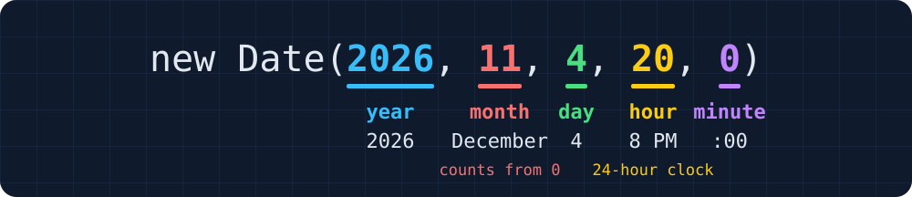

<style>
.caption { font-size: 20px; color: var(--secondary); }
</style>

# Numbers, Math, Dates, and Strings

Colan Biemer

---

## Decimals Aren't Exact

<!-- prettier-ignore -->
```js
console.log(0.1 + 0.2);         // 0.30000000000000004
console.log(0.1 + 0.2 === 0.3); // false
console.log(127.5 * 0.12);      // 15.299999999999999
```

JavaScript [stores every number in binary](#53). Most decimals, like 0.1, have no exact binary form, just as 1/3 has no exact decimal form (0.333...).

How can we tell what kind of number we have?

---

## Checking a Number

<!-- prettier-ignore -->
```js
let count = Number("two");
console.log(count === NaN);         // false
console.log(Number.isNaN(count));   // true

console.log(Number.isInteger(3));   // true
console.log(Number.isInteger(2.5)); // false
console.log(Number.isInteger(NaN)); // false
```

- [`NaN`](../08-js-intro/lecture.html#69) is the only value that isn't equal to itself, so `=== NaN` is always `false`. `Number.isNaN` checks for it.
- `Number.isInteger` is `true` only for whole numbers, so it rules out `NaN` too.

How do we show a number in a form people can read?

---

## `toLocaleString`

<!-- prettier-ignore -->
```js
let total = 1234.5;
let money = { style: "currency", currency: "USD" };

console.log(total.toLocaleString());               // 1,234.5
console.log(total.toLocaleString("en-US", money)); // $1,234.50
```

With no arguments, it follows the browser's language, so a German browser shows `1.234,5`. `"en-US"` and the options in `money` give dollars and cents. Like [`toFixed(2)`](../08-js-intro/lecture.html#78), it returns a string.

To change the number itself, JavaScript has a `Math` object.

---

## The `Math` Object

<!-- prettier-ignore -->
```js
console.log(Math.PI);         // 3.141592653589793
console.log(Math.sqrt(16));   // 4
console.log(Math.abs(-7.5));  // 7.5
console.log(Math.pow(2, 10)); // 1024
```

**`Math`** is an object built into JavaScript. Its properties are constants, like `Math.PI`, and functions, like `Math.sqrt`. `Math.pow(2, 10)` is the same as [`2 ** 10`](../08-js-intro/lecture.html#71).

How do we round?

---

## Rounding: `round`, `floor`, and `ceil`

<center>

| `x`    | `Math.round(x)` | `Math.floor(x)` | `Math.ceil(x)` |
| ------ | --------------- | --------------- | -------------- |
| `4.2`  | `4`             | `4`             | `5`            |
| `4.5`  | `5`             | `4`             | `5`            |
| `4.8`  | `5`             | `4`             | `5`            |
| `-4.2` | `-4`            | `-5`            | `-4`           |

</center>

`round` goes to the nearest whole number. `floor` always goes down and `ceil` always goes up, so `Math.floor(-4.2)` is `-5`.

These give whole numbers. How do we round to cents?

---

## Rounding to Decimal Places

<!-- prettier-ignore -->
```js
console.log(Math.round(Math.PI));               // 3
console.log(Math.round(Math.PI * 10) / 10);     // 3.1
console.log(Math.round(Math.PI * 100) / 100);   // 3.14
console.log(Math.round(Math.PI * 1000) / 1000); // 3.142
```

To keep 1, 2, or 3 decimal places, multiply by 10, 100, or 1000, round, and divide by the same number. Keeping two places rounds dollars to cents.

How do we find the smaller or larger of two numbers?

---

## `Math.min` and `Math.max`

<!-- prettier-ignore -->
```js
console.log(Math.min(4, 9, 2)); // 2
console.log(Math.max(4, 9, 2)); // 9

let count = 20;
count = Math.min(count, 8);
console.log(count); // 8
```

Both take any number of arguments. `Math.min(count, 8)` gives 8 whenever `count` is larger, so it keeps `count` at 8 or less. `Math.max(count, 1)` keeps it at 1 or more.

What if the numbers are in an array?

---

## Spreading an Array: `...`

<!-- prettier-ignore -->
```js
let scores = [35, 52.5, 89.5];
console.log(Math.max(scores));    // NaN
console.log(Math.max(...scores)); // 89.5
console.log(Math.min(...scores)); // 35
```

`Math.max` takes numbers, not an array. `...` **spreads** an array, passing each item as its own argument, so `Math.max(...scores)` is `Math.max(35, 52.5, 89.5)`.

How do we get a number we can't predict?

---

## `Math.random`

<!-- prettier-ignore -->
```js
console.log(Math.random()); // 0.7281964018253458
console.log(Math.random()); // 0.04293581720519471
console.log(Math.random()); // 0.5139022791366285
```

Each call gives a new number from 0 up to, but not including, 1, so your numbers will differ. It takes no arguments.

How do we turn this into a dice roll?

---

## Random Whole Numbers

```js
let roll = Math.floor(Math.random() * 6) + 1;
```

<center>

| Step              | Smallest | Largest  |
| ----------------- | -------- | -------- |
| `Math.random()`   | `0`      | `0.999…` |
| `* 6`             | `0`      | `5.999…` |
| `Math.floor(...)` | `0`      | `5`      |
| `+ 1`             | `1`      | `6`      |

</center>

This rolls a die. Without the `+ 1`, it gives 0 to 5, which is a random [index](../11-js-arrays/lecture.html#5) into an array of 6 items.

---

## Setting Up

Make these two files in a new WebStorm folder:

```html
<!doctype html>
<html lang="en">
  <head>
    <meta charset="utf-8" />
    <title>Practice</title>
  </head>
  <body>
    <script src="practice.js"></script>
  </body>
</html>
```

`practice.js` starts empty. Open the page and its console, and clear `practice.js` before each problem. From here on, any variable we never reassign is a [`const`](../08-js-intro/lecture.html#43), even without an all-caps name like `TAX_RATE`.

---

## Problem: Round to Cents (us)

```js
const amount = 40.375;
// Round amount to the nearest cent, then print it.
```

<p class="caption">Console</p>

```text
40.38
```

- Why not use `toFixed(2)`, which gives a string?

---

## Solution: Round to Cents (us)

```js
const amount = 40.375;
const rounded = Math.round(amount * 100) / 100;
console.log(rounded);
```

Multiplying by 100 moves the cents in front of the decimal point.

---

## Problem: Keep in Range (you)

```text
set count to 20.5
round count down to a whole number
keep count at 1 or more
keep count at 8 or less
print count
```

<p class="caption">Console</p>

```text
8
```

---

## Solution: Keep in Range (you)

```js
let count = 20.5;
count = Math.floor(count);
count = Math.max(count, 1);
count = Math.min(count, 8);
console.log(count);
```

`Math.max` keeps the low side, and `Math.min` keeps the high side.

Dates are numbers too, underneath. How do we get one?

---

## `new Date()`

```js
let now = new Date();
console.log(now);
```

<p class="caption">Console</p>

```text
Tue Oct 27 2026 09:30:00 GMT-0400 (Eastern Daylight Time)
```

A **`Date`** is an object that holds one moment in time. `new` makes a new object, so `new Date()` makes a Date for the moment that line ran.

How do we make a date other than now?

---

## A Date of Our Choosing

```js
let date = new Date(2026, 11, 4, 20, 0);
console.log(date);
```

<p class="caption">Console</p>

```text
Fri Dec 04 2026 20:00:00 GMT-0500 (Eastern Standard Time)
```



Months count from 0, so `new Date(2026, 12, 4)` is January 4, 2027.

---

## Why Do Months Start at 0?

JavaScript 1.0 copied Java's `java.util.Date`, "bugs and all," so the two languages could work together. That brought along months numbered 0 to 11 and time counted from 1970.

Java's year 2000 problem came too: `getYear()` gives `126` for 2026, the years since 1900. Use `getFullYear()`.

Source: Allen Wirfs-Brock and Brendan Eich, [JavaScript: The First 20 Years](https://dl.acm.org/doi/10.1145/3386327) (2020).

---

## Reading the Parts

<!-- prettier-ignore -->
```js
let date = new Date(2026, 11, 4, 20, 0);
console.log(date.getFullYear()); // 2026
console.log(date.getMonth());    // 11
console.log(date.getDate());     // 4
console.log(date.getDay());      // 5
console.log(date.getHours());    // 20
console.log(date.getMinutes());  // 0
```

`getMonth` counts from 0, as it did going in. `getDate` is the day of the month, and `getDay` is the day of the week, from 0 (Sunday) to 6 (Saturday).

How do we compare two dates?

---

## Milliseconds Since 1970

<!-- prettier-ignore -->
```js
let date = new Date(2026, 11, 4, 20, 0);
console.log(date.getTime()); // 1796432400000
console.log(Date.now());     // 1793107800000
```

Inside, a Date is one number: the milliseconds since midnight on January 1, 1970, in UTC, the world's reference time. `Date.now()` gives that number for right now.

What happens if we subtract two dates?

---

## Subtracting Dates

<!-- prettier-ignore -->
```js
let now = new Date(2026, 9, 27, 9, 30); // Tuesday, 9:30 AM
let due = new Date(2026, 9, 30, 17, 0); // Friday, 5:00 PM

console.log(due - now); // 286200000
console.log(due < now); // false
```

`-` and `<` turn each date into its milliseconds, so `due - now` is the time between them. `+` [glues strings](../08-js-intro/lecture.html#74) instead, so `due + now` is one long string.

How do we turn milliseconds into something readable?

---

## From Milliseconds to Days, Hours, and Minutes

<!-- prettier-ignore -->
```js
let ms = 286200000; // due - now

let days = Math.floor(ms / (1000 * 60 * 60 * 24));  // 3
let hours = Math.floor(ms / (1000 * 60 * 60)) % 24; // 7
let minutes = Math.floor(ms / (1000 * 60)) % 60;    // 30

console.log(`${days}d ${hours}h ${minutes}m`); // 3d 7h 30m
```

`ms / (1000 * 60 * 60)` is 79.5 hours. `floor` keeps the 79 whole hours, and [`% 24`](../08-js-intro/lecture.html#72) leaves the 7 that don't fill a day.

---

## `toLocaleDateString` and `toLocaleTimeString`

<style scoped>
pre { font-size: 0.75em; }
</style>

<!-- prettier-ignore -->
```js
let date = new Date(2026, 11, 4, 20, 0);
let short = { hour: "numeric", minute: "2-digit" };

console.log(date.toLocaleDateString());               // 12/4/2026
console.log(date.toLocaleTimeString());               // 8:00:00 PM
console.log(date.toLocaleTimeString("en-US", short)); // 8:00 PM
```

Like [`toLocaleString`](#4), they follow the browser's language, so a British browser shows the date as `04/12/2026`. `"en-US"` and an options object pick the format.

How do we get the names of days and months?

---

## Day and Month Names

<style scoped>
pre { font-size: 0.75em; }
</style>

<!-- prettier-ignore -->
```js
let date = new Date(2026, 11, 4, 20, 0);
let month = { month: "long" };
let weekday = { weekday: "long" };
let full = { weekday: "long", month: "long", day: "numeric" };

console.log(date.toLocaleDateString("en-US", month));   // December
console.log(date.toLocaleDateString("en-US", weekday)); // Friday
console.log(date.toLocaleDateString("en-US", full));    // Friday, December 4
```

`"long"` spells out a name, and `"short"` gives `Dec` or `Fri`. The browser knows the names in other languages too, so `"es-ES"` gives `viernes, 4 de diciembre`.

How do we move a date forward?

---

## Changing a Date

```js
let due = new Date(2026, 9, 30, 17, 0); // Friday, October 30
due.setDate(due.getDate() + 3);
console.log(due);
```

<p class="caption">Console</p>

```text
Mon Nov 02 2026 17:00:00 GMT-0500 (Eastern Standard Time)
```

Each `get` method we've seen, except `getDay`, has a `set` partner. October (`9`, since [months start at 0](#19)) has 31 days, so day 33 rolls over to November 2. `setDate` changes the Date itself.

What if the page should keep updating, like a clock?

---

## `setInterval`

```js
function showTime() {
  console.log(new Date().toLocaleTimeString());
}

setInterval(showTime, 1000);
```

<p class="caption">Console</p>

```text
8:00:00 PM
8:00:01 PM
8:00:02 PM
```

`setInterval` takes [a function as a value](../11-js-arrays/lecture.html#32), with no `()`, and calls it every 1000 milliseconds until the page closes.

---

## Problem: Days Until (us)

```js
const start = new Date(2026, 11, 4);
const end = new Date(2026, 11, 25);
// Print the whole days from start to end.
```

<p class="caption">Console</p>

```text
21
```

- How many milliseconds are in a day?

---

## Solution: Days Until (us)

```js
const start = new Date(2026, 11, 4);
const end = new Date(2026, 11, 25);
const ms = end - start;
console.log(Math.floor(ms / (1000 * 60 * 60 * 24)));
```

Subtracting dates gives milliseconds.

---

## Problem: Full Date (you)

```text
set date to December 4, 2026, at 8 PM
set day to its weekday, month, and day
set time to its time, like 8:00 PM
print "day at time"
```

<p class="caption">Console</p>

```text
Friday, December 4 at 8:00 PM
```

---

## Solution: Full Date (you)

```js
const date = new Date(2026, 11, 4, 20, 0);
const full = { weekday: "long", month: "long", day: "numeric" };
const short = { hour: "numeric", minute: "2-digit" };
const day = date.toLocaleDateString("en-US", full);
const time = date.toLocaleTimeString("en-US", short);
console.log(`${day} at ${time}`);
```

Each method takes `"en-US"` and an options object.

Strings have methods too, with one catch.

---

## Strings Are Immutable

<!-- prettier-ignore -->
```js
let name = "lovelace";
name.toUpperCase();
console.log(name); // lovelace

name = name.toUpperCase();
console.log(name); // LOVELACE
```

A string is **immutable**, which means no method can change it. [`toUpperCase`](../10-js-objects-loops/lecture.html#11) returns a new, uppercase string. `.toLowerCase()` works the same way.

Which methods can we call on what?

---

## Methods Depend on the Type

<!-- prettier-ignore -->
```js
let name = "LOVELACE";
let count = 2;
let paid = true;

console.log(name.toLowerCase());         // lovelace
console.log(count.toFixed(2));           // 2.00
console.log(String(paid).toUpperCase()); // TRUE
console.log(count.toLowerCase());        // TypeError
```

Each type has its own methods: `toFixed` works on numbers, and `toLowerCase` works on strings. Calling a method the type lacks is a `TypeError`, like `count.toLowerCase is not a function`, so [convert with `String()`](../08-js-intro/lecture.html#75) first.

---

## `trim`

<!-- prettier-ignore -->
```js
let typed = "  ada  lovelace ";
console.log(`[${typed}]`);        // [  ada  lovelace ]
console.log(`[${typed.trim()}]`); // [ada  lovelace]
```

`trim` removes the spaces at both ends, but not the ones in the middle. People type stray spaces into boxes, so trim what a box gives us.

Can we call two methods in a row?

---

## Chaining Methods

<!-- prettier-ignore -->
```js
let typed = "  lovelace ";
let name = typed.trim().toUpperCase();
console.log(name); // LOVELACE
```

Calling a method on the result of another method is **chaining**. It runs left to right: `trim` gives `"lovelace"`, and `toUpperCase` runs on that.

How do we search inside a string?

---

## `includes`, `startsWith`, and `endsWith`

<!-- prettier-ignore -->
```js
let email = "ada@school.edu";
console.log(email.includes("@"));      // true
console.log(email.startsWith("ada"));  // true
console.log(email.endsWith(".edu"));   // true
console.log(email.includes("School")); // false
```

Each one returns a boolean. [Like an array's `includes`](../11-js-arrays/lecture.html#21), they look for an exact match, so `"School"` doesn't match `"school"`.

How do we cut out a piece?

---

## `slice`

<!-- prettier-ignore -->
```js
let code = "SC-0042";
console.log(code.slice(0, 2)); // SC
console.log(code.slice(3));    // 0042

let word = "aDA";
word = word[0].toUpperCase() + word.slice(1).toLowerCase();
console.log(word); // Ada
```

`slice(start, end)`<sup>1</sup> copies from `start` up to, but not including, `end`. With no `end`, it copies to the end.

<div class="footnote">1. This is similar to <a href="../../../cs230/06-strings-and-format-strings.html#74">slicing in Python</a>: <code>code.slice(0, 2)</code> is <code>code[0:2]</code>.</div>

---

## Negative Indexes in `slice`

```text
  S   C   -   0   0   4   2
  0   1   2   3   4   5   6
 -7  -6  -5  -4  -3  -2  -1
```

<!-- prettier-ignore -->
```js
let code = "SC-0042";
console.log(code.slice(-4));     // 0042
console.log(code.slice(-4, -2)); // 00
console.log(code.slice(1, -1));  // C-004
console.log(code[-1]);           // undefined
```

A negative index counts back from the end, so `-1` is the last character and `slice(-4)` is `slice(3)`. Square brackets don't count back, so `code[-1]` is `undefined`, [the same as with arrays](../11-js-arrays/lecture.html#7).

---

## `substr`

<!-- prettier-ignore -->
```js
let code = "SC-0042";
console.log(code.substr(5, 2)); // 42
console.log(code.slice(5, 7));  // 42
console.log(code.substr(3));    // 0042
console.log(code.substr(-4));   // 0042
```

`substr(start, length)` copies `length` characters from `start`, so its second argument is a count, where `slice`'s is an end index. [MDN marks `substr` deprecated](https://developer.mozilla.org/en-US/docs/Web/JavaScript/Reference/Global_Objects/String/substr): expect it in older code, and write `slice`.

How do we break a string into words?

---

## `split`

<!-- prettier-ignore -->
```js
let parts = "Ada King Lovelace".split(" ");
console.log(parts);                   // ["Ada", "King", "Lovelace"]
console.log(parts[parts.length - 1]); // Lovelace
console.log("20:00".split(":"));      // ["20", "00"]
```

`split` cuts a string at each match of its argument, and returns an array of the pieces. It's the reverse of [`join`](../11-js-arrays/lecture.html#23). The pieces are strings, even `"20"`.

How do we swap one piece of text for another?

---

## `replaceAll`

<!-- prettier-ignore -->
```js
let typed = "1,250";
console.log(Number(typed));                     // NaN
console.log(Number(typed.replaceAll(",", ""))); // 1250
console.log("1,250,000".replace(",", ""));      // 1250,000
```

`replaceAll` swaps every match of its first argument for its second, and `""` deletes them. `replace` swaps only the first match.

How do we make every number the same width?

---

## `padStart`

<!-- prettier-ignore -->
```js
let minutes = 5;
console.log(String(minutes).padStart(2, "0")); // 05
console.log("4242".padStart(8, "*"));          // ****4242
console.log(String(45).padStart(2, "0"));      // 45
console.log(minutes.padStart(2, "0"));         // TypeError
```

`padStart(length, pad)` adds `pad` to the front of a string until it is `length` characters long. With no `pad`, it adds spaces. A string that is already long enough comes back unchanged. [A number has no `padStart`](#33), so it needs [`String()`](../08-js-intro/lecture.html#75) first.

There is also a [`padEnd`](cheatsheet.html#padding-and-repeating-padstart-padend-and-repeat), which adds to the end.

How do we repeat a string?

---

## `repeat`

<!-- prettier-ignore -->
```js
console.log("█".repeat(6));                 // ██████
console.log("★".repeat(4) + "☆".repeat(1)); // ★★★★☆
```

`repeat(n)` glues `n` copies of a string together, so `"█".repeat(6)` draws a six-block bar without a loop.

---

## Problem: Course Number (us)

```js
const code = "  CS213 ";
// Trim code. If it starts with CS, print the number after CS.
```

<p class="caption">Console</p>

```text
213
```

- Which method gets the part after `CS`?

---

## Solution: Course Number (us)

```js
const code = "  CS213 ";
const trimmed = code.trim();

if (trimmed.startsWith("CS")) {
  console.log(Number(trimmed.slice(2)));
}
```

`slice(2)` starts after the two letters.

---

## Problem: Last Name First (you)

```text
set name to "ada lovelace"
set parts to name, split at each space
set first to the first part
set last to the second part, all uppercase
print "last, first"
```

<p class="caption">Console</p>

```text
LOVELACE, ada
```

---

## Solution: Last Name First (you)

```js
const name = "ada lovelace";
const parts = name.split(" ");
const first = parts[0];
const last = parts[1].toUpperCase();
console.log(`${last}, ${first}`);
```

`split` gives an array, so each part has an index.

---

# Conclusion

---

## Build It Yourself

The [ticket page](../../demos/12-tickets/instruction.html) is a full page built from today's methods, with step-by-step instructions.

---

## Summary

- Decimals aren't exact, so round money to cents: `Math.round(x * 100) / 100`.
- `=== NaN` is always `false`. Check with `Number.isNaN` or `Number.isInteger`.
- `toLocaleString` adds commas, and its options can show dollars and cents.
- `round`, `floor`, and `ceil` make whole numbers. `min` and `max` set limits.
- `...` spreads an array into separate arguments: `Math.max(...scores)`.
- `Math.floor(Math.random() * n) + 1` is a random whole number from 1 to `n`.
- Months and weekdays count from 0, so `new Date(2026, 11, 4)` is December 4.
- Subtracting dates gives milliseconds. Split them up with `floor` and `%`.
- String methods return new strings and can chain: `.trim().toUpperCase()`.
- `slice` copies part of a string, `split` cuts it into an array, and `padStart` pads it.

---

## Next Up: Forms and the DOM

[Forms and the DOM](../13-js-forms-dom/lecture.html)

---

# Questions?

---

## Appendix: Why 0.1 Never Ends in Binary

Binary places are halves, quarters, eighths, and so on.

<center>

| Binary                | Decimal               |
| --------------------- | --------------------- |
| `0.00011`             | `0.09375`             |
| `0.000110011`         | `0.099609375`         |
| `0.0001100110011`     | `0.0999755859375`     |
| `0.00011001100110011` | `0.09999847412109375` |
| ...                   | never 0.1             |

</center>

Each `0011` gets closer to 0.1 but never reaches it, since 0.1 is not a whole number of 16ths, 32nds, or any other power of 2.

---

## Appendix: 0.1 + 0.2 in Binary

```text
  0.1   0.0001100110011001100110011001100110011001100110011001101
+ 0.2   0.0011001100110011001100110011001100110011001100110011010
= sum   0.0100110011001100110011001100110011001100110011001100111
stored  0.0100110011001100110011001100110011001100110011001101000
  0.3   0.0100110011001100110011001100110011001100110011001100110
                                                             ^^^
```

In binary, 0.1 and 0.2 repeat `0011` forever, like 1/3 = 0.333... in decimal, so JavaScript rounds each one off. Their sum is one digit too long, so it rounds again and misses 0.3 in the last three places.

---

## Appendix: Why `0.1` Prints as `0.1`

<center>

| Written     | Stored                      | Printed               |
| ----------- | --------------------------- | --------------------- |
| `0.1`       | `0.10000000000000000555...` | `0.1`                 |
| `0.3`       | `0.29999999999999998889...` | `0.3`                 |
| `0.1 + 0.2` | `0.30000000000000004440...` | `0.30000000000000004` |

</center>

JavaScript and Python print the shortest decimal that leads back to the stored value, so `0.1` hides its extra digits. `0.1 + 0.2` is stored as a different number than `0.3`, so it prints with more digits.
