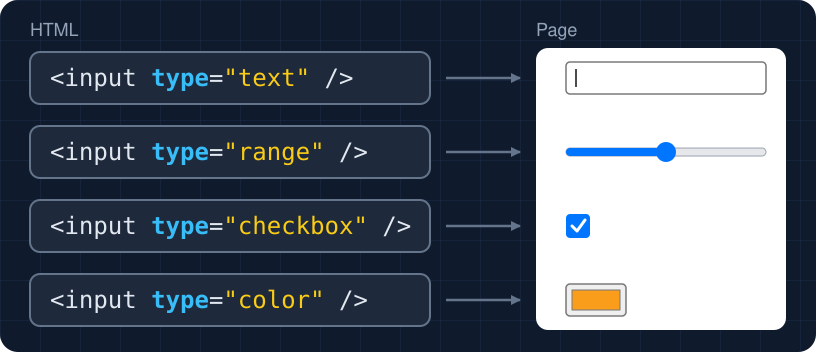

<style>
/* Code on the left, the page it makes (or a diagram) on the right. */
.side-by-side { display: grid; grid-template-columns: 560px minmax(0, 1fr); gap: 24px; align-items: start; }
.side-by-side p { margin: 0; }
.caption { font-size: 20px; color: var(--secondary); }
/* The theme draws a .demo as a white panel whose 12px edge is a shadow, so the margins keep
   that edge clear of the caption above and the slide's sides. The slide's dark color-scheme
   would reach the live controls inside, so a .demo goes back to the browser's light one. */
.demo { margin: 20px 12px 28px; color-scheme: light; }
.demo p { margin: 0; }
.demo div + div { margin-top: 8px; }
.demo input, .demo select, .demo button { font: inherit; }
/* Answer choices for the Predict slides, all on one line. */
.choices { display: flex; gap: 48px; }
</style>

# Forms and the DOM

Colan Biemer

---

## Outline

- HTML Forms
- The DOM

---

# HTML Forms

---

## Forms

A **form** collects what someone types or picks. Every login, search box, and checkout is one.

<div class="side-by-side">
<div>

```html
<form>
  <label for="name">Name</label>
  <input id="name" />
  <button>Send</button>
</form>
```

</div>
<div>
<p class="caption">Page</p>
<div class="demo"><label for="demo-name">Name</label> <input id="demo-name" size="12" /> <button type="button">Send</button></div>
</div>
</div>

Every box here is an `<input>`. How do we get other controls?

---

## The `type` Attribute



An `<input>`'s `type` attribute picks what kind of control it is.

---

## Input Types

<style scoped>
table { font-size: 0.7em; }
/* Like a .demo, the live controls use the browser's light color-scheme. */
table input { color-scheme: light; }
</style>

<center>

| `type`     | Shows                          | Try it                                                          |
| ---------- | ------------------------------ | --------------------------------------------------------------- |
| `text`     | a one-line box, the default    | <input type="text" size="12" aria-label="text" />               |
| `number`   | a box for numbers, with arrows | <input type="number" value="3" aria-label="number" />           |
| `password` | a box that hides what's typed  | <input type="password" value="hunter2" aria-label="password" /> |
| `email`    | a box for an email address     | <input type="email" size="12" aria-label="email" />             |
| `checkbox` | a box to tick                  | <input type="checkbox" aria-label="checkbox" />                 |
| `range`    | a slider                       | <input type="range" aria-label="range" />                       |
| `color`    | a color picker                 | <input type="color" value="#f99d1b" aria-label="color" />       |
| `date`     | a date picker                  | <input type="date" aria-label="date" />                         |

</center>

For many lines of text, `<textarea>` makes a bigger box. Unlike `<input>`, it has a closing tag.

---

## `<label>`


A label's `for` matches its control's `id`. Clicking the label clicks the control, which makes a small checkbox easier to hit. A screen reader reads the label as the control's name, so every control except a button needs one.

What else can we set on a control?

---

## Input Attributes

<!-- prettier-ignore -->
```html
<input id="size" type="range" min="16" max="48" value="32" />
<input id="name" name="name" placeholder="your name" />
```

- `value` is the starting value. `min`, `max`, and `step` limit a slider or a number box.
- `name` labels the control's value when the form is [submitted](#22).
- `placeholder` is a gray hint. It disappears when we type, and it's never the value.

---

## Boolean Attributes

<!-- prettier-ignore -->
```html
<input id="subscribe" type="checkbox" checked />
<input id="email" type="email" disabled />
```

<div class="demo"><input type="checkbox" checked aria-label="subscribe" /> <input type="email" size="12" disabled aria-label="email" /></div>

A **boolean attribute** needs no value: having it means yes, and leaving it off means no. Even `checked="false"` starts the box ticked.

---

## Setting Up

Make these two files in a new WebStorm folder:

```html
<!doctype html>
<html lang="en">
  <head>
    <meta charset="utf-8" />
    <title>Practice</title>
  </head>
  <body>
    <!-- each problem's HTML goes here -->
    <script src="practice.js"></script>
  </body>
</html>
```

`practice.js` starts empty. Before each problem, clear it and paste in the new HTML.

---

## Problem: Sign Up (you)

Paste this in `<body>`, then tell me what each one does.

```html
<div>
  <label for="name">Name</label>
  <input id="name" name="name" placeholder="Ada" />
</div>
<div>
  <input id="subscribe" name="subscribe" type="checkbox" />
  <label for="subscribe">Subscribe</label>
</div>
```

- Click each label. What happens?
- Why does each control have both an `id` and a `name`?

---

## Solution: Sign Up (you)

Clicking **Name** puts the cursor in the box, and clicking **Subscribe** ticks the box. The `id` connects the control to its label and our code, and the `name` labels its value when the form is submitted.

---

## Problem: Find the Bug (you)

**There is a bug** in this HTML. Find it.

```html
<div>
  <label for="email">Email</label>
  <input id="email" name="email" type="email" />
</div>
<div>
  <input id="updates" name="updates" type="checkbox" />
  <label for="email">Send me updates</label>
</div>
```

---

## Solution: Find the Bug (you)

The second label's `for` should be `updates`, the checkbox's `id`. As written, clicking **Send me updates** moves the cursor to the email box.

A text box takes anything. What if only a few answers are allowed?

---

## `<select>` and `<option>`

```html
<label for="major">Major</label>
<select id="major">
  <option value="math">Math</option>
  <option value="history">History</option>
  <option value="art" selected>Studio Art</option>
</select>
```

<div class="demo"><label for="demo-major">Major</label> <select id="demo-major"><option value="math">Math</option><option value="history">History</option><option value="art" selected>Studio Art</option></select></div>

A `<select>` is a drop-down list. Each `<option>` shows its text, but code sees its `value`. `selected` picks the starting option. Without it, the first one starts picked.

A drop-down hides its choices. How do we show them all?

---

## Radio Buttons

<!-- prettier-ignore -->
```html
<input type="radio" id="light" name="theme" value="light" checked />
<label for="light">Light</label>
<input type="radio" id="dark" name="theme" value="dark" />
<label for="dark">Dark</label>
```

<div class="demo"><input type="radio" id="demo-light" name="demo-theme" value="light" checked /> <label for="demo-light">Light</label> <input type="radio" id="demo-dark" name="demo-theme" value="dark" /> <label for="demo-dark">Dark</label></div>

Radio buttons that share a `name` are one group, so picking one unpicks the others. Each one still needs its own `id`, for its label.

How do we show that controls belong together?

---

## `<fieldset>` and `<legend>`

<style scoped>
pre { font-size: 0.75em; }
</style>

<div class="side-by-side">
<div>

```html
<fieldset>
  <legend>Sound</legend>
  <div>
    <label for="bass">Bass</label>
    <input id="bass" type="range" />
  </div>
  <div>
    <label for="treble">Treble</label>
    <input id="treble" type="range" />
  </div>
</fieldset>
```

</div>
<div>
<p class="caption">Page</p>
<div class="demo"><fieldset><legend>Sound</legend><div><label for="demo-bass">Bass</label> <input id="demo-bass" type="range" /></div><div><label for="demo-treble">Treble</label> <input id="demo-treble" type="range" /></div></fieldset></div>
</div>
</div>

A `<fieldset>` draws a box around controls that go together, and its `<legend>` is the box's caption. Screen readers read the legend as the group's name.

---

## Problem: Size (you)

Paste this in `<body>`, then tell me what each one does.

```html
<fieldset>
  <legend>Size</legend>
  <input id="small" name="size" type="radio" value="small" checked />
  <label for="small">Small</label>
  <input id="large" name="size" type="radio" value="large" />
  <label for="large">Large</label>
</fieldset>
```

- Pick Large, then Small. Why can't both be picked?
- Which one starts picked, and why?

---

## Solution: Size (you)

Both buttons share the `name` `size`, so they are one group. **Small** starts picked because it has `checked`.

---

## Problem: Volume (you)

Paste this in `<body>`, then tell me what each one does.

```html
<div>
  <label for="room">Room</label>
  <select id="room" name="room">
    <option value="a">Room A</option>
    <option value="b">Room B</option>
  </select>
</div>
<div>
  <label for="volume">Volume</label>
  <input id="volume" name="volume" type="range" min="0" max="10" value="5" />
</div>
```

- Pick Room B. What would our code see?
- Where does the slider start, and where does it stop?

---

## Solution: Volume (you)

Our code would see `b`, the option's `value`. The slider starts at 5 and stops at 0 and 10.

What happens to these values when someone clicks a button?

---

## Submitting a Form

```html
<form action="https://www.google.com/search">
  <input name="q" />
  <button>Search</button>
</form>
```

<form class="demo" action="https://www.google.com/search" target="_blank"><input name="q" value="cats" /> <button>Search</button></form>

**Submitting** a form loads its `action` address with what we typed, so clicking **Search** loads `https://www.google.com/search?q=cats`. With no `action`, submitting loads the same page again. Before JavaScript, it was how a page [talked to the server](../08-js-intro/lecture.html#8).

Where did `?q=cats` come from?

---

## The Query String

<style scoped>
table { font-size: 0.75em; }
</style>

```text
index.html?note=Hi+there&color=%23ffffff&name=ada&subscribe=on
```

<center>

| Piece         | Means                                                 |
| ------------- | ----------------------------------------------------- |
| `?`           | the query string starts here                          |
| `name=ada`    | one control: its `name` attribute, `=`, and its value |
| `&`           | goes between two controls                             |
| `+` and `%23` | a space and a `#`, written so they fit in an address  |

</center>

Only controls with a `name` are submitted, a checkbox only when it's ticked, and a radio group as its picked button's value.

What if a button shouldn't submit?

---

## Button Types

<!-- prettier-ignore -->
```html
<button type="submit">Send</button>
<button type="reset">Start Over</button>
<button type="button" onclick="showName()">Preview</button>
```

- `submit` [submits the form](#22). It's the default.
- `reset` puts every control back to its starting value.
- `button` does nothing but call its `onclick`.

---

## Problem: Send Button (us)

Paste this in `<body>`.

```html
<form>
  <input id="message" name="message" />
  <button>Send</button>
</form>
```

1. Type `hello` in the box.
2. Think about what will happen when you click **Send**, and then click it.
3. What happened to the page, and to the address?
4. Fix it.

---

## Solution: Send Button (us)

```html
<button type="button">Send</button>
```

A form's `<button>` submits by default, so the page reloaded with `?message=hello` in the address. `type="button"` stops that.

The form collects values, but nothing on the page responds. For that, JavaScript has to reach the page.

---

# The DOM

---

## The DOM

When the browser loads a page, it turns the HTML into objects: one for each tag, each piece of text, and each comment. Together, they're the **DOM** (Document Object Model).

- `document` is the object for the whole page. We reach every other object through it.
- Changing an object changes the page right away.
- Right-click -> **Inspect** shows the DOM as it is now. **View Page Source** shows the file.

What do those objects look like?

---

## The DOM Is a Tree

<div class="side-by-side">
<div>

```html
<body>
  <h1>Welcome</h1>
  <!-- the text -->
  <p id="greeting">Hello <b>Ada</b></p>
</body>
```

Each object is a **node**. A node's **children** hang below it, and its **parent** sits above it, so `<p>` is the parent of `"Hello "` and `<b>`.

</div>


</div>

---

## `getElementById`

<!-- prettier-ignore -->
```js
const greeting = document.getElementById("greeting");
console.log(greeting);                              // <p id="greeting">…</p>
console.log(document.getElementById("Greeting"));  // null
console.log(document.getElementById("#greeting")); // null
```

- `getElementById` returns the one element whose `id` matches exactly, capitals included, and `null` when nothing matches.
- Leave off the `#`.
- Each `id` must be unique on the page.

What if no element matches?

---

## When the `id` Is Wrong

<style scoped>
pre { font-size: 0.75em; }
</style>

```js
document.getElementById("greting").textContent = "Hi";
```

<p class="caption">Console</p>

```text
Uncaught TypeError: Cannot set properties of null (setting 'textContent')
```

No element has the id `greting`, so `getElementById` returned `null`, which has no properties. Reading `.value` from `null` fails the same way. Check the id's spelling and capitals.

Can a correct `id` still give `null`?

---

## When the Script Runs Too Early

```html
<head>
  <script src="practice.js"></script>
</head>
<body>
  <p id="greeting">Hello Ada</p>
</body>
```

The browser builds the DOM from the top and runs each script when it gets there, before `<p id="greeting">` exists, so `getElementById("greeting")` returns `null`. This is why our page puts its script at the end of `<body>`.

<div class="footnote">A script in <code>&lt;head&gt;</code> can also <a href="#63">wait for the DOM with <code>defer</code></a>.</div>

---

## An Element Is an Object

```js
const greeting = document.getElementById("greeting");
greeting.textContent = "Bye Ada";
greeting.style.color = "tomato";
```

An element is an [object](../10-js-objects-loops/lecture.html#3), and its properties are what we read and set. `greeting` holds a [reference](../11-js-arrays/lecture.html#28) to the element, not a copy, so setting `greeting.textContent` changes the page.

Let's start with its text.

---

## Output: `textContent`

```js
const greeting = document.getElementById("greeting");
console.log(greeting.textContent); // Hello Ada
greeting.textContent = "Bye <b>Ada</b>";
```

<p class="caption">Page</p>
<div class="demo"><p>Bye &lt;b&gt;Ada&lt;/b&gt;</p></div>

`textContent` is the text inside an element, without its tags: `Hello Ada`. Assigning a string to it puts in plain text, so `<b>` shows up just as we typed it.

What if we want the `<b>` to make text bold?

---

## Output: `innerHTML`

```js
const greeting = document.getElementById("greeting");
console.log(greeting.innerHTML); // Hello <b>Ada</b>
greeting.innerHTML = "Bye <b>Ada</b>";
```

<p class="caption">Page</p>
<div class="demo"><p>Bye <b>Ada</b></p></div>

`innerHTML` is the HTML inside an element, tags and all: `Hello <b>Ada</b>`. Assigning a string to it turns the HTML into elements, so `<b>` makes the text bold. `+=` adds HTML at the end.

How do we look at what's inside an element?

---

## `childNodes`

```html
<p id="greeting">Hello <b>Ada</b></p>
```

```js
const greeting = document.getElementById("greeting");
console.log(greeting.childNodes.length); // 2
```

`childNodes` is the list of a node's children from [the tree](#29). This `<p>` has two: the text `"Hello "` and `<b>`. The spaces and line breaks between tags are text nodes too, though the tree leaves them out.

How do we read one child?

---

## Indexes and `nodeName`

<!-- prettier-ignore -->
```js
const greeting = document.getElementById("greeting");
console.log(greeting.childNodes[0].nodeName); // #text
console.log(greeting.childNodes[1].nodeName); // B
```

`childNodes` is a [`NodeList`](https://developer.mozilla.org/en-US/docs/Web/API/NodeList), not a JavaScript array, though its indexes also start at 0. `nodeName` says what each child is: `"B"` for `<b>`, the tag's name in capital letters, and `"#text"` for text.

<div class="footnote">A <code>NodeList</code> <a href="#64">lacks most array methods</a>, like <code>push</code>.</div>

How do we visit every child?

---

## Looping Over `childNodes`

```js
const greeting = document.getElementById("greeting");

for (let i = 0; i < greeting.childNodes.length; i++) {
  console.log(greeting.childNodes[i].nodeName); // #text, then B
}

for (let node of greeting.childNodes) {
  console.log(node.nodeName); // #text, then B
}
```

These two loops do the same thing.

Can we change a child the same way?

---

## Changing a Child

<!-- prettier-ignore -->
```js
const greeting = document.getElementById("greeting");
greeting.childNodes[0] = "Bye ";             // does nothing, with no error
greeting.childNodes[0].textContent = "Bye "; // changes the text node
```

<p class="caption">Page</p>
<div class="demo"><p>Bye <b>Ada</b></p></div>

A `NodeList`'s indexes can't be assigned. Each child is an object too, though, so setting its `textContent` changes the page.

Text isn't all we can set.

---

## More Properties

<center>

| Property      | Holds                        | Does                  |
| ------------- | ---------------------------- | --------------------- |
| `disabled`    | a boolean                    | turns a control off   |
| `hidden`      | a boolean                    | hides an element      |
| `style.color` | a CSS value, like `"tomato"` | sets one CSS property |

</center>

A CSS property with a dash drops it and capitalizes the next letter, so `font-family` is `style.fontFamily`. Setting a `style` property to `""` takes it off.

---

## Problem: Change the Heading (us)

```html
<h1 id="title">Hello</h1>
```

```js
// Change the heading to "Hello, Ada" and make it tomato.
```

<p class="caption">Page</p>

```text
Hello, Ada
```

- Which two properties do we set?

---

## Solution: Change the Heading (us)

```js
const title = document.getElementById("title");
title.textContent = "Hello, Ada";
title.style.color = "tomato";
```

`title` holds a reference, so setting its properties changes the page.

---

## Problem: Turn Off a Button (you)

```html
<p id="note">Almost there</p>
<button id="next">Next</button>
```

```text
hide the note
turn off the button
```

<p class="caption">Page</p>

```text
[Next], grayed out
```

---

## Solution: Turn Off a Button (you)

```js
document.getElementById("note").hidden = true;
document.getElementById("next").disabled = true;
```

`hidden` and `disabled` each take a boolean.

So far we write to the page. How do we read what someone typed?

---

## Input: `value`

<!-- prettier-ignore -->
```js
// ada is typed in <input id="name">
console.log(document.getElementById("name").value);  // ada

// Studio Art is picked in <select id="major">
console.log(document.getElementById("major").value); // art

document.getElementById("name").value = "";          // empties the box
```

`value` is what's in a box right now. For a `<select>`, it's the picked option's `value`, not its text. Setting `value` changes what's in the box.

---

## Predict: Adding to a Slider

```html
<input id="size" type="range" min="16" max="48" value="32" />
```

```js
const size = document.getElementById("size").value;
console.log(size + 4);
```

What does it print?

<div class="choices">

**A.** `36`

**B.** `324`

**C.** `NaN`

**D.** `TypeError`

</div>

---

## Answer: Adding to a Slider

**B.** `value` is always a string, even from a slider or a number box, just like [`prompt`](../08-js-intro/lecture.html#68). `+` with a string glues, so `"32" + 4` is `"324"`. Convert the value first:

```js
const size = Number(document.getElementById("size").value);
console.log(size + 4); // 36
```

What about a checkbox?

---

## Checkboxes: `checked`

<!-- prettier-ignore -->
```js
// <input id="subscribe" type="checkbox" />, not ticked
const subscribe = document.getElementById("subscribe");
console.log(subscribe.value);   // on
console.log(subscribe.checked); // false
```

A checkbox's `value` is `on` whether it's ticked or not, so read `checked`, a boolean, instead. Setting `checked` ticks or unticks the box. For radio buttons, check each one's `checked`.

Our code runs once, when the page loads. How do we run it each time someone types?

---

## Calling Our Code

<style scoped>
table { font-size: 0.8em; }
</style>

<center>

| Attribute  | Calls our function when                                                                        |
| ---------- | ---------------------------------------------------------------------------------------------- |
| `onclick`  | the element is clicked                                                                         |
| `oninput`  | the value changes: each keystroke, or each step of a slider                                    |
| `onchange` | a change is done: leaving a box, letting go of a slider, picking an option, ticking a checkbox |

</center>

```html
<input id="name" name="name" oninput="showName()" />
```

These are **events**, which [we'll come back to later](../15-js-events/lecture.html). Setting `value` from code calls neither.

---

## Problem: Live Greeting (us)

```html
<input id="name" oninput="showGreeting()" />
<p id="greeting"></p>
```

```js
// Write showGreeting(), which shows "Hello, " and the typed name.
```

<p class="caption">Page</p>

```text
Hello, Ada
```

- Type `<b>Ada</b>`. What does the page show? What would it show with `innerHTML`?

---

## Solution: Live Greeting (us)

```js
function showGreeting() {
  const name = document.getElementById("name").value;
  document.getElementById("greeting").textContent = `Hello, ${name}`;
}
```

`oninput` calls the function on each keystroke.

---

## Problem: Slider Value (you)

```html
<input
  id="size"
  type="range"
  min="16"
  max="48"
  value="32"
  oninput="showSize()"
/>
<span id="size-value"></span>
```

```text
function showSize
  set size to the slider's value
  put "size px" in size-value, like 32px
```

<p class="caption">Page</p>

```text
[slider] 40px
```

---

## Solution: Slider Value (you)

```js
function showSize() {
  const size = document.getElementById("size").value;
  document.getElementById("size-value").textContent = `${size}px`;
}
```

The slider calls `showSize()` at each step.

---

## Problem: I Agree (us)

```html
<input id="agree" type="checkbox" onchange="showAgree()" />
<label for="agree">I agree</label>
<button id="next" disabled>Next</button>
```

```js
// Write showAgree(), which turns Next on only while the box is ticked.
```

<p class="caption">Page</p>

```text
[x] I agree [Next]
```

- Should we read `value` or `checked`?

---

## Solution: I Agree (us)

```js
function showAgree() {
  const agree = document.getElementById("agree");
  document.getElementById("next").disabled = !agree.checked;
}
```

`checked` is a boolean, so `!` flips it into what `disabled` needs.

---

## Problem: Characters Left (you)

```html
<textarea id="note" oninput="showLeft()"></textarea>
<p id="left"></p>
```

```text
function showLeft
  set left to 10 minus the length of the note
  put "left characters left" in the p
  if left is below 0
    make the p tomato
  else
    give the p back its own color
```

<p class="caption">Page</p>

```text
7 characters left
```

---

## Solution: Characters Left (you)

```js
function showLeft() {
  const left = 10 - document.getElementById("note").value.length;
  const output = document.getElementById("left");

  output.textContent = `${left} characters left`;

  if (left < 0) {
    output.style.color = "tomato";
  } else {
    output.style.color = "";
  }
}
```

Setting a `style` property to `""` takes it off.

---

# Conclusion

---

## Build It Yourself

[Shutterbug](../../demos/13-shutterbug/instruction.html) is a photo editor built from today's forms and DOM, with step-by-step instructions.

---

## Summary

- A form collects input with `<input>`, `<select>`, and `<textarea>`, each labeled.
- A form's `<button>` submits by default, reloading the page. Use `type="button"`.
- Submitting sends each named control as `name=value` in the query string.
- The DOM is a tree of nodes: elements, text, and comments.
- `getElementById` returns one element, or `null` when no `id` matches.
- `value` is always a string. `checked` is a checkbox's or radio button's boolean.
- `textContent` writes plain text, and `innerHTML` turns HTML into elements.
- Scripts go at the end of `<body>`, after the elements they use.

---

## Next Up: The Document Object Model

[The Document Object Model](../14-js-dom/lecture.html)

---

# Questions?

---

## Appendix: `defer`

```html
<head>
  <script src="practice.js" defer></script>
</head>
<body>
  <p id="greeting">Hello Ada</p>
</body>
```

`defer` holds the script until the browser has built the whole DOM, so `getElementById("greeting")` finds the `<p>`. It's a [boolean attribute](#9), and it works only on a script with a `src`.

---

## Appendix: `NodeList` and Arrays

<!-- prettier-ignore -->
```js
const nodes = document.getElementById("greeting").childNodes;
console.log(nodes.length);      // 2
console.log(nodes[1].nodeName); // B
nodes.push("hi");
```

<p class="caption">Console</p>

```text
Uncaught TypeError: nodes.push is not a function
```

A `NodeList` has `length`, indexes, and `for...of`, like an array, but lacks most array methods, such as `push`, `pop`, `join`, and `includes`. `Array.from(nodes)` copies it into an array that has them.
