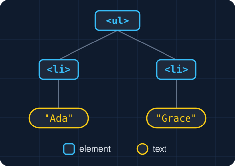

<style>
/* Code on the left, a diagram on the right. */
.side-by-side { display: grid; grid-template-columns: 560px minmax(0, 1fr); gap: 24px; align-items: start; }
.side-by-side p { margin: 0; }
.caption { font-size: 20px; color: var(--secondary); }
/* Shrinks a code block that would crowd its column. */
.small-code pre { font-size: 0.8em; }
/* The theme draws a .demo as a white panel whose 12px edge is a shadow, so the margins keep
   that edge clear of the caption above and the slide's sides. */
.demo { margin: 20px 12px 28px; color-scheme: light; }
.demo ul { margin: 0; }
/* Answer choices for the Predict slides, all on one line. */
.choices { display: flex; gap: 48px; }
</style>

# The Document Object Model

Colan Biemer

---

## The DOM

When the browser loads a page, it turns the HTML into objects, and places them in the [**DOM**](../13-js-forms-dom/lecture.html#28). The objects form a tree, and changing one changes the page.

<div class="side-by-side">
<div>

```html
<ul id="names">
  <li id="name1">Ada</li>
  <li id="name2">Grace</li>
  <!-- ... -->
</ul>
```

`<ul>` is the parent, and each `<li>` is a child.

</div>



</div>

---

## Problem: A Class of 30

With 30 students, we would need 30 ids and 30 lines of code to get each with `document.getElementById`. How can we avoid writing 30 lines of code to get each name?

```html
<ul>
  <li id="name1">Ada</li>
  <li id="name2">Grace</li>
  <!-- ... -->
  <li id="name30">Alan</li>
</ul>
```

---

## Solution 1: String Building

<div class="side-by-side">
<div class="small-code">

```html
<ul>
  <li id="name1">Ada</li>
  <li id="name2">Grace</li>
  <!-- ... -->
  <li id="name30">Alan</li>
</ul>
```

</div>
<div>

```js
for (let i = 1; i <= 30; ++i) {
  const name = document.getElementById(`name${i}`);
  // ...
}
```

</div>
</div>

How could we accomplish this with only one call of `.getElementById`? Hint: We would need to modify the HTML.

---

## Solution 2: `childNodes`

We can also change the `ul` to have an `id`:

<!-- prettier-ignore -->
```html
<ul id="names">...</ul>
```

Then we can select it:

```js
const names = document.getElementById("names");
```

And use [`childNodes`](../13-js-forms-dom/lecture.html#36):

```js
for (const name of names.childNodes) { ... }
```

The loop also visits the line breaks between the `<li>`s, since they're text nodes. We'll handle those soon.

---

## Performing the Same Operation for Multiple Elements

<div class="side-by-side">
<div>

<!-- prettier-ignore -->
```html
<h1>Team 1</h1>
<ul id="team1">
  <li>John Carmack</li>...
</ul>

<h1>Team 2</h1>
<ul id="team2">
  <li>Claude Shannon</li>...
</ul>
```

</div>
<div>

```js
const teams = [
  document.getElementById("team1"),
  document.getElementById("team2"),
];

for (const t of teams) {
  // make whatever changes we wanted to
}
```

<div class="caption">
  (We could also do an index version with strings.)
</div>
</div>
</div>

If we add a third team, we need another `document.getElementById("team3")`, so the code has to change whenever the website changes. How can we handle this by changing the HTML?

---

## Problem: Getting Around It

<div class="side-by-side">
<div>

<!-- prettier-ignore -->
```html
<div id="teams">
  <h1>Team 1</h1>
  <ul>
    <li>John Carmack</li>...
  </ul>
  
  <h1>Team 2</h1>
  <ul>
    <li>Claude Shannon</li>...
  </ul>
</div>
```

</div>
<div>

```js
const teams = [
  document.getElementById("team1"),
  document.getElementById("team2"),
];

for (const t of teams) {
  // make whatever changes we wanted to
}
```

</div>
</div>

What do we change about the JS to loop through the children correctly?

---

## Solution: Getting Around It

<div class="side-by-side">
<div>

<!-- prettier-ignore -->
```html
<div id="teams">
  <h1>Team 1</h1>
  <ul>
    <li>John Carmack</li>...
  </ul>
  
  <h1>Team 2</h1>
  <ul>
    <li>Claude Shannon</li>...
  </ul>
</div>
```

</div>
<div>

```js
const teams = document.getElementById("teams");

for (let i = 3; i < teams.childNodes.length; i += 4) {
  // make whatever changes we wanted to
}
```

- Why start at 3, and why `i += 4`?

</div>
</div>

---

## Answer: Why Start at 3, and Why `i += 4`?

| Index      | 0       | 1    | 2       | 3        | 4       | 5    | 6       | 7        | 8       |
| ---------- | ------- | ---- | ------- | -------- | ------- | ---- | ------- | -------- | ------- |
| `nodeName` | `#text` | `H1` | `#text` | **`UL`** | `#text` | `H1` | `#text` | **`UL`** | `#text` |

The [spaces and line breaks between tags](../13-js-forms-dom/lecture.html#36) are text nodes, so `childNodes` holds more than the tags we wrote. The first `<ul>` is at index 3, and each list after it is 4 nodes later. [This example](examples/getting-around-it.html) logs each `<ul>`'s index to the console.

---

## A Safer Way: Check for `UL`

```js
const teams = document.getElementById("teams");
```

<div class="side-by-side">
<div>

```js
for (let child of teams.childNodes) {
  if (child.nodeName === "UL") {
    // make whatever changes we wanted to
  }
}
```

</div>
<div>

```js
for (let child of teams.childNodes) {
  if (child.nodeName !== "UL") {
    continue;
  }

  // make whatever changes we wanted to
}
```

</div>
</div>

We can also search for tags directly with...

---

## `getElementsByTagName`

```js
const lists = document.getElementsByTagName("ul");

for (let list of lists) {
  // make whatever changes we wanted to
}
```

[`document.getElementsByTagName`](https://developer.mozilla.org/en-US/docs/Web/API/Document/getElementsByTagName) returns every element with that tag. This is great for the problem we've been working on, but not if there are other lists which we don't want to modify.

---

## Problem: Count the Names

```html
<ul>
  <li>Ada</li>
  <li>Grace</li>
  <li>Alan</li>
</ul>
<p id="count"></p>
```

```js
// Put the number of names in the paragraph.
```

<p class="caption">Page</p>

```text
3 names
```

- Which method finds every `<li>`?
- What tells us how many it found?

---

## Solution: Count the Names

```js
const items = document.getElementsByTagName("li");
const count = document.getElementById("count");
count.textContent = `${items.length} names`;
```

`length` is how many elements the search found.

---

## Problem: Capitals

```html
<ul>
  <li>Ada</li>
  <li>Grace</li>
  <li>Alan</li>
</ul>
```

```text
for each li on the page
  set its text to its text in capitals
```

<p class="caption">Page</p>

```text
ADA
GRACE
ALAN
```

---

## Solution: Capitals

```js
for (const item of document.getElementsByTagName("li")) {
  item.textContent = item.textContent.toUpperCase();
}
```

`textContent` reads the old text and writes the new text.

---

## Problem: Different Kinds of Lists

Now the page lists sponsors as well, but we only want to select for teams:

<div class="side-by-side">
<div>

```html
<h1>Team 1</h1>
<ul>
  ...
</ul>
<h1>Team 2</h1>
<ul>
  ...
</ul>
<h1>Sponsors</h1>
<ul>
  ...
</ul>
```

</div>
<div>

<!-- prettier-ignore -->
```js
const lists =
  document.getElementsByTagName("ul");

for (let list of lists) { ... }
```

The sponsors list would also be affected by the code above, because all three are a `<ul>`.

</div>
</div>

---

## `classList`

Give the team lists a class. An element's [`classList`](https://developer.mozilla.org/en-US/docs/Web/API/Element/classList) holds its classes, and `contains` checks for one of them:

<!-- prettier-ignore -->
```html
<ul class="team">...</ul>
<ul class="team">...</ul>
<ul>...</ul> <!-- the sponsors -->
```

```js
const lists = document.getElementsByTagName("ul");
console.log(lists[0].classList.contains("team")); // true
console.log(lists[2].classList.contains("team")); // false
```

---

## Problem: Count the Teams

<!-- prettier-ignore -->
```html
<ul class="team">...</ul>
<ul class="team">...</ul>
<ul>...</ul> <!-- the sponsors -->
<p id="count"></p>
```

```js
// Put the number of teams in the paragraph.
```

<p class="caption">Page</p>

```text
2 teams
```

---

## Solution: Count the Teams

```js
let count = 0;
for (let list of document.getElementsByTagName("ul")) {
  if (list.classList.contains("team")) {
    ++count;
  }
}
document.getElementById("count").textContent = `${count} teams`;
```

This works, but it would be better if we could get elements by class.

---

## `getElementsByClassName`

The browser can do the check for us and search for the class directly. The sponsors have no `team` class, so they stay out:

<!-- prettier-ignore -->
```html
<ul class="team">...</ul>
<ul class="team">...</ul>
<ul>...</ul> <!-- the sponsors -->
```

<!-- prettier-ignore -->
```js
const teams = document.getElementsByClassName("team");
console.log(teams.length);      // 2
console.log(teams[0].nodeName); // UL
```

[`document.getElementsByClassName`](https://developer.mozilla.org/en-US/docs/Web/API/Document/getElementsByClassName) returns every element with that class.

---

## Problem: Percent Scores

```html
<p class="score">90</p>
<p class="score">85</p>
<p>Ada</p>
```

```text
for each element with the class score
  add % to the end of its text
```

<p class="caption">Page</p>

```text
90%
85%
Ada
```

---

## Solution: Percent Scores

```js
for (const score of document.getElementsByClassName("score")) {
  score.textContent += "%";
}
```

The last paragraph has no `score` class, so the search skips it.

---

## `name`

An input's `name` attribute is also a property we can read:

```html
<input id="team-1" name="vote" type="radio" value="Team 1" />
```

```js
const team1 = document.getElementById("team-1");
console.log(team1.name); // vote
```

---

## Problem: Reading the Vote

Say that we want to allow visitors to vote for a team, and we want to know which radio input is picked. Hint: `getElementsByTagName`.

<!-- prettier-ignore -->
```html
<input id="subscribe" name="subscribe" type="checkbox" checked />
<label for="subscribe">Email me the results</label>
<input id="team-1" name="vote" type="radio" value="Team 1" />
<label for="team-1">Team 1</label>
<input id="team-2" name="vote" type="radio" value="Team 2" checked />
<label for="team-2">Team 2</label>
```

```js
// Log the value of the checked input named vote.
```

<p class="caption">Console</p>

```text
Team 2
```

---

## Solution: Reading the Vote

```js
for (const input of document.getElementsByTagName("input")) {
  if (input.name === "vote" && input.checked) {
    console.log(input.value); // Team 2
    break;
  }
}
```

The checkbox comes first and is checked too, so without the `name` check we would log `on`.

---

## A Better Way: `getElementsByName`

```js
const inputs = document.getElementsByName("vote");

for (let input of inputs) {
  if (input.checked) {
    console.log(input.value); // Team 2
    break;
  }
}
```

[`document.getElementsByName`](https://developer.mozilla.org/en-US/docs/Web/API/Document/getElementsByName) returns every element with that `name`.

---

## Problem: Pick a Size

```html
<input id="small" name="size" type="radio" value="Small" />
<label for="small">Small</label>
<input id="large" name="size" type="radio" value="Large" checked />
<label for="large">Large</label>
<p id="picked"></p>
```

Place the selected size in the paragraph with id `picked`.

<p class="caption">Page</p>

```text
Large
```

---

## Solution: Pick a Size

```js
const picked = document.getElementById("picked");

for (const radio of document.getElementsByName("size")) {
  if (radio.checked) {
    picked.textContent = radio.value;
    break;
  }
}
```

`getElementsByName` finds both inputs, and `checked` tells them apart.

---

## `HTMLCollection` and `NodeList`

`length`, indexes, and `for...of` have worked on the result of every search, because each one is a list of elements in page order:

<!-- prettier-ignore -->
```js
const lists = document.getElementsByTagName("ul");      // HTMLCollection
const teams = document.getElementsByClassName("team");  // HTMLCollection
const radios = document.getElementsByName("vote");      // NodeList
```

Loop over an [`HTMLCollection`](https://developer.mozilla.org/en-US/docs/Web/API/HTMLCollection) or a [`NodeList`](https://developer.mozilla.org/en-US/docs/Web/API/NodeList) with [`for...of`](../11-js-arrays/lecture.html#24).

---

## `HTMLCollection` vs. `NodeList`

|                | `HTMLCollection`                                 | `NodeList`                        |
| -------------- | ------------------------------------------------ | --------------------------------- |
| **Comes from** | `getElementsByTagName`, `getElementsByClassName` | `childNodes`, `getElementsByName` |
| **Holds**      | Elements only                                    | Any node, including text          |
| **`forEach`**  | No                                               | Yes                               |

<div class="footnote">The <a href="https://dom.spec.whatwg.org/#old-style-collections">DOM Standard</a> calls both "old-style collections," and calls <code>HTMLCollection</code> "a historical artifact we cannot rid the web of."</div>

---

## Searching Inside an Element

`getElementsByTagName` and `getElementsByClassName` also work on an element. Called on an element, they only search inside it:

<!-- prettier-ignore -->
```html
<ul class="team"><li>Ada</li><li>Grace</li></ul>
<ul class="team"><li>Alan</li><li>Linus</li></ul>
```

<!-- prettier-ignore -->
```js
const team = document.getElementsByClassName("team")[0];
const players = team.getElementsByTagName("li"); // Ada, Grace
```

---

# Selectors

---

## What is a selector?

A [**selector**](../03-css-intro/lecture.html#18) is the part of a CSS rule that picks which elements the rule applies to:

```css
.team li {
  font-weight: bold;
}
```

`.team li` picks every `<li>` inside an element with the class `team`.

---

## Selectors We Know

<center>

| Selector   | Matches                             |
| ---------- | ----------------------------------- |
| `li`       | every `<li>`                        |
| `.team`    | every element with the class `team` |
| `#teams`   | the element whose `id` is `teams`   |
| `.team li` | an `<li>` inside `.team`            |

</center>

These are some of the [selectors from CSS](../03-css-intro/lecture.html#128), and JavaScript can search with them too.

---

## `querySelectorAll`

Bolding every player would take two loops: one over the teams, and one over each team's `<li>`s. One selector replaces both:

<div class="side-by-side">
<div>

<!-- prettier-ignore -->
```js
const teams =
  document.getElementsByClassName("team");

for (const team of teams) {
  const players =
    team.getElementsByTagName("li");

  for (const player of players) {
    player.style.fontWeight = "bold";
  }
}
```

</div>
<div>

<!-- prettier-ignore -->
```js
const players =
  document.querySelectorAll(".team li");

for (const player of players) {
  player.style.fontWeight = "bold";
}
```

</div>
</div>

`querySelectorAll` takes a CSS selector and returns a `NodeList` of every match.

---

## Problem: Only One List

```html
<ul id="first">
  <li>Ada</li>
  <li>Grace</li>
</ul>
<ul id="second">
  <li>Alan</li>
</ul>
```

```text
for each li inside first
  add ! to the end of its text
```

<p class="caption">Page</p>

```text
Ada!
Grace!
Alan
```

---

## Solution: Only One List

```js
for (const item of document.querySelectorAll("#first li")) {
  item.textContent += "!";
}
```

`#first li` means an `<li>` inside `#first`, so Alan stays the same.

---

## `querySelector`

[`document.querySelector`](https://developer.mozilla.org/en-US/docs/Web/API/Document/querySelector), without the `All`, returns only the **first** element that matches. Team 1's first player is the captain:

<!-- prettier-ignore -->
```html
<div id="teams">
  <ul class="team"><li>Ada</li><li>Grace</li></ul>
  <ul class="team"><li>Alan</li><li>Linus</li></ul>
</div>
```

<!-- prettier-ignore -->
```js
const captain = document.querySelector(".team li"); // the first match
const teams = document.querySelector("#teams");     // like getElementById("teams")
const none = document.querySelector("#people");     // null
```

`querySelectorAll` returns a `NodeList` of every match; `querySelector` returns one element, or `null` when nothing matches.

---

## Problem: First Score

```html
<p class="score">90</p>
<p class="score">85</p>
<p id="result"></p>
```

```js
// Put the first score in the paragraph whose id is result.
```

<p class="caption">Page</p>

```text
First: 90
```

- What selector finds a score?
- Which method stops at the first match?

---

## Solution: First Score

```js
const first = document.querySelector(".score");
```

<div class="side-by-side">
<div>

<!-- prettier-ignore -->
```js
const result =
  document.getElementById("result");
```

</div>
<div>

<!-- prettier-ignore -->
```js
const result =
  document.querySelector("#result");
```

</div>
</div>

```js
result.textContent = `First: ${first.textContent}`;
```

Either line finds the same paragraph. `querySelector` returns one element, so it has a `textContent`.

---

# Changing Classes

---

## `add`

`classList.add`, another method on [`classList`](#17), puts a class on an element:

<!-- prettier-ignore -->
```html
<ul class="team">...</ul>
```

<!-- prettier-ignore -->
```js
const team = document.querySelector(".team"); // team
team.classList.add("winner");                 // team winner
team.classList.add("winner");                 // team winner
```

The element's other classes are not modified. Adding a class that is already there does nothing, so the class is never listed twice.

---

## `remove`

`classList.remove` takes a class off an element:

<!-- prettier-ignore -->
```html
<ul class="team winner">...</ul>
```

<!-- prettier-ignore -->
```js
const team = document.querySelector(".team"); // team winner
team.classList.remove("winner");              // team
team.classList.remove("winner");              // team
```

The element's other classes are not modified. Removing a class that is not there does nothing, and there is no error.

---

## `toggle`

`classList.toggle` adds a class when it's missing and removes it when it's there:

<!-- prettier-ignore -->
```html
<ul class="team">...</ul>
```

<!-- prettier-ignore -->
```js
const team = document.querySelector(".team"); // team
team.classList.toggle("winner");              // team winner
team.classList.toggle("winner");              // team
```

---

## `createElement`

Everything so far changes elements already in the HTML. [`document.createElement`](https://developer.mozilla.org/en-US/docs/Web/API/Document/createElement) takes a tag name and makes a new element with that tag:

<!-- prettier-ignore -->
```js
const item = document.createElement("li");       // <li></li>
const paragraph = document.createElement("p");   // <p></p>
const button = document.createElement("button"); // <button></button>
```

The new element works like one we found, so we can set its text and classes:

<!-- prettier-ignore -->
```js
item.textContent = "Ada";
item.classList.add("captain");
console.log(item); // <li class="captain">Ada</li>
```

The new element isn't on the page yet.

---

## `append`

To show the new element, we put it inside one that's already on the page:

<!-- prettier-ignore -->
```html
<ul class="team"><li>John Carmack</li></ul>
```

```js
const player = document.createElement("li");
player.textContent = "Linus Torvalds";
document.querySelector(".team").append(player);
```

<p class="caption">Page</p>
<div class="demo"><ul><li>John Carmack</li><li>Linus Torvalds</li></ul></div>

`append` adds to the end of an element.

---

## `prepend`

`prepend` adds to the start of an element instead:

```js
const captain = document.createElement("li");
captain.textContent = "Ada Lovelace";
document.querySelector(".team").prepend(captain);
```

<p class="caption">Page</p>
<div class="demo"><ul><li>Ada Lovelace</li><li>John Carmack</li><li>Linus Torvalds</li></ul></div>

---

## Problem: Add Each Name

```html
<ul id="names">
  <li>Ada</li>
  <li>Grace</li>
</ul>
```

```text
set newNames to ["Alan", "Linus"]
for each name in newNames
  make an li with that name
  append it to the list
```

<p class="caption">Page</p>

```text
Ada
Grace
Alan
Linus
```

---

## Solution: Add Each Name

```js
const newNames = ["Alan", "Linus"];

for (const name of newNames) {
  const item = document.createElement("li");
  item.textContent = name;
  document.getElementById("names").append(item);
}
```

`createElement` sits inside the loop, since each name needs its own element.

---

# Removing and Replacing

---

## `remove`

When a player retires, their `<li>` should come off the page:

<!-- prettier-ignore -->
```html
<ul class="team">
  <li>Ada</li>
  <li class="retired">Grace</li>
  <li>Alan</li>
</ul>
```

```js
document.querySelector(".retired").remove();
```

It takes an element off the page, with everything inside it.

---

## Problem: Remove the Late

```html
<ul>
  <li class="late">Ada</li>
  <li>Grace</li>
  <li class="late">Alan</li>
</ul>
```

```js
// Take every late student off the page.
```

<p class="caption">Page</p>

```text
Grace
```

---

## Solution: Remove the Late

```js
for (const student of document.querySelectorAll(".late")) {
  student.remove();
}
```

`querySelectorAll` finds both, and the loop removes each one. Would `getElementsByClassName` work too?

---

## Predict: Removing by Class

```html
<ul>
  <li class="late">Ada</li>
  <li>Grace</li>
  <li class="late">Alan</li>
</ul>
```

```js
for (const student of document.getElementsByClassName("late")) {
  student.remove();
}
```

What does the page show?

<div class="choices">

**A.** Grace

**B.** Grace, Alan

**C.** Ada, Grace

**D.** Nothing

</div>

---

## Answer: Removing by Class

**B.** `getElementsByClassName` returns a **live** `HTMLCollection`, which changes as the page changes. The loop reads it by index:

| Step | The collection holds | The loop reads index | So                     |
| ---- | -------------------- | -------------------- | ---------------------- |
| 1    | Ada, Alan            | 0                    | Ada is removed         |
| 2    | Alan                 | 1                    | past the end, it stops |

Every `getElementsBy` search, and `childNodes`, is live. `querySelectorAll` returns a snapshot that never changes, so loop over it when removing.

---

## Remove, Hide, or Disable

`remove` is one of three ways to take something away from the user. The other two are [`hidden` and `disabled`](../13-js-forms-dom/lecture.html#40):

<!-- prettier-ignore -->
```js
document.getElementById("note").remove();
document.getElementById("hint").hidden = true;
document.getElementById("next").disabled = true;
```

| Code              | On the page? | Visible? | Usable? |
| ----------------- | ------------ | -------- | ------- |
| `remove()`        | No           | No       | No      |
| `hidden = true`   | Yes          | No       | No      |
| `disabled = true` | Yes          | Yes      | No      |

---

## `replaceWith`

[`replaceWith`](https://developer.mozilla.org/en-US/docs/Web/API/Element/replaceWith) takes an element off the page and puts another in its place:

```html
<h2 id="status">Loading...</h2>
```

```js
const done = document.createElement("h1");
done.textContent = "Done!";
document.getElementById("status").replaceWith(done);
```

The `<h2>` is gone, and the `<h1>` sits where it was.

---

## Problem: Replace the List

<!-- prettier-ignore -->
```html
<ul id="names">
</ul>
```

```text
get the element with id names
if it has no li inside it
  make a p that says No names yet
  replace the list with the p
```

<p class="caption">Page</p>

```text
No names yet
```

---

## Solution: Replace the List

```js
const names = document.getElementById("names");

if (names.getElementsByTagName("li").length === 0) {
  const message = document.createElement("p");
  message.textContent = "No names yet";
  names.replaceWith(message);
}
```

`names.childNodes.length` would be 1, not 0: the line break inside the `<ul>` is a text node. Counting the `<li>`s skips it.

---

## Summary

| Function                                         | What it does                                          |
| ------------------------------------------------ | ----------------------------------------------------- |
| `getElementsByTagName`                           | Every element with a tag (`HTMLCollection`)           |
| `getElementsByClassName`                         | Every element with a class (`HTMLCollection`)         |
| `getElementsByName`                              | Every element with a `name` (`NodeList`)              |
| `querySelectorAll`                               | Every element that matches a selector (`NodeList`)    |
| `querySelector`                                  | The first element that matches a selector, or `null`  |
| `classList.contains`                             | Checks whether an element has a class                 |

---

## Summary (continued)

| Function                                         | What it does                                          |
| ------------------------------------------------ | ----------------------------------------------------- |
| `classList.add`, `remove`, `toggle`              | Adds, removes, or flips one class                     |
| `createElement`                                  | Makes a new element that isn't on the page yet        |
| `append`, `prepend`                              | Puts an element at the end or start of another        |
| `remove`                                         | Takes an element off the page                         |
| `replaceWith`                                    | Puts another element in an element's place            |

---

## Next Up: Events

[Events](../15-js-events/lecture.html)

