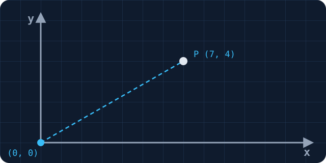
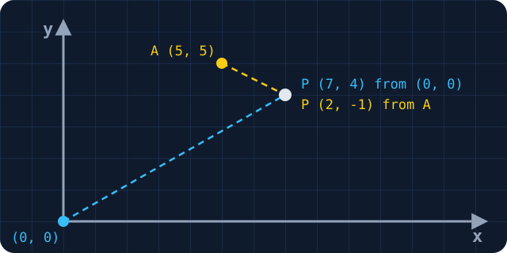
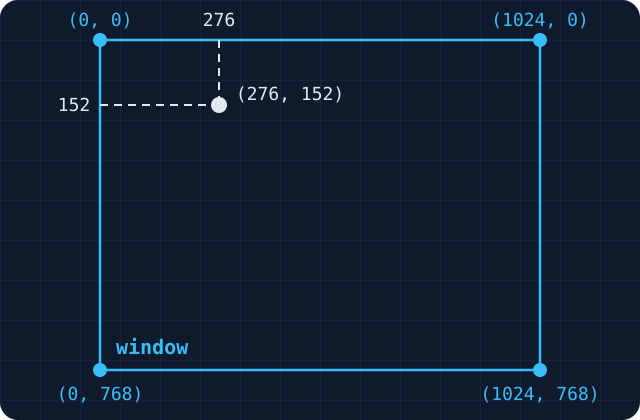
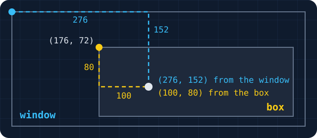
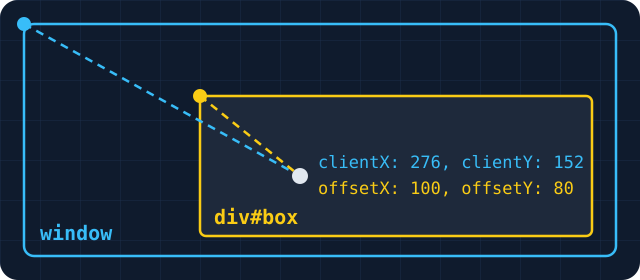

<style>
.caption { font-size: 20px; color: var(--secondary); }
/* Shrinks a code block or table that would crowd the slide. */
.small-code pre { font-size: 0.75em; }
.small-table table { font-size: 0.7em; }
/* HTML on the left, the JavaScript that uses it on the right. */
.pair { display: grid; grid-template-columns: auto minmax(0, 1fr); gap: 24px; align-items: start; }
/* The theme draws a .demo as a white panel whose 12px edge is a shadow, so the margins keep
   that edge clear of the caption above and the slide's sides. */
.demo { margin: 20px 12px 28px; color-scheme: light; }
/* Answer choices for the Predict slides, all on one line. */
.choices { display: flex; gap: 48px; }
</style>

# Events

Colan Biemer

---

## HTML to Call JavaScript Functions

```html
<button type="button" onclick="sayHello()">Say hello</button>
<p id="message"></p>
```

```js
function sayHello() {
  document.getElementById("message").textContent = "Hello";
}
```

Every page so far has called our code from an [event attribute](../13-js-forms-dom/lecture.html#49), like `onclick`. Instead, we can write code that "listens" for _events_.

---

## Events

An **event** is a message the browser emits when something happens (e.g. a mouse press, a key press, or the page loading). We are going to cover only a few, but there are [many events](https://developer.mozilla.org/en-US/docs/Web/API/Document_Object_Model/Events).

---

## Listener

A **listener** is a function subscribed to one event on one element, like clicks on a button. Each time that event happens, the browser calls the function.

---

## `addEventListener`

```html
<button id="hello" type="button">Say hello</button>
```

```js
const hello = document.getElementById("hello");
hello.addEventListener("click", (event) => {
  alert("Hello!");
});
```

[`addEventListener`](https://developer.mozilla.org/en-US/docs/Web/API/EventTarget/addEventListener) takes the event's name and the subscribing function as arguments. In the example above, when someone clicks the button, the browser will call the [arrow function](../11-js-arrays/lecture.html#34), which will run `alert("Hello!")`.

---

## Predict

```html
<button id="hello" type="button">Say hello</button>
```

```js
function sayHello() {
  alert("Hello!");
}

const hello = document.getElementById("hello");
hello.addEventListener("click", sayHello());
```

What happens when the page loads and we click **Say hello**?

<div class="choices">

**A.** Alert on each click

**B.** Alert once, at load

**C.** `TypeError`

**D.** Never alerts

</div>

---

## Predict: B

**B.** `sayHello()` runs when the line runs, so it alerts once at load and gives back `undefined`. That's what gets passed, so nothing listens for clicks, and the browser shows no error.

```js
hello.addEventListener("click", sayHello);
```

---

## Attributes and `addEventListener`?

<div class="small-table">
<center>

| Way to listen                                | Written in | Listeners per event                       |
| -------------------------------------------- | ---------- | ----------------------------------------- |
| `onclick="sayHello()"`                       | HTML       | one                                       |
| `hello.onclick = sayHello;`                  | JavaScript | one, and setting it again replaces it     |
| `hello.addEventListener("click", sayHello);` | JavaScript | as many as we add, run in the order added |

</center>
</div>

---

## Problem: Fade on Click

```html
<button id="fade" type="button" style="opacity: 1">Fade</button>
```

```js
const fade = document.getElementById("fade");

fade.addEventListener("click", () => {
  // fill in here
});
```

Fill in the code so that when the button is pressed, its opacity is reduced by `0.05`.

---

## Solution: Fade on Click

```js
const fade = document.getElementById("fade");

fade.addEventListener("click", () => {
  fade.style.opacity -= 0.05;
});
```

<p class="caption">Try it</p>
<div class="demo"><button type="button" style="opacity: 1" onclick="this.style.opacity -= 0.05">Fade</button> <button type="button" onclick="this.previousElementSibling.style.opacity = 1">Reset</button></div>

Without `style="opacity: 1"`, `fade.style.opacity` starts as `""`, so the first click sets it to `-0.05` and the button vanishes.

---

## `removeEventListener`

<!-- prettier-ignore -->
```js
hello.addEventListener("click", sayHello);
hello.removeEventListener("click", sayHello);         // clicks do nothing

hello.addEventListener("click", () => sayHello());
hello.removeEventListener("click", () => sayHello()); // clicks still say hello
```

[`removeEventListener`](https://developer.mozilla.org/en-US/docs/Web/API/EventTarget/removeEventListener) needs the same function that's listening. [Functions are references](../11-js-arrays/lecture.html#30), and each arrow we write makes a new one, so the second arrow isn't the one listening.

---

## The Event Object

```js
hello.addEventListener("click", (event) => {
  console.log(event.type);
  console.log(event.target);
});
```

<p class="caption">Console</p>

```text
click
<button id="hello" type="button">Say hello</button>
```

The browser calls each listener with an [**event object**](https://developer.mozilla.org/en-US/docs/Web/API/Event), which describes what happened. `type` is the event's name, and `target` is the element it happened to.

---

## Predict: Which Name?

<div class="pair small-code">

```html
<ul>
  <li>Ada</li>
  <li>Grace</li>
</ul>
```

```js
function showName(event) {
  console.log(event.target.textContent);
}

for (const item of document.querySelectorAll("li")) {
  item.addEventListener("click", showName);
}
```

</div>

We click **Grace**. What does the console show?

<div class="choices">

**A.** `Ada`

**B.** `Grace`

**C.** `Ada`, then `Grace`

**D.** Nothing

</div>

---

## Answer: Which Name?

<p class="caption">Console</p>

```text
Grace
```

**B.** The loop ran once, at load, to add a listener to each `<li>`. `showName` has no `item`, so `event.target` tells it which `<li>` was clicked.

---

## Problem: Click Counter

```html
<button id="add" type="button">Add</button>
<p id="count">0</p>
```

```js
// Each click of Add adds 1 to the number on the page.
```

<p class="caption">Page</p>

```text
3
```

---

## Solution: Click Counter

```js
let count = 0;

document.getElementById("add").addEventListener("click", () => {
  ++count;
  document.getElementById("count").textContent = count;
});
```

`count` sits outside the listener, so it keeps its value between clicks.

---

## Problem: Which Button

```html
<button class="pick" type="button">Ada</button>
<button class="pick" type="button">Grace</button>
<p id="picked"></p>
```

```text
for each element with the class pick
  when it is clicked
    put the clicked button's text in picked
```

<p class="caption">Page</p>

```text
Grace
```

---

## Solution: Which Button

```js
function showPick(event) {
  document.getElementById("picked").textContent = event.target.textContent;
}

for (const button of document.querySelectorAll(".pick")) {
  button.addEventListener("click", showPick);
}
```

An arrow inside the loop works too, but makes a new function for each button. With `event.target`, one function serves both.

---

# The Mouse

---

## Mouse Events

<div class="small-table">
<center>

| Event        | Fires when                                                |
| ------------ | --------------------------------------------------------- |
| `click`      | the main mouse button is pressed and let go on an element |
| `dblclick`   | two clicks come quickly, one after the other              |
| `mousedown`  | a mouse button is pressed                                 |
| `mouseup`    | a mouse button is let go                                  |
| `mousemove`  | the mouse moves, many times a second                      |
| `mouseenter` | the mouse moves onto an element                           |
| `mouseleave` | the mouse moves off an element                            |

</center>
</div>

A click is a `mousedown` and then a `mouseup`, both on the same element.

---

## Predict: A Double Click

```html
<button id="hello" type="button">Say hello</button>
```

```js
const hello = document.getElementById("hello");
hello.addEventListener("click", () => console.log("click"));
hello.addEventListener("dblclick", () => console.log("dblclick"));
```

We double-click **Say hello**. How many lines print?

<div class="choices">

**A.** `1`

**B.** `2`

**C.** `3`

**D.** `4`

</div>

---

## Answer: A Double Click

<p class="caption">Console</p>

```text
click
click
dblclick
```

**C.** A double click is two clicks first, then a `dblclick`. A page that listens for both runs the `click` code twice before the `dblclick` code.

---

## Global Coordinates

<center>



</center>

A **global coordinate** is a position measured from the origin, (0, 0). P is 7 right and 4 up from the origin, so it is at (7, 4).

---

## Relative Coordinates

<center>



</center>

A **relative coordinate** is a position measured from some other point. To get one, subtract that point: relative to A, P is at (7 - 5, 4 - 5), or (2, -1).

---

## Coordinates on a Page

<center>



</center>

Coordinates start at (0, 0) in the top-left corner and reach their largest values in the bottom-right corner.

---

## Relative Coordinates on a Page

<center>



</center>

The box's top-left corner is at (176, 72). Relative to that corner, the point is at (276 - 176, 152 - 72), or (100, 80).

---

## Where the Mouse Is

<div class="small-code">

```js
const box = document.getElementById("box");
box.addEventListener("mousemove", (event) => {
  console.log(event.offsetX, event.offsetY);
  console.log(event.clientX, event.clientY);
});
```

</div>

<center>



</center>

[`offsetX`](https://developer.mozilla.org/en-US/docs/Web/API/MouseEvent/offsetX) and `offsetY` count from the element's top-left corner, and [`clientX`](https://developer.mozilla.org/en-US/docs/Web/API/MouseEvent/clientX) and `clientY` from the browser window's.

---

## Problem: Mouse Position

```html
<div id="box" style="height: 200px; background: lightblue"></div>
<p>Global: <span id="global"></span></p>
<p>Relative: <span id="relative"></span></p>
```

```js
// As the mouse moves over the box, show where the mouse is,
// globally and relatively
```

<p class="caption">Page</p>

```text
Global: 48, 128
Relative: 40, 120
```

---

## Solution: Mouse Position

```js
document.getElementById("box").addEventListener("mousemove", (event) => {
  document.getElementById("global").textContent =
    `${event.clientX}, ${event.clientY}`;
  document.getElementById("relative").textContent =
    `${event.offsetX}, ${event.offsetY}`;
});
```

`clientX` and `clientY` count from the window's top-left corner, and `offsetX` and `offsetY` from the box's. The body's default 8px margin puts the box's corner at (8, 8).

---

## `mouseenter` or `:hover`?

```css
#box:hover {
  outline: 3px solid orange;
}
```

```js
box.addEventListener("mouseenter", () => {
  box.textContent = "Hello";
});
```

A look that changes on hover goes in the CSS, with [`:hover`](../03-css-intro/lecture.html#100). When code has to run, like changing the box's text, listen for `mouseenter` and `mouseleave`.

---

## Problem: In or Out

```html
<div id="box" style="height: 200px; background: lightblue"></div>
<p id="status">Out</p>
```

```text
when the mouse enters the box
  put "In" in status
when the mouse leaves the box
  put "Out" in status
```

<p class="caption">Page</p>

```text
In
```

---

## Solution: In or Out

```js
const box = document.getElementById("box");

box.addEventListener("mouseenter", () => {
  document.getElementById("status").textContent = "In";
});

box.addEventListener("mouseleave", () => {
  document.getElementById("status").textContent = "Out";
});
```

Changing the text takes code, so `:hover` cannot do this.

---

# The Keyboard

---

## Keyboard Events

<div class="small-code">

```js
document.addEventListener("keydown", (event) => {
  console.log(`down: ${event.key}`);
});

document.addEventListener("keyup", (event) => {
  console.log(`up: ${event.key}`);
});
```

<p class="caption">Console, holding <code>a</code> down for a moment</p>

```text
down: a
down: a
down: a
up: a
```

</div>

Holding a key repeats `keydown`.

---

## One Key per Event

<p class="caption">Console, the same listeners, holding <code>a</code> and then pressing <code>b</code></p>

```text
down: a
down: a
down: b
up: b
up: a
```

Each event names one key in `event.key`. Nothing in the event says that `a` is still held, so a program that needs it must remember the `keydown` itself.

---

## `event.key` and `event.code`

<div class="small-table">
<center>

| Press      | `event.key`   | `event.code`  |
| ---------- | ------------- | ------------- |
| a          | `"a"`         | `"KeyA"`      |
| Shift + a  | `"A"`         | `"KeyA"`      |
| 1          | `"1"`         | `"Digit1"`    |
| Space      | `" "`         | `"Space"`     |
| Left arrow | `"ArrowLeft"` | `"ArrowLeft"` |
| Enter      | `"Enter"`     | `"Enter"`     |
| Escape     | `"Escape"`    | `"Escape"`    |

</center>
</div>

[`key`](https://developer.mozilla.org/en-US/docs/Web/API/KeyboardEvent/key) is what the key types, or its name, and [`code`](https://developer.mozilla.org/en-US/docs/Web/API/KeyboardEvent/code) is which key it is on the keyboard (e.g. `"Shift"` can be `"ShiftLeft"`).

---

## Default Actions

```js
document.addEventListener("keydown", (event) => {
  if (event.key === " ") {
    event.preventDefault();
  }
});
```

A **default action** is what the browser does on its own after an event, like scrolling on Space, opening a clicked link, or reloading on submit. [`preventDefault()`](https://developer.mozilla.org/en-US/docs/Web/API/Event/preventDefault) stops it.

---

## Keyboard Shortcuts

```js
document.addEventListener("keydown", (event) => {
  if ((event.ctrlKey || event.metaKey) && event.key === "s") {
    event.preventDefault();
    console.log("Save Prevented");
  }
});
```

<p class="caption">Console, after Ctrl + S, or ⌘ + S on a Mac</p>

```text
Save Prevented
```

Without `preventDefault()`, the browser also opens its own Save dialog. `event.metaKey` is for the mac default of `command`.

---

## Keys on an Element

```html
<input id="name" name="name" />
```

```js
const box = document.getElementById("name");

box.addEventListener("keydown", (event) => {
  console.log(`box: ${event.key}`);
});
```

<p class="caption">Console, typing <code>h</code> in the name box</p>

```text
box: h
```

A key event goes to the element with **focus**: the box we clicked into, or `body` when none has it.

---

## Keys on an Element and `document`

<div class="small-code">

```js
const box = document.getElementById("name");

box.addEventListener("keydown", (event) => {
  console.log(`box: ${event.key}`);
});

document.addEventListener("keydown", (event) => {
  console.log(`document: ${event.key}`);
});
```

<p class="caption">Console, typing <code>h</code> in the name box</p>

```text
box: h
document: h
```

</div>

The key went to the box, but `document` hears it too.

---

## Events Bubble Up

<div class="small-code">

```html
<body>
  <main>
    <form id="signup">
      <input id="name" name="name" />
    </form>
  </main>
</body>
```

</div>

<p class="caption">A key typed in the name box runs the listeners on</p>

```text
input#name -> form#signup -> main -> body -> html -> document -> window
```

After the listeners on its target run, the event **bubbles**: it goes up the [DOM tree](../13-js-forms-dom/lecture.html#29), running the listeners on everything above it. `event.target` still names where it started.

---

## `stopPropagation`

<div class="small-code">

```js
box.addEventListener("keydown", (event) => {
  event.stopPropagation();
  console.log(`box: ${event.key}`);
});

document.addEventListener("keydown", (event) => {
  console.log(`document: ${event.key}`);
});
```

<p class="caption">Console, typing <code>h</code> in the name box</p>

```text
box: h
```

</div>

[`stopPropagation()`](https://developer.mozilla.org/en-US/docs/Web/API/Event/stopPropagation) stops the bubbling, but the box still gets its `h`. (Generally speaking, let the event bubble up.)

---

## Problem: Last Keys

```html
<p id="keys"></p>
```

```js
// Show every key pressed anywhere on the page, newest first.
```

<p class="caption">Page, after typing <code>a</code>, <code>b</code>, Enter</p>

```text
Enter,b,a
```

- Which element should we listen on?
- What is different about the first key?

---

## Solution: Last Keys

```js
const keys = document.getElementById("keys");

document.addEventListener("keydown", (event) => {
  if (keys.textContent === "") {
    keys.textContent = event.key;
  } else {
    keys.textContent = `${event.key},${keys.textContent}`;
  }
});
```

Listening on `document` hears keys from the whole page. The new key goes in front of the old `textContent`, and the first key gets no comma after it.

---

## Problem: Escape Clears

Change our [Last Keys](#43) code so that pressing Escape (`event.key` is `"Escape"`) clears the paragraph instead.

<p class="caption">Page, after typing <code>a</code>, <code>b</code>, Escape, <code>c</code></p>

```text
c
```

---

## Solution: Escape Clears

```js
document.addEventListener("keydown", (event) => {
  if (event.key === "Escape") {
    keys.textContent = "";
  } else if (keys.textContent === "") {
    keys.textContent = event.key;
  } else {
    keys.textContent = `${event.key},${keys.textContent}`;
  }
});
```

Escape is checked first, so it never gets added to the paragraph.

---

# The Window

---

## Window Events

<div class="small-table">
<center>

| Event    | Fires when                                                     |
| -------- | -------------------------------------------------------------- |
| `load`   | the page and everything on it, like its images, have loaded    |
| `resize` | the window changes size                                        |
| `scroll` | the page scrolls, and `window.scrollY` says how far down it is |

</center>
</div>

Listen for these on `window`. `document.addEventListener("load", () => {...})` never calls its function, because `document` never gets the `"load"` event.

---

## `resize`

```js
window.addEventListener("resize", () => {
  console.log(window.innerWidth, window.innerHeight);
});
```

<p class="caption">Console, dragging the window's edge</p>

```text
1024 768
1016 768
1008 768
```

`innerWidth` and `innerHeight` are the window's size in pixels. Dragging fires `resize` many times, once for each step.

---

## `load`

```html
<head>
  <script>
    window.addEventListener("load", () => {
      document.getElementById("title").textContent = "Ready";
    });
  </script>
</head>
<body>
  <h1 id="title">Loading</h1>
  
</body>
```

A script in `<head>` runs [before the body exists](../13-js-forms-dom/lecture.html#32), so it waits for `load`. But `load` also waits for every image, so the title says Loading until the photo arrives.

---

## `DOMContentLoaded`

```html
<head>
  <script>
    document.addEventListener("DOMContentLoaded", () => {
      document.getElementById("title").textContent = "Ready";
    });
  </script>
</head>
<body>
  <h1 id="title">Loading</h1>
  
</body>
```

`DOMContentLoaded` fires once the HTML has been read, without waiting for images, so the title changes right away. It fires on `document`.

---

## Problem: Back to Top

```html
<a id="back" href="#" hidden>Back to top</a>
```

```js
// Show the link once the page has scrolled more than 300 pixels down,
// and hide it again above that.
```

<p class="caption">Page, scrolled 500 pixels down</p>

```text
Back to top
```

`window.scrollY` lets you access how far the user has scrolled downwards.

---

## Solution: Back to Top

```js
const back = document.getElementById("back");

window.addEventListener("scroll", () => {
  back.hidden = window.scrollY <= 300;
});
```

The link starts [`hidden`](../13-js-forms-dom/lecture.html#40), and `scroll` shows it past 300 pixels. Its `href="#"` takes the page back to the top.

---

# Forms

---

## Form Events

<div class="small-table">
<center>

| Event    | Fires when                                                                 |
| -------- | -------------------------------------------------------------------------- |
| `input`  | the value changes: each keystroke, or each step of a slider                |
| `change` | a change is done: leaving a box, letting go of a slider, picking an option |
| `focus`  | a control gets focus                                                       |
| `blur`   | a control loses focus                                                      |
| `submit` | the form is submitted                                                      |
| `reset`  | the form's reset button puts every control back                            |

</center>
</div>

These are the events behind [`oninput` and `onchange`](../13-js-forms-dom/lecture.html#49). `focus` and `blur` don't bubble.

---

## `input`

```html
<input id="name" />
<p id="greeting"></p>
```

```js
document.getElementById("name").addEventListener("input", (event) => {
  document.getElementById("greeting").textContent =
    `Hello, ${event.target.value}`;
});
```

This [greets as we type](../13-js-forms-dom/lecture.html#50), like before, with no `oninput` in the HTML. `event.target.value` is what the box holds.

---

## Predict: Leaving the Box

```html
<input id="name" />
```

```js
const name = document.getElementById("name");
name.addEventListener("input", () => console.log("input"));
name.addEventListener("change", () => console.log("change"));
```

We type `Grace` in the box, then press Tab. How many lines print?

<div class="choices">

**A.** `1`

**B.** `3`

**C.** `4`

**D.** `6`

</div>

---

## Answer: Leaving the Box

<p class="caption">Console</p>

```text
input
input
input
input
input
change
```

**D.** `input` fires on each keystroke. `change` fires once, when we leave the box with a new value.

---

## `focus` and `blur`

```js
const name = document.getElementById("name");

name.addEventListener("blur", () => {
  name.value = name.value.trim();
});
```

`focus` fires when we click or Tab into a box, and `blur` when we leave it, a good time to [`trim`](../12-js-math-dates-strings/lecture.html#34) what was typed.

---

## `submit`

```js
document.getElementById("signup").addEventListener("submit", (event) => {
  event.preventDefault();
  console.log("Signed up");
});
```

A form's submit button and Enter in one of its text boxes both submit it, so listen on the form for `submit`. `preventDefault()` stops [the reload](../13-js-forms-dom/lecture.html#22).

---

## Problem: Say Hello

```html
<form id="hello">
  <input id="name" />
  <button>Say hello</button>
</form>
<p id="message"></p>
```

```js
// On submit, stop the reload and show "Hello, " and the name.
```

<p class="caption">Page</p>

```text
Hello, Ada
```

- Press Enter in the box. What happens?

---

## Solution: Say Hello

```js
document.getElementById("hello").addEventListener("submit", (event) => {
  event.preventDefault();
  const name = document.getElementById("name").value;
  document.getElementById("message").textContent = `Hello, ${name}`;
});
```

Enter in the box submits too, so we listen on the form, not the button.

---

## Problem: Hint

```html
<input id="name" />
<p id="hint" hidden>First name only</p>
```

```text
when the box gets focus
  show the hint
when the box loses focus
  hide the hint
```

<p class="caption">Page</p>

```text
First name only
```

---

## Solution: Hint

```js
const name = document.getElementById("name");

name.addEventListener("focus", () => {
  document.getElementById("hint").hidden = false;
});

name.addEventListener("blur", () => {
  document.getElementById("hint").hidden = true;
});
```

`focus` and `blur` don't bubble, so each goes on the box itself.

---

## Next Up: Form Validation

[Form Validation](../16-js-form-validation/lecture.html)
