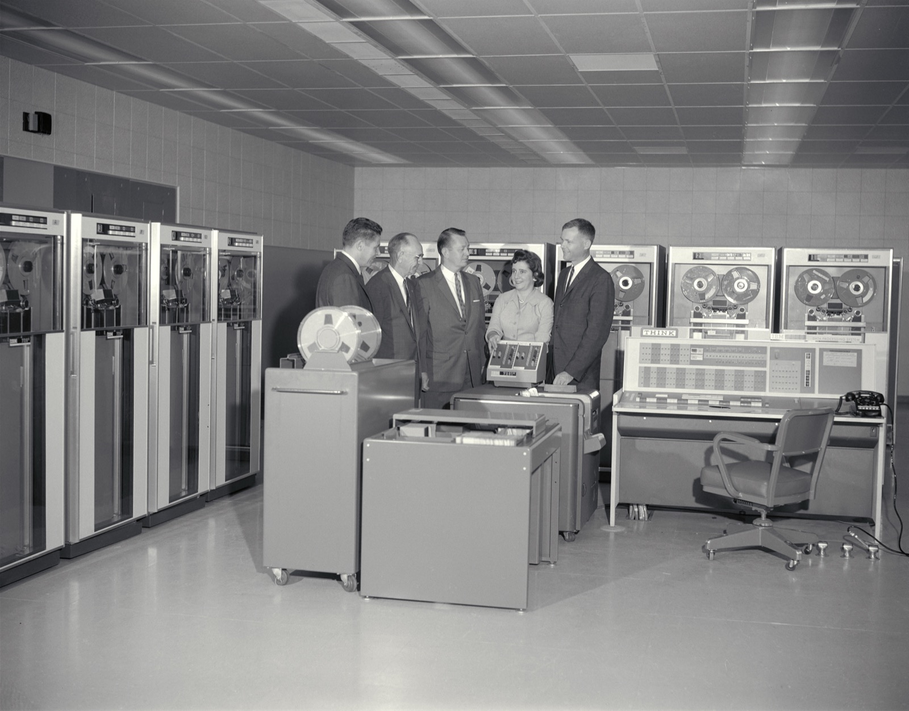
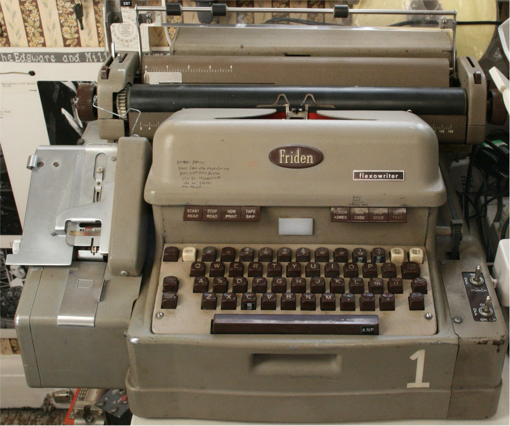
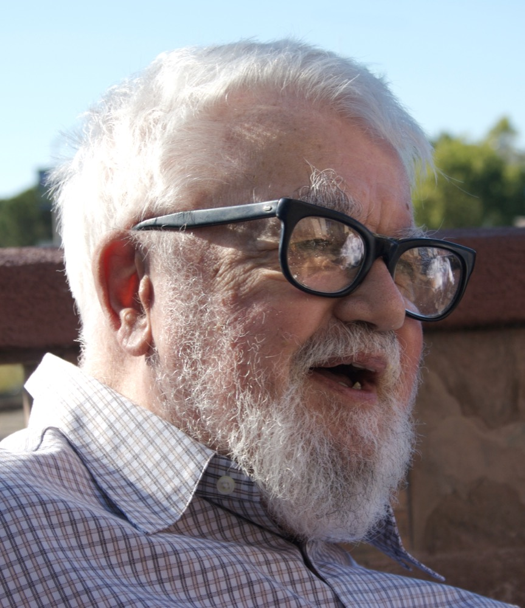
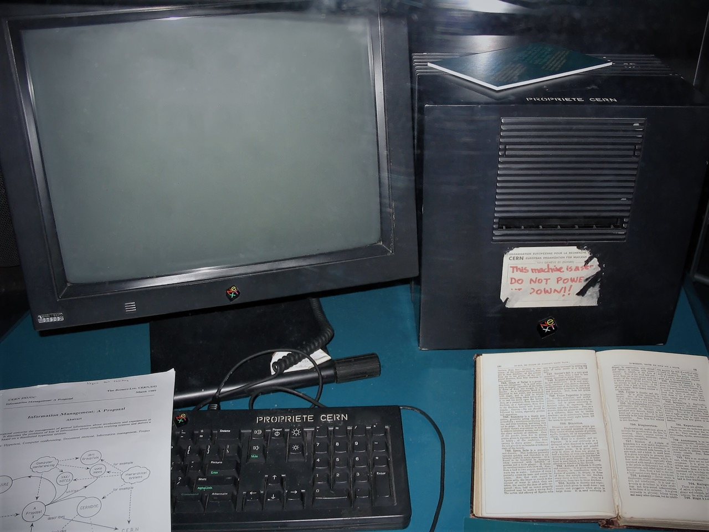
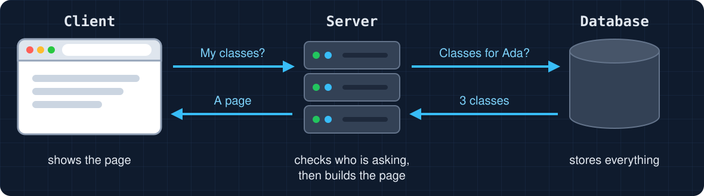

# What Is a Server?

Colan Biemer

---

## A Computer in 1961

An IBM 7090. MIT had one of these, and so did NASA, where this photo was taken.

Photo: [NASA Ames Research Center](https://commons.wikimedia.org/wiki/File:IBM_7090_computer.jpg), public domain

---

## Terminals

To use a computer, you used a **terminal**: a keyboard and a printer, wired to the computer. You typed your program in, ran it, and the answer printed out in front of you.

Photo: [Godfrey Manning](https://commons.wikimedia.org/wiki/File:Flexowriter.JPG), CC BY 3.0

---

## Programming One at a Time

The computer had one terminal, so only one person could use it at a time. To get a turn, you needed to sign up with a sheet where you could reserve access for an hour. You would write your program beforehand by hand. Then, the first part of your hour went to typing in your program as fast as you could, and the remaining time went to thinking and fixing bugs.1

1. Steven Levy, <em>Hackers: Heroes of the Computer Revolution</em> (Garden City, NY: Anchor Press/Doubleday, 1984).

---

## Time-Sharing: The Idea

In 1959, John McCarthy proposed time-sharing at MIT: wire many terminals to one computer, and let everyone use it at once.1

Most of the time spent on a program goes to thinking and typing. So while you typed, the computer could work on everyone else. When you sent a command, it got its turn, and the answer came back in a second or two.

1. John McCarthy, "A Time Sharing Operator Program for Our Projected IBM 709," memorandum to P. M. Morse, January 1, 1959, <a href="https://www-formal.stanford.edu/jmc/history/timesharing-memo/timesharing-memo.html">https://www-formal.stanford.edu/jmc/history/timesharing-memo/timesharing-memo.html</a>.

Photo: John McCarthy in 2006, by [null0](https://commons.wikimedia.org/wiki/File:John_McCarthy_Stanford.jpg), CC BY-SA 2.0

---

## Time-Sharing: The First System

In 1961, Fernando Corbató, Marjorie Merwin-Daggett, and Robert Daley built it at MIT: the Compatible Time-Sharing System, or CTSS.1, 2

No more sign-up sheet: each person sat at their own terminal, wired to the one computer. People are slow and computers are fast, so each person felt like they had the computer to themselves.

Fernando Corbató later won the Turing Award, computing's highest prize, largely for this work.

1. Fernando J. Corbató, Marjorie Merwin-Daggett, and Robert C. Daley, "An Experimental Time-Sharing System," in <em>Proceedings of the May 1–3, 1962, Spring Joint Computer Conference</em> (New York: ACM, 1962), 335, <a href="https://doi.org/10.1145/1460833.1460871">https://doi.org/10.1145/1460833.1460871</a>. 2. David Walden and Tom Van Vleck, eds., <em>The Compatible Time-Sharing System (1961–1973): Fiftieth Anniversary Commemorative Overview</em> (Washington, DC: IEEE Computer Society, 2011), <a href="https://history.computer.org/pubs/2011-06-ctss.pdf">https://history.computer.org/pubs/2011-06-ctss.pdf</a>.

Photo: Fernando Corbató, by [Jason Dorfman, MIT CSAIL](https://commons.wikimedia.org/wiki/File:Fernando_Corbato.jpg), CC BY-SA 3.0

---

## Taking Turns

Some commands took minutes, not seconds. If the computer ran one to the end, everyone else would wait, and everyone would be back to waiting their turn.

So the computer never ran anything to the end in one go. Instead it went round and round:

1. Run one person's program for a fraction of a second.
2. Save exactly where it stopped.
3. Move to the next person's, and come back to this one later.

A running program is called a **process**. Laptops still do this: the browser, the music, and the code editor look like they run at once, but they take turns, thousands of times a second.

---

## Accounts

Thirty people on one computer brought new questions: whose files are whose, and who is using up all the time?

So each person got an **account**: a name and a **password**, typed in to **log in**. Each account had its own files and a limit on its computer time. These were some of the first computer passwords.

In 1962, a student named Allan Scherr wanted more than his four hours a week. He had the computer print out everyone's passwords, and used theirs.

---

## The Shape of a Server

Time-sharing put the pieces together:

- one computer, always on, doing the work
- many people asking from somewhere else
- an account for each of them

Every server since has the same shape.

---

## The 1980s: A Computer on Every Desk

Computers got small and cheap enough for every desk. That made a new problem: everything was stuck on one desk.

- A report written on one computer and needed on another went on a floppy disk, carried by hand. People called this **sneakernet**.
- Every desk would need its own printer.

So offices joined their computers with cables, and gave one computer a job: hold everyone's files, or run the printer, and answer when asked.

---

## Client and Server

- A **client** is a program that asks for something. A browser is a client, and so is a phone app.
- A **server** is a program that waits to be asked, and answers.

The computer it runs on is also called a server. It doesn't have to be a special computer: while a server program runs on your laptop, your laptop is a server.

---

## Like a Restaurant

| Restaurant               | Web                             |
| ------------------------ | ------------------------------- |
| a customer               | the client                      |
| placing an order         | a request                       |
| the kitchen              | the server                      |
| the pantry               | where the server keeps its data |
| the plate that comes out | a response                      |

The customer never goes into the kitchen. The kitchen doesn't cook until someone orders, but someone has to be there, ready, the whole time it's open.

---

## 1983: One File for the Whole Internet

Computers on the internet find each other by number, called an **IP address**. Names like wikipedia.org are for people.

At first, every name and number was in one file, kept by one office in California, and every computer downloaded a copy. As the internet grew, the file couldn't keep up.

So in 1983 came **DNS**: the list split up over many servers, each in charge of its own part. It works like the contacts on a phone: you tap a name, and the phone dials a number.

Remember DNS. It comes back when things go wrong.

---

## 1989: CERN Forgets

[CERN](https://home.cern/science/computing/birth-web/short-history-web) is a physics lab near Geneva, with thousands of scientists from all over the world. In 1989, it had a problem: it kept forgetting things.

- People came for a couple of years, then left, and what they knew left with them.
- Every group had different computers, with different commands and different files.
- Even notes that were written down often couldn't be found.

Tim Berners-Lee, a programmer there, wrote a [proposal](https://www.w3.org/History/1989/proposal.html) to fix it. Its first section is called "Losing Information at CERN."

---

## Vague but Exciting

His idea had three parts:

1. Keep information on a computer that is always on.
2. Let any kind of computer ask for it, using the same simple rules.
3. Let a page link to a page on a different computer.

His boss, Mike Sendall, wrote three words on the cover: *"Vague but exciting..."* That was enough to let him keep going. He called it the World Wide Web.

---

## 1990: The First Web Server

At the end of 1990, it worked. The server was an ordinary desktop computer, a NeXT, in his office, with a handwritten label:

> This machine is a server. DO NOT POWER IT DOWN!!

For a while, it was the only web server there was. Turning it off turned off the web.

---

## The First Web Server

The paper on the keyboard is a copy of the proposal.

Photo: [Coolcaesar](https://commons.wikimedia.org/wiki/File:First_Web_Server.jpg), CC BY-SA 3.0

---

## A Request and a Response

The client sends one **request**, and the server sends back one **response**. The client always goes first. The rules for these messages are called **HTTP**, the letters at the front of a web address. The **S** in HTTPS means the messages are encrypted on the way.

---

## When the Answer Is No

Each response comes with a number that says how it went.

| Number | What it is   | Who has the problem? |
| ------ | ------------ | -------------------- |
| 200    | Success      | nobody               |
| 301    | Moved        | nobody               |
| 403    | Forbidden    | the client           |
| 404    | Not Found    | the client           |
| 500    | Server Error | the server           |

A popular story says 404 was a room at CERN. There was no room 404: a 4 means the client made the mistake. **Try it:** type nonsense after a site's name, like `/asdfgh`. There are [dozens more codes](https://developer.mozilla.org/en-US/docs/Web/HTTP/Reference/Status).

---

## 1993: The Same Page for Everyone

The first servers only sent files, and a file is the same for everyone. That's a **static** page. This course site is static.

People wanted search boxes, forms, and today's news. So in 1993, servers learned to run a small program for each request and send back what it made. That's a **dynamic** page. Two people open the same Instagram address at the same moment and get different photos.

To make a page for you, the server needs to know who you are and what you follow. Where does it keep all that?

---

## Where the Data Lives

A **database** is a program whose job is to store data and find it fast. The browser never talks to it. Everything goes through the server, which decides what you're allowed to see.

---

## 1994: The Shopping Cart Forgets

HTTP is **stateless**: each request stands alone. For an online store, that's a disaster. With every click, the server forgot what was in your cart.

In 1994, Lou Montulli at Netscape was building a store and [invented the **cookie**](https://en.wikipedia.org/wiki/Lou_Montulli): a bit of text the server hands your browser, which the browser sends back with every request after. Now the server knows it's you.

It works like a wristband at a concert: checked once, then shown at every door. Anyone who steals it gets in too.

**Try it:** on a news site, open DevTools, click **Application**, then **Cookies**. How many did it leave?

---

## Predict: A One-Dollar Laptop

Once servers took money, people started lying to them.

Two stores sell the same laptop for $900. On both, you open DevTools, change the price on the page to $1, and click **Buy**. Store A charges you $900. Store B charges you $1. What's different?

**A.** Store B's page

**B.** Store B's server

**C.** Your browser

**D.** The laptop

---

## Answer: A One-Dollar Laptop

**B.** The page is your copy, so you changed it the same way on both, and both sent $1.

- Store A's server ignores the price you send and looks it up in its database. You pay **$900**.
- Store B's server believes you. You pay **$1**.

The browser is the customer's side of the counter. Checks there [help honest people](../16-js-form-validation/lecture.html#3) fix typos. Checks on the server protect the store.

You can't read the server's code, only its answers. So passwords, prices, and grades live there: anything secret sent to the browser isn't secret anymore.

---

## Predict: Change One Number

In 2019, a company that handles home sales showed you your own document at an address ending in `doc=1234`. You change it to `doc=1235`.

What do you see?

**A.** An error

**B.** Your document again

**C.** A stranger's document

**D.** The login page

---

## Answer: Change One Number

**C.** The company was First American, and about [885 million documents](https://krebsonsecurity.com/2019/05/first-american-financial-corp-leaked-hundreds-of-millions-of-title-insurance-records/) were open this way: bank records, Social Security numbers, and driver's licenses, going back to 2003.

A server should ask two questions every time:

- **Authentication**: who are you? A password or a cookie answers this.
- **Authorization**: are you allowed to see this? Only the server can answer.

First American's server asked neither. A stranger found it by changing one digit, the same way you did.

---

## Late 1990s: Knocked Over by a Link

A small site gets a link from a popular news site. Thousands of people click at once. The one computer behind the small site can't answer them all, and it goes down.

It happened so often to sites linked from the news site Slashdot that it got a name: being [**Slashdotted**](https://en.wikipedia.org/wiki/Slashdot_effect).

Being popular could knock a site offline.

---

## Sharing the Work

One computer can answer only so many requests at once. A **load balancer** spreads them over many servers with the same program. If one breaks, the rest keep answering, and nobody notices.

---

## Predict: New York to Sydney

A perfect server in Sydney answers instantly. You click a link in New York, about 16,000 km away, over a perfect cable.

What's the soonest you could hear back?

**A.** 0.0016 seconds

**B.** 0.016 seconds

**C.** 0.16 seconds

**D.** 1.6 seconds

---

## Answer: New York to Sydney

**C.** Light in a glass cable goes about 200,000 km each second. That's 0.08 seconds there and 0.08 back, and no better computer can fix it.

It really is a cable. Over [99% of the data between continents](https://blog.telegeography.com/2023-mythbusting-part-3) goes through cables on the ocean floor, and almost none by satellite. **Try it:** [submarinecablemap.com](https://www.submarinecablemap.com) shows them all.

It also adds up. If a page needs ten trips, one after another, that's over a second and a half of waiting for light.

---

## 1998: The World Wide Wait

The web was so slow that people joked WWW stood for World Wide Wait. Tim Berners-Lee challenged researchers at MIT to fix it, and in 1998, two of them started [Akamai](https://www.akamai.com/company/company-history).

Nobody can make light faster, so they made the trip shorter. A **CDN** (content delivery network) keeps copies of files on servers all over the world, and each request goes to a close one.

- You used one: your pages loaded [Bootstrap from a CDN](../07-css-bootstrap/lecture.html).
- It's also why a popular show starts right away. The video is likely on a server near you.

---

## 2004: The Whole Page, or Only the Data

With [server-side rendering](../08-js-intro/lecture.html#8), any change meant a new page. Gmail (2004) and Google Maps (2005) asked the server for only what changed, and [put it on the page](../13-js-forms-dom/lecture.html#34).

---

## Web APIs

A server that answers with data instead of pages is called a **web API**. Its clients are programs, not people.

- A weather company runs one web API. Its website, its phone app, and a smart speaker all ask it.
- A pizza shop's site shows a map. The shop didn't make the map: its page asks a map company's API.
- A "Sign in with Google" button asks one of Google's APIs who you are.

An API is like the menu at the restaurant: a list of what you can ask for, with no word about how the kitchen makes it.

---

## 2006: Renting Servers

A store needs enough servers for its busiest day, and most sit idle the rest of the year. Owning them means a building, power, and people to fix them.

In 2006, Amazon started [renting out servers](https://aws.amazon.com/about-aws/our-origins/) by the hour. That's the **cloud**: someone else's computers. Microsoft and Google do it too.

- A shop can rent 100 servers for a holiday sale, and give back 98 the next day.
- When Facebook bought Instagram for $1 billion in 2012, Instagram had 13 employees, and its servers were [rented from Amazon](https://instagram-engineering.com/what-powers-instagram-hundreds-of-instances-dozens-of-technologies-adf2e22da2ad).

The trade: it's their building, so when they have a bad day, so do you.

---

## Data Centers

The cloud lives in buildings full of servers, called **data centers**. Their hardest problems aren't about code:

- **Power**: batteries and generators take over if the lights go out.
- **Heat**: every server is a small heater, so cooling never stops.
- **Parts**: with thousands of machines, something breaks every day. Microsoft once sealed 864 servers in a tube [under the sea](https://www.microsoft.com/en-us/research/project/natick/), and they broke one-eighth as often.

In 2024, data centers used about [1.5% of the world's electricity](https://www.iea.org/reports/energy-and-ai/executive-summary). The International Energy Agency expects nearly 3% by 2030, mostly because of AI.

---

## 2021: Where Did Facebook Go?

On October 4, Facebook, Instagram, and WhatsApp were gone for about six hours. The servers were on the whole time. Remember DNS?

1. During routine maintenance, one command [disconnected Facebook's data centers](https://engineering.fb.com/2021/10/05/networking-traffic/outage/) from each other by mistake. A tool meant to catch bad commands had a bug.
2. Facebook's DNS servers couldn't reach the data centers, so they took themselves offline. Nobody could look up where Facebook was.
3. Facebook's own tools used the same network. Engineers couldn't fix it from their desks, and [some badges stopped opening doors](https://www.snopes.com/news/2021/10/05/cause-facebook-outage-2021/).

---

## 2025: One Landlord

Amazon rents out the cloud, and many companies rent from the same region, in Virginia. On October 20:

1. Two copies of a program that keeps DNS up to date got out of step, and one [erased the address of a database](https://www.infoq.com/news/2025/11/aws-dynamodb-outage-postmortem) that many other services use.
2. Apps that depended on it failed, then apps that depended on those.
3. Snapchat and Slack [had trouble](https://www.thousandeyes.com/blog/aws-outage-analysis-october-20-2025) along with many others, for up to 15 hours.

These companies share no code and don't know each other. They had a landlord in common.

---

## Still the Job

> This machine is a server. DO NOT POWER IT DOWN!!

Facebook in 2021 and Amazon in 2025 were the same label, broken.

Every site you opened today has people awake right now, keeping that promise.

Photo: [Coolcaesar](https://commons.wikimedia.org/wiki/File:First_Web_Server.jpg), CC BY-SA 3.0

---

## Next Up: What Is TypeScript?

[What Is TypeScript?](../18-typescript/lecture.html)
