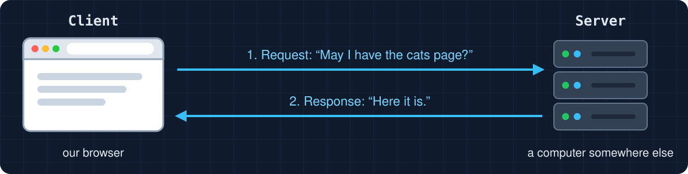
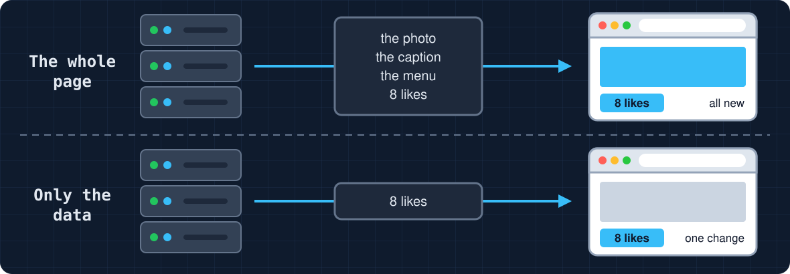
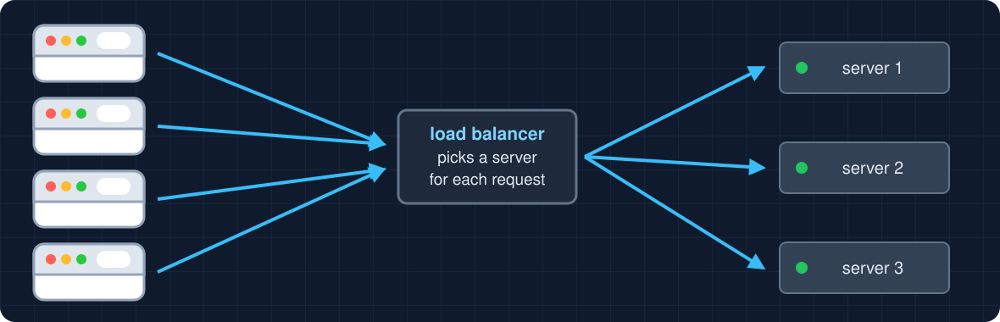

# What Is a Server?

Colan Biemer

---

## Where We Left Off

[Last time](../16-js-form-validation/lecture.html#30), we checked a sign-up form in the browser, and then said the server has to check everything again.

What is that server?

Today has no code and no exercises. We won't build a server, but every site we visit has one, and they're more interesting than they look.

---

# What a Server Is

---

## Where Is the Page?

Think of a page on Wikipedia. Before we open it, where is it?

- It isn't on our laptop, or we could read it without Wi-Fi.
- It isn't in the browser. The browser only knows how to show pages.

It's on a computer somewhere else. Something on that computer has to notice that we asked, find the page, and send it to us.

---

## Client and Server

- A **client** is a program that asks for something. Our browser is a client, and so is a phone app.
- A **server** is a program that waits to be asked, and answers.

We also call the computer it runs on a server. It doesn't have to be a special computer: while a server program runs on our laptop, our laptop is a server.

---

## Like a Restaurant

| Restaurant               | Web                             |
| ------------------------ | ------------------------------- |
| a customer               | the client                      |
| placing an order         | a request                       |
| the kitchen              | the server                      |
| the pantry               | where the server keeps its data |
| the plate that comes out | a response                      |

The customer never goes into the kitchen. The kitchen doesn't cook until someone orders, but someone has to be there, ready, the whole time it's open.

---

## The First Web Server

At the end of 1990, Tim Berners-Lee had the first web server running at [CERN](https://home.cern/science/computing/birth-web/short-history-web), a physics lab near Geneva. It was an ordinary desktop computer, a NeXT, in an office.

A handwritten label stuck to the front said:

> This machine is a server. DO NOT POWER IT DOWN!!

What would have happened if someone did?

---

## The Whole Web, Turned Off

For a while, that computer was the only web server there was. Turning it off turned off the web.

That label is still the main thing about servers: a server has to be **on**, and **connected**, whenever anyone might ask. Our laptop can be a server, but it stops being one when we close the lid.

Much of what makes servers interesting comes from trying to never turn one off.

---

# One Click

---

## A Request and a Response

The client sends one **request**, and the server sends back one **response**. The client always goes first. The rules for these messages are called **HTTP**, the letters at the front of a web address. The **S** in HTTPS means the messages are encrypted on the way.

---

## How Does the Browser Find It?

A name like wikipedia.org is for people. Computers find each other by number, called an **IP address**.

Before the browser can ask for a page, it has to look up the number for the name. The system that answers is called **DNS**. It works like the contacts on a phone: we tap a name, and the phone dials a number.

Remember DNS. It comes back when things go wrong.

---

## Predict: How Many Requests?

We open a page for the first time. It has:

- one CSS file
- one JavaScript file
- four different photos

How many requests does the browser send?

**A.** 1

**B.** 3

**C.** 6

**D.** 7

---

## Answer: How Many Requests?

**D.** One for the page itself, and one for each of the six files it names. The browser can't know about the files until it has read the page.

Many real pages make over a hundred, for fonts, ads, and trackers as well as photos, and often from many different servers.

**Try it:** open DevTools, click the **Network** tab, and reload a news site.

---

## When the Answer Is No

Each response comes with a number that says how it went.

| Number | Means                               | Who has the problem? |
| ------ | ----------------------------------- | -------------------- |
| 200    | OK, here it is                      | nobody               |
| 301    | it moved, look over there           | nobody               |
| 403    | you aren't allowed                  | the client           |
| 404    | there's nothing here by that name   | the client           |
| 500    | something broke while I was working | the server           |

A 404 is good news about the server: it was on, it got our request, and it answered. The answer was that it couldn't find the page.

---

## The Same for Everyone, or Made for You

- A **static** page is a file. The server finds it and sends it, and everyone gets the same one. Our course site is static.
- A **dynamic** page is made when we ask for it. Two people open the same Instagram address at the same moment and get different photos.

To make a page for us, the server needs to know who we are and what we follow. Where does it keep all that?

---

## Where the Data Lives

A **database** is a program whose job is to store data and find it fast. The browser never talks to it. Everything goes through the server, which decides what we're allowed to see.

---

## The Whole Page, or Only the Data

With [server-side rendering](../08-js-intro/lecture.html#8), any change meant a new page. Now JavaScript can ask for one number, and [put it on the page](../13-js-forms-dom/lecture.html#34).

---

## Web APIs

A server that answers with data instead of pages is called a **web API**. Its clients are programs, not people.

- A weather company runs one web API. Its website, its phone app, and a smart speaker all ask it.
- A pizza shop's site shows a map. The shop didn't make the map: its page asks a map company's API.
- A "Sign in with Google" button asks one of Google's APIs who we are.

An API is like the menu at our restaurant: a list of what we can ask for, with no word about how the kitchen makes it.

---

## The Server Forgets

HTTP is **stateless**: each request stands alone. Nothing in it says that this request and the last one came from the same person. So how do we stay logged in?

1. We log in once, and the server gives our browser a long secret number in a **cookie**, a bit of text the browser keeps for that site.
2. The browser sends the cookie back with every request.

It works like a wristband at a concert. They check our ticket once, and after that, they check the wristband. Anyone who steals it gets in too.

---

# Trust

---

## Predict: A One-Dollar Laptop

A store's page shows a laptop for $900. We open DevTools, change the price on the page to $1, and click **Buy**.

What happens?

**A.** We pay $1

**B.** We pay $900

**C.** The page won't let us

**D.** It depends

---

## Answer: A One-Dollar Laptop

**D.** The page is our copy, so we can change anything on it.

- A careful server ignores the price we send and looks it up in its database. We pay **$900**.
- A careless server believes us. We pay **$1**.

The browser is the customer's side of the counter. Checks there [help honest people](../16-js-form-validation/lecture.html#3) fix typos. Checks on the server protect the store.

---

## What We Can and Can't See

We can read the HTML, CSS, and JavaScript of any page we visit, because the browser needs a copy to run it.

We can't read the server's code. It runs on their computer, and only its answers come to us. This is why:

- passwords are checked on the server
- prices and grades are stored on the server
- in an online game, the server decides who won

Anything secret that gets sent to the browser isn't secret anymore.

---

## Who Are You? Are You Allowed?

A server has two questions for every request, and they're different.

- **Authentication**: who are you? Our password, or our cookie, answers this.
- **Authorization**: are you allowed to do this? Only the server can answer.

Suppose we log in as ourselves, and then change the student number in the address to someone else's. A server that asks only the first question shows us their grades. Real sites have leaked real data exactly this way.

---

# Millions of Visitors

---

## Sharing the Work

One computer can answer only so many requests at once. A **load balancer** spreads them over many servers with the same program. If one breaks, the rest keep answering, and nobody notices.

---

## Data Centers

Big sites need thousands of servers, so they fill buildings with them, called **data centers**. The building's hardest problems aren't about code:

- **Power**: batteries and generators take over if the lights go out.
- **Heat**: every server is a small heater, so cooling never stops.
- **Parts**: with thousands of machines, something breaks every day.

In 2024, data centers used about [1.5% of the world's electricity](https://www.iea.org/reports/energy-and-ai/executive-summary). The International Energy Agency expects that to be nearly 3% by 2030, with AI as the main reason.

---

## The Cloud

The **cloud** is someone else's data center. Companies like Amazon, Microsoft, and Google rent out their servers by the hour, or even by the second.

- A shop can rent 100 servers for a holiday sale, and give back 98 the next day.
- Two students can start a company without buying a computer.
- A company that rents has no building, no generators, and no broken parts.

The trade: it's their building, so when they have a bad day, so do we.

---

## Predict: New York to Sydney

A perfect server in Sydney answers instantly. We click a link in New York, about 16,000 km away, over a perfect cable.

What's the soonest we could hear back?

**A.** 0.0016 seconds

**B.** 0.016 seconds

**C.** 0.16 seconds

**D.** 1.6 seconds

---

## Answer: New York to Sydney

**C.** Light in a glass cable goes about 200,000 km each second. That's 0.08 seconds there and 0.08 back, and no better computer can fix it.

It really is a cable. Over [99% of the data between continents](https://blog.telegeography.com/2023-mythbusting-part-3) goes through cables on the ocean floor, and almost none by satellite.

It also adds up. If a page needs ten trips, one after another, that's over a second and a half of waiting for light.

---

## Keeping a Copy Nearby

We can't make light faster, so we make the trip shorter. A **CDN** (content delivery network) keeps copies of files on servers all over the world, and each request goes to a close one.

- We used one: our pages loaded [Bootstrap from a CDN](../07-css-bootstrap/lecture.html).
- It's also why a popular show starts right away. The video is likely on a server near us, maybe inside our internet company's building.

The hard part is when the original changes, and old copies are still out there.

---

## October 4, 2021: Facebook

Facebook, Instagram, and WhatsApp were gone for about six hours.

1. During routine maintenance, one command [disconnected Facebook's data centers](https://engineering.fb.com/2021/10/05/networking-traffic/outage/) from each other by mistake. A tool meant to catch bad commands had a bug.
2. Facebook's DNS servers couldn't reach the data centers, so they took themselves offline. Nobody could look up where Facebook was.
3. Facebook's own tools used the same network. Engineers couldn't fix it from their desks, and [some badges stopped opening doors](https://www.snopes.com/news/2021/10/05/cause-facebook-outage-2021/).

The servers were on the whole time. They just couldn't be found.

---

## October 20, 2025: Amazon

Amazon rents out the cloud, and many companies rent from the same region, in Virginia.

1. Two copies of a program that keeps DNS up to date got out of step, and one [erased the address of a database](https://www.infoq.com/news/2025/11/aws-dynamodb-outage-postmortem) that many other services use.
2. Apps that depended on it failed, then apps that depended on those.
3. Snapchat and Slack [had trouble](https://www.thousandeyes.com/blog/aws-outage-analysis-october-20-2025) along with many others, for up to 15 hours.

These companies share no code and don't know each other. They had a landlord in common.

---

## Summary

- A client asks, and a server answers. A server is a program, and the computer it runs on.
- A server has to be on and connected whenever anyone might ask.
- Opening one page can take dozens of requests.
- Servers send pages, or with a web API, only the data.
- The page is our copy, so the server has to check everything.
- Big sites share the work over many servers and keep copies close by.
- Behind every site is a real building, real cables, and people on call.

---

## Next Up: What Is TypeScript?

[What Is TypeScript?](../18-typescript/lecture.html)
