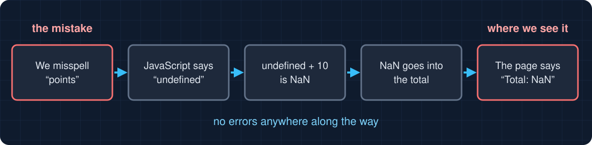
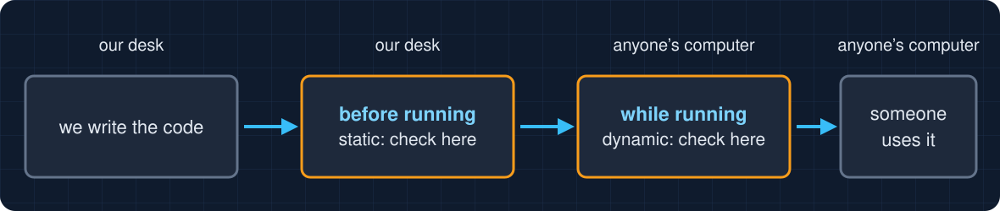
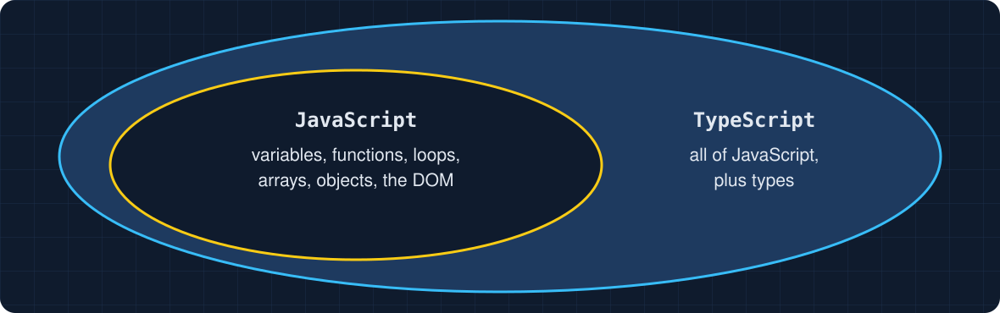
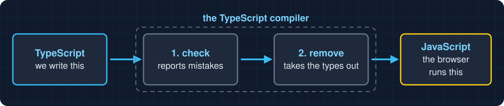

# What Is TypeScript?

Colan Biemer

---

## Today

Look for a web developer job, and the posting may ask for **TypeScript**. It's on GitHub, in tutorials, and in the code AI tools write.

- What is it?
- What problem does it solve?
- Why do some people love it, and others leave it?

Today has no code and no exercises. We won't write any TypeScript. The goal is to know what it is when you see it.

---

# JavaScript Rarely Complains

---

## Ten Days in 1995

Brendan Eich wrote the [first JavaScript in ten days](../08-js-intro/lecture.html#14). It was for small jobs: check a box on a form, or change an image under the mouse.

For small jobs, being forgiving makes sense. If one line has a strange value in it, it's better to carry on than to show the visitor a broken page. So JavaScript carries on whenever it can.

---

## What It Became

Then people built bigger things with it:

- **2004**: Gmail, a whole email program in a page
- **2005**: Google Maps, a map we can drag
- **2009**: [Node.js](../08-js-intro/lecture.html#19), which runs JavaScript on servers
- **Now**: photo editors, games, and VS Code, a code editor

A big program can have millions of lines, written by hundreds of people over many years. Nobody has read all of it.

Being forgiving isn't as helpful anymore. Why?

---

## Kinds of Values

Every value in JavaScript has a [type](../08-js-intro/lecture.html#54), the kind of thing it is.

| Type      | For example                      |
| --------- | -------------------------------- |
| number    | 20                               |
| string    | "20", or any other text          |
| boolean   | true or false                    |
| undefined | nothing was ever put here        |
| object    | a player, with a name and points |

The number 20 and the text "20" look the same on a page, but they aren't the same type.

---

## Predict: Happy Birthday

A form asks for your age, and you type 20. On your birthday, the page adds 1 to what you typed.

What age does it show?

**A.** 21

**B.** 201

**C.** 20

**D.** An error

---

## Answer: Happy Birthday

**B.** A text box [always gives a string](../08-js-intro/lecture.html#68), even when we type digits. Adding to a string glues, so "20" and 1 make "201".

JavaScript did what it was told, and reported no problem. It had two choices, and neither is what we meant:

- stop with an error
- guess what we wanted

It guessed.

---

## Predict: One Letter Short

A player has a name and a number of points. In one place, we leave the **s** off and ask for the player's "point".

What does JavaScript do?

**A.** Stops with an error

**B.** Gives 0

**C.** Gives undefined

**D.** Fixes the typo

---

## Answer: One Letter Short

**C.** Asking an object for something it doesn't have [gives undefined](../10-js-objects-loops/lecture.html#5).

That's not an error, because sometimes it's useful: maybe some players have a team and some don't. JavaScript can't tell a player with no team from a programmer who can't spell.

So what happens to the undefined?

---

## A Mistake Travels

**NaN** means "not a number", and any math with it gives NaN again. By the time someone sees it, it could be on another page, in a file we didn't write, weeks later. Finding the missing letter means walking the whole trail backward.

---

## Who Finds the Mistake?

| Who finds it | When           | What it costs                       |
| ------------ | -------------- | ----------------------------------- |
| us           | while typing   | two seconds                         |
| us           | when we try it | a few minutes                       |
| a teammate   | next week      | an hour, and a message to us        |
| a user       | next year      | maybe they leave, and never say why |

The same typo costs more the later it's found. Can we move every mistake up this table?

---

## A Number With No Label

In 1999, NASA lost the **Mars Climate Orbiter**, a spacecraft usually said to have cost $125 million.

- One program wrote out the push of the thrusters in pounds of force, the English unit.
- Another [read the same numbers](https://sma.nasa.gov/docs/default-source/safety-messages/safetymessage-2009-08-01-themarsclimateorbitermishap.pdf) as newtons, the metric unit. It was off by about 4.45 times.

Both programs ran without an error. The numbers were fine as numbers, but nothing written on them said what they were.

What if values had labels, and something checked them?

---

# Checking Before Running

---

## What Is a Type?

A **type** is a label that says what can go in something, and what we can do with it.

- Electrical outlets have shapes, so the wrong plug doesn't go in.
- A measuring cup labeled "sugar" gets sugar.
- A form's number box doesn't take a name.

Nobody has to remember the rule. The shape enforces it. A language where we, or the computer, check those labels is doing **type checking**.

---

## Two Times to Check

- **Static** typing checks before the program runs, like the airport checking our passport before we board.
- **Dynamic** typing checks while it runs, like finding out when we land.

JavaScript is [dynamic](../08-js-intro/lecture.html#15), and it often lets us in without a passport.

---

## Which Languages?

| Static           | Dynamic    |
| ---------------- | ---------- |
| Java             | JavaScript |
| C, C++, and C#   | Python     |
| Go and Rust      | Ruby       |
| Swift and Kotlin | PHP        |

Neither side is better. Dynamic languages are quick to start, and good for small programs and trying things out. Static languages ask for more up front, and pay it back as the program grows.

What if we have a program that started small?

---

# TypeScript

---

## TypeScript

**TypeScript** is JavaScript, plus types that are checked before the program runs.

Microsoft released it in 2012. Teams there were building large programs in JavaScript and having the trouble we just saw. It was led by Anders Hejlsberg, who also designed C#. It's free, and anyone can use it.

It works like a spell checker. While we type, it underlines what looks wrong and says why, before anyone else sees it.

---

## What It Would Have Said

| We wrote                                   | JavaScript      | TypeScript                                  |
| ------------------------------------------ | --------------- | ------------------------------------------- |
| a player's "point"                         | gives undefined | There is no "point". Did you mean "points"? |
| a function that wants a number, given text | runs it anyway  | That's a string, and this needs a number.   |
| a function that wants 2 things, given 1    | runs it anyway  | This needs 2, and you gave it 1.            |

These are paraphrased, but it really does suggest "points". Each shows up in the editor, under the mistake, as we type.

---

## JavaScript Is Inside

Everything we learned this semester is also TypeScript. A language that contains all of another one is called a **superset**. Why not design a better language from scratch?

---

## Why Not a New Language?

Browsers run JavaScript. A new language needs every browser to agree to it, and billions of pages can't be rewritten.

Google tried. In 2011, it announced **Dart**, and hoped browsers would run it directly. Other browsers didn't want it, and in 2015 Google gave up on putting it in Chrome. Dart lives on today, mostly in phone apps.

TypeScript asked browsers for nothing. How can it work, if no browser understands it?

---

## What Happens to It

A **compiler** is a program that turns one language into another. TypeScript's checks the types, then mostly just removes them. The browser gets plain JavaScript and never knows.

The types are like scaffolding: there while we build, and gone when it opens.

---

## Predict: A Server's Answer

Our TypeScript says a player's points are a number. The compiler finds no mistakes. Then, with the page running, a [server](../17-servers/lecture.html#17) sends us the points as the text "600", and we add 1.

What happens?

**A.** The editor warns us

**B.** It stops with an error

**C.** 601

**D.** 6001

---

## Answer: A Server's Answer

**D.** The types were gone before the page ran, so nothing was there to check. We're back to plain JavaScript, gluing strings.

- TypeScript checks **our code**, before it runs.
- It can't check **data** that arrives later, from a server or a person typing.

A type is a claim about data we haven't seen yet. This is why TypeScript doesn't replace [form validation](../16-js-form-validation/lecture.html#3), or checks on the server.

---

## A Little at a Time

A team with a million lines of JavaScript can't stop for a year to add types. With TypeScript, they don't have to.

- They can move **one file at a time**, and the rest keeps working.
- They can leave a part **unchecked** until they get to it.
- They don't have to label everything. If a variable starts as 10, TypeScript figures out that it holds a number. This is called **inference**.

This may be why it caught on when other languages didn't: it never asked anyone to start over.

---

## More Than Catching Mistakes

Once the editor knows the type of everything, it can do more:

- **Suggest**: type a dot after a player, and it lists name and points.
- **Rename**: change "points" to "score", and it changes every use, and nothing else with the same name.
- **Explain**: the types say what a function needs, and unlike a comment, they get checked.

VS Code uses TypeScript for suggestions even in plain JavaScript files. You may have used it already without knowing.

---

# Is It Worth It?

---

## Predict: Which Would It Catch?

Which of these mistakes would TypeScript find before the program runs?

1. A misspelled property name
2. Taking $10 off instead of 10%
3. Giving a function two values when it needs three
4. Text from a server where we expected a number
5. Using an element without checking that it was found

---

## Answer: Which Would It Catch?

1. **Yes.** It knows what properties there are.
2. **No.** $10 and 10% are both numbers, and both subtract fine.
3. **Yes.** It knows how many the function takes.
4. **No.** The data comes after the types are gone.
5. **Yes.** Looking up an element might give [null](../13-js-forms-dom/lecture.html#31), and it makes us plan for that.

It finds code that **doesn't fit together**. It can't find code that fits together and does the wrong thing. On its own, it wouldn't have saved the orbiter, unless the programmers had made a type for each unit.

---

## How Many Bugs Is That?

- In 2017, researchers took 400 bugs that had been fixed in public JavaScript projects, and added types to the code from before each fix. TypeScript would have caught [about 15%](https://blog.acolyer.org/2017/09/19/to-type-or-not-to-type-quantifying-detectable-bugs-in-javascript).
- Airbnb looked back at its own bugs, and estimated [38%](https://www.infoq.com/news/2020/08/airbnb-typescript-migration).

Why would they be so different? One is a study of bugs that had already gotten past testing and review. The other is a company's estimate about itself.

Is 15% a lot?

---

## What It Costs

- **Setup**: there's a step between writing and running. Our pages this semester had none.
- **Time**: we write and read more.
- **Arguing**: sometimes our code is right, and we can't convince the checker.
- **Learning**: the types for complicated code can be harder to read than the code.

In 2023, the team behind Turbo, a web tool, [removed TypeScript](https://developers.slashdot.org/story/23/09/07/2026202/ruby-on-rails-creator-removes-typescript-from-turbo-framework-upsets-community). Its creator had never been a fan. That year, the Svelte team [stopped writing their own code in it](https://devclass.com/2023/05/11/typescript-is-not-worth-it-for-developing-libraries-says-svelte-author-as-team-switches-to-javascript-and-jsdoc/) to skip the extra step, but kept the types by putting them in comments.

---

## Who Uses It?

In August 2025, TypeScript became the [most used language on GitHub](https://github.blog/news-insights/octoverse/octoverse-a-new-developer-joins-github-every-second-as-ai-leads-typescript-to-1/), counted by how many people contributed code in it that month. It passed both Python and JavaScript.

GitHub gives part of the credit to AI. When a tool writes our code, a checker that reads every line is a useful second opinion.

One more twist: TypeScript's compiler was written in TypeScript. In 2026, Microsoft released a version [rewritten in Go](https://www.infoq.com/news/2026/08/typescript-7-released/), another static language, and it's about 10 times faster.

---

## Summary

- JavaScript was made for small scripts, and carries on when a value makes no sense.
- A mistake can travel far before anyone sees it, and costs more the later it's found.
- Static typing checks before a program runs. Dynamic typing checks while it runs.
- TypeScript is JavaScript plus types, checked as we write.
- The types are removed before the browser runs the code, so they can't check data that arrives later.
- It finds code that doesn't fit together, not code that does the wrong thing.
- It takes time, and helps most when there's a lot of code and many people.

---

## Next Up: Wrap-Up

[Wrap-Up](../19-wrap-up/lecture.html)
