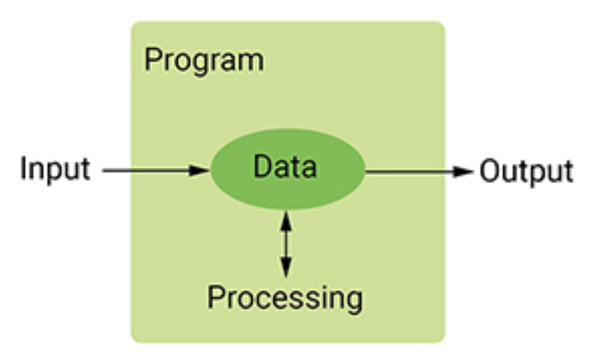
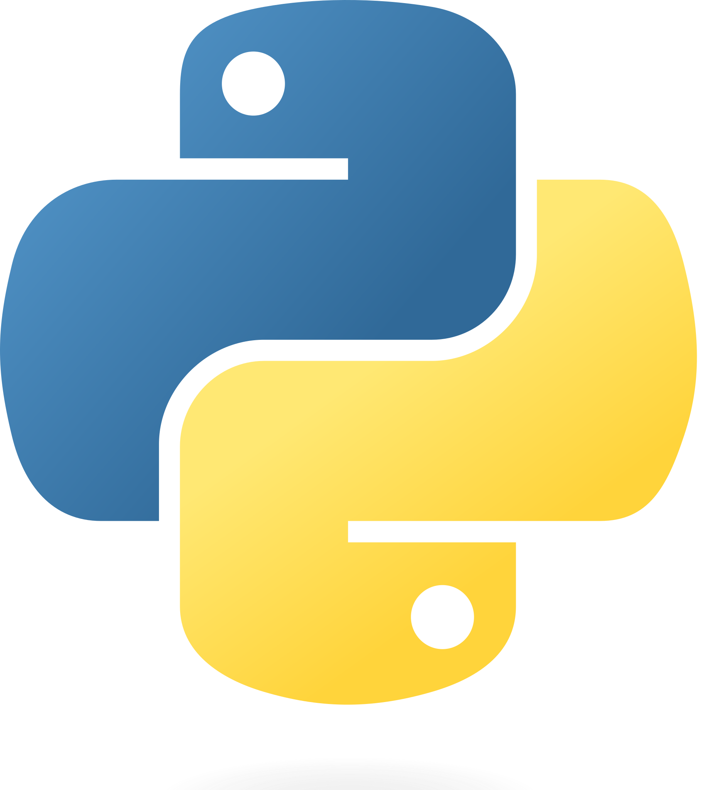

# Introduction to Programming with Python

Colan Biemer

---

## Course Info

- Syllabus
- Schedule
- Office Hours
- etc.

---

## What is a Computer Program?

"A computer program takes input, processes it in a desired way, and provides output."

<center>
</img>
</center>

---

## Example: Calculator

- Input: ?
- Processing: ?
- Output: ?

---

## Example: Calculator

- Input: User pressing on buttons
- Processing: Button presses combined into a math expression
- Output: A number

---

## Example: Vending Machine

- Input: ?
- Processing: ?
- Output: ?

---

## Example: Vending Machine

- Input: Money and button press
- Processing: Machine checks money matches item price
- Output: Item drops, change returned

---

## Python

Python is a general purpose scripting language, and it is one of the most popular programming languages in the world.

<center>
    </img>
</center>

---

## Examples of Where Python is Used Today

- Dropbox - desktop client built in Python
- Instagram - backend client written in Python
- Google - "Python where we can, C++ where we must."
- Fenris Creations - backend client for the MMO _Eve Online_
- ... and many more

---

## Python Beyond Corporate Examples

- Python is used as the backbone behind LLM training
- Python is, arguably, the most common language used for data science
- Python is frequently used to automate simple tasks (e.g. delete files that are 30 days old)

---

## Python Compared to Other Programming Languages

- Python is slower than "compiled" languages
- Python is general purpose
- Python cannot easily run on the browser

---

## Running Python from the Terminal

```
$ python3
>>> print("Hello, World!")
Hello, World!
```

---

## Running Python from Visual Studio Code

...

---

## General Terms

- Editor
- Integrated Development Environment

---

## Last Point

One of the selling points of Python is that reads like english. So far, we haven't seen much but we'll come back to this as we progress through the semester.

---

## Summary

- A program takes **input**, **processes** it, and gives **output** (IPO)
- Python is a general purpose scripting language, and one of the most popular
- Python runs Dropbox, Instagram, LLM training, data science, and small automation scripts
- Python is slower than compiled languages and doesn't run in the browser
- You can run Python from the terminal or from an editor like Visual Studio Code

---

## Next Time

We start writing programs: variables, printing, user input, and the types Python uses to hold data.
