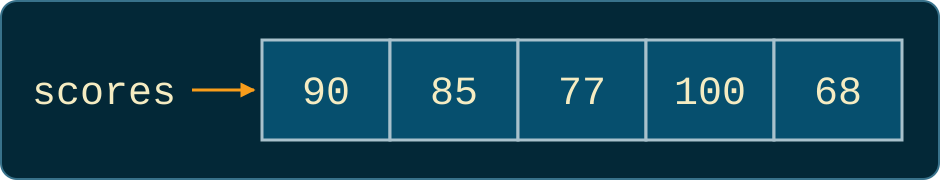
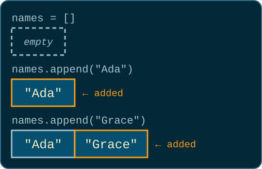
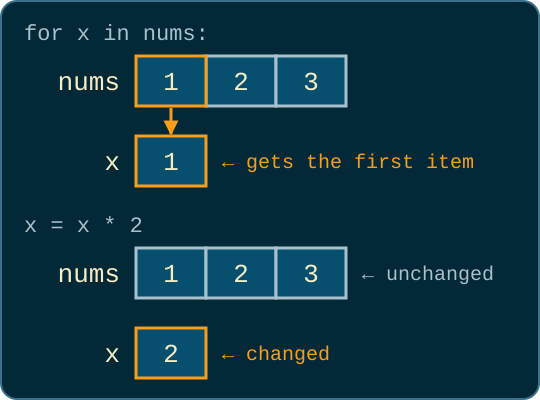

# Lists

Colan Biemer

---

## Required Reading

Read **Chapter 6: Lists** and **Appendix G: Lists in Brief** of the textbook.

The syllabus, in the Course Info Module, has details of the textbook and how you may acquire it.

---

## Announcements

**TODO: TBD**

- Program 3 (Due: TODO)
- Practice Problems 6.1, 6.2, and 6.3 (Due: TODO)

---

## Average of Five Scores

```python
s1 = 90
s2 = 85
s3 = 77
s4 = 100
s5 = 68

average = (s1 + s2 + s3 + s4 + s5) / 5
print(f"Average: {average}")   # Average: 84.0
```

- What about a class of 30?
- What if we don't know how many scores there will be?

---

## Creating a List

```python
scores = [90, 85, 77, 100, 68]
```

<center> 

</center>
<br/>

`scores` holds all five scores, in order. Square brackets go around the values, with commas between them. Each value is an **item**. The textbook also calls them **elements**.

---

## The List Type

```python
scores = [90, 85, 77, 100, 68]
print(type(scores))   # <class 'list'>

parts = "Jane Doe".split(" ")
print(type(parts))    # <class 'list'>
```

`list` is a type, like `int`, `float`, `str`, and `bool`.

---

## Lists Can Hold Any Type

```python
names = ["Ada", "Grace", "Alan"]   # strings
prices = [2.50, 1.25, 4.00]        # floats
present = [True, False, True]      # bools
student = ["Ada", 19, 3.9, True]   # a mix: name, age, GPA, enrolled

print(student)                     # ['Ada', 19, 3.9, True]
```

The items in a list do not have to be the same type. Python allows a mix, but most lists hold one type so that every item can be treated the same way.

---

## Indexing a List

```python
scores = [90, 85, 77, 100, 68]
```

<center>

| Index | 0    | 1    | 2    | 3     | 4    |
| ----- | ---- | ---- | ---- | ----- | ---- |
| Item  | `90` | `85` | `77` | `100` | `68` |

</center>

This is the same way that we index a string (e.g. `scores[0]` gives `90`).

---

## Index Out of Range

```python
scores = [90, 85, 77, 100, 68]

print(len(scores))               # 5
print(scores[len(scores) - 1])   # 68
print(scores[5])                 # IndexError: list index out of range
```

---

## Negative Indexes

```python
scores = [90, 85, 77, 100, 68]
print(scores[-1])   # 68, the same as scores[len(scores) - 1]
```

<center>

| Index          | 0    | 1    | 2    | 3     | 4    |
| -------------- | ---- | ---- | ---- | ----- | ---- |
| Item           | `90` | `85` | `77` | `100` | `68` |
| Negative index | -5   | -4   | -3   | -2    | -1   |

</center>

A **negative index** counts from the end: `-1` is the last item. Going past the front, like `scores[-6]`, crashes the same as going past the end. Strings work the same way: `"hello"[-1]` is `"o"`. (You can also use negative indexes for strings.)

---

## Adding Items with `append`

<div class="cols">
<div>

```python
names = []
names.append("Ada")
names.append("Grace")

print(names)        # ['Ada', 'Grace']
print(len(names))   # 2
```

</div>
<div>



</div>
</div>

`[]` is an empty list. `append` adds one item to the end.

---

## `append` Gives Back `None`

```python
names = []
names = names.append("Ada")
print(names)            # None
names.append("Grace")   # AttributeError
```

```
AttributeError: 'NoneType' object has no attribute 'append'
```

`append` changes the list and gives back `None`, like a function without a `return`. Storing that `None` in `names` throws the list away. Call `append` on a line of its own.

---

## Functions Can Return a List

```python
def countdown(n):
    numbers = []
    for i in range(n, 0, -1):
        numbers.append(i)

    return numbers

print(countdown(3))   # [3, 2, 1]
print(countdown(5))   # [5, 4, 3, 2, 1]
```

A function can build a list and hand it back with `return`, the same way `split` hands back a list of words.

---

## I Do: Collect Scores

```python
# Write a function, read_scores, that asks for test scores until the
# user enters a blank line and returns them as a list.
# Print the list and how many scores there are.
```

```
Score: 90
Score: 85
Score: 77
Score:
[90, 85, 77]
3 scores
```

---

## Solution: Collect Scores

<style scoped>
pre { font-size: 0.75em; }
</style>

```python
def read_scores():
    scores = []
    entry = input("Score: ")
    while entry != "":
        scores.append(int(entry))
        entry = input("Score: ")

    return scores

scores = read_scores()
print(scores)
print(f"{len(scores)} scores")
```

The loop is the Summing Numbers loop from week 3: read, check, then read again at the bottom. `return scores` comes after the loop, once every score is in. The `scores` inside the function is local; the one outside gets the returned list.

---

## Parsons Problems

A **Parsons problem** gives you every line of a working program, but scrambled and with no indentation. Your job is to put the lines back in order and indent them.

1. Copy the lines into VS Code.
2. Move a line with `Option + ↑` / `Option + ↓` (Mac) or `Alt + ↑` / `Alt + ↓` (Windows).
3. Indent with `Tab`, and unindent with `Shift + Tab`.
4. Run it and compare your output with the expected output.

---

## How to Untangle a Program

1. **Read the expected output.** What gets printed, and in what order?
2. **Find the start.** What does everything else need first? A function's `def` comes before any call to it.
3. **Find the end.** Output usually comes last.
4. **Find the blocks.** A line ending in `:` owns the lines you indent under it.
5. **Check the names.** Every variable needs a value before it is used.

More than one order can be correct. Run it with a few different inputs to check.

---

## We Do: Score Lookup

Look up a test score by its test number, where the first test is test 1. Put the lines in order and indent them.

<div class="cols">
<div>

```python
score = get_score(scores, test)
return None
else:
def get_score(scores, test):
print("No such test.")
scores = [90, 85, 77, 100, 68]
print(f"Test {test}: {score}")
if test < 1 or test > len(scores):
test = int(input("Test number: "))
return scores[test - 1]
if score == None:
```

</div>
<div>

```
Test number: 3
Test 3: 77
```

```
Test number: 9
No such test.
```

</div>
</div>

---

## Solution: Score Lookup

<style scoped>
pre { font-size: 0.75em; }
</style>

```python
def get_score(scores, test):
    if test < 1 or test > len(scores):
        return None
    return scores[test - 1]

scores = [90, 85, 77, 100, 68]
test = int(input("Test number: "))
score = get_score(scores, test)
if score == None:
    print("No such test.")
else:
    print(f"Test {test}: {score}")
```

Test numbers start at 1 and indexes start at 0, so test `n` is at index `n - 1`. The guard returns `None` before indexing, so test 9 never reaches `scores[8]`. `return scores[test - 1]` sits at the function's level: inside the `if`, a real test would get `None`.

---

## You Do: Step Goal

Read daily step counts until a blank line. Keep the ones that reach the 10,000 step goal.

<div class="cols">
<div>

```python
entry = input("Steps: ")
print(f"{len(good_days)} good days")
good_days.append(steps)
entry = input("Steps: ")
if steps >= 10000:
good_days = []
while entry != "":
print(good_days)
steps = int(entry)
```

</div>
<div>

```
Steps: 12000
Steps: 8500
Steps: 10000
Steps: 4300
Steps:
[12000, 10000]
2 good days
```

</div>
</div>

---

## Solution: Step Goal

```python
good_days = []
entry = input("Steps: ")

while entry != "":
    steps = int(entry)
    if steps >= 10000:
        good_days.append(steps)
    entry = input("Steps: ")

print(good_days)
print(f"{len(good_days)} good days")
```

`steps = int(entry)` has to come before the `if` that uses it. The second `input` sits at the loop's level, not inside the `if`. Otherwise, the first day under 10,000 steps would loop forever.

---

## Looping Over a List

Visiting every item, one at a time.

---

## The For-Each Loop

```python
for [ITEM] in [LIST]:
    # runs once for each item in the list, in order
    # ITEM holds the current item
```

Name the list after many things and the loop variable after one: `for score in scores`, `for name in names`.

---

## `for` Two Ways

<div class="cols">
<div>

```python
scores = [90, 85, 77]

for i in range(len(scores)):
    print(scores[i])
```

</div>
<div>

```python
scores = [90, 85, 77]

for score in scores:
    print(score)
```

</div>
</div>

Both print `90`, `85`, and `77`. The left loop goes through the indexes, so it has to look each item up. The right loop goes through the items themselves: each time around, `score` holds the next one.

---

## `enumerate`

```python
scores = [90, 85, 77]

for i, score in enumerate(scores):
    print(i, score)
```

```
0 90
1 85
2 77
```

`enumerate` hands the loop two things each time around: the index and the item. `i, score` unpacks them, the same way `a, b = ...` unpacked [two returned values](07-functions.html#84).

---

## Which Loop?

<br/>

<center>

| You need...        | Use                                  |
| ------------------ | ------------------------------------ |
| only the items     | `for score in scores:`               |
| the index          | `for i in range(len(scores)):`       |
| index and the item | `for i, score in enumerate(scores):` |

</center>
<br/>

You can always use the index to access individual items, but getting the index from the item is much more involved.

---

## Modifying List Items

<div class="cols">
<div>

```python
nums = [1, 2, 3]

for x in nums:
    x = x * 2

print(nums)   # [1, 2, 3]
```

</div>
<div>



</div>
</div>

`x` is a separate variable that gets each item in turn. Changing `x` changes only `x`, the same way changing a parameter inside a function does not change the variable you passed in ([example](07-functions.html#48)).

---

## Two Ways to Change Every Item

<div class="cols">
<div>

```python
nums = [1, 2, 3]

doubled = []
for x in nums:
    doubled.append(x * 2)

print(nums)      # [1, 2, 3]
print(doubled)   # [2, 4, 6]
```

</div>
<div>

```python
nums = [1, 2, 3]

for i, x in enumerate(nums):
    nums[i] = x * 2

print(nums)   # [2, 4, 6]
```

</div>
</div>

Left: build a new list and `append` each changed value; `nums` keeps its old values. Right: change the list in place by assigning to `nums[i]`, something a string can never do. Assigning to `x` alone does nothing; assigning to `nums[i]` changes the list.

---

## Functions Can Take and `return` a List

<style scoped>
pre { font-size: 0.8em; }
</style>

```python
def shout_all(words):
    loud = []
    for word in words:
        loud.append(word.upper())

    return loud

names = ["ada", "grace"]
print(shout_all(names))   # ['ADA', 'GRACE']
print(names)              # ['ada', 'grace']
```

A list can be an argument like any other value. `shout_all` builds a new list and returns it, so `names` is unchanged.

---

## I Do: Average of Scores

```python
# Write a function, average, that takes a list of scores and returns
# their average, or None if the list is empty.
scores = [90, 85, 77]
```

```
Average: 84.00
```

---

## Solution: Average of Scores

<style scoped>
pre { font-size: 0.75em; }
</style>

```python
def average(scores):
    if len(scores) == 0:
        return None

    total = 0
    for score in scores:
        total += score
    return total / len(scores)

scores = [90, 85, 77]
result = average(scores)
if result == None:
    print("No scores.")
else:
    print(f"Average: {result:.2f}")
```

The guard returns `None` for an empty list, like `split_bill` in week 5. The loop is the week 3 accumulator, now walking through a list.

---

## We Do: Longest Word

```python
# Write a function, longest_word, that takes a list of words and
# returns the longest one. If two words tie, return the first one.
words = ["lists", "are", "surprisingly", "useful"]
```

```
Longest: surprisingly
```

What do we need to remember as we go? What should it start as?

---

## Solution: Longest Word

<style scoped>
pre { font-size: 0.75em; }
</style>

```python
def longest_word(words):
    longest = ""
    for word in words:
        if len(word) > len(longest):
            longest = word

    return longest

words = ["lists", "are", "surprisingly", "useful"]
print(f"Longest: {longest_word(words)}")
```

`longest` starts as `""`, so any real word beats it. Using `>` instead of `>=` keeps the first word when two tie.

---

## You Do: Even Numbers

Write `evens`, a function that takes a list of numbers and returns a new list with only the even ones. Then print that list and how many there are.

<div class="cols">
<div>

```python
result.append(n)
print(found)
def evens(nums):
nums = [3, 8, 5, 12, 7, 4]
for n in nums:
print(f"{len(found)} even numbers")
return result
result = []
found = evens(nums)
if n % 2 == 0:
```

</div>
<div>

```
[8, 12, 4]
3 even numbers
```

</div>
</div>

---

## Solution: Even Numbers

<style scoped>
pre { font-size: 0.75em; }
</style>

```python
def evens(nums):
    result = []
    for n in nums:
        if n % 2 == 0:
            result.append(n)

    return result

nums = [3, 8, 5, 12, 7, 4]
found = evens(nums)
print(found)
print(f"{len(found)} even numbers")
```

`n % 2 == 0` is the even check from week 3. `result.append(n)` belongs inside the `if`, or every number would be added. `return result` goes after the loop, at the function's level. Indented into the loop, the function would return after the first number.

---

## `min`, `max`, `sum`, and `in`

Answers about the whole list, without writing the loop yourself.

---

## `min` and `max` on a List

```python
print(max(3, 7))       # 7     week 1: the values in the parentheses

scores = [90, 85, 77, 100, 68]
print(max(scores))     # 100   now: every item in the list
print(min(scores))     # 68
```

Since week 1, `max` has compared the values inside its parentheses. Give it one list, and it compares every item in the list instead.

---

## How `max` Works

<div class="cols">
<div>

```python
temps = [-5, -2, -9]

largest = 0
for temp in temps:
    if temp > largest:
        largest = temp

print(largest)   # 0
```

</div>
<div>

```python
temps = [-5, -2, -9]

largest = temps[0]
for temp in temps:
    if temp > largest:
        largest = temp

print(largest)   # -2
```

</div>
</div>

`max` runs this loop for you. Starting from `0` (left) fails when every item is negative: `0` is not even in the list. Start from an item instead (right). `min` is the same loop with `<`.

---

## `min` and `max` on Strings

```python
words = ["pear", "Apple", "fig"]

print(min(words))              # Apple
print(max(words))              # pear
print(max(["3", "10", "7"]))   # 7
```

Strings compare the way they did in week 4: one character at a time, and every uppercase letter comes before every lowercase letter. Numbers stored as strings compare as text, so `"7"` beats `"10"`. Convert with `int` before you `append`.

---

## `sum`

```python
scores = [90, 85, 77, 100, 68]

print(sum(scores))                 # 420
print(sum(scores) / len(scores))   # 84.0
```

`sum` is new: it is the accumulator loop from Average of Scores in one call.

---

## When `max` and `sum` Fail

```python
print(max([]))                 # ValueError
print(sum(["3", "10", "7"]))   # TypeError
```

```
ValueError: max() iterable argument is empty
TypeError: unsupported operand type(s) for +: 'int' and 'str'
```

Each line crashes on its own. An empty list has no largest item, so check `len` first. The second list holds strings, which is what you get when you `append` an `input` without `int`.

---

## `in` and `not in`

```python
names = ["Ada", "Grace", "Alan"]

print("Ada" in names)         # True
print("ada" in names)         # False
print("Ad" in names)          # False
print("Linus" not in names)   # True
print("Ad" in "Ada")          # True
```

On a list, `in` looks for a whole item that matches exactly. On a string, it looks for any piece.

---

## I Do: Score Summary

```python
# Given a list of scores, print the highest, the lowest, the average,
# and whether anyone got a perfect 100.
scores = [90, 85, 77, 100, 68]
```

```
Highest: 100
Lowest: 68
Average: 84.00
Perfect score: True
```

What should this print if `scores` is empty?

---

## Solution: Score Summary

```python
scores = [90, 85, 77, 100, 68]

if len(scores) == 0:
    print("No scores.")
else:
    print(f"Highest: {max(scores)}")
    print(f"Lowest: {min(scores)}")
    print(f"Average: {sum(scores) / len(scores):.2f}")
    print(f"Perfect score: {100 in scores}")
```

Compare with Average of Scores: the loop and the accumulator are gone. The guard stays, since `max`, `min`, and dividing by `len` all fail on an empty list.

---

## We Do: Bleep the Banned Words

```python
# Chat apps hide banned words. Write a function, bleep, that takes a
# message and a list of banned words. Return the message with each
# banned word replaced by stars, one star per letter.
```

```
Message: Shoot I forgot my darn umbrella
***** I forgot my **** umbrella
```

- HINT: we can split the sentence with `.split()`
- How do we check one word?
- How do we get the words back into one string?

---

## Solution: Bleep the Banned Words

<style scoped>
pre { font-size: 0.75em; }
</style>

```python
def bleep(message, banned):
    clean = []
    for word in message.split():
        if word.lower() in banned:
            clean.append("*" * len(word))
        else:
            clean.append(word)

    return " ".join(clean)

banned = ["darn", "heck", "shoot"]
message = input("Message: ")
print(bleep(message, banned))
```

The banned words are a parameter, so `bleep` works with any list. It builds a new list one word at a time, then `join` from week 4 glues it back into a string. What happens with `"darn!"`?

---

## You Do: Above Average

<style scoped>
pre { font-size: 0.75em; }
</style>

Write `count_above`, a function that counts the scores above a cutoff. Use it to print the average and how many scores are above it. **One line does not belong.**

<div class="cols">
<div>

```python
above = count_above(scores, average)
count += 1
print(f"Above average: {above}")
for score in scores:
if scores > cutoff:
scores = [72, 95, 88, 64, 91]
def count_above(scores, cutoff):
print(f"Average: {average}")
if score > cutoff:
average = sum(scores) / len(scores)
count = 0
return count
```

</div>
<div>

```
Average: 82.0
Above average: 3
```

</div>
</div>

---

## Solution: Above Average

<style scoped>
pre { font-size: 0.75em; }
</style>

```python
def count_above(scores, cutoff):
    count = 0
    for score in scores:
        if score > cutoff:
            count += 1

    return count

scores = [72, 95, 88, 64, 91]
average = sum(scores) / len(scores)
above = count_above(scores, average)
print(f"Average: {average}")
print(f"Above average: {above}")
```

The extra line was `if scores > cutoff:`. `scores` is the whole list and `score` is one item, so it compares a list with a number and raises a `TypeError`. `return count` goes after the loop, so every score gets counted first.

---

## Summary

<style scoped>
ul { font-size: 0.85em; }
</style>

- A **list** holds many values, in order, under one name: `[90, 85, 77]`
- Indexing, `len`, and `IndexError` work the same as for strings; a negative index counts from the end, so `-1` is the last item
- Build a list by starting from `[]` and calling `append`, which changes the list and gives back `None`
- `for item in a_list:` visits every item; `for i in range(len(a_list)):` gives the position; `for i, item in enumerate(a_list):` gives both
- Changing the loop variable does not change the list; build a new list, or assign to `a_list[i]` to change it in place
- `sum`, `min`, and `max` answer questions about a whole list; `min` and `max` fail on an empty list
- `in` and `not in` check for a whole item, not a piece of one
- A function can take a list as a parameter and return a list, like any other value

---

## Next Up: Changing Lists

Slicing, `insert`, `remove`, `pop`, copying, sorting, and tables as lists of lists.
