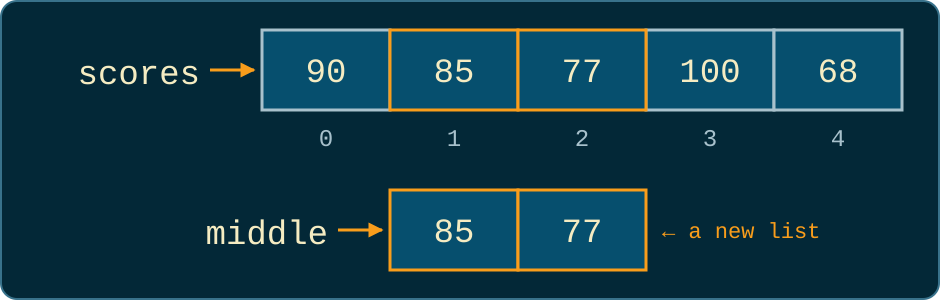
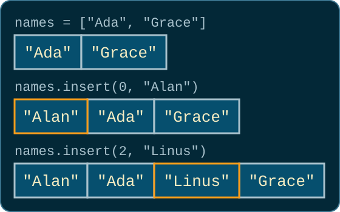
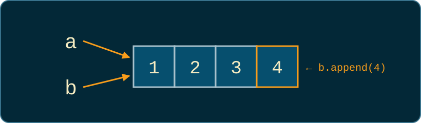
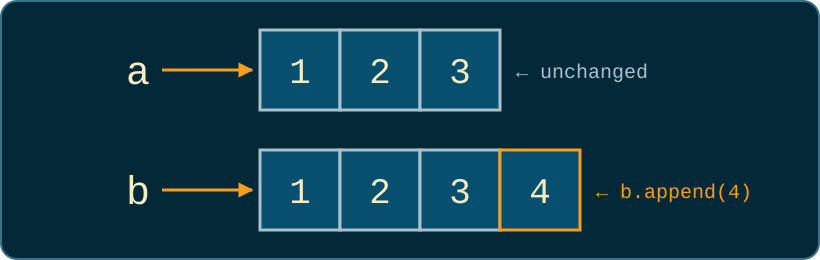

# Changing Lists

Colan Biemer

---

## Slicing and Changing a List

Taking part of a list, and changing what is in it.

---

## Slicing a List

```python
scores = [90, 85, 77, 100, 68]

print(scores[1:3])    # [85, 77]
print(scores[:2])     # [90, 85]
print(scores[2:])     # [77, 100, 68]
print(scores[-2:])    # [100, 68]
```

Slices follow the same rules as [string slices](06-strings-and-format-strings.html#74): start at the first index and stop before the second. Leave out the first index to begin at the front, or the second to run to the end. `scores[-2:]` starts two from the end, so it is the last two items.

---

## A Slice Is a New List

```python
scores = [90, 85, 77, 100, 68]
middle = scores[1:3]

print(middle)   # [85, 77]
print(scores)   # [90, 85, 77, 100, 68]
```

<center>

</center>

`middle` is a new list holding two of the items. `scores` keeps all five.

---

## Changing One Item

```python
scores = [90, 85, 77, 100, 68]
scores[0] = 95
print(scores)   # [95, 85, 77, 100, 68]

word = "hello"
word[0] = "H"   # TypeError
```

```
TypeError: 'str' object does not support item assignment
```

Assigning to an index replaces that item, as in [Two Ways to Change Every Item](08-lists.html#27). A list can change in place. A string is [immutable](06-strings-and-format-strings.html#41), so it cannot.

---

## Adding with `insert`

<div class="cols">
<div>

```python
names = ["Ada", "Grace"]
names.insert(0, "Alan")
print(names)
# ['Alan', 'Ada', 'Grace']

names.insert(2, "Linus")
print(names)
# ['Alan', 'Ada', 'Linus', 'Grace']
```

</div>
<div>



</div>
</div>

`insert(i, x)` puts `x` at index `i` and moves every item after it one place to the right. `append` can only add at the end.

---

## Removing Items

```python
names = ["Alan", "Ada", "Linus", "Grace", "Barbara"]

names.remove("Linus")   # removes the first "Linus"
last = names.pop()      # removes and returns the last item
first = names.pop(0)    # removes and returns item 0
del names[0]            # removes item 0

print(last, first)      # Barbara Alan
print(names)            # ['Grace']
```

`del` is a keyword, not a method: no dot, no parentheses, and nothing given back.

---

## Which Removal?

<br/>

<center>

| To remove...            | Use               | Gives back |
| ----------------------- | ----------------- | ---------- |
| the first match for `x` | `names.remove(x)` | `None`     |
| the item at index `i`   | `names.pop(i)`    | the item   |
| the item at index `i`   | `del names[i]`    | nothing    |
| the last item           | `names.pop()`     | the item   |

</center>
<br/>

`pop` is the only one that hands the item back, so you can store it or pass it along. Use `del` when you do not need the item.

---

## When `remove` and `pop` Fail

```python
names = ["Ada", "Grace"]
names.remove("Alan")   # ValueError
[].pop()               # IndexError
```

```
ValueError: list.remove(x): x not in list
IndexError: pop from empty list
```

Each line crashes on its own. Check with `in` before `remove`, and check `len` before `pop`, the same `len` guard as [When `max` and `sum` Fail](08-lists.html#40).

---

## Removing While Looping

<div class="cols">
<div>

```python
nums = [3, 5, 8, 7, 9]

for n in nums:
    if n % 2 == 1:
        nums.remove(n)

print(nums)   # [5, 8, 9]
```

</div>
<div>

```python
nums = [3, 5, 8, 7, 9]

evens = []
for n in nums:
    if n % 2 == 0:
        evens.append(n)

print(evens)   # [8]
```

</div>
</div>

The left loop walks by position. Removing `3` slides `5` into index 0, and the loop moves on to index 1, so it never checks `5`. Removing `7` skips `9` the same way. Build a new list instead (right), as in [Even Numbers](08-lists.html#34). [Visualization](https://pythontutor.com/visualize.html#code=nums%20%3D%20%5B3%2C%205%2C%208%2C%207%2C%209%5D%0A%0Afor%20n%20in%20nums%3A%0A%20%20%20%20if%20n%20%25%202%20%3D%3D%201%3A%0A%20%20%20%20%20%20%20%20nums.remove%28n%29%0A%0Aprint%28nums%29&curInstr=0&mode=display&origin=opt-frontend.js&py=311)

---

## I Do: Playlist

```python
# A playlist plays its songs in order. Move the last song to the
# front, then print the next three songs and the rest.
playlist = ["Blue Sky", "Rainy Day", "Night Drive", "Sunrise", "Last Call"]
```

```
Up next: ['Last Call', 'Blue Sky', 'Rainy Day']
Later: ['Night Drive', 'Sunrise']
```

What should this do if the playlist is empty?

---

## Solution: Playlist

<style scoped>
pre { font-size: 0.75em; }
</style>

```python
playlist = ["Blue Sky", "Rainy Day", "Night Drive", "Sunrise", "Last Call"]

if len(playlist) > 0:
    song = playlist.pop()
    playlist.insert(0, song)

print(f"Up next: {playlist[:3]}")
print(f"Later: {playlist[3:]}")
```

`pop` hands back the song it removed, so it can go straight into `insert`. The guard skips the move for an empty playlist, where `pop` would crash. `playlist[:3]` and `playlist[3:]` split the list at index 3 with no overlap, and neither slice changes `playlist`.

---

## We Do: Waitlist

```python
# A full class keeps a waitlist, in the order students joined.
#   1. Grace leaves the waitlist.
#   2. Alan has priority and goes to the front.
#   3. A seat opens, and the first student on the waitlist gets it.
waitlist = ["Ada", "Grace", "Linus", "Barbara"]
```

```
Enrolled: Alan
Waitlist: ['Ada', 'Linus', 'Barbara']
```

- Which steps know a name, and which know a position?
- What if Grace already left?

---

## Solution: Waitlist

<style scoped>
pre { font-size: 0.75em; }
</style>

```python
waitlist = ["Ada", "Grace", "Linus", "Barbara"]

if "Grace" in waitlist:
    waitlist.remove("Grace")

waitlist.insert(0, "Alan")

student = waitlist.pop(0)
print(f"Enrolled: {student}")
print(f"Waitlist: {waitlist}")
```

Grace is known by name, so `remove` takes her out, and the `in` check keeps it from crashing if she already left. Alan goes to index 0 with `insert`. The open seat goes to whoever is at index 0, so `pop(0)` removes that student and hands them back.

---

## You Do: Remove Duplicates

Write `unique`, a function that returns a new list with each word once, in the order the words first appear. **One line does not belong.**

<div class="cols">
<div>

```python
print(f"{len(words) - len(kept)} repeats removed")
result.append(word)
words = ["red", "blue", "red", "green", "blue"]
return result
for word in words:
words.remove(word)
def unique(words):
kept = unique(words)
if word not in result:
result = []
print(kept)
```

</div>
<div>

```
['red', 'blue', 'green']
2 repeats removed
```

</div>
</div>

---

## Solution: Remove Duplicates

<style scoped>
pre { font-size: 0.75em; }
</style>

```python
def unique(words):
    result = []
    for word in words:
        if word not in result:
            result.append(word)

    return result

words = ["red", "blue", "red", "green", "blue"]
kept = unique(words)
print(kept)
print(f"{len(words) - len(kept)} repeats removed")
```

The extra line was `words.remove(word)`. Removing from `words` while looping over it skips items, and it would also change the caller's list (more on that next). `not in result` checks the words kept so far, so each word goes in once, the first time it appears.

---

## Copies, Functions, and Sorting

When two names share one list, and two ways to put a list in order.

---

## Copy by Value and Copy by Reference

```python
x = 5
y = x
y = y + 1

print(x)   # 5
print(y)   # 6
```

- **Copy by value:** `y = x` acts as if `y` got its own copy, so changing `y` leaves `x` alone. Numbers and strings act this way, as [`double(n)`](07-functions.html#45) did in week 5.
- **Copy by reference:** `y = x` gives `y` the location of the value, so both names reach the same value. Lists act this way.

---

## Two Names, One List

<div class="cols">
<div>

```python
a = [1, 2, 3]
b = a
b.append(4)

print(a)   # [1, 2, 3, 4]
print(b)   # [1, 2, 3, 4]
```

</div>
<div>



</div>
</div>

`b = a` copies the reference, not the list. There is one list with two names, so a change made through `b` shows up through `a`. [Visualization](https://pythontutor.com/visualize.html#code=a%20%3D%20%5B1%2C%202%2C%203%5D%0Ab%20%3D%20a%0Ab.append%284%29%0A%0Aprint%28a%29%0Aprint%28b%29&curInstr=0&mode=display&origin=opt-frontend.js&py=311)

---

## Making a Copy

<div class="cols">
<div>

```python
a = [1, 2, 3]
b = a.copy()
b.append(4)

print(a)   # [1, 2, 3]
print(b)   # [1, 2, 3, 4]
```

</div>
<div>



</div>
</div>

`copy` builds a new list with the same items: copy by value for a list. `a` and `b` are now separate, so changing one leaves the other alone. A slice like `a[:]` is a new list too. [Visualization](https://pythontutor.com/visualize.html#code=a%20%3D%20%5B1%2C%202%2C%203%5D%0Ab%20%3D%20a.copy%28%29%0Ab.append%284%29%0A%0Aprint%28a%29%0Aprint%28b%29&curInstr=0&mode=display&origin=opt-frontend.js&py=311)

<!--
copy() and a[:] copy only the outer list. For a table, table.copy() still shares
the rows: changing a row through the copy changes it in the original too.
-->

---

## Why Numbers and Strings Never Showed This

```python
a = "hi"
b = a
b += "!"

print(a)   # hi
print(b)   # hi!
```

Numbers and strings only look copied by value. Python copies the reference every time, for every type. A string cannot change in place, though, so `b += "!"` builds a new string and points `b` at it, as [`+=` on strings](06-strings-and-format-strings.html#43) did in week 4. `a` still reaches the old string. Numbers work the same way. A list can change in place, so sharing one shows. [Visualization](https://pythontutor.com/visualize.html#code=a%20%3D%20%22hi%22%0Ab%20%3D%20a%0Ab%20%2B%3D%20%22%21%22%0A%0Aprint%28a%29%0Aprint%28b%29&curInstr=0&mode=display&origin=opt-frontend.js&py=311&heapPrimitives=nevernest)

---

## Functions That Change a List

```python
def double_all(nums):
    for i, x in enumerate(nums):
        nums[i] = x * 2

scores = [1, 2, 3]
double_all(scores)
print(scores)   # [2, 4, 6]
```

Passing a list to a function copies the reference, so `nums` and `scores` are one list. `double_all` changes that list and gives back `None`, like `append`. Compare [`double(n)`](07-functions.html#45), which could not change the caller's `n`, and [`shout_all`](08-lists.html#28), which built a new list. [Visualization](https://pythontutor.com/visualize.html#code=def%20double_all%28nums%29%3A%0A%20%20%20%20for%20i%2C%20x%20in%20enumerate%28nums%29%3A%0A%20%20%20%20%20%20%20%20nums%5Bi%5D%20%3D%20x%20%2A%202%0A%0Ascores%20%3D%20%5B1%2C%202%2C%203%5D%0Adouble_all%28scores%29%0Aprint%28scores%29&curInstr=0&mode=display&origin=opt-frontend.js&py=311)

---

## `sorted` and `sort`

<div class="cols">
<div>

```python
nums = [3, 1, 2]
ordered = sorted(nums)

print(ordered)   # [1, 2, 3]
print(nums)      # [3, 1, 2]
```

</div>
<div>

```python
nums = [3, 1, 2]
nums.sort()

print(nums)   # [1, 2, 3]
```

</div>
</div>

Left: `sorted` builds a new list in order and leaves `nums` alone. Right: `sort` changes `nums` itself. These are the same two ways as [Two Ways to Change Every Item](08-lists.html#27).

---

## `sort` Gives Back `None`

```python
nums = [3, 1, 2]
nums = nums.sort()
print(nums)   # None
```

`sort` changes the list and gives back `None`, like [`append`](08-lists.html#10). Storing that `None` in `nums` throws the list away. Call `sort` on a line of its own, or use `sorted` when you want a new list.

---

## Sorting Strings

```python
words = ["pear", "Apple", "fig"]
print(sorted(words))              # ['Apple', 'fig', 'pear']

print(sorted(["3", "10", "7"]))   # ['10', '3', '7']
print(sorted([3, 10, 7]))         # [3, 7, 10]
```

Strings sort the way [`min` and `max` compared them](08-lists.html#38): one character at a time, with uppercase before lowercase. Numbers stored as strings sort as text, so convert with `int` before you `append`.

---

## I Do: Median

```python
# Write a function, median, that returns the middle score once the
# scores are in order. With an even number of scores, return the
# average of the two middle ones. Leave scores unchanged.
scores = [90, 72, 85, 100, 68]
```

```
Median: 85
Scores: [90, 72, 85, 100, 68]
```

---

## Solution: Median

<style scoped>
pre { font-size: 0.75em; }
</style>

```python
def median(scores):
    ordered = sorted(scores)
    middle = len(ordered) // 2
    if len(ordered) % 2 == 1:
        return ordered[middle]
    return (ordered[middle - 1] + ordered[middle]) / 2

scores = [90, 72, 85, 100, 68]
print(f"Median: {median(scores)}")
print(f"Scores: {scores}")
```

`sorted` gives `median` a list of its own, so `scores` prints the way it was entered. With five scores, `middle` is `5 // 2`, or 2: the third item. With four, the two middle items sit at indexes 1 and 2. `scores.sort()` would find the same median, but it would reorder the caller's list.

---

## We Do: Curve the Scores

```python
# Write a function, curve, that adds points to every score in the
# list without going over 100. curve changes the list itself and
# returns nothing.
scores = [90, 85, 77, 98]
curve(scores, 5)
print(scores)
```

```
[95, 90, 82, 100]
```

- Do we need the items, the indexes, or both?
- Why does `print(scores)` show the change?

---

## Solution: Curve the Scores

```python
def curve(scores, points):
    for i, score in enumerate(scores):
        scores[i] = min(score + points, 100)

scores = [90, 85, 77, 98]
curve(scores, 5)
print(scores)
```

The loop needs both: `score` to work out the new value, and `i` to put it back. `min(score + points, 100)` caps each score, using `min` the way week 1 did. The `scores` inside `curve` and the one outside are one list, so the caller sees every change.

---

## You Do: Top Three

Write `top_three`, a function that returns the three highest scores, lowest first. Then print them and the scores as entered. **One line does not belong.**

<div class="cols">
<div>

```python
print(f"Scores: {scores}")
ranked = scores.sort()
return ranked[-3:]
scores = [72, 95, 88, 64, 91]
def top_three(scores):
best = top_three(scores)
ranked = sorted(scores)
print(f"Top three: {best}")
```

</div>
<div>

```
Top three: [88, 91, 95]
Scores: [72, 95, 88, 64, 91]
```

</div>
</div>

---

## Solution: Top Three

```python
def top_three(scores):
    ranked = sorted(scores)
    return ranked[-3:]

scores = [72, 95, 88, 64, 91]
best = top_three(scores)
print(f"Top three: {best}")
print(f"Scores: {scores}")
```

The extra line was `ranked = scores.sort()`. `sort` gives back `None`, so `ranked[-3:]` would raise a `TypeError`. Even without the crash, it would reorder `scores`, and the last line would print them sorted. After `sorted`, the three highest scores are at the end, so `[-3:]` takes them.

---

## In-Class Activity 1: Drop the Lowest

[https://bi3mer.github.io/autograder/cs230/w7i1.html](https://bi3mer.github.io/autograder/cs230/w7i1.html)

`drop_lowest` has to leave the list it was given unchanged. The program prints that list at the end, so a shared list shows up in the output.

---

## Tables and Tuples

A list of lists holds a table, and a tuple is like a list that cannot change.

---

## A List of Lists

```python
grades = [[90, 85], [70, 88], [100, 95]]

print(grades[1])      # [70, 88]
print(grades[1][0])   # 70
print(len(grades))    # 3
```

<center>

|           | Column 0 | Column 1 |
| --------- | -------- | -------- |
| **Row 0** | `90`     | `85`     |
| **Row 1** | `70`     | `88`     |
| **Row 2** | `100`    | `95`     |

</center>

Each item of `grades` is a row, and each row is a list. `grades[1]` is a whole row; `grades[1][0]` is item 0 of that row.

---

## Looping Over a Table

```python
grades = [[90, 85], [70, 88], [100, 95]]

for i, row in enumerate(grades):
    total = 0
    for grade in row:
        total += grade
    print(f"Row {i}: {total}")
```

```
Row 0: 175
Row 1: 158
Row 2: 195
```

The outer loop hands over one row at a time, and the inner loop walks through that row's items: the nested loops from week 3. `total = 0` sits inside the outer loop, so each row starts over. `sum(row)` would do the inner loop in one call.

---

## A Row from a Line of Text

```python
line = "Ada,90,85"
fields = line.split(",")
print(fields)   # ['Ada', '90', '85']

row = [fields[0], int(fields[1]), int(fields[2])]
print(row)      # ['Ada', 90, 85]
```

Chapter 7 reads files one line at a time, and each line is a string like this one. `split` from week 4 turns it into a list of strings, so the numbers still need `int`.

---

## Tuples

```python
point = (3, 4)

print(point[0])     # 3
print(len(point))   # 2
point[0] = 5        # TypeError
```

```
TypeError: 'tuple' object does not support item assignment
```

A **tuple** is written with parentheses. Indexing, `len`, slices, and `for` loops work the same as on a list. Changing an item fails, the same as on a string.

---

## You Have Used Tuples Already

```python
def low_high(nums):
    return min(nums), max(nums)

result = low_high([4, 9, 2])
print(result)      # (2, 9)

low, high = result
print(low, high)   # 2 9
```

`return a, b` [hands back one tuple](07-functions.html#80), and `low, high = ...` unpacks it. `enumerate` hands the loop a tuple each time around, like `(0, 90)`, and `i, score` unpacks it the same way.

---

## I Do: Student Totals

```python
# Each row holds a name and three test scores. Print each
# student's total.
table = [
    ["Ada", 90, 85, 92],
    ["Grace", 70, 88, 81],
    ["Alan", 100, 95, 98],
]
```

```
Ada: 267
Grace: 239
Alan: 293
```

---

## Solution: Student Totals

<style scoped>
pre { font-size: 0.75em; }
</style>

```python
table = [
    ["Ada", 90, 85, 92],
    ["Grace", 70, 88, 81],
    ["Alan", 100, 95, 98],
]

for row in table:
    total = 0
    for score in row[1:]:
        total += score
    print(f"{row[0]}: {total}")
```

`row[0]` is the name, and the slice `row[1:]` holds only the scores. Looping over `row` itself would try to add `"Ada"` to a number and raise a `TypeError`. `sum(row[1:])` does the inner loop in one call.

---

## We Do: Best Student

```python
# Write a function, best_student, that takes the table and returns
# the name and average of the student with the highest average, as
# a tuple.
table = [
    ["Ada", 90, 85, 92],
    ["Grace", 70, 88, 81],
    ["Alan", 100, 95, 98],
]
```

```
Best: Alan (97.67)
```

What do we need to remember as we go? What should it start as?

---

## Solution: Best Student

<style scoped>
pre { font-size: 0.7em; }
</style>

```python
def best_student(table):
    best = table[0]
    for row in table:
        if sum(row[1:]) > sum(best[1:]):
            best = row

    average = sum(best[1:]) / len(best[1:])
    return best[0], average

table = [
    ["Ada", 90, 85, 92],
    ["Grace", 70, 88, 81],
    ["Alan", 100, 95, 98],
]
name, average = best_student(table)
print(f"Best: {name} ({average:.2f})")
```

`best` starts as the first row, as in [How `max` Works](08-lists.html#37). Every row has three scores, so the highest total is also the highest average. `return best[0], average` hands back a tuple, and the caller unpacks it.

---

## You Do: Column Average

<style scoped>
pre { font-size: 0.75em; }
</style>

Write `column_average`, a function that returns the average of one column of the table. Use it to print the average of each test. **One line does not belong.**

```python
return total / len(table)
for col in range(3):
total = 0
table = [["Ada", 90, 85], ["Grace", 70, 88], ["Alan", 100, 95]]
total += row[col]
def column_average(table, col):
for col in range(1, 3):
print(f"Test {col}: {column_average(table, col):.2f}")
for row in table:
```

```
Test 1: 86.67
Test 2: 89.33
```

---

## Solution: Column Average

<style scoped>
pre { font-size: 0.75em; }
</style>

```python
def column_average(table, col):
    total = 0
    for row in table:
        total += row[col]
    return total / len(table)

table = [["Ada", 90, 85], ["Grace", 70, 88], ["Alan", 100, 95]]
for col in range(1, 3):
    print(f"Test {col}: {column_average(table, col):.2f}")
```

The extra line was `for col in range(3):`. Column 0 holds the names, so `column_average(table, 0)` would add `"Ada"` to a number and raise a `TypeError`. `range(1, 3)` gives only the score columns. `len(table)` is the number of rows, one per student.

---

## Summary

<style scoped>
ul { font-size: 0.85em; }
</style>

- A slice like `nums[1:3]` is a new list; the original keeps every item
- `nums[i] = x` replaces one item, which a string or a tuple cannot do
- `insert` adds at a position; `remove` takes out a value; `pop` takes out a position and hands the item back; `del` takes out a position
- Removing from a list while a `for` loop walks through it skips items, so build a new list instead
- Lists are copied by reference: after `b = a`, or after passing a list to a function, both names share one list; `copy()` makes a separate one
- `sorted` returns a new list; `sort` changes the list and gives back `None`
- A list of lists holds a table, read with `table[row][col]`
- A tuple is like a list that cannot change; `return a, b` and `enumerate` hand back tuples

---

## Next Up: Files

Reading and writing files: Chapter 7.

<!--
If time (from plans/1-lists.md): extend(), clear(), reverse(), a slice step (nums[::2]),
and the list methods count() and index().
Skip: list comprehensions and zip(). (enumerate() is taught in class 8.)
-->
