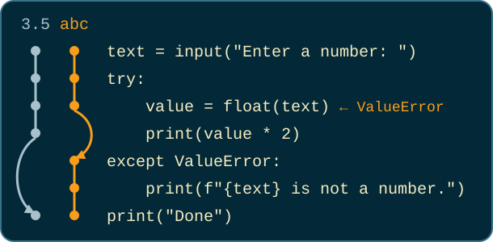

# Exceptions and Files

Colan Biemer

---

## Exceptions

---

## Errors We Have Seen

| Exception        | What caused it                        | Where                                          |
| ---------------- | ------------------------------------- | ---------------------------------------------- |
| `NameError`      | calling `say_hello()` above its `def` | [Define Before You Call](07-functions.html#12) |
| `AttributeError` | calling `append` on `None`            | [`append` Gives Back `None`](08-lists.html#10) |
| `IndexError`     | `scores[5]` on a list of five         | [Index Out of Range](08-lists.html#7)          |

And more... Each of these is an **exception**: Python stops the program and names what went wrong. Instead of avoiding them, though, we can `catch` them.

---

## New Keywords: `try` and `except`

```python
try:
    # code that might raise an exception
except [EXCEPTION]:
    # runs only if the code in try raised EXCEPTION

# program continues as normal
```

Notice the colons and the indentation, just like `if` and `else`.

---

## Catching a `ValueError`

<div class="cols">
<div>



</div>
<div>

```
Enter a number: 3.5
7.0
Done
```

```
Enter a number: abc
abc is not a number.
Done
```

</div>
</div>

With `3.5`, every line in `try` runs, and Python skips the `except` block. With `abc`, `float(text)` raises a `ValueError`. Python stops the `try` block on that line, jumps to `except ValueError:`, and runs its body. Either way, the program reaches `print("Done")`.

---

## Problem: What Is the Output?

```python
try:
    print("A")
    n = int("seven")
    print("B")
except ValueError:
    print("C")
print("D")
```

---

## Solution: What Is the Output?

```python
try:
    print("A")         # A
    n = int("seven")   # ValueError
    print("B")
except ValueError:
    print("C")         # C
print("D")             # D
```

`A` prints before anything fails. `int("seven")` raises, so `B` never prints: like `return`, the line that fails ends the `try` block. With `int("7")`, the output would be `A`, `B`, `D`.

---

## Problem: Find the Bug

```python
text = input("Enter a number: ")
try:
    value = flaot(text)
    print(value * 2)
except:
    print("Not a number.")
```

```
Enter a number: 3.5
Not a number.
```

`3.5` is a number. Why does every input print `Not a number.`?

---

## Solution: Find the Bug

```python
text = input("Enter a number: ")
try:
    value = flaot(text)   # misspelled
    print(value * 2)
except ValueError:
    print("Not a number.")
```

```
NameError: name 'flaot' is not defined. Did you mean: 'float'?
```

`except:` with no name catches every exception, including the `NameError` from the typo, so the bug hides behind the wrong message. The textbook writes `except:` this way.

---

## Problem: Keep the Integers (us)

```python
# Write keep_integers, a function that returns a new list of the
# entries that are integers, converted with int.
entries = ["12", "-3", "abc", "7", "4.5"]
print(keep_integers(entries))
```

```
[12, -3, 7]
```

- What should the `except` block do?
- Why not check with `isdigit` instead?

---

## Solution: Keep the Integers (us)

```python
def keep_integers(entries):
    numbers = []
    for entry in entries:
        try:
            numbers.append(int(entry))
        except ValueError:
            pass
    return numbers

entries = ["12", "-3", "abc", "7", "4.5"]
print(keep_integers(entries))
```

`pass` is new; the next slide covers it. `isdigit` would reject `-3` ([week 4](06-strings-and-format-strings.html#81)), but `int` accepts it.

---

## New Keyword: `pass`

<div class="cols">
<div>

```python
try:
    numbers.append(int(entry))
except ValueError:
    # skip bad entries

print(numbers)
```

</div>
<div>

```python
try:
    numbers.append(int(entry))
except ValueError:
    pass

print(numbers)
```

</div>
</div>

```
IndentationError: expected an indented block after 'except' statement on line 3
```

Python refuses to run the left version. Every block needs at least one indented line, and a comment does not count ([Indentation Errors](07-functions.html#10)). `pass` is a line that does nothing, so it fills a block that has nothing to do (right). It works in any block: `if`, `for`, `while`, `def`, or `except`.

---

## Parsons Problem #1 (you)

**One line does not belong.**

```python
quantity = get_float("Quantity: ")
except ValueError:
return None
def get_float(prompt):
print(f"Total: ${price * quantity:.2f}")
try:
print("Enter a number.")
price = get_float("Price: ")
while True:
return float(input(prompt))
```

---

## Solution: Parsons Problem #1 (you)

```python
def get_float(prompt):
    while True:
        try:
            return float(input(prompt))
        except ValueError:
            print("Enter a number.")

price = get_float("Price: ")
quantity = get_float("Quantity: ")
print(f"Total: ${price * quantity:.2f}")
```

The extra line was `return None`. `get_float` has to ask again, and `return None` would end the function on the first bad entry, and `price * quantity` would raise a `TypeError`. `return` ends the function, and the loop with it, the first time `float` succeeds. A bad entry prints the message, and `while True` asks again.

---

## Reading Files

---

## Files We'll Use Today

Download today's files and save them next to your program: [names.txt](data/names.txt), [measures.txt](data/measures.txt), [scores.csv](data/scores.csv), [sales.csv](data/sales.csv), and [prices.csv](data/prices.csv).

---

## Opening a File with `with`

```python
with open([FILENAME], "r") as [NAME]:
    # NAME is the open file; "r" means read

# the file is closed here
```

- `open` finds the file named `FILENAME` and opens it. The `"r"` is short for "read", so the line above it read a file.
- `with` keeps the file open for the indented block, then closes it, even if the block raises an exception.

---

## Without `with`: `open` and `close`

```python
[NAME] = open([FILENAME], "r")
# NAME is the open file

[NAME].close()   # the file is closed here
```

Without `with`, you have to write a program like above. `close` is like clicking Save: until it runs, what the program wrote may not be in the file yet. `with` calls `close` for you.

---

## Problem: What Is the Output?

<div class="cols">
<div>

```python
with open("names.txt", "r") as f:
    for line in f:
        print(line)
```

</div>
<div>

```
Ada
Grace
Alan
```

</div>
</div>

Right: `names.txt`, as it looks in VS Code.

---

## Solution: What Is the Output?

```
Ada

Grace

Alan
```

`for line in f:` hands the loop one line at a time, as a string. Each line keeps the `\n` that ends it in the file, so the first `line` is `"Ada\n"`, and `len(line)` is 4. `print` adds its own `\n`, so a blank line follows each name.

---

## Removing the `\n`

```python
with open("names.txt", "r") as f:
    for line in f:
        print(line.strip())
```

```
Ada
Grace
Alan
```

`strip` removes spaces and newlines from both ends.

---

## `FileNotFoundError`

```python
filename = "na.txt"
try:
    with open(filename, "r") as f:
        for line in f:
            print(line.strip())
except FileNotFoundError:
    print(f"Could not find {filename}")
```

```
Could not find na.txt
```

`open` raises a `FileNotFoundError` when no file has that name, such as `na.txt` typed for `names.txt`.

---

## Problem: What Is the Output?

```python
total = 0
with open("measures.txt", "r") as f:
    for line in f:
        total += float(line)

print(f"Total: {total:.1f}")
```

`measures.txt` holds `10.1`, `9.9`, and `9.8`, one per line, then a blank last line.

---

## Solution: What Is the Output?

```
ValueError: could not convert string to float: '\n'
```

```python
    for line in f:
        if line.strip() != "":
            total += float(line)
```

`float("10.1\n")` works, since `float` ignores spaces and newlines around the number ([Converting Text to Numbers](exceptions-and-files-cheatsheet.html#converting-text-to-numbers)). The last line is only `"\n"`, with no number to convert. Skip blank lines before converting, and the program prints `Total: 29.8`.

---

## Lines with Fields

```python
line = "Ada,90\n"
fields = line.strip().split(",")
print(fields)            # ['Ada', '90']

name = fields[0]
score = int(fields[1])
print(name, score + 5)   # Ada 95
```

Each line of `scores.csv` holds two **fields**, separated by a comma. Strip, split, then convert.

---

## Problem: What Is the Output?

```python
with open("scores.csv", "r") as f:
    for line in f:
        fields = line.strip().split(",")
        print(fields[0], int(fields[1]))
```

---

## Solution: What Is the Output?

```
ValueError: invalid literal for int() with base 10: 'score'
```

The way to fix this is to read the header first, and then process the rest of the file:

```python
with open("scores.csv", "r") as f:
    f.readline()
    for line in f:
        fields = line.strip().split(",")
        print(fields[0], int(fields[1]))
```

Nothing stores what `readline` gave back, so the header is thrown away.

---

## Problem: Total Sales (us)

```python
# sales.csv holds one sale per line. Print the total of
# price * quantity over every sale, to the cent.
```

<div class="cols">
<div>

```
product,date,price,quantity
P-01,2023-01-01,9.95,5
P-02,2023-01-02,10.50,2
P-01,2023-01-03,9.85,4
P-02,2023-01-04,10.60,3
P-01,2023-01-05,9.95,1
```

</div>
<div>

```
Total: $151.90
```

</div>
</div>

- Which line is different from the rest?
- Which fields need converting, and to what?

---

## Solution: Total Sales (us)

```python
total = 0
with open("sales.csv", "r") as f:
    f.readline()
    for line in f:
        fields = line.strip().split(",")
        price = float(fields[2])
        quantity = int(fields[3])
        total += price * quantity

print(f"Total: ${total:.2f}")
```

The header is the line that differs, so `readline` skips it. Price is field 2 and quantity is field 3. The product and the date are never used, so they stay strings. Quantity counts whole items, so it gets `int`.

---

## Parsons Problem #2 (you)

**One line does not belong.**

```python
best_score = score
print(f"Top student: {best_name} ({best_score})")
f.readline()
if fields[1] > best_score:
score = int(fields[1])
best_name = ""
for line in f:
if score > best_score:
with open("scores.csv", "r") as f:
best_name = fields[0]
fields = line.strip().split(",")
best_score = -1
```

---

## Solution: Parsons Problem #2 (you)

<style scoped>
pre { font-size: 0.75em; }
</style>

```python
best_name = ""
best_score = -1
with open("scores.csv", "r") as f:
    f.readline()
    for line in f:
        fields = line.strip().split(",")
        score = int(fields[1])
        if score > best_score:
            best_score = score
            best_name = fields[0]

print(f"Top student: {best_name} ({best_score})")
```

The extra line was `if fields[1] > best_score:`. `fields[1]` is a string like `"90"`, and comparing a string with a number raises a `TypeError`. `best_score` starts at `-1`, below any real score, so the first student always replaces it.

---

## Writing Files

---

## Opening a File for Writing

```python
with open([FILENAME], "w") as [NAME]:
    # NAME is the open file; "w" means write

# the file is closed here
```

The only change from reading is `"w"`. If the file already exists, `"w"` **erases it** first.

---

## Writing with `write`

<div class="cols">
<div>

```python
name = "Ada"
score = 90
with open("report.txt", "w") as f_out:
    f_out.write(f"Report for {name}\n")
    f_out.write("name,score\n")
    f_out.write(f"{name},{score}\n")
```

</div>
<div>

```
Report for Ada
name,score
Ada,90
```

This is `report.txt` after the program runs.

</div>
</div>

`write` puts the text in the file exactly as given, so end each line with `\n`. `print(..., file=f_out)` works as well.

---

## Problem: Raise the Prices (us)

```python
# Copy prices.csv (left) to new_prices.csv (right) with
# every price raised 10%, to the cent. Skip rows whose price is not
# a number, and print how many.
```

<div class="cols">
<div>

```
item,price
coffee,3.00
bagel,2.50
tea,n/a
muffin,2.80
juice,4.00
```

</div>
<div>

```
item,price
coffee,3.30
bagel,2.75
muffin,3.08
juice,4.40
```

</div>
</div>

- How do we copy the header?
- What does `float("n/a")` do?

---

## Solution: Raise the Prices (us)

<style scoped>
pre { font-size: 0.7em; }
</style>

```python
skipped = 0
with open("prices.csv", "r") as f_in:
    with open("new_prices.csv", "w") as f_out:
        header = f_in.readline()
        f_out.write(header)
        for line in f_in:
            fields = line.strip().split(",")
            try:
                price = float(fields[1]) * 1.10
                f_out.write(f"{fields[0]},{price:.2f}\n")
            except ValueError:
                skipped += 1

print(f"Rows skipped: {skipped}")
```

Both files stay open at once, so the `with` blocks nest. The header keeps its `\n`, so `write` copies it as is. `float("n/a")` raises a `ValueError`, so the `write` after it never runs, the `tea` row is left out, and the program prints `Rows skipped: 1`.

---

## Opening a File for Appending

```python
with open([FILENAME], "a") as [NAME]:
    # NAME is the open file; "a" means append

# the file is closed here
```

`"a"` keeps what is already in the file and adds to its end, like `append` on a list.

---

## Parsons Problem #3 (you)

**One line does not belong.**

```python
f_out.write(f"{name}\n")
names = []
else:
with open("names.txt", "w") as f_out:
name = input("Name: ")
for line in f_in:
print(f"{name} is already on the list.")
with open("names.txt", "a") as f_out:
names.append(line.strip())
if name in names:
with open("names.txt", "r") as f_in:
```

---

## Solution: Parsons Problem #3 (you)

```python
names = []
with open("names.txt", "r") as f_in:
    for line in f_in:
        names.append(line.strip())

name = input("Name: ")
if name in names:
    print(f"{name} is already on the list.")
else:
    with open("names.txt", "a") as f_out:
        f_out.write(f"{name}\n")
```

The extra line was `with open("names.txt", "w") as f_out:`. `"w"` would erase the list and leave only the new name.

---

## Summary

<style scoped>
ul { font-size: 0.85em; }
</style>

- An **exception** stops the program; `try` and `except` catch one, so the program can keep going
- Name the exception you expect, like `except ValueError:`; a bare `except:` also hides bugs such as typos
- `int` and `float` raise a `ValueError` on text that is not a number
- `with open(filename, "r") as f:` closes the file when the block ends; without `with`, call `f.close()`
- `for line in f:` reads one line at a time, as a string that keeps its `\n`, so `strip` it
- `f.readline()` reads one line (`""` at the end of the file), which is how to skip a header
- `split(",")` breaks a line into fields; convert number fields with `int` or `float`
- `open(filename, "w")` creates or erases a file, and `"a"` adds to its end; `f_out.write(text)` adds `text` with no `\n` of its own

---

## Next Up: Folders and Dictionaries

The `os` module, then dictionaries: Appendix K and Chapter 9.

The [Exceptions and Files Cheat Sheet](exceptions-and-files-cheatsheet.html) has today's tools in one place, with more examples and the textbook's `readline` loop.

<!--
If time: the textbook's while loop over readline() (program 7-2), which stops when readline()
returns "", and a demo of "a" (append): run the cheat sheet's guests.txt program twice.
Next week: os.path.join() and os.listdir() (both moved out of this deck), os.getcwd() to explain
FileNotFoundError from the wrong folder, os.path.isfile(), os.path.exists(), and programs K-1
and K-2.
-->
