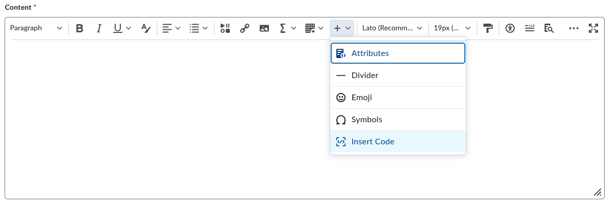

# Submitting Code as Text in Brightspace

Most in-class activities ask you to paste your code into a Brightspace text box instead of uploading a `.py` file. Brightspace's text editor is built for writing paragraphs, not code. If you paste Python straight into it, indentation and blank lines can get lost or changed, and since indentation is how Python knows what belongs to an `if`, a loop, or a function, that turns working code into broken code. Brightspace has an **Insert Code** tool that avoids this, and this document shows you how to use it.

## Steps

1. Write and run your code in VS Code and the AutoGrader first. Make sure it works before you copy it anywhere.
2. Select all of your code (`Ctrl+A` on Windows/Linux, `Cmd+A` on Mac) and copy it (`Ctrl+C` / `Cmd+C`).
3. Open the activity in Brightspace and click into the text box. It will be labeled "Content" or something similar.
4. In the editor toolbar, click the `+` button. A dropdown will appear. Click **Insert Code**.

   

5. A window will pop up. Choose **Python** from the language dropdown, paste your code into the box (`Ctrl+V` / `Cmd+V`), and click the checkmark in the top left corner of the window. If you hover over it, it will say "Save".
6. Your code should now appear in the text box as a code block with the indentation intact. Look it over and make sure that it is correct.
7. Submit when you're happy with the submission.

## Troubleshooting

- **I don't see the `+` button.** The toolbar hides buttons when the browser window is narrow. Make the window wider, or click the `...` button on the right side of the toolbar to show the hidden ones.
- **My code lost its indentation.** You probably pasted it directly into the text box instead of using Insert Code. Delete it and try again with the steps above.
- **I pasted the code as plain text and already submitted.** If before the deadline, resubmit. If after the deadline, resubmit with code and a note at the top telling me what happened. Do not delete your previous submission.
