# Visualization

Colan Biemer

---

## What We Can Draw

<div class="cols">
<div>

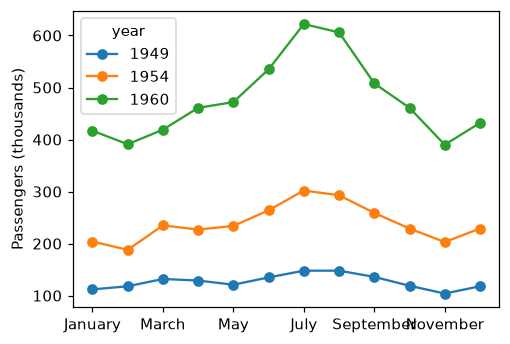

`kind="line"`

</div>
<div>

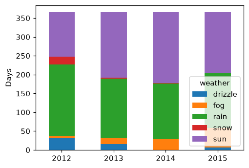

`kind="bar"`

</div>
<div>

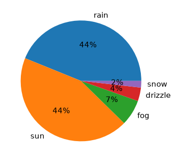

`kind="pie"`

</div>
</div>

Each chart is one call to `plot` on a table.

---

## What Else We Can Draw

<div class="cols">
<div>


`kind="hist"`

</div>
<div>


`kind="box"`

</div>
<div>

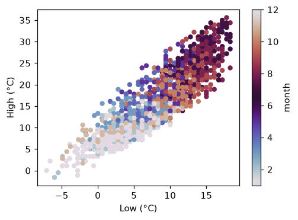

`kind="scatter"`

</div>
</div>

The pandas [chart guide](https://pandas.pydata.org/docs/user_guide/visualization.html) shows more, such as area and hexbin charts.

---

## `import matplotlib.pyplot as plt`

```python
import pandas as pd
import matplotlib.pyplot as plt
```

pandas draws its charts with **Matplotlib**, a library for charts. Install it once from the terminal with `python3 -m pip install matplotlib` (Mac) or `py -m pip install matplotlib` (Windows). `pyplot` is the part of Matplotlib that shows charts, named `plt` by custom.

---

## A First Chart

---

## Plotting a Series

<div class="cols">
<div>

```python
import pandas as pd
import matplotlib.pyplot as plt

days = ["Mon", "Tue", "Wed", "Thu", "Fri"]
sales = pd.Series([50, 75, 60, 90, 40], index=days)

sales.plot()
plt.show()
```

</div>
<div>


</div>
</div>

`plot` draws a line chart of the values, with the index along the bottom. `plt.show()` opens the chart in a window, and the program waits until we close it.

---

## Reading a CSV File from the Web

```python
import pandas as pd

url = "https://raw.githubusercontent.com/mwaskom/seaborn-data/master/"
flights = pd.read_csv(url + "flights.csv")
print(flights.head(3))
print(flights.shape)
```

```
   year     month  passengers
0  1949   January         112
1  1949  February         118
2  1949     March         132
(144, 3)
```

`read_csv` takes a web address as well as a file name, so there is nothing to download. `flights` counts an airline's passengers, in thousands, every month from 1949 to 1960. From here on, the slides leave out `url` and the two `import` lines.

---

## Plotting a DataFrame: `x` and `y`

<div class="cols">
<div>

```python
flights = pd.read_csv(url + "flights.csv")
january = flights[flights["month"] == "January"]

january.plot(x="year", y="passengers")
plt.show()
```

</div>
<div>


</div>
</div>

A Series has one column of values to draw, but a table has several. `x` names the column along the bottom and `y` the column to draw. The legend names the line `passengers`, after its column.

---

## Problem: What Is Drawn?

```python
flights = pd.read_csv(url + "flights.csv")
january = flights[flights["month"] == "January"]

january.plot()
plt.show()
```

What is along the bottom? How many lines are there?

---

## Solution: What Is Drawn?

<div class="cols">
<div>


</div>
<div>

With no `x`, the index is along the bottom: the labels January kept from `flights`, 0, 12, 24, and on up to 132.

With no `y`, every number column gets a line. `year` runs flat near 1950 and squashes `passengers` down to the bottom. `month` holds strings, so it is left out.

</div>
</div>

---

## Kinds of Charts

---

## A Second Table: `tips`

```python
tips = pd.read_csv(url + "tips.csv")
print(tips.head())
print(tips.shape)
```

```
   total_bill   tip     sex smoker  day    time  size
0       16.99  1.01  Female     No  Sun  Dinner     2
1       10.34  1.66    Male     No  Sun  Dinner     3
2       21.01  3.50    Male     No  Sun  Dinner     3
3       23.68  3.31    Male     No  Sun  Dinner     2
4       24.59  3.61  Female     No  Sun  Dinner     4
(244, 7)
```

Each row of `tips` is one table at a restaurant: the bill, the tip, the day, the meal, and the size of the party. Unlike the months of `flights`, the rows have no order for a line to follow.

---

## Bar Charts: `kind="bar"`

<div class="cols">
<div>

```python
tips = pd.read_csv(url + "tips.csv")
counts = tips["day"].value_counts()

counts.plot(kind="bar")
plt.show()
```

</div>
<div>


</div>
</div>

A line from Sat to Sun to Thur would claim a trend from one day to the next. A bar chart draws each group on its own, here the [`value_counts`](15-pandas.html#69) of each day. `kind` picks the chart, and `plot` without it draws a line.

---

## Pie Charts: `kind="pie"`

<div class="cols">
<div>

```python
tips = pd.read_csv(url + "tips.csv")
counts = tips["time"].value_counts()

counts.plot(kind="pie")
plt.show()
```

</div>
<div>


</div>
</div>

Bars compare the days with each other. Every table ate dinner or lunch, so a pie shows each meal's share of the whole instead. With more than a few groups, the slices are hard to compare.

---

## Problem: How Many Bars?

```python
tips = pd.read_csv(url + "tips.csv")
counts = tips["total_bill"].value_counts()

counts.plot(kind="bar")
plt.show()
```

We want to see how big the bills are, as the bar chart showed how busy each day is. How many bars are there, and how tall are they?

---

## Solution: How Many Bars?

<div class="cols">
<div>

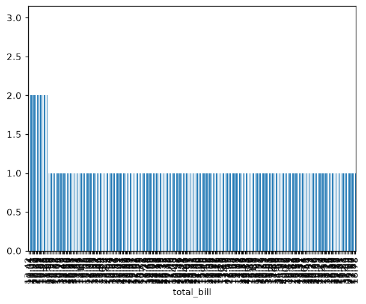

</div>
<div>

229 bars, one for each different bill, with their labels piled on top of each other.

Nearly every bar is 1 tall: only 14 bills appear more than once. Few bills are exactly equal, so counting equal values says nothing about how big they are.

</div>
</div>

---

## Histograms: `kind="hist"`

<div class="cols">
<div>

```python
tips = pd.read_csv(url + "tips.csv")
bills = tips["total_bill"]

bills.plot(kind="hist", bins=10)
plt.show()
```

</div>
<div>


</div>
</div>

A **histogram** counts the values that fall in each range, called a **bin**, instead of the values that are equal. `bins=10` splits the bills into ten ranges of the same width. Most bills are between $10 and $25.

---

## Scatter Charts: `kind="scatter"`

<div class="cols">
<div>

```python
tips = pd.read_csv(url + "tips.csv")
tips.plot(kind="scatter", x="total_bill",
          y="tip")
plt.show()
```

</div>
<div>


</div>
</div>

A histogram spreads out one number. A scatter chart compares two numbers, with a dot for each row at its `x` and `y`. The dots rise to the right: bigger bills tend to get bigger tips.

---

## Problem: Which Kind?

Name the `kind` of chart for each question.

1. How are the tips spread out? Are most near $3?
2. Do bigger parties leave bigger tips?
3. How many tables ate dinner, and how many ate lunch?
4. How did the passengers in `flights` change from year to year?

---

## Solution: Which Kind?

1. `hist`: it counts how many tips fall in each range
2. `scatter`, with `size` as `x` and `tip` as `y`
3. `bar`, or `pie`, since there are only two groups
4. `line`, the default, since the years run in order

---

## Preparing the Data

---

## Problem: What Is Drawn?

```python
flights = pd.read_csv(url + "flights.csv")

flights.plot(x="year", y="passengers")
plt.show()
```

This is the line for question 4, drawn from all of `flights`. How many points are drawn above each year?

---

## Solution: What Is Drawn?

<div class="cols">
<div>

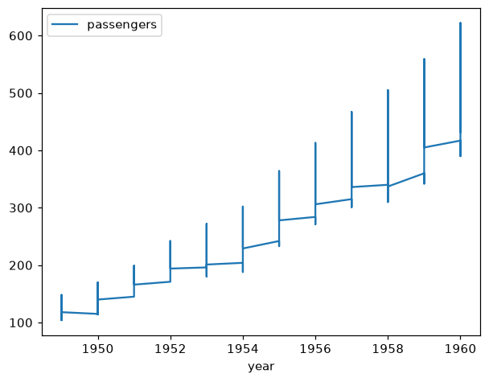

</div>
<div>

Twelve: `flights` has a row for each month, so the line runs up and down through the months of a year before it moves on to the next.

A line by year needs one row for each year, holding that year's total.

</div>
</div>

---

## A Line for Each Year

<div class="cols">
<div>

```python
flights = pd.read_csv(url + "flights.csv")
yearly = flights.pivot_table(
    index="year", values="passengers",
    aggfunc="sum")
print(yearly.head(3))

yearly.plot()
plt.show()
```

```
      passengers
year
1949        1520
1950        1676
1951        2042
```

</div>
<div>


</div>
</div>

A [pivot table](15-pandas.html#70) makes one row for each group, adding up the twelve months of each year. Its index is the years, so the years are along the bottom with no `x`.

---

## A Bar for Each Column

<div class="cols">
<div>

```python
tips = pd.read_csv(url + "tips.csv")
totals = tips.pivot_table(
    index="day", columns="time",
    values="total_bill", aggfunc="sum",
    fill_value=0)
week = ["Thur", "Fri", "Sat", "Sun"]
totals = totals.loc[week]

totals.plot(kind="bar")
plt.show()
```

</div>
<div>

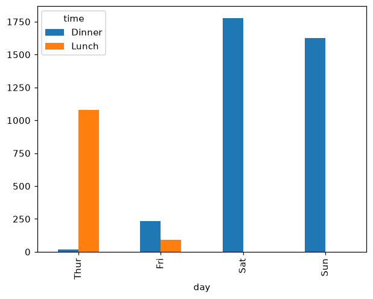

</div>
</div>

A bar chart gives each column its own bars, side by side in each group, and a name in the legend. `pivot_table` sorts the days by name, so `loc` with a list of labels puts them in the week's order.

---

## Problem: Tips by Party Size

Question 2 asked whether bigger parties leave bigger tips, but a scatter chart stacks the dots in six columns. Read `tips.csv` from the web and draw the average tip for each party size as a bar chart.

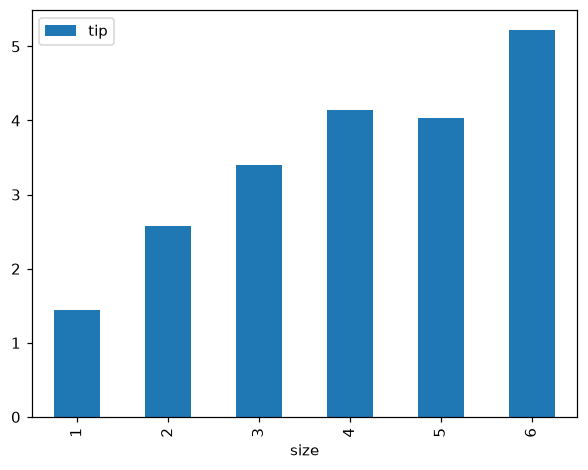

---

## Solution: Tips by Party Size

```python
tips = pd.read_csv(url + "tips.csv")
by_size = tips.pivot_table(index="size", values="tip")

by_size.plot(kind="bar")
plt.show()
```

`pivot_table` takes the `mean` with no `aggfunc`. The sizes are numbers, so sorting the index puts them in order and `loc` is not needed.

The chart answers the question, but it names things after columns, `size` along the bottom and `tip` in the legend, its labels lie on their side, and nothing says what the bars are.

---

## Refining a Chart

---

## Titles and Labels

<div class="cols">
<div>

```python
tips = pd.read_csv(url + "tips.csv")
by_size = tips.pivot_table(index="size",
                           values="tip")

by_size.plot(kind="bar",
             title="Bigger Parties Tip More",
             xlabel="Party size",
             ylabel="Average tip ($)")
plt.show()
```

</div>
<div>

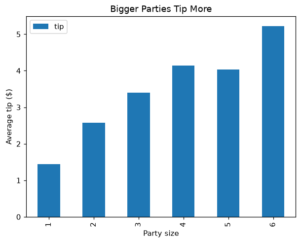

</div>
</div>

A title that says what the chart shows tells the reader what to look for, and `xlabel` and `ylabel` replace the column names. The legend and the sideways labels are still there.

---

## Legend, Rotation, Color, and Size

<div class="cols">
<div>

```python
tips = pd.read_csv(url + "tips.csv")
by_size = tips.pivot_table(index="size",
                           values="tip")

by_size.plot(kind="bar", legend=False,
             rot=0, color="seagreen",
             figsize=(8, 4),
             title="Bigger Parties Tip More",
             xlabel="Party size",
             ylabel="Average tip ($)")
plt.show()
```

</div>
<div>

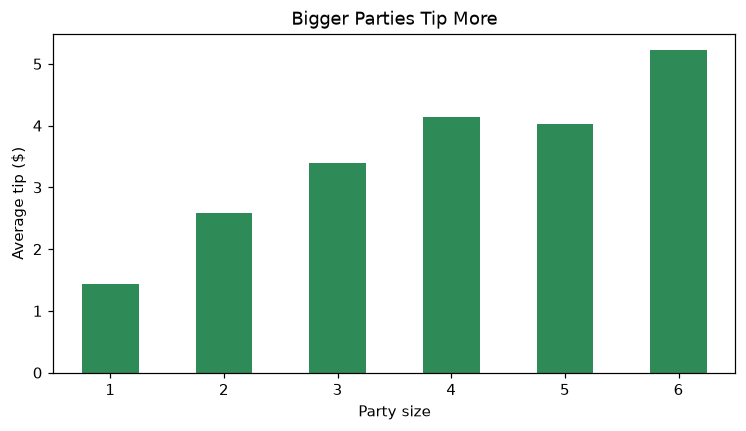

</div>
</div>

- `legend=False`: one set of bars needs no name, since the title gives it
- `rot`: how many degrees to turn the labels along the bottom; `0` keeps them flat
- `color`: a [color name](https://matplotlib.org/stable/gallery/color/named_colors.html) or a code like `"#2e8b57"`
- `figsize`: the width and height, in inches, as a tuple

---

## Two Charts Side by Side: `subplots`

```python
tips = pd.read_csv(url + "tips.csv")
fig, (left, right) = plt.subplots(1, 2, figsize=(10, 4))
tips["total_bill"].plot(kind="hist", bins=10, ax=left, title="Bills")
tips["tip"].plot(kind="hist", bins=10, ax=right, title="Tips")
fig.tight_layout()
plt.show()
```

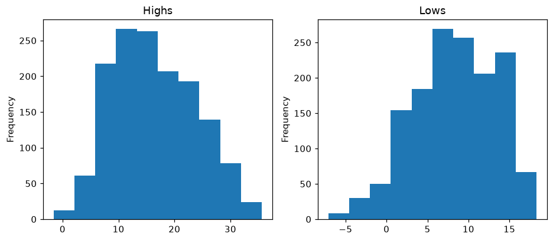

`plot` draws on a Matplotlib **Axes**, which holds one chart. `subplots(1, 2)` makes a **figure**, the whole window, with 1 row of 2 Axes. `ax` tells `plot` which one to draw on, and `tight_layout` keeps their labels from overlapping.

---

## Saving a Chart: `savefig`

```python
tips = pd.read_csv(url + "tips.csv")
tips.plot(kind="scatter", x="total_bill", y="tip")
plt.savefig("tips.png")
```

A chart in a window is gone once we close it. `savefig` writes it to a file, to put in a report or a web page. The ending picks the format: `.png`, `.jpg`, `.svg`, or `.pdf`.

---

## Problem: Smokers' Tips

Do smokers tip more? Read `tips.csv` from the web and draw this chart. Each day has two bars: the average tip from smokers and from non-smokers.

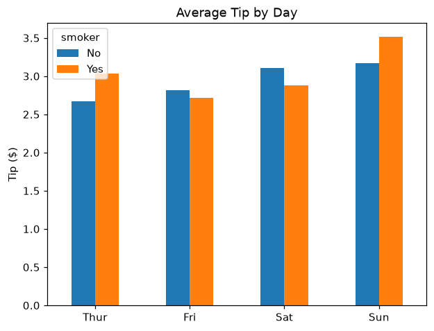

---

## Solution: Smokers' Tips

```python
tips = pd.read_csv(url + "tips.csv")
smokers = tips.pivot_table(index="day", columns="smoker", values="tip")
smokers = smokers.loc[["Thur", "Fri", "Sat", "Sun"]]

smokers.plot(kind="bar", rot=0, title="Average Tip by Day",
             xlabel="", ylabel="Tip ($)")
plt.show()
```

`columns="smoker"` gives the `No` and `Yes` bars, and this time the legend stays to name them. `loc` puts the days in order, `rot=0` keeps their names flat, and `xlabel=""` drops `day`, which the title already says.

---

## Charts in Streamlit

---

## `st.pyplot`

```python
import pandas as pd
import matplotlib.pyplot as plt
import streamlit as st

url = "https://raw.githubusercontent.com/mwaskom/seaborn-data/master/"
tips = pd.read_csv(url + "tips.csv")
week = ["Thur", "Fri", "Sat", "Sun"]

split = st.selectbox("Split each day by", ["smoker", "sex", "time"])
means = tips.pivot_table(index="day", columns=split, values="tip")
fig, ax = plt.subplots()
means.loc[week].plot(kind="bar", rot=0, ylabel="Tip ($)", ax=ax)
st.pyplot(fig)
```

Smokers' Tips split each day by `smoker`, and this app lets the reader pick the split. [Streamlit](14-streamlit.html) shows the figure from `subplots` on the page with `st.pyplot`, in place of `plt.show()`. Picking a new split reruns the script and redraws the chart.

---

## Next Up: Pandas for Data Preparation

- Cleaning messy data before we chart it
- The pandas [chart guide](https://pandas.pydata.org/docs/user_guide/visualization.html) shows every `kind`
