# Visualization

Colan Biemer

---

## Examples

<div class="cols" style="text-align: center">
<div>


</div>
<div>


</div>
<div>


</div>
</div>

<div class="cols" style="text-align: center">
<div>


</div>
<div>

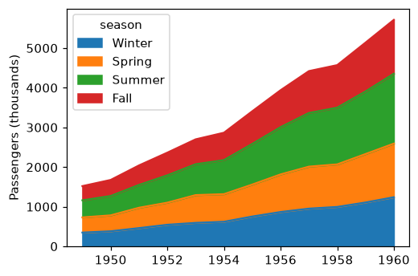

</div>
<div>

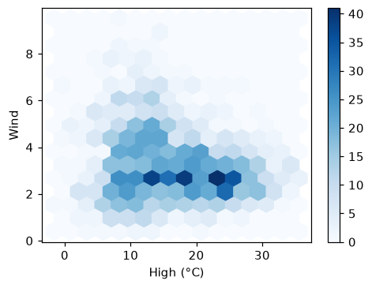

</div>
</div>

---

## `import matplotlib.pyplot as plt`

```python
import pandas as pd
import matplotlib.pyplot as plt
```

pandas draws its charts with **Matplotlib**, a library for charts. Install it the way you [installed Streamlit in VS Code](14-streamlit.html#6), searching for `matplotlib` in place of `streamlit`.

---

## Plotting a Series

<div class="cols">
<div>

```python
import pandas as pd
import matplotlib.pyplot as plt

days = ["Mon", "Tue", "Wed", "Thu", "Fri"]
sales = pd.Series([50, 75, 60, 90, 40], index=days)

sales.plot()
plt.show()
```

</div>
<div>

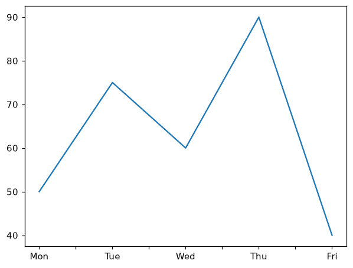

</div>
</div>

`plot` asks Matplotlib to draw a line chart of the values, with the index along the bottom. `plt.show()` opens the chart in a window, and the program waits until we close it.

---

## Reading a CSV File from the Web

```python
import pandas as pd

flights_url = "https://raw.githubusercontent.com/bi3mer/lectures/main/cs230/data/visualization/flights.csv"
df = pd.read_csv(flights_url)
print(df.head(3))
```

```
   year     month  passengers
0  1949   January         112
1  1949  February         118
2  1949     March         132
```

`read_csv` takes a web address as well as a file name, so there is nothing to download. [`flights.csv`](https://raw.githubusercontent.com/bi3mer/lectures/main/cs230/data/visualization/flights.csv) counts an airline's passengers, in thousands, every month from 1949 to 1960.<sup>1</sup>

<div class="footnote">1. The slides going forward leave out <code>flights_url</code> and the two <code>import</code> lines for <code>pandas</code> and <code>matplotlib</code>.</div>

---

## Plotting a DataFrame

<div class="cols">
<div>

```python
df = pd.read_csv(flights_url)
january = df[df["month"] == "January"]

january.plot()
plt.show()
```

</div>
<div>

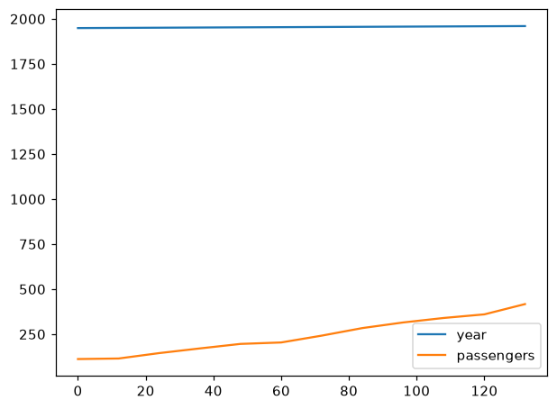

</div>
</div>

By default, `plot` draws every number column of a DataFrame as a line, with the index along the bottom.

---

## Choosing Columns: `x` and `y`

<div class="cols">
<div>

```python
df = pd.read_csv(flights_url)
january = df[df["month"] == "January"]

january.plot(x="year", y="passengers")
plt.show()
```

</div>
<div>


</div>
</div>

`x` names the column along the bottom, and `y` names the column to draw.

---

## Two Months, Two Charts

<div class="cols">
<div>

```python
df = pd.read_csv(flights_url)
january = df[df["month"] == "January"]
february = df[df["month"] == "February"]

january.plot(x="year", y="passengers")
february.plot(x="year", y="passengers")
plt.show()
```

</div>
<div>

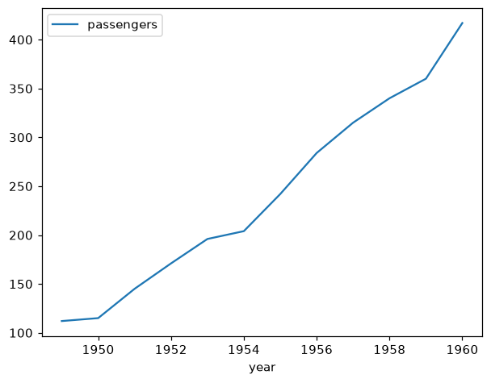
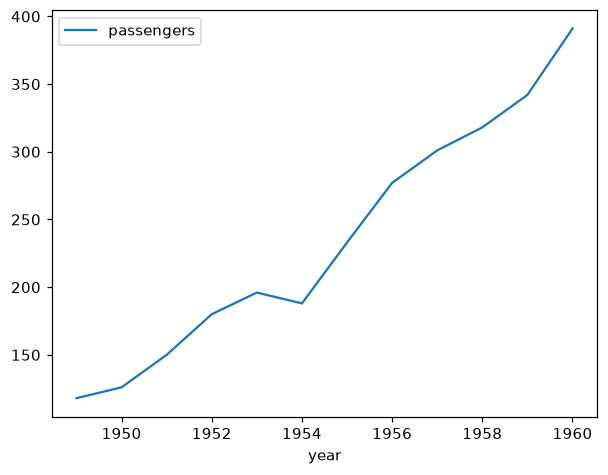

</div>
</div>

Each `plot` on a DataFrame starts a new chart, so `plt.show()` opens two windows with one line each.

---

## Axes

```python
df = pd.read_csv(flights_url)
january = df[df["month"] == "January"]

ax = january.plot(x="year", y="passengers")
print(type(ax))
```

```
<class 'matplotlib.axes._axes.Axes'>
```

An **Axes** is one chart. `plot` returns the Axes it drew on, so we can store the result in a variable.

---

## Two Lines on One Chart: `ax`

<div class="cols">
<div>

```python
df = pd.read_csv(flights_url)
january = df[df["month"] == "January"]
february = df[df["month"] == "February"]

ax = january.plot(x="year", y="passengers")
february.plot(x="year", y="passengers", ax=ax)
plt.show()
```

</div>
<div>

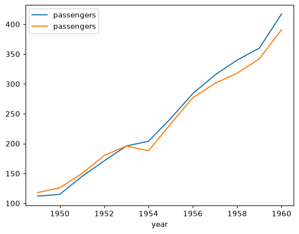

</div>
</div>

Passing `ax=ax` tells `plot` to draw February on January's Axes instead of starting a new chart.

---

## Naming Lines: `label`

<div class="cols">
<div>

```python
df = pd.read_csv(flights_url)
january = df[df["month"] == "January"]
february = df[df["month"] == "February"]

ax = january.plot(x="year", y="passengers",
                  label="January")
february.plot(x="year", y="passengers",
              label="February", ax=ax)
plt.show()
```

</div>
<div>

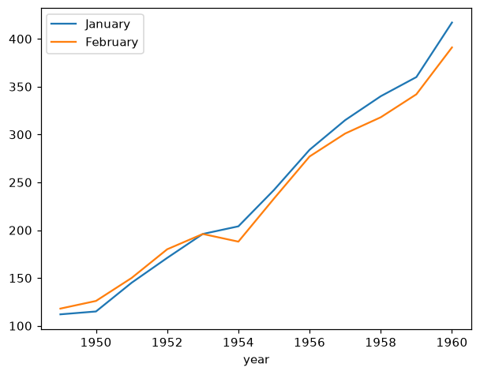

</div>
</div>

`label` gives each line its own name in the legend, in place of its column name.

---

## Yearly Totals

<div class="cols">
<div>

```python
df = pd.read_csv(flights_url)
yearly = df.pivot_table(
    index="year", values="passengers",
    aggfunc="sum")

yearly.plot()
plt.show()
```

</div>
<div>

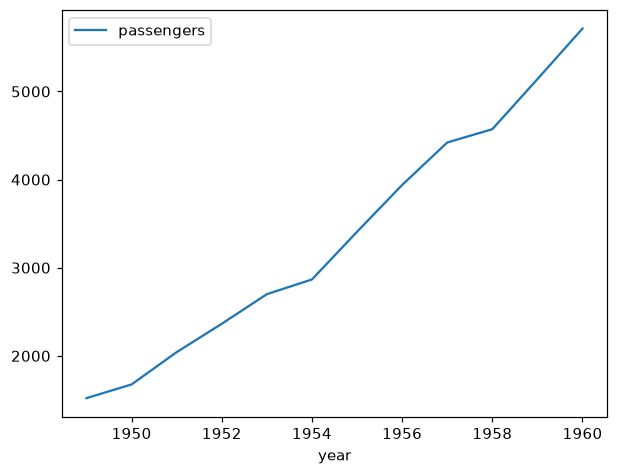

</div>
</div>

The [pivot table](15-pandas.html#71) adds up the twelve months of each year. Its index is the years, so the years are along the bottom with no `x`.

---

## Adding a Title

<div class="cols">
<div>

```python
df = pd.read_csv(flights_url)
yearly = df.pivot_table(
    index="year", values="passengers",
    aggfunc="sum")

yearly.plot(title="Passengers per Year")
plt.show()
```

</div>
<div>

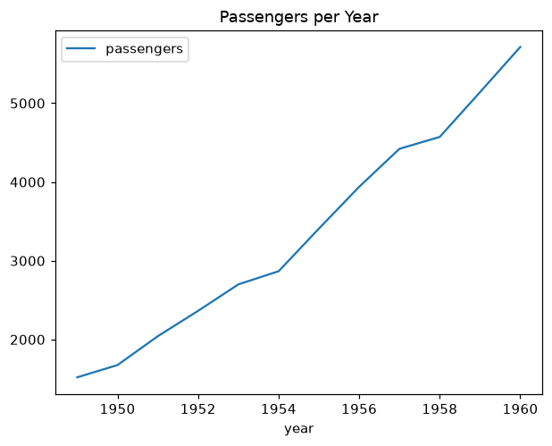

</div>
</div>

`title` puts a name above the chart.

---

## A Second Table: `weather.csv`

```python
weather_url = "https://raw.githubusercontent.com/bi3mer/lectures/main/cs230/data/visualization/weather.csv"
df = pd.read_csv(weather_url)
print(df.head())
print(df.shape)
```

```
         date  precipitation  temp_max  temp_min  wind  weather
0  2012-01-01            0.0      12.8       5.0   4.7  drizzle
1  2012-01-02           10.9      10.6       2.8   4.5     rain
2  2012-01-03            0.8      11.7       7.2   2.3     rain
3  2012-01-04           20.3      12.2       5.6   4.7     rain
4  2012-01-05            1.3       8.9       2.8   6.1     rain
(1461, 6)
```

Each row of [`weather.csv`](https://raw.githubusercontent.com/bi3mer/lectures/main/cs230/data/visualization/weather.csv) is one day in Seattle from 2012 to 2015: the rain in millimeters, the high and low in °C, the wind, and the kind of weather. Later slides leave out `weather_url` too.

---

## Bar Charts: `kind="bar"`

<div class="cols">
<div>

```python
df = pd.read_csv(weather_url)
counts = df["weather"].value_counts()

counts.plot(kind="bar")
plt.show()
```

</div>
<div>

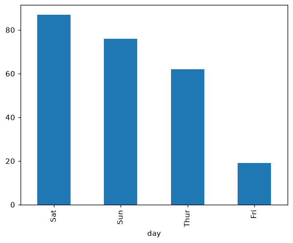

</div>
</div>

`kind` picks the chart, and `plot` without it draws a line. Each bar is one kind's count from [`value_counts`](15-pandas.html#69).

---

## Pie Charts: `kind="pie"`

<div class="cols">
<div>

```python
df = pd.read_csv(weather_url)
counts = df["weather"].value_counts()

counts.plot(kind="pie")
plt.show()
```

</div>
<div>

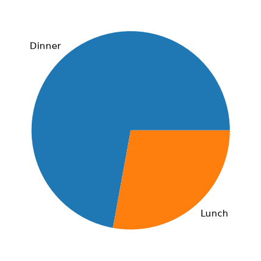

</div>
</div>

`kind="pie"` draws the same `counts` as slices. What happens if we count a number column, like `temp_max`?

---

## Counting the Highs

<div class="cols">
<div>

```python
df = pd.read_csv(weather_url)
counts = df["temp_max"].value_counts()

counts.plot(kind="bar")
plt.show()
```

</div>
<div>

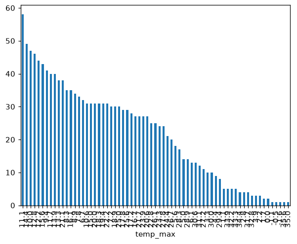

</div>
</div>

Each of the 67 bars is one different high, most common first, so the temperatures along the bottom jump around: 11.1, 14.4, 10.0, 12.8. How do we count the days in each range of temperatures?

---

## Histograms: `kind="hist"`

<div class="cols">
<div>

```python
df = pd.read_csv(weather_url)
highs = df["temp_max"]

highs.plot(kind="hist", bins=10)
plt.show()
```

</div>
<div>

A **histogram** counts the values that fall in each range, called a **bin**, instead of the values that are equal. `bins` sets how many ranges of the same width there are.

</div>
</div>

<div class="cols" style="text-align: center">
<div>

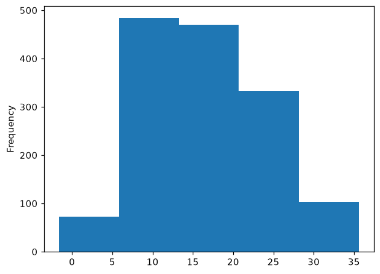

`bins=5`

</div>
<div>

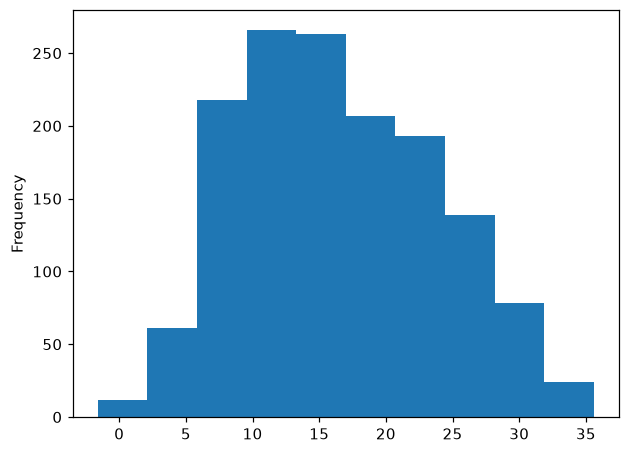

`bins=10`

</div>
<div>

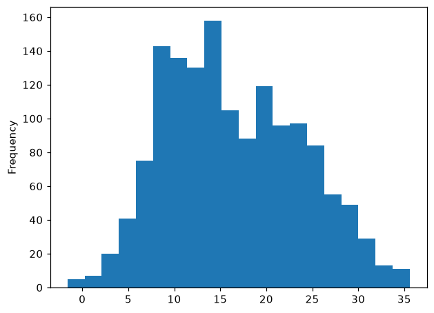

`bins=20`

</div>
</div>

---

## Scatter Charts: `kind="scatter"`

<div class="cols">
<div>

```python
df = pd.read_csv(weather_url)
df.plot(kind="scatter", x="temp_min",
        y="temp_max")
plt.show()
```

</div>
<div>

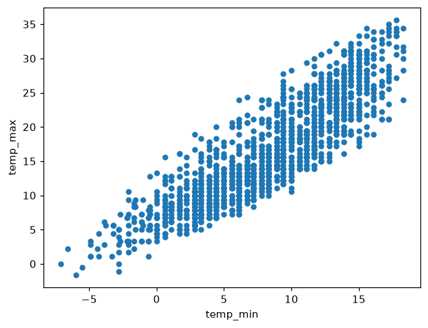

</div>
</div>

A **scatter chart** draws a dot for each row, at its `x` and `y`. How warm is each kind of weather, on average?

---

## A Bar for Each Column

<div class="cols">
<div>

```python
df = pd.read_csv(weather_url)
temps = df.pivot_table(
    index="weather",
    values=["temp_min", "temp_max"])

temps.plot(kind="bar")
plt.show()
```

</div>
<div>


</div>
</div>

[`pivot_table` takes the `mean`](15-pandas.html#71) when no `aggfunc` is given.

---

## Axis Labels: `xlabel` and `ylabel`

<div class="cols">
<div>

```python
df = pd.read_csv(weather_url)
temps = df.pivot_table(
    index="weather",
    values=["temp_min", "temp_max"])

temps.plot(kind="bar", xlabel="Weather",
           ylabel="Celsius")
plt.show()
```

</div>
<div>

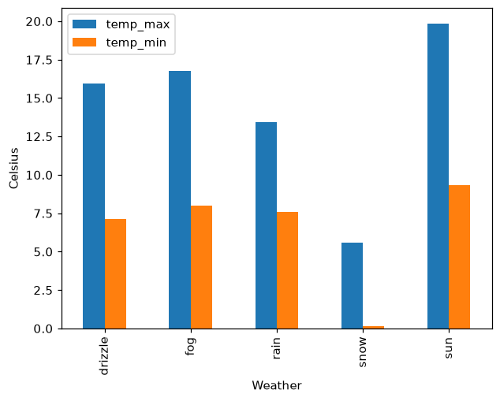

</div>
</div>

`xlabel` names the axis along the bottom, and `ylabel` names the axis up the side.

---

## Rotation, Color, and Size

<div class="cols">
<div>

```python
df = pd.read_csv(weather_url)
temps = df.pivot_table(
    index="weather",
    values=["temp_min", "temp_max"])

temps.plot(kind="bar", xlabel="Weather",
           ylabel="Celsius", rot=0,
           color=["tomato", "steelblue"],
           figsize=(8, 4))
plt.show()
```

</div>
<div>

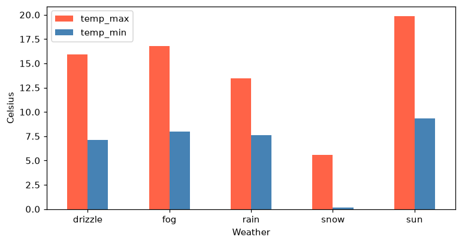

</div>
</div>

- `rot`: how many degrees to turn the labels along the bottom; `0` keeps them flat
- `color`: a [color name](https://matplotlib.org/stable/gallery/color/named_colors.html) or a code like `"#2e8b57"`; a list gives each column its own, in order
- `figsize`: the width and height, in inches, as a tuple

---

## Renaming the Legend: `ax.legend`

<div class="cols">
<div>

```python
df = pd.read_csv(weather_url)
temps = df.pivot_table(
    index="weather",
    values=["temp_min", "temp_max"])

ax = temps.plot(kind="bar", xlabel="Weather",
                ylabel="Celsius", rot=0,
                color=["tomato", "steelblue"],
                figsize=(8, 4),
                title="Seattle Temperatures")
ax.legend(["Max temperature",
           "Min temperature"])
plt.show()
```

</div>
<div>

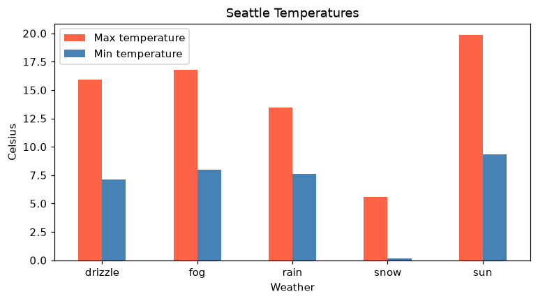

</div>
</div>

`ax.legend` names the columns in the table's order: `temp_max`, then `temp_min`. Without `y`, a list given to `label` is ignored. How do we put the highs and the lows side by side?

---

## Two Charts Side by Side: `subplots`

```python
df = pd.read_csv(weather_url)
fig, (left, right) = plt.subplots(1, 2, figsize=(10, 4))
df["temp_max"].plot(kind="hist", bins=10, ax=left, title="Highs")
df["temp_min"].plot(kind="hist", bins=10, ax=right, title="Lows")
plt.show()
```

<div class="cols">
<div>


</div>
<div>

`subplots(1, 2)` returns a **figure**, the whole window, and its 1 row of 2 Axes, which `(left, right)` [unpacks](09-changing-lists.html#39). `ax` picks the Axes to draw on, [as it did for February](16-visualization.html#10).

</div>
</div>

---

## Stacking Charts: `subplots(2, 1)`

<div class="cols">
<div>

```python
df = pd.read_csv(weather_url)
fig, (top, bottom) = plt.subplots(
    2, 1, figsize=(6, 8))
df["temp_max"].plot(kind="hist", bins=10,
                    ax=top, title="Highs")
df["temp_min"].plot(kind="hist", bins=10,
                    ax=bottom, title="Lows")
plt.show()
```

`subplots(2, 1)` makes 2 rows of 1 Axes, and `figsize=(6, 8)` makes the figure taller than it is wide.

</div>
<div>

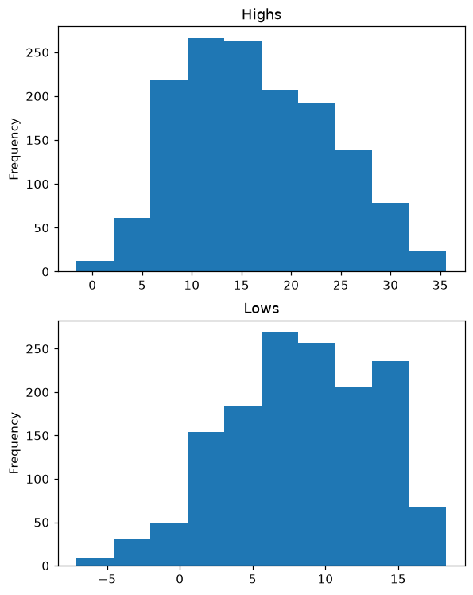

</div>
</div>

---

## A Grid of Charts: `subplots(2, 2)`

<div class="cols">
<div>

```python
df = pd.read_csv(weather_url)
fig, axes = plt.subplots(
    2, 2, figsize=(11, 8))
df["temp_max"].plot(
    kind="hist", ax=axes[0][0], title="Highs")
df["temp_min"].plot(
    kind="hist", ax=axes[0][1], title="Lows")
df["wind"].plot(
    kind="hist", ax=axes[1][0], title="Wind")
df["precipitation"].plot(
    kind="hist", ax=axes[1][1], title="Rain")
plt.show()
```

</div>
<div>

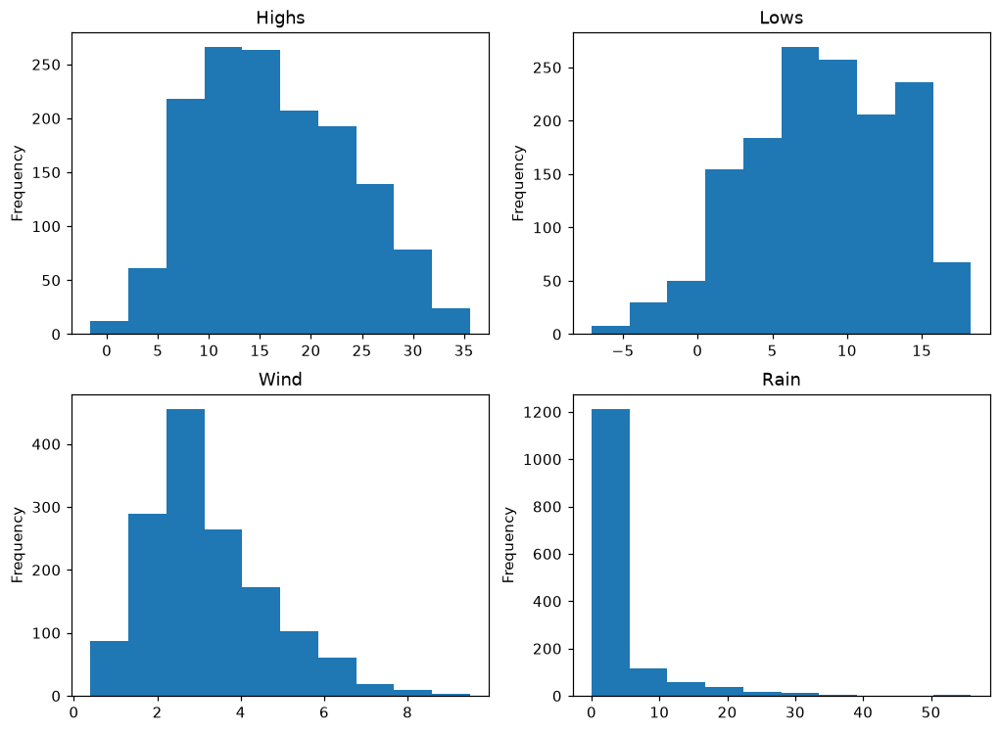

</div>
</div>

`subplots(2, 2)` returns its 4 Axes as 2 rows of 2, so `axes[1][0]` is [row 1, column 0](09-changing-lists.html#30): the bottom left.

---

## Charts in Streamlit: `st.pyplot`

```python
import pandas as pd
import matplotlib.pyplot as plt
import streamlit as st

weather_url = "https://raw.githubusercontent.com/bi3mer/lectures/main/cs230/data/visualization/weather.csv"
df = pd.read_csv(weather_url)

column = st.selectbox("Column", ["temp_max", "temp_min", "wind", "precipitation"])
fig, ax = plt.subplots()
df[column].plot(kind="hist", bins=10, ax=ax, title=column)
st.pyplot(fig)
```

`st.pyplot` shows a figure from `subplots` on a [Streamlit](14-streamlit.html) page, in place of `plt.show()`. Picking a new column reruns the script and redraws the histogram.

---

## Saving a Chart: `savefig`

```python
df = pd.read_csv(weather_url)
df.plot(kind="scatter", x="temp_min", y="temp_max")
plt.savefig("temps.png")
```

`savefig` writes the chart to a file, and the extension (`.png`, `.jpg`, `.svg`, or `.pdf`) picks the format. Call it before `plt.show()`; after the window closes, `savefig` saves a blank image.

---

## Problem: Windy Weather

<div class="cols">
<div>

Which kind of weather is the windiest? Read `weather.csv` from the web and draw a bar chart of the average wind for each kind, with:

- a title of your choice
- a color other than the default blue
- no legend: set `legend` to `False`
- flat names along the bottom: set `rot` to `0`
- "Average wind" up the side, and no label along the bottom: set `xlabel` to `""`

</div>
<div style="text-align: center">

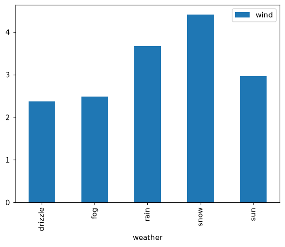

The default chart, for comparison

</div>
</div>

---

## Solution: Windy Weather

<div class="cols">
<div>

```python
df = pd.read_csv(weather_url)
wind = df.pivot_table(index="weather",
                      values="wind")

wind.plot(kind="bar", rot=0, legend=False,
          color="seagreen",
          title="Snow Days Are the Windiest",
          xlabel="", ylabel="Average wind")
plt.show()
```

</div>
<div>

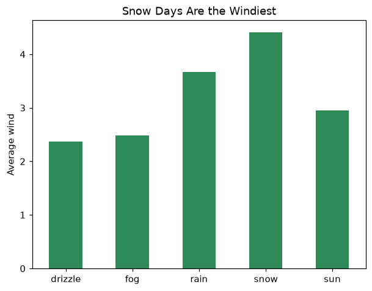

</div>
</div>

---

## Next Up: Pandas for Data Preparation

- [Pandas for Data Preparation](17-data-preparation.html)
- The pandas [chart guide](https://pandas.pydata.org/docs/user_guide/visualization.html) shows every `kind`
