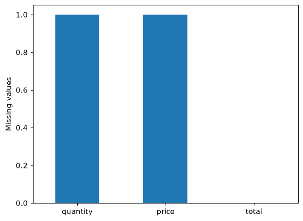
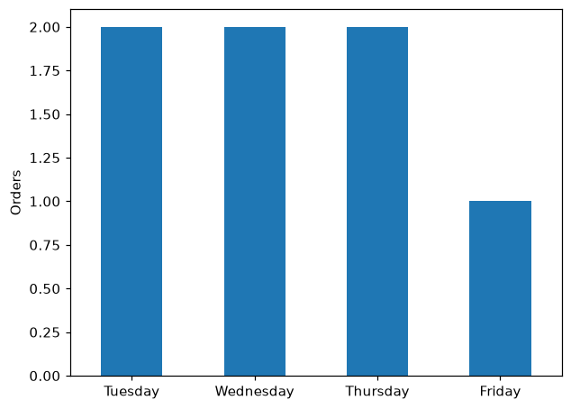
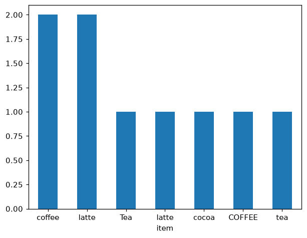
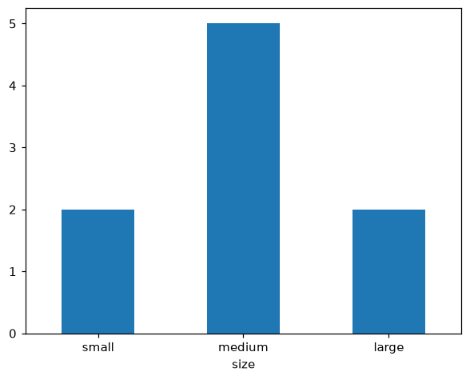
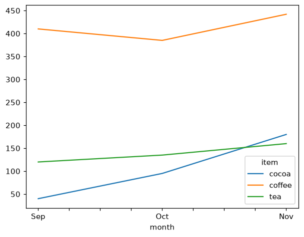

# Pandas for Data Preparation

Colan Biemer

---

## What Is Wrong?

```python
import pandas as pd
import matplotlib.pyplot as plt

orders_url = "https://raw.githubusercontent.com/bi3mer/lectures/main/cs230/data/preparation/orders.csv"
df = pd.read_csv(orders_url)
print(df)
```

```
   order_id        date customer     item    size quantity  price  total
0      1001  2026-09-01      C01   coffee   small        2   3.00   6.00
1      1002  2026-09-01      C02      Tea  medium        1   2.75   2.75
2      1003  2026-09-02      C03   latte    large        1  $4.75   4.75
3      1004  2026-09-02      C01   coffee   Large       -1   3.50  -3.50
4      1005  2026-09-31      C04    cocoa   small      two   2.50   5.00
5      1006  2026-09-03      C02    latte     med        1   4.25   4.25
6      1006  2026-09-03      C02    latte     med        1   4.25   4.25
7      1007  2062-09-04      C05   COFFEE     NaN        2   3.25   6.50
8      1008  2026-09-04      C03      tea  medium       20   2.75   5.50
```

<div class="footnote">The slides going forward leave out <code>orders_url</code> and the two <code>import</code> lines.</div>

---

## A Lot

- [Numbers](#4): `quantity` holds `two`, and order 1004 is for `-1` drinks
- [Dates](#15): September 31 does not exist, and 2062 has not happened yet
- [Strings](#24): `Tea`, `" latte "`, and `COFFEE` add stray capitals and spaces to drink names, and one price is `$4.75`
- [Categories](#36): the sizes include `Large`, `med`, and a blank
- [Key Fields](#47): order 1006 appears twice
- [Consistency](#54): 20 teas at 2.75 each do not cost 5.50
- [Missing Rows](#59): customer C05 has no row in a file we read later

**Data preparation** is finding and fixing problems like these before we use a table

---

## Numbers

---

## Strings to Numbers: `to_numeric`

```python
prices = pd.Series(["3", "2.75", "4"])
numbers = pd.to_numeric(prices)

print(prices.sum())    # 32.754
print(numbers.sum())   # 9.75
```

`to_numeric` takes a Series of strings and gives back a new Series of numbers. `sum` joins strings, as `+` does, so `prices` has to become numbers before we do math with it.

---

## Columns with the Wrong Type

```python
df = pd.read_csv(orders_url)
print(df.dtypes)
```

<pre><code>order_id      int64
date            str
customer        str
item            str
size            str
<strong>quantity        str</strong>
<strong>price           str</strong>
total       float64
dtype: object</code></pre>

We expect `quantity` and `price` to hold numbers, as `total` does, but [`read_csv`](15-pandas.html#22) made them columns of strings. Each must have at least one value that is not a number. What happens if we run `to_numeric` on `quantity`?

---

## A String That Is Not a Number

```python
df = pd.read_csv(orders_url)
quantity = pd.to_numeric(df["quantity"])
```

```
ValueError: Unable to parse string 'two' at position 4
```

Which is caused by row 4:

<pre><code>order_id          1005
date        2026-09-31
customer           C04
item             cocoa
size             small
<strong>quantity           two</strong>
price             2.50
total              5.0
Name: 4, dtype: object</code></pre>


---

## Bad Values to `NaN`: `errors="coerce"`

`to_numeric` stopped at the first bad value. How many are there?

```python
df = pd.read_csv(orders_url)
df["quantity"] = pd.to_numeric(df["quantity"], errors="coerce")
print(df["quantity"].head())
```

<pre><code>0    2.0
1    1.0
2    1.0
3   -1.0
4    <strong>NaN</strong>
Name: quantity, dtype: float64</code></pre>

With the argument `errors="coerce"`, `to_numeric` sets a value it cannot read to [`NaN`](15-pandas.html#24) rather than raise a `ValueError`. The column becomes `float64`, since `NaN` is a float.

---

## Counting the Problems: `isna`

```python
df = pd.read_csv(orders_url)
df["quantity"] = pd.to_numeric(df["quantity"], errors="coerce")
print(df["quantity"].isna().sum())   # 1
```

`isna` marks each missing value `True`, and `sum` counts the `True` values. The `two` is the only quantity that `to_numeric` could not read.

---

## Seeing the Problems

<div class="cols">
<div>

```python
df = pd.read_csv(orders_url)
df["quantity"] = pd.to_numeric(
    df["quantity"], errors="coerce")
df["price"] = pd.to_numeric(
    df["price"], errors="coerce")

numbers = df[["quantity", "price", "total"]]
missing = numbers.isna().sum()
missing.plot(kind="bar", rot=0,
             ylabel="Missing values")
plt.show()
```

</div>
<div>



</div>
</div>

`isna().sum()` on a table counts the missing values in each column, and the [bar chart](16-visualization.html#15) draws the counts. `quantity` has its `two`, and `price` has `$4.75`, which `to_numeric` could not read either. Every `total` is a number.

---

## Changing Matching Rows: `loc`

```python
df = pd.read_csv(orders_url)
df["quantity"] = pd.to_numeric(df["quantity"], errors="coerce")
df.loc[df["quantity"] < 1, "quantity"] = None
print(df[["order_id", "quantity"]])
```

```
   order_id  quantity
0      1001       2.0
1      1002       1.0
2      1003       1.0
3      1004       NaN
4      1005       NaN
5      1006       1.0
6      1006       1.0
7      1007       2.0
8      1008      20.0
```

No one orders fewer than one drink, but `-1` is a number, so `to_numeric` kept it. [`loc[rows, column]`](15-pandas.html#36) takes a Series of `True` and `False` for the rows, so this sets each quantity under 1 to missing, and `None` is stored as `NaN`. Two sets of brackets, `df["quantity"][...] = None`, change a copy and leave `df` alone.

---

## Dropping Rows by Column: `subset`

```python
df = pd.read_csv(orders_url)
df["quantity"] = pd.to_numeric(df["quantity"], errors="coerce")
df.loc[df["quantity"] < 1, "quantity"] = None
print(df.dropna(subset=["quantity"]))
```

```
   order_id        date customer     item    size  quantity  price  total
0      1001  2026-09-01      C01   coffee   small       2.0   3.00   6.00
1      1002  2026-09-01      C02      Tea  medium       1.0   2.75   2.75
2      1003  2026-09-02      C03   latte    large       1.0  $4.75   4.75
5      1006  2026-09-03      C02    latte     med       1.0   4.25   4.25
6      1006  2026-09-03      C02    latte     med       1.0   4.25   4.25
7      1007  2062-09-04      C05   COFFEE     NaN       2.0   3.25   6.50
8      1008  2026-09-04      C03      tea  medium      20.0   2.75   5.50
```

`subset` makes [`dropna`](15-pandas.html#61) check only the listed columns. Without it, order 1007 would go too, for its blank `size`.

---

## Problem: Drinks Sold

```python
# Read orders.csv from the web and print how many drinks were
# sold. Skip quantities that are not numbers or fall outside
# 1 to 10, since no one orders more than 10 drinks.
```

```
Drinks sold: 8.0
```

---

## Solution: Drinks Sold

```python
df = pd.read_csv(orders_url)
quantity = pd.to_numeric(df["quantity"], errors="coerce")
good = quantity[(quantity >= 1) & (quantity <= 10)]
print(f"Drinks sold: {good.sum()}")
```

`NaN` fails every comparison, so `two` drops out along with `-1` and `20`. Order 1006 counts twice, which [Key Fields](#47) fixes.

---

## Dates

---

## Strings to Dates: `to_datetime`

```python
df = pd.read_csv(orders_url)
dates = pd.to_datetime(df["date"])
```

```
ValueError: day 31 must be in range 1..30 for month 9 in year 2026.
You might want to try: ...
```

`read_csv` reads dates [as strings](15-pandas.html#22). `to_datetime` turns them into dates and checks that each one exists, and order 1005's September 31 does not.

---

## Bad Dates to `NaT`

```python
df = pd.read_csv(orders_url)
df["date"] = pd.to_datetime(df["date"], errors="coerce")
print(df[["order_id", "date"]])
```

```
   order_id       date
0      1001 2026-09-01
1      1002 2026-09-01
2      1003 2026-09-02
3      1004 2026-09-02
4      1005        NaT
5      1006 2026-09-03
6      1006 2026-09-03
7      1007 2062-09-04
8      1008 2026-09-04
```

**`NaT`**, "not a time," marks a missing date, as `NaN` marks a missing number. `isna` marks both.

---

## Parts of a Date: `.dt`

```python
df = pd.read_csv(orders_url)
df["date"] = pd.to_datetime(df["date"], errors="coerce")
df["day"] = df["date"].dt.day_name()
print(df[["order_id", "date", "day"]])
```

```
   order_id       date        day
0      1001 2026-09-01    Tuesday
1      1002 2026-09-01    Tuesday
2      1003 2026-09-02  Wednesday
3      1004 2026-09-02  Wednesday
4      1005        NaT        NaN
5      1006 2026-09-03   Thursday
6      1006 2026-09-03   Thursday
7      1007 2062-09-04     Monday
8      1008 2026-09-04     Friday
```

`.dt` runs a date method on every value, as [`.str`](15-pandas.html#55) runs a string method. `.dt.year`, `.dt.month`, and `.dt.day` give the parts as numbers, with no parentheses.

---

## Dates in a Range: `between`

```python
df = pd.read_csv(orders_url)
df["date"] = pd.to_datetime(df["date"], errors="coerce")
september = df["date"].between("2026-09-01", "2026-09-30")
print(df[~september])
```

```
   order_id       date customer    item   size quantity price  total
4      1005        NaT      C04   cocoa  small      two  2.50    5.0
7      1007 2062-09-04      C05  COFFEE    NaN        2  3.25    6.5
```

2062-09-04 is a real date, so `to_datetime` let it through. `between` checks a range, both ends included, and is `False` for `NaT`, so [`~`](15-pandas.html#50) finds both bad dates.

---

## Problem: What Is the Output?

```python
dates = pd.Series(["2026-02-28", "2026-02-29", "2028-02-29"])
dates = pd.to_datetime(dates, errors="coerce")

print(dates.dt.day_name())
print(dates.isna().sum())
```

---

## Solution: What Is the Output?

```
0    Saturday
1         NaN
2     Tuesday
dtype: str
1
```

2026 is not a leap year, so it has no February 29, and `coerce` gives `NaT`, whose day name is `NaN`. 2028 is a leap year.

---

## Problem: Orders by Day

<div class="cols">
<div>

Read `orders.csv` from the web and draw a bar chart of how many orders there are on each day of the week. Leave out dates outside September 2026, with flat day names, `Orders` up the side, and nothing named along the bottom.

</div>
<div>



</div>
</div>

---

## Solution: Orders by Day

```python
df = pd.read_csv(orders_url)
df["date"] = pd.to_datetime(df["date"], errors="coerce")
september = df[df["date"].between("2026-09-01", "2026-09-30")]

counts = september["date"].dt.day_name().value_counts()
counts.plot(kind="bar", rot=0, xlabel="", ylabel="Orders")
plt.show()
```

[`value_counts`](15-pandas.html#69) counts each day name, and its index becomes the names along the bottom. Thursday's 2 counts order 1006 twice.

---

## Strings

---

## How Many Drinks?

<div class="cols">
<div>

```python
df = pd.read_csv(orders_url)
counts = df["item"].value_counts()

counts.plot(kind="bar", rot=0)
plt.show()
```

</div>
<div>



</div>
</div>

The café sells four drinks, but the chart has seven bars. Capital letters split off `Tea` and `COFFEE`, and spaces split one `latte` from the rest.

---

## Chaining `.str` Methods

```python
df = pd.read_csv(orders_url)
df["item"] = df["item"].str.strip().str.lower()
print(list(df["item"].unique()))
```

```
['coffee', 'tea', 'latte', 'cocoa']
```

`unique` gives each different value once. Each `.str` method gives back a new Series, so another `.str` can follow it. [`strip` and `lower`](15-pandas.html#55) work as they do on one string.

---

## Replacing Text: `.str.replace`

```python
df = pd.read_csv(orders_url)
df["price"] = pd.to_numeric(df["price"].str.replace("$", ""))
print(df[["order_id", "price"]])
```

```
   order_id  price
0      1001   3.00
1      1002   2.75
2      1003   4.75
3      1004   3.50
4      1005   2.50
5      1006   4.25
6      1006   4.25
7      1007   3.25
8      1008   2.75
```

`.str.replace` swaps each `$` for nothing, as [`replace`](06-strings-and-format-strings.html#90) does on one string, so `to_numeric` can read order 1003's price. [`errors="coerce"`](#8) alone would have turned `$4.75` into `NaN`.

---

## Problem: Drink Prices

```python
# Read orders.csv from the web and print the highest price
# of each drink.
```

```
        price
item         
cocoa    2.50
coffee   3.50
latte    4.75
tea      2.75
```

---

## Solution: Drink Prices

```python
df = pd.read_csv(orders_url)
df["item"] = df["item"].str.strip().str.lower()
df["price"] = pd.to_numeric(df["price"].str.replace("$", ""))
print(df.pivot_table(index="item", values="price", aggfunc="max"))
```

Without `strip` and `lower`, `Tea`, `" latte "`, and `COFFEE` would each get a row of their own in the [pivot table](15-pandas.html#71).

---

## A Second File: `customers.csv`

```python
customers_url = "https://raw.githubusercontent.com/bi3mer/lectures/main/cs230/data/preparation/customers.csv"
customers = pd.read_csv(customers_url)
print(customers)
```

```
  customer            name                email
0      C01    ada lovelace      ada@example.com
1      C02    GRACE HOPPER    grace@example.com
2      C03    Alan Turing      alan.example.com
3      C04  barbara liskov  barbara@example.com
4      C06  Linus Torvalds    linus@example.com
```

The café typed its customer list, [`customers.csv`](https://raw.githubusercontent.com/bi3mer/lectures/main/cs230/data/preparation/customers.csv), by hand, so its names have stray capitals and spaces too. Later slides leave out `customers_url`.

---

## Capitalizing Names: `.str.title`

```python
customers = pd.read_csv(customers_url)
customers["name"] = customers["name"].str.strip().str.title()
print(customers)
```

```
  customer            name                email
0      C01    Ada Lovelace      ada@example.com
1      C02    Grace Hopper    grace@example.com
2      C03     Alan Turing     alan.example.com
3      C04  Barbara Liskov  barbara@example.com
4      C06  Linus Torvalds    linus@example.com
```

`title` capitalizes the first letter of each word and lowercases the rest. `strip` removes the spaces before `ada` and after `Turing`.

---

## Splitting a Column: `.str.split`

```python
customers = pd.read_csv(customers_url)
customers["name"] = customers["name"].str.strip().str.title()
parts = customers["name"].str.split(" ", expand=True)
customers[["first", "last"]] = parts
print(customers[["first", "last"]])
```

```
     first      last
0      Ada  Lovelace
1    Grace    Hopper
2     Alan    Turing
3  Barbara    Liskov
4    Linus  Torvalds
```

`expand=True` puts each piece of the [`split`](06-strings-and-format-strings.html#86) in its own column, numbered from 0, and assigning to a list of two names adds both columns.

---

## Checking for Text: `.str.contains`

```python
customers = pd.read_csv(customers_url)
has_at = customers["email"].str.contains("@")
print(customers[~has_at])
```

```
  customer          name             email
2      C03  Alan Turing   alan.example.com
```

`.str.contains` marks each value that has the text anywhere in it, as [`in`](06-strings-and-format-strings.html#53) does for one string. It reads symbols like `$` and `.` as a pattern, so add `regex=False` to look for one of those.

---

## Problem: What Is the Output?

```python
names = pd.Series([" mary jackson", "KATHERINE JOHNSON "])
names = names.str.strip().str.title()
parts = names.str.split(" ", expand=True)

print(list(names))
print(list(parts[1]))
print(list(names.str.contains("john")))
```

---

## Solution: What Is the Output?

```
['Mary Jackson', 'Katherine Johnson']
['Jackson', 'Johnson']
[False, False]
```

`expand=True` numbers the columns from 0, so `parts[1]` holds the last names. Capital letters count for `contains`, as they do for `in`, so `Johnson` does not have `john` in it.

---

## Categories

---

## A Fixed Set of Values

```python
df = pd.read_csv(orders_url)
df["size"] = df["size"].astype("category")
print(df["size"].cat.categories)
```

```
Index(['Large', 'large', 'med', 'medium', 'small'], dtype='str')
```

A size should be one of three values. A **category** column can hold only the values in its list of **categories**, and `astype("category")` makes that list from every different value in the column, `Large` and `med` included.

---

## Replacing Whole Values: `replace`

```python
df = pd.read_csv(orders_url)
df["size"] = df["size"].str.lower().replace("med", "medium")
print(list(df["size"].unique()))
```

```
['small', 'medium', 'large', nan]
```

`replace`, with no `.str`, swaps a value only when the whole value matches, so `medium` stays `medium`.

---

## Choosing the Categories: `CategoricalDtype`

```python
df = pd.read_csv(orders_url)
df["size"] = df["size"].str.lower().replace("med", "medium")

sizes = pd.CategoricalDtype(["small", "medium", "large"], ordered=True)
df["size"] = df["size"].astype(sizes)
print(df[["order_id", "size"]].sort_values("size"))
```

```
   order_id    size
0      1001   small
4      1005   small
1      1002  medium
5      1006  medium
6      1006  medium
8      1008  medium
2      1003   large
3      1004   large
7      1007     NaN
```

`sort_values` follows the list's order, where alphabetical order would put `large` first. Clean the values first: `astype` turns any value not in the list into `NaN`, with a warning.

---

## Comparing Categories

```python
df = pd.read_csv(orders_url)
df["size"] = df["size"].str.lower().replace("med", "medium")
sizes = pd.CategoricalDtype(["small", "medium", "large"], ordered=True)
df["size"] = df["size"].astype(sizes)
big = df[df["size"] >= "medium"]
print(big[["order_id", "size"]])
```

```
   order_id    size
1      1002  medium
2      1003   large
3      1004   large
5      1006  medium
6      1006  medium
8      1008  medium
```

`ordered=True` lets `<` and `>=` compare values by their place in the list, so `>= "medium"` keeps medium and large. Without it, `>=` raises a `TypeError`.

---

## Filling Missing Values: `fillna`

```python
df = pd.read_csv(orders_url)
df["size"] = df["size"].str.lower().replace("med", "medium")
sizes = pd.CategoricalDtype(["small", "medium", "large"], ordered=True)
df["size"] = df["size"].astype(sizes).fillna("medium")
print(df["size"].value_counts())
```

```
size
medium    5
small     2
large     2
Name: count, dtype: int64
```

The café's register leaves `size` blank for a medium, so order 1007 belongs in [the last filter](#40). `fillna` puts one value in place of every `NaN`, and in a category column that value must be one of the categories, or pandas raises a `TypeError`.

---

## Charts in Category Order

<div class="cols">
<div>

```python
df = pd.read_csv(orders_url)
df["size"] = df["size"].str.lower()
df["size"] = df["size"].replace("med", "medium")
sizes = pd.CategoricalDtype(
    ["small", "medium", "large"], ordered=True)
df["size"] = df["size"].astype(sizes).fillna("medium")

counts = df["size"].value_counts().sort_index()
counts.plot(kind="bar", rot=0)
plt.show()
```

</div>
<div>



</div>
</div>

`value_counts` puts the most common size first. [`sort_index`](15-pandas.html#41) sorts by label, and category labels sort in the list's order, so the bars go from small to large.

---

## Problem: What Is the Output?

```python
typed = pd.Series(["small", "med", "medium"])

print(list(typed.str.replace("med", "medium")))
print(list(typed.replace("med", "medium")))
```

---

## Solution: What Is the Output?

```
['small', 'medium', 'mediumium']
['small', 'medium', 'medium']
```

`.str.replace` swaps `med` wherever it appears, even inside `medium`. `replace` swaps only a value that is exactly `med`.

---

## Problem: Big Drinks

```python
# Read orders.csv from the web. Clean the sizes, make them an
# ordered category, and fill the blank size with medium. Then
# print the orders for a medium or large drink, largest first.
```

```
   order_id    size
2      1003   large
3      1004   large
1      1002  medium
5      1006  medium
6      1006  medium
7      1007  medium
8      1008  medium
```

---

## Solution: Big Drinks

```python
df = pd.read_csv(orders_url)
df["size"] = df["size"].str.lower().replace("med", "medium")
sizes = pd.CategoricalDtype(["small", "medium", "large"], ordered=True)
df["size"] = df["size"].astype(sizes).fillna("medium")

big = df[df["size"] >= "medium"]
print(big[["order_id", "size"]].sort_values("size", ascending=False))
```

Order 1007 makes the list only because `fillna` runs before the comparison.

---

## Key Fields

---

## What Is a Key Field?

```python
df = pd.read_csv(orders_url)
print(df["order_id"].is_unique)   # False
print(df["order_id"].nunique())   # 8
print(len(df))                    # 9
```

A **key field** is a column whose value is different in every row, so each value names exactly one row, as a [dictionary key](12-dictionaries.html#2) names one value. `is_unique` is `True` when no value repeats, and `nunique` counts the different values: 9 rows hold only 8 ids.

---

## Finding Repeated Keys: `duplicated`

```python
df = pd.read_csv(orders_url)
print(df[df["order_id"].duplicated(keep=False)])
```

```
   order_id        date customer   item size quantity price  total
5      1006  2026-09-03      C02  latte  med        1  4.25   4.25
6      1006  2026-09-03      C02  latte  med        1  4.25   4.25
```

`duplicated` marks each row whose value appeared in an earlier row. `keep=False` marks every copy, so both 1006 rows show.

---

## Dropping Repeated Rows: `drop_duplicates`

```python
df = pd.read_csv(orders_url)
df = df.drop_duplicates()
print(len(df))                    # 8
print(df["order_id"].is_unique)   # True
```

`drop_duplicates` drops each row that matches an earlier row in every column. Two different orders that share an id both stay, and one of them needs a new id.

---

## A Key as the Index

```python
df = pd.read_csv(orders_url)
df = df.drop_duplicates().set_index("order_id")
print(df.loc[1006])
```

```
date        2026-09-03
customer           C02
item             latte
size               med
quantity             1
price             4.25
total             4.25
Name: 1006, dtype: object
```

With a key field as the index, `loc` gives back one row as a Series, where [repeated labels](15-pandas.html#39) gave back a table.

---

## Problem: What Is the Output?

```python
df = pd.DataFrame({
    "order_id": [2001, 2002, 2002, 2003, 2003],
    "item": ["tea", "coffee", "coffee", "latte", "cocoa"],
})

print(df.duplicated().sum())
print(df["order_id"].duplicated().sum())
print(df.drop_duplicates()["order_id"].is_unique)
```

---

## Solution: What Is the Output?

```
1
2
False
```

Only the two 2002 rows match in every column. The 2003 rows are two different orders with one id, so `drop_duplicates` keeps both.

---

## Consistency

---

## Totals That Disagree

```python
df = pd.read_csv(orders_url)
df["quantity"] = pd.to_numeric(df["quantity"], errors="coerce")
df["price"] = pd.to_numeric(df["price"].str.replace("$", ""))

expected = (df["quantity"] * df["price"]).round(2)
print(df[df["total"] != expected])
```

```
   order_id        date customer   item    size  quantity  price  total
4      1005  2026-09-31      C04  cocoa   small       NaN   2.50    5.0
8      1008  2026-09-04      C03    tea  medium      20.0   2.75    5.5
```

`round(2)` keeps float math like `3 * 1.10`, which gives `3.3000000000000003`, from counting as a mismatch. `NaN` equals nothing, so order 1005 shows up too. Order 1004 does not, since `-1 * 3.50` is its total, so this check cannot replace the [range check](#11).

---

## Filling from Other Columns

```python
df = pd.read_csv(orders_url)
df["quantity"] = pd.to_numeric(df["quantity"], errors="coerce")
df["price"] = pd.to_numeric(df["price"].str.replace("$", ""))
df["quantity"] = df["quantity"].fillna(df["total"] / df["price"])
print(df[["order_id", "quantity", "price", "total"]])
```

```
   order_id  quantity  price  total
0      1001       2.0   3.00   6.00
1      1002       1.0   2.75   2.75
2      1003       1.0   4.75   4.75
3      1004      -1.0   3.50  -3.50
4      1005       2.0   2.50   5.00
5      1006       1.0   4.25   4.25
6      1006       1.0   4.25   4.25
7      1007       2.0   3.25   6.50
8      1008      20.0   2.75   5.50
```

Given a Series, [`fillna`](#41) fills each missing value from the same row, so order 1005's quantity is `5.00 / 2.50`.

---

## Problem: Fix the Quantities

```python
# Read orders.csv from the web. Order 1008's total is right, and
# its quantity is a typo. For every order whose total is not
# quantity times price, set the quantity to total divided by
# price. Print each order's id, quantity, price, and total.
```

```
   order_id  quantity  price  total
0      1001       2.0   3.00   6.00
1      1002       1.0   2.75   2.75
2      1003       1.0   4.75   4.75
3      1004      -1.0   3.50  -3.50
4      1005       2.0   2.50   5.00
5      1006       1.0   4.25   4.25
6      1006       1.0   4.25   4.25
7      1007       2.0   3.25   6.50
8      1008       2.0   2.75   5.50
```

---

## Solution: Fix the Quantities

```python
df = pd.read_csv(orders_url)
df["quantity"] = pd.to_numeric(df["quantity"], errors="coerce")
df["price"] = pd.to_numeric(df["price"].str.replace("$", ""))

wrong = (df["quantity"] * df["price"]).round(2) != df["total"]
df.loc[wrong, "quantity"] = df["total"] / df["price"]
print(df[["order_id", "quantity", "price", "total"]])
```

[`loc`](#11) changes only the rows marked in `wrong`: order 1005, whose `NaN` equals nothing, and order 1008, which sold 2 teas and which [Drinks Sold](#14) skipped as 20. Order 1004 keeps its `-1`.

---

## Missing Rows

---

## Orders with No Customer

```python
df = pd.read_csv(orders_url)
customers = pd.read_csv(customers_url)

print(df[~df["customer"].isin(customers["customer"])])
print(customers[~customers["customer"].isin(df["customer"])])
```

```
   order_id        date customer    item size quantity price  total
7      1007  2062-09-04      C05  COFFEE  NaN        2  3.25    6.5
  customer            name              email
4      C06  Linus Torvalds  linus@example.com
```

[`isin`](15-pandas.html#53) takes a Series as well as a list. Order 1007's customer has no row in `customers.csv`, and customer C06 has no orders.

---

## Missing Keys with Sets

```python
df = pd.read_csv(orders_url)
customers = pd.read_csv(customers_url)

print(set(df["customer"]) - set(customers["customer"]))
print(set(customers["customer"]) - set(df["customer"]))
```

```
{'C05'}
{'C06'}
```

`set` makes a set from a column, and [`-`](13-records-and-sets.html#16) keeps the values in the first set that are not in the second. The sets name the missing keys, and `isin` finds their rows.

---

## Problem: Latte Lovers

```python
# Read orders.csv and customers.csv from the web and print the
# email of every customer who ordered a latte.
```

```
1    grace@example.com
2     alan.example.com
Name: email, dtype: str
```

---

## Solution: Latte Lovers

```python
df = pd.read_csv(orders_url)
customers = pd.read_csv(customers_url)

df["item"] = df["item"].str.strip().str.lower()
lattes = df[df["item"] == "latte"]
fans = customers[customers["customer"].isin(lattes["customer"])]
print(fans["email"])
```

Without `strip`, order 1003's `" latte "` would not match, and Alan would be left out. His email still has no `@`, as [`.str.contains`](#33) found.

---

## Rearranging a Table

---

## Wide and Long Tables

```python
monthly_url = "https://raw.githubusercontent.com/bi3mer/lectures/main/cs230/data/preparation/monthly.csv"
df = pd.read_csv(monthly_url)
print(df)
```

```
     item  Sep  Oct  Nov
0  coffee  410  385  442
1     tea  120  135  160
2   cocoa   40   95  180
```

The values in [`monthly.csv`](https://raw.githubusercontent.com/bi3mer/lectures/main/cs230/data/preparation/monthly.csv) are clean, but the table is **wide**: each row holds several values of one kind, drinks sold, in a column for each month. [`pivot_table` with `columns`](15-pandas.html#72) makes a wide table. A **long** table holds one value in each row, with the month in a column of its own. Later slides leave out `monthly_url`.

---

## Wide to Long: `melt`

```python
df = pd.read_csv(monthly_url)
long = df.melt(id_vars="item", var_name="month", value_name="sold")
print(long)
```

```
     item month  sold
0  coffee   Sep   410
1     tea   Sep   120
2   cocoa   Sep    40
3  coffee   Oct   385
4     tea   Oct   135
5   cocoa   Oct    95
6  coffee   Nov   442
7     tea   Nov   160
8   cocoa   Nov   180
```

`melt` keeps the `id_vars` columns and turns each other column into rows, with the column's name in `month` and its values in `sold`.

---

## Long to Wide: `pivot_table`

<div class="cols">
<div>

```python
df = pd.read_csv(monthly_url)
long = df.melt(id_vars="item", var_name="month",
               value_name="sold")
months = pd.CategoricalDtype(
    ["Sep", "Oct", "Nov"], ordered=True)
long["month"] = long["month"].astype(months)

wide = long.pivot_table(
    index="month", columns="item",
    values="sold", aggfunc="sum")
wide.plot()
plt.show()
```

</div>
<div>



</div>
</div>

[`pivot_table`](15-pandas.html#72) turns the long table wide again, now with a row for each month, so `plot` draws a line for each drink. The [category](#39) keeps the months in order; as strings, November would come first.

---

## Problem: Best Months

```python
# Read monthly.csv from the web and print every drink and month
# with more than 150 sold, most first.
```

```
     item month  sold
6  coffee   Nov   442
0  coffee   Sep   410
3  coffee   Oct   385
8   cocoa   Nov   180
7     tea   Nov   160
```

---

## Solution: Best Months

```python
df = pd.read_csv(monthly_url)
long = df.melt(id_vars="item", var_name="month", value_name="sold")
best = long[long["sold"] > 150]
print(best.sort_values("sold", ascending=False))
```

In the wide table, this takes a condition for each month column, and a row could not say which month matched.

---

## Next Up: Final Projects

The pandas guides cover each topic in depth: [missing data](https://pandas.pydata.org/docs/user_guide/missing_data.html), [strings](https://pandas.pydata.org/docs/user_guide/text.html), [dates](https://pandas.pydata.org/docs/user_guide/timeseries.html), [categories](https://pandas.pydata.org/docs/user_guide/categorical.html), and [reshaping](https://pandas.pydata.org/docs/user_guide/reshaping.html).
