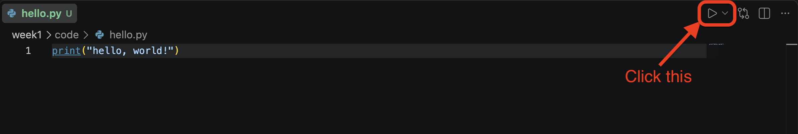

# Welcome

Hello and welcome!

To get started, I highly recommend going over the Course Info module. It has the syllabus, schedule, and information about how to get in touch with me if you run into any trouble.

Because this is a Python class, the most important step is getting your computer set up to run it. To that end, we need to install two things:

1. Python
2. Visual Studio Code

We are going to use Visual Studio Code (VS Code for short) to write and run Python code. This document should help you install both and then we'll test a simple program.

## Installing Python

We are going to use Python 3.14 for this course, and it can be downloaded here: [https://www.python.org/downloads/](https://www.python.org/downloads/)

You'll notice that the site says "3.14.7"; this falls under 3.14 and is the correct version.

Regardless of your operating system, this should just work. On Windows, you may need to check "Add python.exe to PATH" if it appears. (The box may no longer appear since the installer recently changed.) If you run into problems, you have three resources available:

- Me (email: cbiemer@bentley.edu)
- [CIS Sandbox](https://cissandbox.bentley.edu/sandbox/)
- An AI[^ai]

Now, how will you know if you've run into any problems? Great question. One way to test whether the install worked is to run some Python code. To do that, we will need VS Code installed.

## Install VS Code

You can download VS Code here: [code.visualstudio.com/download](https://code.visualstudio.com/download)

The textbook recommends: "After clicking on one of the download links, your browser should download an installer file. Locate and run this file in order to install VS Code. Once installed, you may want to pin VS Code to your dock or taskbar for easy access." That's up to you.

What you will need to do, though, after installing VS Code is to open it and install the Python extension:

1. Click the "Extensions" button on the left-hand tool bar. You can also open it with `Ctrl+Shift+X` (Windows/Linux) or `Cmd+Shift+X` (Mac).
2. In the search bar (grayed out, says "Search extensions"), type "Python".
3. Near the top of the results you'll see "Python" with "Python language support..." underneath it, and a blue star icon with a checkmark. This is the one we want.
4. Click install.

## A Place to Code

Great work so far. We're almost done. What we need to do next is set up a folder where you can keep and run your code. I won't tell you where to put it or what to name it: "CS230", "bentley-python", or anything you fancy. Once you've made that folder, go to the VS Code toolbar and click: File > Open Folder. A file explorer should open. Navigate to the folder you made and then click Open.

You should be in a new VS Code project, and on the left you'll see an empty explorer bar.

## Running a Program

On that empty explorer bar, right click (`control+click` if you are on a Mac) and you can make a "New File." Then you can type in the name of the file. In this case, name it "hello.py". That ".py" at the end stands for "python" and it is important because it tells VS Code that the file should contain Python code. If you want to rename the file, you can right click (`control+click` on Mac) and click "Rename".

Now if you made the file, it should be open, and it will be a blank file. You don't have to type anything, just copy and paste this into the file:[^hello]

```python
print("Hello, World!")
```

From here (make sure you save the file (`ctrl+s` on Windows/Linux and `command+s` on Mac)), if everything has worked, you can run the code in your file using VS Code by pressing the arrow towards the top right:



A new window in VS Code should show up and you'll see "Hello, World!". Nice job!

## Troubleshooting

- **"python not recognized" / "'python' is not recognized as internal command"** - PATH not set (Windows). Reinstall and check "Add python.exe to PATH", or reboot your terminal.
- **`python` runs but wrong version, or opens Microsoft Store** - Windows App Execution Alias hijacking the `python` command. Disable in Settings > Apps > Advanced app settings > App execution aliases.
- **VS Code "Run" button missing/greyed out, or runs but no terminal appears** - Python extension not installed or not detecting an interpreter. Check the bottom-right status bar for the interpreter selector and pick the correct one.
- **"No module named ..." errors** - wrong Python interpreter selected in VS Code (common if you have multiple installs). Fix: `Ctrl+Shift+P` > "Python: Select Interpreter."
- **File saved but VS Code won't run it as Python** - you probably forgot the `.py` extension.
- **Nothing happens when clicking the Run arrow** — the extension may still be installing/loading. Check the Extensions icon for a spinner and wait for it to finish.
- **Permission/antivirus blocking the installer** (Windows) — run the installer as admin, or whitelist it in your antivirus.

If none of these help, email me, go to the CIS Sandbox, or ask an AI.

[^ai]: Using an AI for problem-solving install issues is, I think, a valid use case.

[^hello]: See [wikipedia](https://en.wikipedia.org/wiki/Hello,_world) for why "Hello, World!" was used.
